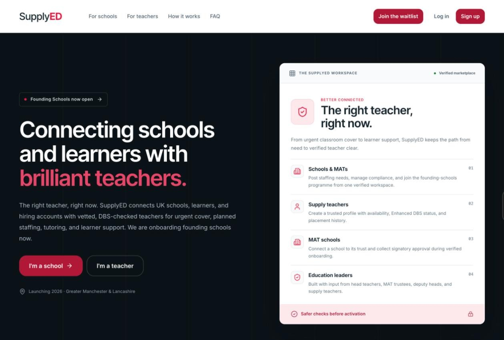

# SupplyED

A staffing marketplace that connects UK schools with teachers. Schools post jobs and find teachers. Teachers build a profile, apply and get booked. This repo is the Next.js web app. It talks to a separate NestJS backend.

**Status:** prototype · **Preview:** [supplyed.vercel.app](https://supplyed.vercel.app)



## Features

- **Role-based workspaces** for schools and teachers, with guided onboarding
- **Jobs:** post jobs, search jobs, apply and track applications
- **Teacher matching:** find and rank teachers for a role
- **Bookings and calendar** for confirmed work
- **Real-time messaging** over Socket.IO
- **Payments and payouts** with Stripe Connect
- **Accounts:** email and password, Google and Microsoft sign-in (Auth.js), two-factor settings and password reset
- **Public pages:** how it works, founding schools and teachers sign-up, and signatory approval links

## Tech stack

Next.js 16 (App Router) · React 19 · TypeScript (strict) · Tailwind CSS 4 · Auth.js (NextAuth v5) · TanStack Query · Stripe Connect · Socket.IO · Docker · GitHub Actions

## Getting started

Requires Node.js 24 (the version CI uses) and a running SupplyED backend.

```bash
npm ci
cp .env.example .env.local   # then fill in the values below
npm run dev                  # http://localhost:3000
```

### Environment variables

| Variable | Purpose |
|---|---|
| `AUTH_SECRET`, `AUTH_URL` | Auth.js secret and app URL |
| `AUTH_GOOGLE_ID`, `AUTH_GOOGLE_SECRET` | Google sign-in |
| `AUTH_MICROSOFT_ENTRA_ID_ID`, `AUTH_MICROSOFT_ENTRA_ID_SECRET`, `AUTH_MICROSOFT_ENTRA_ID_ISSUER` | Microsoft sign-in |
| `API_BASE_URL` | Backend base URL |
| `AUTH_BACKEND_OAUTH_ENABLED` | `true` when the backend handles Google OAuth |
| `NEXT_PUBLIC_SITE_URL` | Public URL of this site |
| `NEXT_PUBLIC_API_URL` | Backend origin for the live messaging socket |

## Scripts

| Command | What it does |
|---|---|
| `npm run dev` | Start the dev server |
| `npm run build` / `npm start` | Production build and server |
| `npm run lint` | Run ESLint |
| `npm test` | Run the tests in `tests/` with the Node test runner |

## Project structure

```
app/          Routes in (public), (auth) and (app) groups, plus API routes
components/   UI organised as atoms, molecules and organisms
features/     Logic per feature: auth, jobs, bookings, payments, matching, ...
lib/          Server helpers and query client setup
tests/        Tests for the Node test runner
deploy/       Docker Compose files for the dev and main environments
docs/         Integration notes (Stripe, messaging, mobile handoff)
```

## Deployment

Pushes to `dev` run lint and build in GitHub Actions, then build and restart the Docker container on the dev server. Pull requests to `dev` run the checks only. See [`deploy/README.md`](deploy/README.md).
