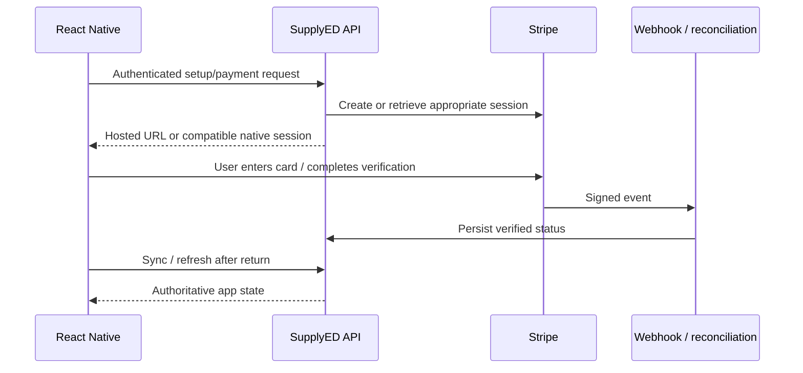
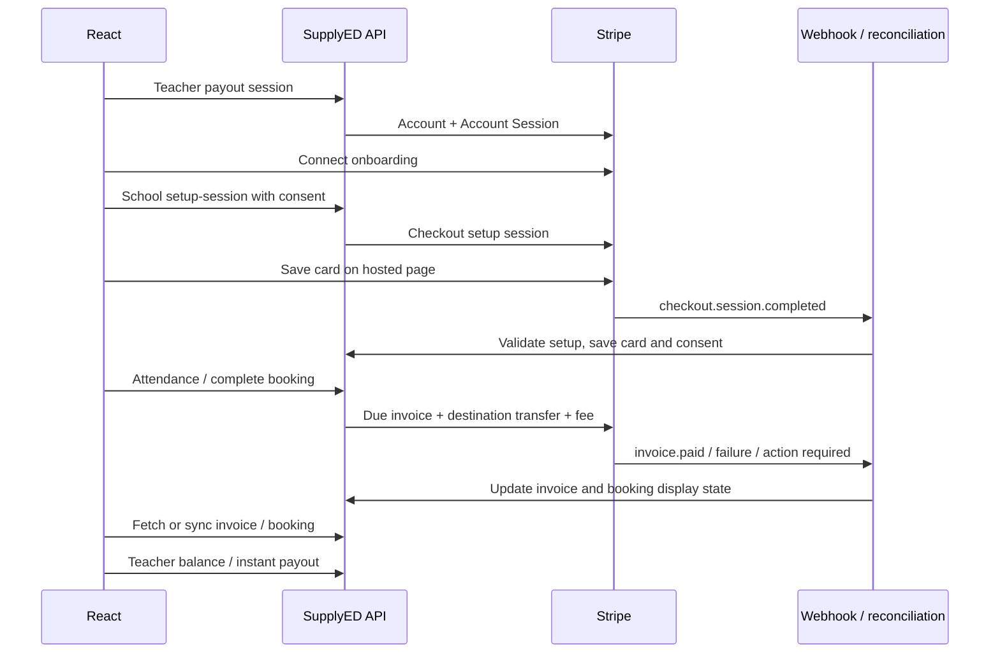

# SupplyED React Native payments: implementation specification and complete reference

Version: 2026-11-12. Target: feature parity with the checked-out SupplyED website and Nest backend.

## Read this first

This file is a handoff to the developer or coding agent implementing payments in the React Native app. It includes implementation instructions, mobile architecture, exact existing backend contracts, required mobile extensions, UI behaviour, recovery rules, tests, and full source/reference appendices. The appendices are included in this file so they remain available when it is copied to another repository.

The requested scope is the website's Stripe integration: school saved cards and consent, automatic booking billing, invoice payment/recovery, teacher onboarding/payouts, and tips. It is not a specification for recreating unrelated messaging, recruitment, identity verification, or the complete onboarding application.

This is a specification, not an installed mobile implementation. No React Native repository or native app identifiers were supplied. Do not claim the app is implemented merely because this file exists. Code templates below require integration with the target app; implement every named adapter and run the verification matrix before reporting completion.

### Instructions for the implementing agent

1. Inspect the mobile repository, its AGENTS.md, package.json, lockfile, native projects, router, authentication, design system, tests, and environment handling.
2. Reuse the existing app architecture. Do not create a second login system, router, query client, or theme.
3. Detect Expo versus bare React Native. Use installed compatible dependencies; use pnpm when the repository uses pnpm. Do not blindly install latest SDK releases.
4. Find the existing API origin, bundle ID, Android application ID, associated domain, app scheme, secure token storage, and authenticated user ID. Reuse discovered values; never invent credentials or shipping identifiers.
5. Implement the files and flows specified below, including any required backend and return-page changes in the available backend/web repositories.
6. Preserve existing web contracts. Mobile-specific contracts in this guide are marked PROPOSED and must actually be implemented before the app calls them.
7. Use test-mode Stripe for development. Do not create live charges, refunds, or payouts as tests.
8. Do not stop after scaffolding. Wire real screens, navigation, auth, API calls, pending-flow recovery, errors, loading states, and tests.
9. Report exact changed files, test results, and any external prerequisite that could not be configured. Domain ownership, signing credentials, Stripe dashboard access, and absent repositories cannot be fabricated by this document.
10. Do not put secret environment values into code, this file, fixtures, screenshots, analytics, or console output.

### What is already supported versus new work

| Feature | Existing backend | Mobile work |
|---|---|---|
| School save/replace card | Hosted Checkout setup | Native settings UI, consent, browser launch, return handling, sync |
| School enable/disable/remove | Existing APIs | Confirmations and authoritative state refresh |
| Automatic collection | Existing backend workers | Display server state; do not duplicate billing engine |
| Hosted invoice payment | hostedInvoiceUrl on invoice | Browser launch and invoice sync |
| Web embedded invoice payment | Web Payment Element session | Native PaymentSheet needs a compatible backend extension |
| Teacher hosted onboarding | onboarding-link API | Browser launch, fresh links, return/readiness check |
| Teacher web embedded Connect | Account Session API | Verify native SDK component support; do not import web JSX |
| Teacher balances/cash-out | Existing APIs | Native balance/history UI and confirmed withdrawal |
| Tips | Hosted Checkout payment | Amount UI, browser launch, return and sync |
| Mobile callback routing | Website routes currently | Add verified app links and an HTTPS fallback/bridge |

Do not describe hosted fallback as identical embedded native UX. It preserves business functionality while native PaymentSheet/Connect integration is completed.

## Contents

1. Architecture and ownership
2. Repository discovery and deliverables
3. Configuration and device networking
4. HTTP/authentication and types
5. Money and date handling
6. Durable browser-flow coordinator
7. Callback routing and backend extensions
8. School billing screen
9. Invoice list/detail/payment
10. Teacher payouts
11. Booking payments and attendance
12. Tips
13. Queries, lifecycle, errors and observability
14. Backend configuration, migrations and webhooks
15. Accessibility and visual parity
16. Test matrix and completion criteria
17. Implementation sequence
18. Appendix A: complete supplied backend contract
19. Appendix B: checked-out website source snapshots
20. Appendix C: checked-out backend integration sources

## 1. Architecture and ownership

School pays SupplyED in GBP. Teacher has a Stripe Connect Accounts v2 account. School has a platform Stripe Customer. Backend calculates teacher earnings, fee, and total. Backend selects teacher destination and creates invoice-related transfers. Existing invoice code does not set on_behalf_of.

The app owns screens, explicit user consent, navigation, input validation, state display, and launching Stripe UI. Backend owns authentication/authorization, amounts, attendance/payroll rules, customer/account identity, collection eligibility, Stripe calls, idempotency, webhook processing, and final state.

Never create a parallel PaymentIntent for an invoice. Never interpret returning from Stripe as payment success. Never expose Stripe secret keys in mobile. Never store full card details or CVC. Invoice collection and bank payout are different statuses.



## 2. Repository discovery and deliverables

Before editing, record the existing equivalents of these modules. Adapt paths rather than duplicate them:

```text
src/
  config/payments.ts
  api/client.ts
  auth/session.ts
  payments/
    types.ts
    api.ts
    queryKeys.ts
    queries.ts
    mutations.ts
    money.ts
    status.ts
    pendingFlows.ts
    flowCoordinator.ts
    paymentLinks.ts
    usePaymentReturn.ts
    screens/
      SchoolBillingScreen.tsx
      InvoiceListScreen.tsx
      InvoiceDetailsScreen.tsx
      TeacherPayoutsScreen.tsx
      PaymentReturnScreen.tsx
    components/
      ConsentCheckbox.tsx
      SavedCard.tsx
      AutomaticPaymentStatus.tsx
      InvoiceBreakdown.tsx
      BookingTipForm.tsx
      PayoutBalance.tsx
      PaymentError.tsx
```

Required deliverables: functional native screens, typed API layer, session refresh integration, account-scoped query caching, durable pending-flow storage, verified callback routing, device networking setup, compatible invoice payment flow, teacher payout setup, tests, and a concise setup/run note. Add backend changes separately and identify the repositories changed.

## 3. Configuration and device networking

Current local backend: port 3003, global prefix /api. Current web app: port 3000. Historical examples in the supplied document use different ports; use the actual running environment.

| Runtime | API base |
|---|---|
| iOS simulator on backend Mac | http://localhost:3003/api |
| Standard Android Studio emulator | http://10.0.2.2:3003/api |
| Physical device | http://MAC_LAN_IP:3003/api |
| Production | Deployed HTTPS API origin plus /api |

Check firewall and bind address for physical devices. A phone's localhost is the phone. Keep HTTP/cleartext exceptions development-only in native configuration. Do not disable transport security globally in release builds. Metro's port is not the backend port.

Mobile configuration contains public values only: API_BASE_URL, WEB_ORIGIN, registered APP_SCHEME, and where necessary a Stripe publishable key. Prefer the publishable key returned by the backend session so account/mode match.

Discover native build configuration:

- Expo: app.json/app.config.*, ios.bundleIdentifier, android.package, scheme, plugins, associatedDomains and intentFilters. Use a development build for native SDK features not available in the chosen Expo Go runtime.
- Bare RN: Info.plist, entitlements, AppDelegate/SceneDelegate, AndroidManifest.xml, Gradle application ID and native linking configuration.
- Install the Stripe React Native SDK only for native payment/Connect features, with versions compatible with the existing app. Hosted browser flows do not require importing Stripe.js.
- Verify official SDK installation and native build requirements at implementation time. Do not copy web dependencies @stripe/react-stripe-js or @stripe/react-connect-js into native UI.

## 4. HTTP/authentication and types

All client payment endpoints require a backend access token. React Native calls Nest directly, not Next.js server actions, and cannot assume website cookies exist.

Use Authorization: Bearer TOKEN, Accept: application/json, and Content-Type: application/json for bodies. Unwrap response.data. Successful POSTs can return 201; accept all HTTP 2xx with success=true. Unknown DTO fields are rejected.

The supplied contract appendix contains complete request validators and backend response DTOs. Website types are also embedded below, but some are reduced display shapes; do not mistake them for the entire backend response.

### API transport template

```ts
export type Envelope<T> = {
  success: boolean;
  data: T;
  message?: string | string[];
  code?: string;
  fieldErrors?: Record<string, string>;
  retryAfter?: number;
  meta?: { requestId?: string };
};

export class ApiError extends Error {
  constructor(
    message: string,
    public readonly status: number,
    public readonly code?: string,
    public readonly requestId?: string,
    public readonly retryAfter?: number,
    public readonly fieldErrors?: Record<string, string>,
  ) { super(message); }
}

export async function request<T>(
  baseUrl: string,
  token: string,
  path: string,
  method = 'GET',
  body?: unknown,
): Promise<T> {
  if (!path.startsWith('/') || path.startsWith('//')) {
    throw new Error('API path must be relative to the configured backend');
  }
  const controller = new AbortController();
  const timeout = setTimeout(() => controller.abort(), 20_000);
  try {
    const response = await fetch(baseUrl.replace(/\/$/, '') + path, {
      method,
      signal: controller.signal,
      headers: {
        Accept: 'application/json',
        Authorization: `Bearer ${token}`,
        ...(body === undefined ? {} : { 'Content-Type': 'application/json' }),
      },
      ...(body === undefined ? {} : { body: JSON.stringify(body) }),
    });
    if (!(response.headers.get('content-type') ?? '').includes('application/json')) {
      throw new ApiError('Unexpected server response', response.status);
    }
    const result = await response.json() as Envelope<T>;
    if (!response.ok || !result.success) {
      const message = Array.isArray(result.message)
        ? result.message.join(' ')
        : result.message || 'Request could not be completed';
      throw new ApiError(message, response.status, result.code,
        result.meta?.requestId ?? response.headers.get('x-request-id') ?? undefined,
        result.retryAfter, result.fieldErrors);
    }
    return result.data;
  } finally { clearTimeout(timeout); }
}
```

Integrate this with the existing session manager. Implement a single-flight refresh: concurrent 401s await one refresh. Existing backend exposes POST /auth/refresh with {refreshToken}; inspect the current auth response DTO before mapping credentials. Retry the original request at most once after an explicit authentication rejection. Never refresh endlessly. A timeout/connection reset is not an authentication rejection and must not cause automatic mutation replay.

Store refresh credentials in existing platform-protected storage. On logout clear user-scoped query cache and deactivate pending flows. Never resume a previous user's flow under another account. Preserve the return destination when reauthentication is required, but require the original user to resolve ownership-sensitive flows.

### Required typed API facade

Implement wrappers for all endpoint rows in Appendix A. User-facing mobile functions include:

```ts
interface PaymentApi {
  getSchoolBilling(): Promise<SchoolBillingSettings>;
  startSchoolSetup(input: {consentToTerms: true}): Promise<SchoolBillingSetupSession>;
  syncSchoolSetup(sessionId: string): Promise<SchoolBillingSettings>;
  updateSchoolBilling(input: {
    automaticPaymentsEnabled: boolean;
    consentToTerms?: boolean;
  }): Promise<SchoolBillingSettings>;
  removeSchoolCard(): Promise<SchoolBillingSettings>;
  listInvoices(query: InvoiceListQuery): Promise<PaginatedInvoices>;
  getInvoice(invoiceId: string): Promise<Invoice>;
  syncInvoice(invoiceId: string): Promise<Invoice>;
  getPayoutAccount(): Promise<PayoutAccount>;
  getPayoutBalance(): Promise<PayoutBalance>;
  createOnboardingLink(): Promise<{url: string; expiresAt: string | null}>;
  instantPayout(amountPence?: number): Promise<PayoutSummary>;
  startTip(input: {bookingId: string; amountPence: number}): Promise<BookingTipCheckoutSession>;
  syncTip(input: {tipId: string; sessionId: string}): Promise<BookingTipStatusResult>;
}
```

The interface references definitions in the source appendix. Implement these wrappers; this interface is not executable by itself. Use encodeURIComponent for path identifiers and URLSearchParams for queries. Omit optional fields instead of sending undefined strings or empty invalid values.

## 5. Money and date handling

Amounts ending in Pence are integer pence. rateAmount is pounds. Currency is GBP/gbp according to response. Fee configuration belongs to backend, not mobile. Never use the documentation's illustrative 12.5% as a product default.

```ts
export function parsePoundsToPence(input: string): number | null {
  const value = input.trim();
  if (!/^\d+(?:\.\d{1,2})?$/.test(value)) return null;
  const [whole, fraction = ''] = value.split('.');
  const pence = Number(whole) * 100 + Number(fraction.padEnd(2, '0'));
  return Number.isSafeInteger(pence) ? pence : null;
}
export function formatPence(pence: number): string {
  return new Intl.NumberFormat('en-GB', {
    style: 'currency', currency: 'GBP',
  }).format(pence / 100);
}
```

Reject negatives, exponent notation, commas/ambiguous input, NaN and more than two decimal places unless a deliberate localized parser is implemented. Do not silently round typed amounts.

Dates normally arrive as ISO strings; school setup expiresAt is Unix seconds. Multiply it by 1000 before comparing with Date.now(). Preserve nullable dates. Attendance/billing periods follow the booking timezone, with Europe/London fallback; do not recompute periods in the device timezone. Test daylight-saving transitions.

## 6. Durable browser-flow coordinator

A robust app must survive browser dismissal, duplicate callbacks, app restart, stale sessions, and account switching.

```ts
export type PendingFlow = {
  version: 1;
  flowId: string;
  userId: string;
  createdAt: string;
  lastCheckedAt?: string;
} & (
  | {kind: 'school-card'; sessionId: string; expiresAt: number}
  | {kind: 'tip'; bookingId: string; tipId: string; sessionId: string}
  | {kind: 'invoice'; invoiceId: string}
  | {kind: 'teacher-onboarding'}
);
```

Implement PendingFlowStore with load(userId), save(flow), remove(userId, flowId). Persist references before opening the browser. Do not persist client secrets, signed onboarding URLs, raw card data or access tokens in this store. Use a map of flows if multiple invoice/tip operations are allowed; permit only one in-flight setup mutation per resource. Preserve a previous record when persistence fails; do not open Stripe if recovery state was not saved.

Coordinator states:

```text
idle -> requesting -> persisted -> browser-open -> checking
checking -> resolved | waiting | needs-login | failed
```

Rules:

- Acquire an in-memory resource lock before creating a session. Release in finally.
- Reconcile on incoming link, cold-start link, app foreground, and explicit Check status.
- Serialize reconciliation per flowId so an AppState event and callback cannot duplicate it.
- After each await, ensure the authenticated user still matches the flow user before updating UI.
- Authenticate before syncing; never trust IDs in a callback as authorization.
- Match callback references to pending flow where available. Missing local state can occur after reinstall: authenticated backend ownership validation still applies; do not declare success based on URL alone.
- For school card: POST setup sync, then render BillingSettings. READY and automaticPaymentsEnabled determine success. Handle still-pending without clearing recovery state prematurely.
- For invoice: POST invoice sync, then refresh related queries. PAID/VOID are terminal for this payment attempt. OPEN can remain pending/failed; do not auto-charge again.
- For tip: POST tip sync, then refresh booking. PROCESSING is not success. Preserve refunded/failed/cancelled states faithfully.
- For teacher onboarding: GET payout-account and balance. Browser return does not prove readiness.
- Bounded retries: for invoice sync the web does up to 5 attempts, 1500ms apart, stopping at PAID/VOID. Stop on auth/rate-limit errors, unmount or background. Do not hold a spinner forever.
- Once an operation is verified, clear only its own pending record. Do not clear a newer replacement setup when an older callback arrives.
- On browser cancellation show neutral copy, refresh state, and retain unresolved references as appropriate. Never PATCH automation off just because the browser closed.
- No automatic replay of instant-payout, refund or setup-creation on network failure.

Browser opening example:

```ts
import {Linking} from 'react-native';
export function checkoutUrl(raw: string): string {
  const url = new URL(raw);
  if (url.protocol !== 'https:' || url.hostname !== 'checkout.stripe.com' ||
      url.username || url.password) throw new Error('Invalid Checkout URL');
  return url.toString();
}
// Within a guarded handler after explicit consent:
// const session = await payments.startSchoolSetup({consentToTerms: true});
// await pendingFlows.save({...metadata, kind:'school-card', ...sessionReferences});
// await Linking.openURL(checkoutUrl(session.url));
```

Use separate URL policies for Checkout, Connect and hosted invoices. Do not apply the Checkout hostname rule to Connect links. Permit only backend-configured provider/custom-domain hosts and HTTPS. Do not send Authorization headers to Stripe-hosted pages. Never put API tokens in URLs.

## 7. Callback routing and backend extensions

### Existing behaviour

Backend frontendUrl builds Stripe returns from FRONTEND_URL. Existing return paths:

| Flow | Success/return | Cancel/refresh |
|---|---|---|
| School card | /settings?setup=success&session_id={CHECKOUT_SESSION_ID} | /settings?setup=cancelled |
| Tip | /bookings?tip=success&tip_id=ID&session_id={CHECKOUT_SESSION_ID} | /bookings?tip=cancelled&tip_id=ID |
| Teacher onboarding | /payouts/return | /payouts/refresh |
| Web Payment Element | Actual web code uses /billing?paidInvoice=ID | Client closes modal |

The attached document's /invoices/:id/return is an illustrative suggestion, not the implemented website return route. The source snapshot of PayInvoiceModal below is authoritative for current web behaviour.

### Required mobile return design (PROPOSED extension)

Implement a dedicated HTTPS bridge on the existing controlled web domain, for example /mobile/payments/return. Configure the exact domain from the real deployment. Keep the existing FRONTEND_URL for website users.

Add optional clientPlatform: 'web' | 'mobile' only to DTOs that need return routing, defaulting to web. Apply it to school setup, tip checkout and onboarding-link creation using validated DTOs; update Swagger and controller bodies. Current APIs do NOT accept this new field. Deploy the backend extension before sending it from mobile. Preserve requests without a body for existing onboarding-link clients.

Map each platform to server-controlled callback destinations. Do not accept arbitrary returnUrl from the client. For mobile school setup, construct:

```text
https://CONTROLLED_DOMAIN/mobile/payments/return?flow=school-card&result=success&session_id={CHECKOUT_SESSION_ID}
https://CONTROLLED_DOMAIN/mobile/payments/return?flow=school-card&result=cancelled
```

For mobile tips add tip_id and, on success, session_id. For teacher onboarding use flow=teacher-onboarding and result=return|refresh. Keep URL values encoded. Do not interpolate untrusted hosts.

Bridge behaviour:

1. Render without requiring a website NextAuth session. A mobile user may not have browser cookies.
2. Show neutral status: Return to SupplyED to check the result. The bridge must not mutate payment state using only query parameters.
3. Offer Open SupplyED with a registered app link/custom scheme fallback and a browser fallback.
4. Forward only an allowlisted set of flow/reference fields. Do not forward Stripe client secrets or arbitrary query strings.
5. Never assert payment/card success based on result=success.
6. Do not depend on automatic redirect interception alone. Browser/OS behaviour varies; the visible button and app foreground reconciliation are required.
7. For refresh onboarding, the app requests a new authenticated onboarding link. Do not reuse a single-use expired account link.

Platform setup:

- iOS: associated domain entitlement for the controlled HTTPS host; serve apple-app-site-association with the real Team ID + bundle ID and narrowly scoped payment paths. Configure custom scheme fallback if used. Wire native incoming-link handling according to the app's AppDelegate/SceneDelegate architecture.
- Android: verified HTTPS intent filter with autoVerify and path scope; serve .well-known/assetlinks.json containing the real package name and signing certificate SHA-256. Include debug and production signing associations deliberately; test release signing separately.
- Both: handle Linking.getInitialURL() and Linking.addEventListener('url', handler), unsubscribe on teardown, de-duplicate events, and route only after navigation/auth is ready.
- Host association files with HTTPS and correct response format; validate installed-app behaviour on real devices, not just JS mocks.

Official reference: https://reactnative.dev/docs/linking

## 8. School billing screen

Place under school Settings > School details / Automatic payments and link from Billing. Teachers must not see school-only controls. Server roles remain authoritative.

Load GET /payments/school-billing. Show skeleton while loading, error with Retry on failure, and actual data on success. A failed fetch must not become a fabricated 'No saved card' state.

Screen sections in order:

1. Automatic payments heading and state badge.
2. Explanation that bookings charge when due without a separate release.
3. Add/replace card panel explaining Stripe hosts card entry and no booking payment is taken during setup.
4. Explicit unchecked consent control.
5. Add card and enable automatic payments / Replace card securely button.
6. Saved card label or No saved card.
7. Remove confirmation.
8. Automation setting with fresh consent when enabling.
9. Current payment, next collection time, failure/recovery information and synchronization warnings.

Consent copy from website:

> I authorise SupplyED to save my card with Stripe and charge eligible booking payments automatically.

Supporting copy:

> Payments follow each booking's agreed schedule: daily, weekly, monthly or on completion. The amount is payable teacher earnings plus the displayed SupplyED fee. Absences are excluded where attendance determines pay. I can turn off future automatic payments in Billing.

Do not precheck consent, infer it from an old card, or silently send true on screen mount. Disable submit until consent is checked. Lock mutation buttons while a mutation is pending.

Actions:

| UI | API | Exact body |
|---|---|---|
| Add/replace | POST /payments/school-billing/setup-session | {"consentToTerms":true} |
| Verify return | POST /payments/school-billing/sync | {"sessionId":"cs_..."} |
| Enable | PATCH /payments/school-billing | {"automaticPaymentsEnabled":true,"consentToTerms":true} |
| Disable | PATCH /payments/school-billing | {"automaticPaymentsEnabled":false} |
| Remove | DELETE /payments/school-billing/payment-method | No body |

After mutation, update cache with returned settings and invalidate related bookings. READY alone does not imply automation enabled. Show canEnableAutomaticPayments accurately. Display lastSetupError and stripeSyncError as user-safe messages. PENDING/FAILED stripeSyncStatus means changes may still be reconciling; do not claim all future collections are stopped while provider synchronization failed. A processing payment can complete after opt-out.

Legacy non-card methods should prompt replacement with a card, matching web behaviour. Never display full card identifiers or fabricate expiry/brand fields absent from the response.

## 9. Invoice list/detail/payment

### List and detail

GET /invoices/me for institution/teacher. GET /invoices/:id for details. List filters use PENDING, OPEN, PAID, VOID, UNCOLLECTIBLE. Pagination page>=1, limit 1..100, default20. Display invoices and pagination, not a bare array.

Show invoice number, job/school/teacher, period label, earnings, fee, total, due/paid date, refunded amount, payment attempts/next attempt, failure message, and available PDF/hosted invoice links. Null fields must not crash formatting. Refund leaves an invoice PAID; use amountRefundedPence. Dispute status is independent.

### Hosted invoice payment: existing-contract fallback

Use hostedInvoiceUrl from a fresh invoice. Persist invoiceId, open the validated provider URL, reconcile on return/foreground, and refetch invoice/list/booking/billing. If URL is missing show preparing/retry, not a broken button. Do not offer manual payment alongside a processing or scheduled automatic collection. Existing backend payment-session eligibility is authoritative for recovery; inspect invoice flags and handle 409 by refreshing.

### Native invoice PaymentSheet: required adaptation for embedded mobile parity

Current backend POST /invoices/:id/payment-session creates a Customer Session with components.payment_element.enabled=true and returns clientSecret, customerSessionClientSecret, publishableKey, amountPence, currency. It does NOT return customerId. It uses the Stripe invoice's confirmation_secret.client_secret.

Do not simply cast this web response into PaymentSheet parameters. Native support must be verified against installed Stripe React Native SDK and current Stripe API behaviour.

PROPOSED endpoint: POST /invoices/:id/mobile-payment-session, same owning-institution authorization as web payment-session, no body initially. Proposed response after compatibility verification:

```ts
type MobileInvoicePaymentSession = {
  publishableKey: string;
  customerId: string;
  customerSessionClientSecret: string;
  paymentIntentClientSecret: string;
  amountPence: number;
  currency: string;
};
```

Backend implementation requirements:

- Reuse/refactor existing invoice payment-session eligibility and Stripe reconciliation logic. Do not duplicate divergent rules.
- Permit payment only for an eligible existing invoice. Paid/void or scheduled/processing automatic collections must not create a new payment.
- Configure Customer Session for the mobile payment component supported by the selected SDK/API; preserve intended saved-method redisplay/save semantics.
- Obtain a native-supported client secret for the existing invoice payment. Verify invoice confirmation-secret compatibility experimentally in Stripe test mode and official SDK docs. A field rename alone is not evidence of compatibility.
- Never manufacture a separate unrelated PaymentIntent as a shortcut.
- Return the actual Stripe customer ID belonging to that invoice and mode/account.
- If the current invoice model cannot be supported by the selected native SDK, ship hosted fallback and report the native parity gap explicitly rather than inventing a working endpoint.
- Keep web payment-session unchanged and cover both with regression tests.
- Saved methods in invoice UI use on-session semantics and do not replace automatic-card consent/setup.

Native UI sequencing (adapt parameter names to installed SDK types):

```text
User taps Pay
 -> request mobile invoice session
 -> initialize Stripe with returned publishable key and registered URL scheme
 -> initialize PaymentSheet with supported invoice payment secret,
    customerId, compatible customer session secret, merchantDisplayName,
    registered returnURL and approved payment-method configuration
 -> present PaymentSheet
 -> cancel: neutral dismissal, reconcile if ambiguous
 -> SDK error: display safe message, retain invoice for retry
 -> completion: sync existing invoice with backend
 -> PAID: display receipt state
 -> still OPEN/processing: display checking, bounded refresh
```

Keep secrets in component memory. Do not refetch a payment session underneath an open sheet. Request a fresh session after an expired/failed session only on deliberate retry. Support 3DS return paths and app resume. Do not automatically enable Apple Pay/Google Pay without their merchant/environment/native configuration; web parity here requires card payment, not unconfigured wallets.

Official SDK references:

- https://docs.stripe.com/payments/accept-a-payment
- https://github.com/stripe/stripe-react-native

### Invoice creation and administration

School/admin may create invoice for completed booking via POST /invoices. bookingId required; unitsWorked optional in DTO but required by service for some hourly/daily cases; omit for fixed price. poNumber optional trimmed nonempty <=100. Units 0.01..9999.99, <=2 decimals, capped by agreed schedule; covered attendance derives units server-side.

Do not add a second manual invoice path to bypass automatic billing state. Surface backend conflicts. Teachers cannot create/pay school invoices solely because they can view them.

Send endpoint resends an unpaid invoice. Void/refund are admin-only. If target app has no admin role, do not expose those buttons. Admin screens, if required, use the exact Appendix A contracts. Refund confirms amount/reason and refetches totals; do not automatically retry after timeout. No client dispute-submission endpoint exists.

## 10. Teacher payouts

Teacher-only Payouts screen. Fetch GET /payments/payout-account and GET /payments/payout-account/balance.

States:

- connected=false: Set up payouts.
- connected=true but not ready: Continue setup / resolve requirements.
- requirementsDue nonempty or disabledReason present: show action needed.
- ready=true: show balance/history; obey backend booking restrictions independently.
- Zero balances are valid but not proof onboarding completed.

Hosted onboarding uses POST /payments/payout-account/onboarding-link; open URL in supported browser flow, never persist account-link URL, refetch account/balance on return. Refresh requests a fresh link. Existing Accounts v2 configuration and dashboard mode must be respected.

For embedded native parity, verify supported Connect native React Native components and version/account eligibility using official Stripe sources. The web uses Account Session clientSecret plus publishableKey from POST /payments/payout-account/session and ConnectAccountOnboarding, ConnectNotificationBanner, ConnectPayouts. Do not import these web components into RN. Map supported native equivalents, implement secret refresh, unmount on account change, and refetch readiness on exit. Unsupported components need a hosted/native-screen fallback and an explicit parity note. Do not assume all Connect web components have a stable native equivalent.

Dashboard-link requires an eligible Express dashboard account; default STRIPE_TEACHER_DASHBOARD=none. Changing an env value does not migrate existing connected account configuration. Never make dashboard-link the unconditional fallback.

Balances:

| Field | Display |
|---|---|
| pendingPence | Pending funds |
| availablePence | Available funds |
| instantAvailablePence | Available for instant cash-out |
| instantDestination.label | Destination summary |
| recentPayouts | History with amount, method, status, arrival date |

Cash-out uses POST /payments/payout-account/instant-payout with {} for all available instant funds or {amountPence: INTEGER}. Minimum explicit amount40 pence. Confirm amount and destination, disable repeated taps, never send destination IDs. Refetch after success. Status pending/in_transit does not mean paid to bank. Timeout: fetch history/balance, do not replay blindly.

The website disables payout and schedule-edit actions in embedded payouts and uses the backend cash-out action. Preserve that control model if native Connect supports those feature flags.

## 11. Booking payments and attendance

GET /bookings/:id returns automaticPayment, attendancePayroll, attendanceShifts, adjustments, invoice summary and tip. Copy the complete DTO from Appendix A when needed; not every response has a plural invoices field. The supplied prose mentions invoices in places, but current BookingResponseDto exposes singular invoice; inspect actual payload before designing lists.

| automaticPayment.state | Behaviour |
|---|---|
| DISABLED | Link owning school to settings |
| BLOCKED | Show server message and setup action |
| REVIEW_REQUIRED | Route to review |
| WAITING_ATTENDANCE | Resolve pending attendance |
| NOT_DUE | Future/not-due state |
| NO_PAYMENT_DUE | No collectible earnings |
| PREPARING | Preparing and bounded refresh |
| SCHEDULED | Show nextCollectionAt |
| PROCESSING | Processing; no duplicate Pay button |
| FAILED | Failure and eligible recovery |
| PAID | Collected; payout state remains separate |

POST /bookings/:id/payment-sync is an explicit mutation: it can evaluate/create due automatic invoices. Use GET for routine polling. Trigger it from an intentional check/reconcile action, not every render.

Attendance endpoints/DTOs are in Appendix A. Server derives hourly present minutes, daily fully present days, weekly/monthly periods, no-show exclusions and fixed-completion rules. Do not reproduce the billing engine in JavaScript. Corrections after collection may require adjustments; do not imply editing attendance automatically refunded a paid invoice.

Retain immutable agreedTerms when displaying booking rates/schedule rather than current edited job terms. Missing legacy agreedTerms must display the server's legacy status instead of inventing precision.

## 12. Tips

School-only, owning completed booking, ready teacher payouts. Parse typed GBP to integer pence. API input range1..99,999,999 pence; total with fee must satisfy backend Stripe minimum/maximum (30..99,999,999). Show backend validation if tip plus fee is below minimum.

POST /payments/booking-tips/checkout with {bookingId,amountPence}. Response contains tipId, sessionId, url, tipAmountPence, feeAmountPence, totalAmountPence. Display server totals; do not invent a fee quote from a hard-coded percentage.

Suggested UI: enter amount -> request checkout -> show returned breakdown -> Continue to Stripe. A created but unopened checkout remains a pending session; reuse/reconcile according to backend rather than creating one on every render.

Persist references, open Checkout, then POST /payments/booking-tips/:tipId/sync with {sessionId}; refresh booking. States PENDING, PROCESSING, PAID, FAILED, CANCELLED, REFUNDED. One tip record per booking. Processing/paid must not permit a second tip. Changing amount while an open session exists may conflict. Cancellation of browser does not itself persist cancellation. Raw sync response is richer than reduced booking summary; map only display fields and retain authoritative refund information.

## 13. Queries, lifecycle, errors and observability

Include userId in query keys:

```ts
export const paymentKeys = {
  root: (userId: string) => ['payments', userId] as const,
  billing: (userId: string) => ['payments', userId, 'school-billing'] as const,
  invoices: (userId: string, filters: object) => ['payments', userId, 'invoices', filters] as const,
  invoice: (userId: string, id: string) => ['payments', userId, 'invoice', id] as const,
  payout: (userId: string) => ['payments', userId, 'payout-account'] as const,
  balance: (userId: string) => ['payments', userId, 'balance'] as const,
};
```

Web polling reference: pending school setup5s, current payment15s, open/pending invoices15s, pending payout balance30s. On mobile poll only foreground, focused, online screens and stop at terminal state. Connect AppState/focus to the existing query library. Cancel timers on unmount; use backoff on errors. Avoid background battery/network churn.

| Mutation | Refresh |
|---|---|
| School card/automation | Billing and affected bookings |
| Invoice pay/sync/refund | Invoice, list, booking, school billing |
| Tip sync/refund | Booking and tip |
| Attendance | Booking/payroll/invoices |
| Teacher setup | Account and balance |
| Cash-out | Balance/history |

Error treatment:

- 400/422: field validation where available.
- 401: one shared auth refresh, then re-login; preserve return intent.
- 403: role/ownership restriction; do not retry with another user's token.
- 409: fetch latest state and display conflict, not generic card decline.
- 429: honor retryAfter/Retry-After; disable retry until due.
- 502/503: provider/config/service unavailable; preserve support requestId.
- Timeout/network after mutation: uncertain outcome; reconcile, not automatic replay.
- Never expose SQL, Prisma traces, secret keys, raw provider diagnostics or stack traces in customer copy.

Authentication-required recovery codes: authentication_required, invoice_payment_intent_requires_action, payment_intent_requires_action. Route owning school to eligible existing invoice payment.

Logs: sanitized endpoint category, status, error code, requestId, app version, and duration. Do not log tokens, client secrets, Checkout URLs, card input, or personal billing details. Distinguish browser cancellation, transport failure, backend rejection, and provider rejection in diagnostics.

## 14. Backend configuration, migrations and webhooks

Backend-only configuration checklist; retain existing approved business values:

```dotenv
STRIPE_SECRET_KEY=<server-only test or live secret>
STRIPE_PUBLISHABLE_KEY=<matching publishable key>
STRIPE_WEBHOOK_SECRET=<snapshot destination signing secret>
STRIPE_CONNECT_WEBHOOK_SECRET=<configured Connect/thin destination signing secret>
FRONTEND_URL=<actual website origin>
PROCESSING_FEE_PERCENT=<approved configured percentage>
AUTOMATIC_BILLING_TERMS_VERSION=2026-11-card-v1
AUTOMATIC_BILLING_ENABLED=<deliberately enabled in prepared environment>
NOTIFICATION_WORKERS_ENABLED=<worker configuration>
STRIPE_TEACHER_DASHBOARD=none
```

Do not ship placeholders or copy real secrets into the mobile repo. Missing AUTOMATIC_BILLING_TERMS_VERSION causes setup to fail before Stripe checkout. This was reproduced in this session and fixed locally. The running backend needs restart after .env changes. Card setup can succeed while automatic billing worker remains disabled.

Other interval/batch/grace/due-date settings and exact defaults are in Appendix A. Current backend pins Stripe API2026-08-26.dahlia; do not silently upgrade it to make an SDK compile. Verify compatibility and test web regressions if changing it.

Prepare intended database using repository scripts and pnpm:

```sh
pnpm install --frozen-lockfile
pnpm exec prisma generate
pnpm exec prisma migrate status
# After verifying the intended database and pending checked-in migrations:
pnpm exec prisma migrate deploy
pnpm run build
```

Do not reset the database or seed unrelated production data for mobile integration. Seed only when the environment requires it and using the repository's documented seed script. Local Docker compose must be selected from the backend repository, not the frontend compose.

Webhook endpoint: POST /api/payments/webhooks/stripe. Preserve raw body and Stripe-Signature. Do not call webhooks from the app. Exact handled event list is in Appendix A. Configure snapshot and Accounts v2 thin event destinations and corresponding secrets; test/live keys and events must match. Retry/replay webhooks safely; backend deduplicates processed events. Use test forwarding or a reachable test deployment for local devices; mobile cannot receive provider webhooks directly.

Reconciliation worker is not a complete replacement for webhooks: refunds, disputes, account requirements, card detach and payout updates still need appropriate delivery. Payments may collect before a device reconnects; refresh backend on foreground.

PROPOSED mobile return extensions require deployment coordination: backend DTOs/routes and controlled HTTPS bridge first, then native app release. Keep old app/web clients working without new fields.

## 15. Accessibility and visual parity

Reuse app tokens for SupplyED blue, typography, cards, spacing, badges, dark mode and alerts. Use native View/Text/Pressable components. Translate desktop two-column layouts into scrollable mobile sections while preserving order and copy. Do not embed the whole authenticated website to avoid implementation.

Every screen needs loading, error/retry, empty, normal, pending mutation and confirmed result states. Buttons have accessible labels and disabled/busy states; consent has accessibilityRole=checkbox and checked state. Do not communicate status using color alone. Respect dynamic type, keyboard avoidance, safe areas and screen-reader announcements. Focus first validation error. Put amount/fee/total together before confirmation. Never hide failures solely in a disappearing toast.

Use role-specific navigation: school Billing/settings versus teacher Payouts/earnings. Admin features only for admin-enabled apps. Backend ownership remains enforced even when buttons are hidden.

## 16. Test matrix and completion criteria

Write meaningful tests around integration/recovery, not assertions that simply mirror literals.

### Unit tests

- GBP parser: 0.40, 10, 10.01; reject negative, exponent, NaN, >2 decimals and overflow.
- HTTP envelopes: 200/201, message array, non-JSON, 401, requestId, timeout.
- Shared auth refresh: concurrent401s -> one refresh; no infinite replay.
- Pending flow persists before browser launch; storage failure prevents launch.
- Duplicate callback + foreground -> one reconciliation.
- Wrong user does not consume another user's flow.
- Old setup result cannot clear newer pending reference.
- URL validator rejects HTTP, credentials, lookalike hosts and unapproved schemes.
- Return parser ignores secrets and arbitrary URL targets.
- Failed list request remains error rather than false empty state.

### Backend extension tests

- clientPlatform defaults web; mobile maps only to configured callback host.
- Unknown platform and arbitrary URL fields rejected.
- Mobile invoice route enforces same school ownership and payable-state rules.
- Customer session/customer/payment secret all reference same account/mode/invoice.
- Mobile route does not create a separate payable obligation.
- Existing web requests retain current response and callback contracts.

### Device/end-to-end matrix (Stripe test mode only)

| Scenario | Expected result |
|---|---|
| School card happy path | Explicit consent, hosted Stripe, sync, masked card and enabled state |
| No consent | No setup API request |
| Setup provider error | Visible error and safe retry |
| Setup cancellation | No false success; backend state refreshed |
| App killed during checkout | Relaunch recovers stored reference |
| Expired auth on return | Login then resume original user's flow |
| Old callback after opt-out | Does not re-enable newer revoked authorization |
| Replace card | Backend selects new verified card; no duplicate consent assumptions |
| Remove failure | Card stays visible; error shown |
| Disable with pending sync | Pending warning; no promise processing payment was cancelled |
| Scheduled automatic invoice | No second Pay action |
| Failed automatic invoice | Eligible recovery pays same invoice |
| 3DS authentication | Return resumes and invoice is synced |
| Payment made on web | Mobile refetch reflects paid state |
| Partial/full invoice refund | PAID with correct refund amount display |
| Teacher incomplete onboarding | Return still shows requirements |
| Teacher onboarding link expired | Fresh link obtained |
| Teacher pending funds only | Cannot withdraw unavailable amount |
| Instant payout timeout | History checked, no duplicate automatic retry |
| Tip success | Separate tip state and totals on booking |
| Tip processing | Duplicate checkout prevented |
| Tip below provider total minimum | Clear validation from backend |
| Webhook delayed | Bounded sync/pending UI, no false paid state |
| Duplicate webhook | No duplicate obligation/state regression |
| Account switch | No previous-user card/balance/session leak |
| Offline return | Pending verification preserved until reconnect |
| iOS and Android release links | Real signed builds open correct app route |
| Large text/dark mode | Controls and money remain readable |

Use Stripe's current official test payment methods for success/decline/authentication cases. Do not use real cards. Test on physical iOS and Android devices for browser/deep links, not only simulators.

### Definition of done

- All school and teacher screens wired to actual authenticated API.
- No fake success, stubbed adapters, unresolved TODOs or fabricated native endpoints.
- Existing web functionality unaffected by mobile backend extensions.
- Card consent and backend terms version preserved.
- App restart/cancellation/auth refresh handled.
- Invoice payment is tied to existing invoice; no double charge path.
- Native UI parity gaps explicitly identified if SDK prevents an embedded flow.
- Typecheck, lint, unit and relevant backend tests pass.
- Device test matrix executed with recorded evidence, or unexecuted cases clearly reported.
- No secrets in generated files or source control.
- Final developer report includes paths, commands, tests, and genuine external blockers.

## 17. Implementation sequence

1. Discover app architecture and map this specification to existing modules.
2. Implement transport/auth integration and DTO mapping.
3. Implement read-only billing/invoice/payout screens.
4. Implement durable flow store and callback coordinator.
5. Implement/host callback bridge and native link associations.
6. Add backward-compatible backend mobile return routing.
7. Wire school consent/setup/sync/enable/disable/remove.
8. Wire hosted invoice payment/recovery and verify existing-invoice semantics.
9. Implement native PaymentSheet extension only after SDK/invoice compatibility verification.
10. Wire teacher onboarding/balance/history/cash-out and supported native Connect components.
11. Wire tips and booking payment/attendance state.
12. Complete cache lifecycle, errors, accessibility and test matrix.
13. Run required checks and report actual results. Do not call a template a completed integration.

## Appendix precedence and provenance

Appendix A reproduces the user-supplied backend contract, including DTO/source appendices and illustrative examples. It is reference material, not an instruction to execute every command in it. Its generic React snippets and npm commands are web examples; the mobile sections above supersede them for implementation approach. Endpoint behaviour must match the actual backend version used by the app.

Appendix B embeds checked-out web source for exact UI wording, mutation/query behaviour, types, status helpers and return handling. These are reference snapshots, not files to paste unchanged into native code.

Appendix C embeds selected backend sources to make mobile contract extensions reviewable. All source snapshots are dated 2026-11-12. Secrets and .env contents are intentionally excluded.


## Appendix A: complete supplied backend contract

# SupplyED Stripe integration for React

Repository contract reviewed 12 November 2026. This describes the checked-out backend, not a generic Stripe integration. Examples use fictional IDs and amounts. No real credentials are included. API examples are illustrative, not recordings of live payments. The source contract appendix contains the complete request validators and response fields.

## 1. Architecture and money flow

The school (`INSTITUTION`) pays SupplyED in GBP. Each teacher (`INSTRUCTOR`) has a Stripe Connect Accounts v2 account. The school has a platform Stripe Customer. Invoices and tips use destination transfers to the teacher account, with the platform application fee retained by SupplyED. The current invoice creation code does **not** set `on_behalf_of`, despite older comments in payout account code. SupplyED remains merchant for reusable school card authorisation.

There are five distinct integrations:

1. Teacher onboarding and bank details: Connect embedded components or a hosted onboarding link.
2. School reusable card: hosted Checkout in `setup` mode, with explicit automatic-payment consent.
3. Automatic booking invoices: backend calculates due earnings and charges the saved card off session; Stripe handles later collection attempts.
4. Manual invoice payment and failed automatic payment recovery: Payment Element using an existing invoice's confirmation secret, or the hosted invoice URL.
5. Optional completed-booking tips: a separate hosted Checkout payment, not an invoice line.

A paid invoice means the school payment was collected. It does not mean money has reached the teacher's bank. Display payout status separately.



## 2. HTTP contract

Base URL: `http://localhost:3000/api` (port is configurable). Swagger: `/api/docs`.
All client endpoints below require `Authorization: Bearer <access-token>`. Roles are server enforced; owning-school/teacher checks also apply. Only the webhook is public, authenticated with Stripe signatures. Use JSON bodies and `Content-Type: application/json`. Unknown body properties are rejected. Do not send amounts or Stripe IDs beyond the documented DTO fields.

Successful responses wrap the route result:

```json
{
  "success": true,
  "statusCode": 200,
  "message": "Invoice fetched successfully",
  "data": {},
  "meta": {
    "requestId": "req-example",
    "timestamp": "2026-11-12T08:00:00.000Z",
    "path": "/api/invoices/INVOICE_UUID",
    "method": "GET"
  }
}
```

Every response example below is the **data** value; wrap it as above. Dates serialize as ISO strings except school setup `expiresAt`, which is Unix seconds. Nullable properties should be handled explicitly.

```json
{
  "success": false,
  "statusCode": 409,
  "message": "Attendance is still pending or requires review. Resolve it before creating the final invoice.",
  "error": "Conflict",
  "data": null,
  "code": "ATTENDANCE_PENDING",
  "meta": {"requestId":"req-example","timestamp":"2026-11-12T08:00:00.000Z","path":"/api/invoices","method":"POST"}
}
```

`message` can also be a string array. `code`, `fieldErrors`, and `retryAfter` are optional, not guaranteed on every error. Preserve request IDs for support.

## 3. Every payment endpoint

Paths below are relative to `/api`. `—` means no body. Named response contracts refer to examples and the appendix. POST defaults to 201 unless explicitly overridden; do not assume all actions return 200.

| Method and path | Role/access | Request body or query | HTTP success / data |
|---|---|---|---|
| GET `/payments/school-billing` | Institution | — | 200 BillingSettings |
| POST `/payments/school-billing/setup-session` | Institution | `{"consentToTerms":true}` | 201 SetupSession |
| POST `/payments/school-billing/sync` | Institution, matching setup | `{"sessionId":"cs_test_example"}` | 200 BillingSettings |
| PATCH `/payments/school-billing` | Institution | `{"automaticPaymentsEnabled":true,"consentToTerms":true}` or `{"automaticPaymentsEnabled":false}` | 200 BillingSettings |
| DELETE `/payments/school-billing/payment-method` | Institution | — | 200 BillingSettings |
| GET `/payments/payout-account` | Instructor | — | 200 PayoutAccount |
| POST `/payments/payout-account/session` | Instructor | — | 200 PayoutSession |
| POST `/payments/payout-account/onboarding-link` | Instructor | — | 200 StripeLink |
| POST `/payments/payout-account/dashboard-link` | Instructor, dashboard-enabled account | — | 200 StripeLink |
| GET `/payments/payout-account/balance` | Instructor | — | 200 Balance |
| POST `/payments/payout-account/instant-payout` | Instructor | `{}` or `{"amountPence":10000}` | 201 PayoutSummary |
| GET `/payments/payout-accounts/instructor/:instructorId` | Admin | Instructor profile ID | 200 PayoutAccount |
| POST `/invoices` | Owning institution or admin | `{"bookingId":"BOOKING_UUID","unitsWorked":4.5,"poNumber":"PO-2026-0412"}` | 201 Invoice |
| GET `/invoices/me` | Instructor or institution | `?page=1&limit=20&status=OPEN` | 200 InvoicePage |
| GET `/invoices` | Admin | Pagination/status plus optional `jobId`, `bookingId`, `instructorId`, `institutionId` | 200 InvoicePage |
| GET `/invoices/job/:jobId` | Admin | UUID v4 job; pagination/status | 200 JobPayments |
| GET `/invoices/:id` | Booking party or admin | — | 200 Invoice |
| POST `/invoices/:id/payment-session` | Owning institution | — | 200 InvoicePaymentSession |
| POST `/invoices/:id/sync` | Booking party or admin | — | 200 Invoice |
| POST `/invoices/:id/send` | Owning institution or admin | — | 200 Invoice |
| POST `/invoices/:id/void` | Admin | — | 200 Invoice |
| POST `/invoices/:id/refund` | Admin | `{}` or `{"amountPence":2000,"reason":"requested_by_customer"}` | 200 Invoice |
| POST `/bookings/:id/payment-sync` | Booking party or admin | UUID booking, no body | 200 BookingResponseDto |
| POST `/payments/booking-tips/checkout` | Owning institution | `{"bookingId":"BOOKING_UUID","amountPence":1000}` | 201 TipCheckout |
| POST `/payments/booking-tips/:id/sync` | Owning institution | Tip UUID; `{"sessionId":"cs_test_example"}` | 200 BookingTip database record |
| POST `/payments/booking-tips/:id/refund` | Admin | Refund body as above | 200 BookingTip database record |
| POST `/payments/webhooks/stripe` | Stripe signature | Exact signed Stripe JSON bytes | 200 `{"received":true}` |

Pagination defaults: page 1, limit 20; maximum limit 100. Invoice status filters: `PENDING`, `OPEN`, `PAID`, `VOID`, `UNCOLLECTIBLE`. IDs for instructor/institution filters are profile IDs, not login user IDs.

### Shared invoice response example

Used by create, get, sync, send, void and refund, with fields changed according to the action. A refund keeps invoice status `PAID`; check `amountRefundedPence`.

```json
{
  "id":"INVOICE_UUID","createdById":"USER_UUID","status":"OPEN",
  "booking":{
    "id":"BOOKING_UUID","jobId":"JOB_UUID","jobTitle":"Supply Teacher",
    "startDate":"2026-11-10T00:00:00.000Z","endDate":"2026-11-10T00:00:00.000Z",
    "hours":null,"days":1,
    "instructor":{"id":"INSTRUCTOR_PROFILE_UUID","userId":"TEACHER_USER_UUID","name":"Example Teacher"},
    "institution":{"id":"INSTITUTION_PROFILE_UUID","userId":"SCHOOL_USER_UUID","name":"Example School"}
  },
  "payType":"daily","rateAmount":180,"unitsWorked":1,
  "teacherAmountPence":18000,"feeAmountPence":2250,"totalAmountPence":20250,"currency":"gbp",
  "poNumber":null,"billingPeriodKey":null,"billingPeriodLabel":null,"collectionMethod":"send_invoice",
  "invoiceNumber":"EXAMPLE-0001","hostedInvoiceUrl":"https://invoice.stripe.com/example",
  "invoicePdfUrl":null,"dueAt":"2026-12-12T08:00:00.000Z","paidAt":null,"voidedAt":null,
  "amountRefundedPence":0,"disputeStatus":null,"paymentAttemptCount":0,"nextPaymentAttemptAt":null,
  "lastPaymentFailureCode":null,"lastPaymentFailureMessage":null,
  "createdAt":"2026-11-12T08:00:00.000Z","updatedAt":"2026-11-12T08:00:00.000Z"
}
```

The example assumes a configured 12.5% fee only for illustration. There is no fee default. `rateAmount` is in pounds; `*Pence` values are integer pence. `unitsWorked` is null for fixed-price bookings. Automatic invoice period keys can be `completion`, dates, shift start timestamps, `week:...`, or `month:...`.

InvoicePage:

```json
{"invoices":[],"pagination":{"page":1,"limit":20,"total":0,"totalPages":0,"hasNextPage":false}}
```

Each item is an Invoice as above. JobPayments contains `job`, `bookingCount`, `completedBookingsWithoutInvoice`, `totalsByStatus`, `invoices`, and `pagination`. Its invoices additionally expose `stripeInvoiceId`, `stripePaymentIntentId`, `destinationAccountId`. Whole-job totals are independent of page/status filtering. Full shapes are in the appendix.

## 4. Teacher payout setup

1. GET payout-account and show onboarding if needed.
2. POST payout-account/session to create or reuse the account and obtain an Account Session.
3. Render Connect onboarding, notification banner and payouts components.
4. On onboarding exit/return, GET payout-account again. Leaving Stripe does not establish readiness.
5. Use balance and instant-payout endpoints for the custom withdrawal button.

PayoutAccount:

```json
{"connected":true,"ready":true,"detailsSubmitted":true,"chargesEnabled":true,"payoutsEnabled":true,"requirementsDue":[],"disabledReason":null}
```

Before setup, all booleans are false, requirements are empty and disabledReason is null. `ready` is computed as chargesEnabled AND payoutsEnabled. Booking automatic-payment display applies additional requirements/details checks; follow its server message when blocked.

PayoutSession:

```json
{"clientSecret":"example_account_session_secret","publishableKey":"pk_test_example","expiresAt":"2026-11-12T09:00:00.000Z"}
```

StripeLink:

```json
{"url":"https://connect.stripe.com/example","expiresAt":"2026-11-12T09:00:00.000Z"}
```

Hosted onboarding uses `/payouts/return` and `/payouts/refresh` on FRONTEND_URL. On refresh, obtain a new onboarding-link. Dashboard links have null expiresAt and require an Express dashboard account. Default dashboard configuration is `none`, so prefer embedded components. Existing accounts do not change configuration merely because an environment variable changes.

Balance:

```json
{"pendingPence":5000,"availablePence":10000,"instantAvailablePence":9500,"instantDestination":{"id":"ba_example","label":"Example Bank ****2345"},"recentPayouts":[{"id":"po_example","amountPence":1000,"method":"instant","status":"paid","arrivalDate":"2026-11-11T00:00:00.000Z"}]}
```

No ready account or unconfigured Stripe can return zero balances with null destination. Do not equate zero balance with completed onboarding.

Instant payout response:

```json
{"id":"po_example","amountPence":1000,"method":"instant","status":"in_transit","arrivalDate":"2026-11-12T00:00:00.000Z"}
```

Minimum requested amount is 40 pence. Omitting amount withdraws available instant funds. Destination is selected server-side from eligible destinations; do not send destination IDs. Refetch balance after submitting. Disable repeated clicks. Standard payout timing and actual fees depend on Stripe account settings; this endpoint does not promise bank arrival time. Embedded payouts explicitly disables instant payout, standard payout and schedule-edit actions; use the backend withdrawal endpoint.

## 5. School card setup and consent

GET BillingSettings:

```json
{
  "automaticPaymentsEnabled":true,"setupStatus":"READY",
  "paymentMethod":{"type":"card","label":"Visa ending 6789","last4":"6789","mandateStatus":null},
  "lastSetupError":null,"canEnableAutomaticPayments":true,
  "consentedAt":"2026-11-12T08:00:00.000Z","consentTermsVersion":"YOUR_CONFIGURED_VERSION",
  "stripeSyncStatus":"SYNCED","stripeSyncError":null,"nextScheduledCollectionAt":null,"currentPayment":null
}
```

`currentPayment`, when present, includes `id`, `bookingId`, `jobTitle`, `status`, `totalAmountPence`, `failureCode`, `failureMessage`, `nextAttemptAt`, `paymentAttemptCount`.

SetupSession:

```json
{"url":"https://checkout.stripe.com/example","sessionId":"cs_test_example","expiresAt":1794474000}
```

Obtain real user consent explaining card storage, off-session charges for payable attendance/completed bookings, platform fees and opt-out. Then POST setup-session with consentToTerms true and redirect to its URL. Backend uses card-only Checkout setup mode. This does not pay an invoice.

Success return: `/settings?setup=success&session_id={CHECKOUT_SESSION_ID}`.
Cancel return: `/settings?setup=cancelled`.
On success POST sync with sessionId, then render returned settings. Backend verifies customer, institution, authorisation revision, session and SetupIntent before enabling automation. A delayed old session cannot undo a newer opt-out. Cancellation is a UI event, not proof that a card was saved or removed.

PATCH enabling requires a ready card and consentToTerms true. Disabling records opt-out and synchronizes existing automatic invoices; inspect stripeSyncStatus (`SYNCED`, `PENDING`, `FAILED`). A payment already processing may still finish. DELETE payment-method disables automation and detaches the saved card. Never optimistically show successful removal if the API fails.

Saving a card through the invoice Payment Element uses `on_session` usage; it is not a substitute for the explicit school automatic-billing setup/consent flow.

## 6. Automatic billing and attendance

The frontend does not create a new PaymentIntent or release funds. The worker creates one obligation per eligible period, reserves it locally, issues/finalizes Stripe invoices, attempts the initial collection and reconciles status. Internal reservation/idempotency and recovery prevent normal retries from creating duplicate obligations.

Requirements include enabled backend automation, enabled/synchronized school consent, ready saved card, ready teacher account and a valid payable booking. Consent applies to eligible new triggers, with a configurable five-minute default grace; enabling today does not generally sweep old bookings.

Hourly earnings derive from present scheduled minutes; daily earnings from fully present days. Absent time is excluded. Mixed daily attendance requires review; pending/review amounts block automatic collection for that period. Weekly/monthly periods follow booking anchors and timezone (Europe/London fallback). Fixed completion earnings are constrained by attendance and completion rules; milestone bookings require review. Completed hourly/daily bookings with no attendance decisions have a separate completion fallback using booked quantities.

Use `/bookings/:id/payment-sync` to evaluate due billing immediately and refresh open/uncollectible invoices. This endpoint can create an eligible automatic invoice: it is not a pure read. Return is the complete BookingResponseDto, including server-derived automaticPayment, attendancePayroll, invoices and tip. See appendix for every field.

Booking `automaticPayment.state`:

| State | UI behavior |
|---|---|
| DISABLED | Offer school Billing settings |
| BLOCKED | Show server message and required setup |
| REVIEW_REQUIRED | Route to attendance/billing review |
| WAITING_ATTENDANCE | Resolve remaining attendance |
| NOT_DUE | Show future due state |
| NO_PAYMENT_DUE | Show no collectible earnings |
| PREPARING | Show preparation; refresh with backoff |
| SCHEDULED | Show nextCollectionAt if supplied |
| PROCESSING | Show processing, suppress another payment button |
| FAILED | Show failure and recovery action for owning school |
| PAID | Show collection complete; teacher payout remains separate |

Use the returned `message` and `nextCollectionAt`; do not reconstruct this state from a single invoice.

Related booking endpoints return BookingResponseDto (except lists):

| Endpoint | Request | Access |
|---|---|---|
| GET `/bookings/:id` | None | Party/admin |
| PATCH `/bookings/:id/complete` | None | Owning school/admin |
| PATCH `/bookings/:id/no-show` | None | Owning school/admin |
| PATCH `/bookings/:id/cancel` | CancelBookingDto (appendix) | Party/admin |
| PATCH `/bookings/:id/attendance/:shiftId` | `{"status":"PRESENT","reason":"Confirmed attendance"}` | School/admin |
| POST `/bookings/:id/attendance/activate` | None | School/admin; 201 |
| PATCH `/bookings/:id/attendance/:shiftId/correct` | `{"status":"ABSENT","reason":"Attendance correction"}` | School/admin |
| PATCH `/bookings/:id/attendance/correction-requests/:requestId` | `{"decision":"APPROVED","reason":"Reviewed evidence"}` | School/admin |

Other rows are 200. Attendance status accepts PRESENT/ABSENT. Regular reason is optional, up to 500 characters; correction/review reasons require 3–1000 characters, review decision is APPROVED/REJECTED. Service-level booking state/ownership rules still apply. Correcting attendance after collection does not itself prove a refund was issued; use invoice refund totals and payroll adjustments.

## 7. Manual invoice and failed payment recovery

POST `/invoices` requires a completed booking. `bookingId` is required UUID; `poNumber` optional trimmed nonempty string up to 100 characters. `unitsWorked` is optional, numeric 0.01–9999.99 with at most two decimals; omit for fixed price. For finalized covered attendance, units derive from attendance and conflicting user values are rejected. Teacher/rate/fee/currency/destination come from backend records, never frontend calculations.

When attendance does not derive hourly/daily units, unitsWorked is required by the service even though optional in the DTO. Units cannot exceed the agreed scheduled days/minutes (legacy bookings use date-span caps). Amount calculation uses rounded integer rate pence × units, then rounds teacher pay; fee = round(teacherAmountPence × feeBasisPoints / 10000), total = teacher pay + fee. Automatic payroll may supply an authoritative pence snapshot.

Manual invoices use send_invoice, a hosted invoice URL and due date. GET invoices/me for lists; GET invoice for detail. Show hostedInvoiceUrl for payment/viewing and invoicePdfUrl when available.

Invoice states: PENDING means preparing; OPEN awaiting payment; PAID collected; VOID canceled before payment; UNCOLLECTIBLE written off but potentially still payable. There is no invoice REFUNDED enum.

For an unpaid invoice POST payment-session:

```json
{"clientSecret":"example_invoice_payment_secret","customerSessionClientSecret":"example_customer_session_secret","publishableKey":"pk_test_example","amountPence":20250,"currency":"gbp"}
```

Mount Payment Element with both secrets and the returned publishable key. Confirm through Stripe.js, then POST invoice sync and refresh the booking. Automatic invoices only expose manual recovery after a recorded failure; scheduled/processing collections return 409. A return URL or Stripe client success is not final application state: use the server invoice status. Payment-session can also return 409 when payment completed elsewhere, or 502 when no payment secret is ready yet.

POST send resends an unpaid invoice. Admin void only applies to unpaid invoices. Admin refund requires a paid Stripe invoice; amount is optional (remaining refundable amount when absent), integer >=1 and cannot exceed remaining total. Reason is duplicate, fraudulent or requested_by_customer. Refunds reverse transfers and refund the application fee. The response remains an Invoice with updated amountRefundedPence. Disputes are tracked independently in disputeStatus; lost-dispute handling attempts destination transfer reversal. No frontend dispute-submission endpoint exists here.

## 8. Booking tips

Only the owning school can tip a completed booking; teacher payout setup must be ready. Tip input is integer pence 1–99,999,999, but the computed total including fee must also satisfy configured charge limits (30–99,999,999 pence). One tip record per booking; pending checkout may be resumed, processing/completed tips block another checkout. A changed amount while checkout is open can conflict.

TipCheckout:

```json
{"tipId":"TIP_UUID","sessionId":"cs_test_example","url":"https://checkout.stripe.com/example","tipAmountPence":1000,"feeAmountPence":125,"totalAmountPence":1125}
```

Fee example assumes 12.5%. Redirect to URL. Success return is `/bookings?tip=success&tip_id=TIP_UUID&session_id=cs_test_example`; cancellation `/bookings?tip=cancelled&tip_id=TIP_UUID`. POST tip sync with the returned sessionId, then refresh booking. Tip states: PENDING, PROCESSING, PAID, FAILED, CANCELLED, REFUNDED. Canceling navigation alone does not guarantee persisted cancellation; session expiration/webhooks update status.

Tip sync/refund currently return the raw BookingTip scalar record, unlike the reduced tip summary embedded in bookings. The exact fields are in the schema appendix; do not confuse these with TipCheckout. Partial refunds update amountRefundedPence; full refunds can set REFUNDED. Do not display raw provider/internal IDs unnecessarily.

## 9. React integration examples

These are integration templates to adapt to your router/auth/query library, not installed or end-to-end tested frontend code. Keep session secrets in component memory, never localStorage, logs or analytics. The API's existing authentication supplies the access token.

```ts
const API = '/api'; // use a same-origin development/reverse proxy
export async function api<T>(token: string, path: string, method = 'GET', body?: unknown): Promise<T> {
  const response = await fetch(`${API}${path}`, {
    method,
    headers: { Authorization: `Bearer ${token}`, ...(body === undefined ? {} : {'Content-Type':'application/json'}) },
    ...(body === undefined ? {} : {body: JSON.stringify(body)}),
  });
  const result = await response.json();
  if (!response.ok || !result.success) {
    const error = new Error(Array.isArray(result.message) ? result.message.join('; ') : result.message);
    throw Object.assign(error, {status: response.status, code: result.code, requestId: result.meta?.requestId});
  }
  return result.data as T;
}

// Run only after the user explicitly accepts your displayed authorisation.
async function saveSchoolCard(token: string) {
  const session = await api<{url: string}>(token, '/payments/school-billing/setup-session', 'POST', {consentToTerms:true});
  window.location.assign(session.url);
}

async function handleSchoolReturn(token: string) {
  const query = new URLSearchParams(window.location.search);
  const sessionId = query.get('session_id');
  if (query.get('setup') === 'success' && sessionId) {
    return api(token, '/payments/school-billing/sync', 'POST', {sessionId});
  }
  return api(token, '/payments/school-billing');
}

async function handleTipReturn(token: string) {
  const query = new URLSearchParams(window.location.search);
  const tipId = query.get('tip_id'), sessionId = query.get('session_id');
  if (query.get('tip') === 'success' && tipId && sessionId) {
    return api(token, `/payments/booking-tips/${encodeURIComponent(tipId)}/sync`, 'POST', {sessionId});
  }
}
```

Remove consumed query parameters after server verification; show errors rather than claiming success. Handle expired login by restoring the return location after login.

Install React payment packages in the React repository:

```sh
npm install @stripe/stripe-js @stripe/react-stripe-js @stripe/connect-js @stripe/react-connect-js
```

Payment Element template (request the session in a deliberate Pay action, disable duplicate clicks, and mount only after it succeeds):

```tsx
import {useMemo, useState, type FormEvent} from 'react';
import {loadStripe} from '@stripe/stripe-js';
import {Elements, PaymentElement, useStripe, useElements} from '@stripe/react-stripe-js';

type Session = {clientSecret:string; customerSessionClientSecret:string; publishableKey:string; amountPence:number; currency:string};
// session = await api<Session>(token, `/invoices/${id}/payment-session`, 'POST')
export function InvoicePayment({session, token, id}: {session:Session; token:string; id:string}) {
  const stripe = useMemo(() => loadStripe(session.publishableKey), [session.publishableKey]);
  return <Elements key={session.clientSecret} stripe={stripe} options={{
    clientSecret:session.clientSecret,
    customerSessionClientSecret:session.customerSessionClientSecret,
  }}><PayForm token={token} id={id}/></Elements>;
}
function PayForm({token,id}:{token:string;id:string}) {
  const stripe = useStripe(), elements = useElements();
  const [busy,setBusy] = useState(false), [message,setMessage] = useState('');
  async function submit(event:FormEvent) {
    event.preventDefault();
    if (!stripe || !elements || busy) return;
    setBusy(true); setMessage('');
    try {
      const result = await stripe.confirmPayment({elements,
        confirmParams:{return_url:`${window.location.origin}/invoices/${encodeURIComponent(id)}/return`},
        redirect:'if_required'});
      if (result.error) {setMessage(result.error.message ?? 'Payment could not be confirmed'); return;}
      const invoice = await api<{status:string}>(token, `/invoices/${id}/sync`, 'POST');
      setMessage(invoice.status === 'PAID' ? 'Payment received' : 'Payment is being verified; refresh shortly.');
    } catch(error) {setMessage(error instanceof Error ? error.message : 'Unable to refresh payment');}
    finally {setBusy(false);}
  }
  return <form onSubmit={submit}><PaymentElement/><button disabled={!stripe || !elements || busy}>Pay</button><p role="status">{message}</p></form>;
}
```

The `/invoices/:id/return` page is a suggested frontend route, not a backend redirect configured automatically. On that page call POST `/invoices/:id/sync` and render its result. Refresh query caches for invoices, booking and billing. [Stripe's React SDK](https://github.com/stripe/react-stripe-js) documents its provider and payment components; use the Elements flow matching this backend's invoice payment secret, not a new Checkout payment session.

Connect template (initialize once per authenticated teacher; dispose/remount on account change):

```tsx
import {useState} from 'react';
import {loadConnectAndInitialize} from '@stripe/connect-js';
import {ConnectComponentsProvider, ConnectAccountOnboarding, ConnectNotificationBanner, ConnectPayouts} from '@stripe/react-connect-js';

type ConnectSession = {clientSecret:string;publishableKey:string;expiresAt:string};
// Fetch initial with POST /payments/payout-account/session before mounting.
export function TeacherPayouts({initial,token,onRefresh}:{initial:ConnectSession;token:string;onRefresh:()=>void}) {
  const [instance] = useState(() => {
    let firstSecret: string | undefined = initial.clientSecret;
    return loadConnectAndInitialize({publishableKey:initial.publishableKey,
      fetchClientSecret:async () => {
        if (firstSecret) {const secret=firstSecret;firstSecret=undefined;return secret;}
        const next=await api<ConnectSession>(token,'/payments/payout-account/session','POST');
        return next.clientSecret;
      }});
  });
  return <ConnectComponentsProvider connectInstance={instance}>
    <ConnectNotificationBanner/>
    <ConnectAccountOnboarding onExit={onRefresh}/>
    <ConnectPayouts/>
  </ConnectComponentsProvider>;
}
```

Conditionally show onboarding according to current account state; onRefresh should fetch payout-account and balance. Refresh the authentication mechanism used by the callback if tokens rotate. This provider/initialization pattern follows [Stripe's Connect embedded component example](https://stripe.dev/blog/connect-embedded-components-streamline-onboarding).

## 10. Webhooks, recovery, and notifications

Backend endpoint: POST `/api/payments/webhooks/stripe`. Never call it from React or fabricate signatures. Nest preserves raw body bytes. Backend tries STRIPE_WEBHOOK_SECRET and STRIPE_CONNECT_WEBHOOK_SECRET, supports snapshot and v2 thin events, and rejects snapshot test/live mode mismatch.

Handled snapshot events:

- invoice.paid, invoice.voided, invoice.marked_uncollectible, invoice.payment_failed, invoice.payment_action_required, invoice.updated
- charge.refunded
- charge.dispute.created, charge.dispute.updated, charge.dispute.closed
- account.updated
- payout.created, payout.updated, payout.paid, payout.failed, payout.canceled
- checkout.session.completed, checkout.session.async_payment_succeeded, checkout.session.async_payment_failed, checkout.session.expired
- setup_intent.setup_failed, payment_method.detached, mandate.updated

Thin notifications whose type starts `v2.core.account` and related_object type is `v2.core.account` trigger a fresh account read. Configure Stripe event destinations for the appropriate platform/connected-account events and both payload styles; each destination's signing secret belongs in its corresponding backend configuration. The same URL accepts both.

Events are marked processed after successful handling; duplicate processed events are skipped. Failures remain retryable. Unknown event types are recorded without business changes. Invoice payment success also triggers application invoice-paid notifications. Payout events refresh account readiness; balance/history endpoints and embedded payouts are the payout-history source.

AutomaticPaymentReconciliationWorker checks OPEN/UNCOLLECTIBLE automatic invoices even if new automatic billing is disabled. Default interval five minutes and batch 50. It requires workers enabled and configured Stripe. Webhooks remain necessary for broad updates such as refunds, disputes and account changes; reconciliation is not a universal webhook replacement.

## 11. Backend configuration and local setup

Set backend variables using your own test credentials; do not expose secret keys or webhook secrets in React.

```dotenv
STRIPE_SECRET_KEY=sk_test_REPLACE
STRIPE_PUBLISHABLE_KEY=pk_test_REPLACE
STRIPE_WEBHOOK_SECRET=whsec_REPLACE
STRIPE_CONNECT_WEBHOOK_SECRET=whsec_REPLACE
FRONTEND_URL=http://localhost:5173
PROCESSING_FEE_PERCENT=12.5
INVOICE_DAYS_UNTIL_DUE=30
STRIPE_TEACHER_DASHBOARD=none
AUTOMATIC_BILLING_ENABLED=true
AUTOMATIC_BILLING_TERMS_VERSION=YOUR_CONSENT_VERSION
NOTIFICATION_WORKERS_ENABLED=true
AUTOMATIC_BILLING_INTERVAL_MS=300000
AUTOMATIC_BILLING_BATCH_SIZE=50
AUTOMATIC_BILLING_ACTIVATION_GRACE_MS=300000
AUTOMATIC_PAYMENT_RECONCILIATION_INTERVAL_MS=300000
AUTOMATIC_PAYMENT_RECONCILIATION_BATCH_SIZE=50
```

Fee is illustrative; use your approved fee. Fee percent is required, finite and >=0, <100. Intervals accept >=30000ms; batch sizes 1–500; grace 0–900000ms. Due days default 30. Automatic billing defaults off unless explicitly true. Worker flag disables workers only when exactly `false` after trimming. STRIPE_API_HOST/PORT/PROTOCOL are test overrides and should not be set in deployed environments. Current source pins Stripe API version `2026-08-26.dahlia`.

Prepare Prisma using the intended database:

```sh
npx prisma generate
npx prisma migrate status
# Apply existing migrations only when pending, against the intended database:
npx prisma migrate deploy
npm run dev
```

Restart a previously running backend after generating the client. Unknown arguments such as collectionMethod/billingPeriodKey indicate stale Prisma client/schema alignment; do not remove fields from the frontend payload to fix a server query error.

`main.ts` does not call enableCors. Use a same-origin proxy in React development, or explicitly configure backend CORS for your frontend origin before direct cross-origin fetches. FRONTEND_URL controls Stripe returns; it does not configure CORS.

## 12. Error handling and acceptance checks

| HTTP | Likely meaning | React action |
|---|---|---|
| 400 | Invalid body, not completed/payable, wrong amount, missing payout setup | Show message, correct input/state |
| 401 | Authentication failed | Restore authenticated session |
| 403 | Wrong role or ownership | Hide action and show access error |
| 404 | Missing/inaccessible booking, invoice, setup session | Refresh current resources |
| 409 | Concurrent preparation, changed consent, pending attendance, already processing/paid | Refetch first; avoid blind new-payment retries |
| 502 | Stripe rejected request or secret/URL unavailable | Preserve IDs, refresh state, report requestId |
| 503 | Missing payment config or provider unavailable | Show retryable service state |
| 500 | Unexpected server error | Preserve requestId and investigate backend |

Test with separate school, instructor and admin identities and Stripe test-mode configuration. Verify onboarding unfinished/ready, school consent/cancel/success/opt-out, manual invoice payment, authentication-required payment, automatic decline/recovery, attendance pending/mixed/absent, duplicate clicks, payment-sync after a missed webhook, tip resume/cancel/success, partial/full admin refund, invoice void, wrong-role/ownership denial and payout unavailable/eligible states. Confirm invoice PAID and bank payout state remain separate. Do not run a new charge simply because a network response was lost; refetch/sync the original obligation.

## 13. Exact source contract appendix

The following files are included verbatim from this checkout to provide every field, validator, optional property and DTO mapping, including complex booking/job responses. They are reference TypeScript with Nest/Prisma imports, not files to paste directly into a browser bundle. Convert Date fields to strings in frontend types, and remove decorators/backend imports. The narrative/examples above explain how to use them.

### src/modules/payments/dto/booking-tip.dto.ts

```ts
import { ApiProperty } from '@nestjs/swagger';
import { IsInt, IsString, IsUUID, Matches, Max, Min } from 'class-validator';

export class CreateBookingTipDto {
  @ApiProperty({ format: 'uuid' })
  @IsUUID()
  bookingId: string;

  @ApiProperty({ description: 'The gratuity the teacher receives, in whole pence', minimum: 1 })
  @IsInt()
  @Min(1)
  @Max(99_999_999)
  amountPence: number;
}

export class SyncBookingTipDto {
  @ApiProperty({ example: 'cs_test_...' })
  @IsString()
  @Matches(/^cs_(?:test_|live_)?[A-Za-z0-9]+$/)
  sessionId: string;
}

export class BookingTipCheckoutResponseDto {
  @ApiProperty({ format: 'uuid' })
  tipId: string;

  @ApiProperty()
  sessionId: string;

  @ApiProperty()
  url: string;

  @ApiProperty()
  tipAmountPence: number;

  @ApiProperty()
  feeAmountPence: number;

  @ApiProperty()
  totalAmountPence: number;
}

```

### src/modules/payments/dto/create-invoice.dto.ts

```ts
import { ApiProperty, ApiPropertyOptional } from '@nestjs/swagger';
import { Transform } from 'class-transformer';
import { IsNotEmpty, IsNumber, IsOptional, IsString, IsUUID, Max, MaxLength, Min } from 'class-validator';

export class CreateInvoiceDto {
  @ApiProperty({ format: 'uuid', description: 'A completed booking' })
  @IsUUID()
  bookingId!: string;

  @ApiPropertyOptional({
    example: 4.5,
    minimum: 0.01,
    maximum: 9999.99,
    description: 'Days (daily rate) or hours (hourly rate) worked, up to two decimal places. Omit for a fixed price',
  })
  @IsOptional()
  @IsNumber({ maxDecimalPlaces: 2 })
  @Min(0.01)
  @Max(9999.99)
  unitsWorked?: number;

  @ApiPropertyOptional({ example: 'PO-2026-0412', maxLength: 100, description: "The school's purchase order number" })
  @IsOptional()
  @Transform(({ value }: { value: unknown }) => (typeof value === 'string' ? value.trim() : value))
  @IsString()
  @IsNotEmpty()
  @MaxLength(100)
  poNumber?: string;
}

```

### src/modules/payments/dto/embedded-session.dto.ts

```ts
import { ApiProperty } from '@nestjs/swagger';

export class PayoutSessionResponseDto {
  @ApiProperty({
    description:
      "Account Session client secret for Stripe's Connect embedded components (onboarding, notification banner, " +
      "payouts). Pass it to the teacher's browser only; fetch a new one when it expires.",
  })
  clientSecret: string;

  @ApiProperty({ example: 'pk_test_...', description: "Stripe's publishable key to load the components with" })
  publishableKey: string;

  @ApiProperty()
  expiresAt: Date;
}

export class InvoicePaymentSessionResponseDto {
  @ApiProperty({ description: "Client secret of the invoice's payment, for Stripe's Payment Element" })
  clientSecret: string;

  @ApiProperty({
    description: "Customer Session client secret: shows the school's saved cards and lets it save new ones",
  })
  customerSessionClientSecret: string;

  @ApiProperty({ example: 'pk_test_...', description: "Stripe's publishable key to load the Payment Element with" })
  publishableKey: string;

  @ApiProperty({ example: 11000, description: 'What is left to pay, in pence' })
  amountPence: number;

  @ApiProperty({ example: 'gbp' })
  currency: string;
}

```

### src/modules/payments/dto/invoice-response.dto.ts

```ts
import { ApiProperty, ApiPropertyOptional } from '@nestjs/swagger';
import { InvoiceStatus } from '@prisma/client';
import type { InvoiceWithBooking } from '../invoices.repository';

export class InvoicePartyDto {
  @ApiProperty({ description: 'Profile ID, not the login user ID' })
  id: string;

  @ApiProperty({ description: 'Login user ID' })
  userId: string;

  @ApiProperty()
  name: string;
}

export class InvoiceBookingSummaryDto {
  @ApiProperty()
  id: string;

  @ApiProperty()
  jobId: string;

  @ApiProperty()
  jobTitle: string;

  @ApiPropertyOptional({ nullable: true })
  startDate: Date | null;

  @ApiPropertyOptional({ nullable: true })
  endDate: Date | null;

  @ApiPropertyOptional({
    type: Number,
    nullable: true,
    description: 'Planned hours agreed at booking time, separate from actual unitsWorked',
  })
  hours: number | null;

  @ApiPropertyOptional({
    type: Number,
    nullable: true,
    description: 'Planned days agreed at booking time, separate from actual unitsWorked',
  })
  days: number | null;

  @ApiProperty({ type: InvoicePartyDto })
  instructor: InvoicePartyDto;

  @ApiProperty({ type: InvoicePartyDto })
  institution: InvoicePartyDto;
}

export class InvoiceResponseDto {
  @ApiProperty()
  id: string;

  @ApiProperty({ type: String, nullable: true, description: 'User who created the invoice; not necessarily its payer' })
  createdById: string | null;

  @ApiProperty({ enum: InvoiceStatus })
  status: InvoiceStatus;

  @ApiProperty({ type: InvoiceBookingSummaryDto })
  booking: InvoiceBookingSummaryDto;

  @ApiProperty({ example: 'daily', description: 'hourly | daily | fixed' })
  payType: string;

  @ApiProperty({ example: 180, description: 'Agreed rate in pounds' })
  rateAmount: number;

  @ApiPropertyOptional({ example: 4.5, nullable: true, description: 'Hours or days billed; null for a fixed price' })
  unitsWorked: number | null;

  @ApiProperty({ example: 81000, description: "The teacher's pay, in pence" })
  teacherAmountPence: number;

  @ApiProperty({ example: 10125, description: "SupplyEd's processing fee, in pence" })
  feeAmountPence: number;

  @ApiProperty({ example: 91125, description: 'What the school pays, in pence' })
  totalAmountPence: number;

  @ApiProperty({ example: 'gbp' })
  currency: string;

  @ApiPropertyOptional({ nullable: true })
  poNumber: string | null;

  @ApiPropertyOptional({ nullable: true, example: 'month:2026-10' })
  billingPeriodKey: string | null;

  @ApiPropertyOptional({ nullable: true, example: '2026-10' })
  billingPeriodLabel: string | null;

  @ApiProperty({ example: 'charge_automatically' })
  collectionMethod: string;

  @ApiPropertyOptional({ nullable: true, example: 'A1B2C3D4-0001', description: "Stripe's invoice number" })
  invoiceNumber: string | null;

  @ApiPropertyOptional({ nullable: true, description: 'Stripe page where the school views and pays the invoice' })
  hostedInvoiceUrl: string | null;

  @ApiPropertyOptional({ nullable: true })
  invoicePdfUrl: string | null;

  @ApiPropertyOptional({ nullable: true })
  dueAt: Date | null;

  @ApiPropertyOptional({ nullable: true })
  paidAt: Date | null;

  @ApiPropertyOptional({ nullable: true })
  voidedAt: Date | null;

  @ApiProperty({ example: 0 })
  amountRefundedPence: number;

  @ApiPropertyOptional({
    nullable: true,
    example: 'needs_response',
    description: "Stripe's dispute status when the school disputed the payment",
  })
  disputeStatus: string | null;

  @ApiProperty({ example: 1 })
  paymentAttemptCount: number;

  @ApiPropertyOptional({ nullable: true })
  nextPaymentAttemptAt: Date | null;

  @ApiPropertyOptional({ nullable: true, example: 'PAYMENT_FAILED' })
  lastPaymentFailureCode: string | null;

  @ApiPropertyOptional({ nullable: true })
  lastPaymentFailureMessage: string | null;

  @ApiProperty()
  createdAt: Date;

  @ApiProperty()
  updatedAt: Date;

  static fromEntity(entity: InvoiceWithBooking): InvoiceResponseDto {
    const { booking } = entity;

    return {
      id: entity.id,
      createdById: entity.createdById,
      status: entity.status,
      booking: {
        id: booking.id,
        jobId: booking.job.id,
        jobTitle: booking.job.title,
        startDate: booking.startDate,
        endDate: booking.endDate,
        hours: booking.hours ?? null,
        days: booking.days ?? null,
        instructor: { id: booking.instructor.id, userId: booking.instructor.userId, name: booking.instructor.fullName },
        institution: { id: booking.institution.id, userId: booking.institution.userId, name: booking.institution.name },
      },
      payType: entity.payType,
      rateAmount: Number(entity.rateAmount),
      unitsWorked: entity.unitsWorked != null ? Number(entity.unitsWorked) : null,
      teacherAmountPence: entity.teacherAmountPence,
      feeAmountPence: entity.feeAmountPence,
      totalAmountPence: entity.totalAmountPence,
      currency: entity.currency,
      poNumber: entity.poNumber,
      billingPeriodKey: entity.billingPeriodKey,
      billingPeriodLabel: entity.billingPeriodLabel,
      collectionMethod: entity.collectionMethod,
      invoiceNumber: entity.stripeInvoiceNumber,
      hostedInvoiceUrl: entity.hostedInvoiceUrl,
      invoicePdfUrl: entity.invoicePdfUrl,
      dueAt: entity.dueAt,
      paidAt: entity.paidAt,
      voidedAt: entity.voidedAt,
      amountRefundedPence: entity.amountRefundedPence,
      disputeStatus: entity.disputeStatus,
      paymentAttemptCount: entity.paymentAttemptCount,
      nextPaymentAttemptAt: entity.nextPaymentAttemptAt,
      lastPaymentFailureCode: entity.lastPaymentFailureCode,
      lastPaymentFailureMessage: entity.lastPaymentFailureMessage,
      createdAt: entity.createdAt,
      updatedAt: entity.updatedAt,
    };
  }
}

export class InvoicesPaginationDto {
  @ApiProperty({ example: 1 })
  page: number;

  @ApiProperty({ example: 20 })
  limit: number;

  @ApiProperty({ example: 45 })
  total: number;

  @ApiProperty({ example: 3 })
  totalPages: number;

  @ApiProperty({ example: true })
  hasNextPage: boolean;
}

export class PaginatedInvoicesResponseDto {
  @ApiProperty({ type: [InvoiceResponseDto] })
  invoices: InvoiceResponseDto[];

  @ApiProperty({ type: InvoicesPaginationDto })
  pagination: InvoicesPaginationDto;
}

```

### src/modules/payments/dto/job-payments-response.dto.ts

```ts
import { ApiProperty } from '@nestjs/swagger';
import { InvoiceStatus, JobStatus } from '@prisma/client';
import { PaginationMetaDto } from '../../../common/dto/pagination.dto';
import type { InvoiceWithBooking } from '../invoices.repository';
import { InvoiceResponseDto } from './invoice-response.dto';

export class JobPaymentInvoiceDto extends InvoiceResponseDto {
  @ApiProperty({ type: String, nullable: true })
  stripeInvoiceId: string | null;

  @ApiProperty({ type: String, nullable: true })
  stripePaymentIntentId: string | null;

  @ApiProperty({ description: 'Instructor Stripe account recorded when this invoice was created' })
  destinationAccountId: string;

  static fromEntity(entity: InvoiceWithBooking): JobPaymentInvoiceDto {
    return {
      ...InvoiceResponseDto.fromEntity(entity),
      stripeInvoiceId: entity.stripeInvoiceId,
      stripePaymentIntentId: entity.stripePaymentIntentId,
      destinationAccountId: entity.destinationAccountId,
    };
  }
}

export class PaymentJobDto {
  @ApiProperty()
  id: string;

  @ApiProperty()
  title: string;

  @ApiProperty({ enum: JobStatus })
  status: JobStatus;

  @ApiProperty()
  postedByUserId: string;

  @ApiProperty({ type: Number, nullable: true })
  hours: number | null;

  @ApiProperty({ type: Number, nullable: true })
  days: number | null;
}

export class JobPaymentTotalsDto {
  @ApiProperty()
  currency: string;

  @ApiProperty({ enum: InvoiceStatus })
  status: InvoiceStatus;

  @ApiProperty()
  invoiceCount: number;

  @ApiProperty()
  teacherAmountPence: number;

  @ApiProperty()
  feeAmountPence: number;

  @ApiProperty()
  totalAmountPence: number;

  @ApiProperty({ description: 'Recorded refund total; not a bank settlement confirmation' })
  amountRefundedPence: number;
}

export class JobPaymentsResponseDto {
  @ApiProperty({ type: PaymentJobDto })
  job: PaymentJobDto;

  @ApiProperty({ description: 'All bookings for this job, including cancelled and no-show bookings' })
  bookingCount: number;

  @ApiProperty({ description: 'Completed bookings with no non-VOID invoice' })
  completedBookingsWithoutInvoice: number;

  @ApiProperty({ type: [JobPaymentTotalsDto], description: 'Whole-job totals, independent of page and status filter' })
  totalsByStatus: JobPaymentTotalsDto[];

  @ApiProperty({ type: [JobPaymentInvoiceDto] })
  invoices: JobPaymentInvoiceDto[];

  @ApiProperty({ type: PaginationMetaDto })
  pagination: PaginationMetaDto;
}

```

### src/modules/payments/dto/list-invoices-query.dto.ts

```ts
import { ApiPropertyOptional } from '@nestjs/swagger';
import { InvoiceStatus } from '@prisma/client';
import { Type } from 'class-transformer';
import { IsEnum, IsIn, IsInt, IsOptional, IsUUID, Max, Min } from 'class-validator';

/** Parties can see preparation as well as submitted invoices. */
export const PARTY_VISIBLE_INVOICE_STATUSES = [
  InvoiceStatus.PENDING,
  InvoiceStatus.OPEN,
  InvoiceStatus.PAID,
  InvoiceStatus.VOID,
  InvoiceStatus.UNCOLLECTIBLE,
] as const;

class InvoicePageQueryDto {
  @ApiPropertyOptional({ default: 1, minimum: 1 })
  @IsOptional()
  @Type(() => Number)
  @IsInt()
  @Min(1)
  page = 1;

  @ApiPropertyOptional({ default: 20, minimum: 1, maximum: 100 })
  @IsOptional()
  @Type(() => Number)
  @IsInt()
  @Min(1)
  @Max(100)
  limit = 20;
}

export class ListMyInvoicesQueryDto extends InvoicePageQueryDto {
  @ApiPropertyOptional({ enum: PARTY_VISIBLE_INVOICE_STATUSES })
  @IsOptional()
  @IsIn(PARTY_VISIBLE_INVOICE_STATUSES)
  status?: (typeof PARTY_VISIBLE_INVOICE_STATUSES)[number];
}

export class JobInvoicesQueryDto extends InvoicePageQueryDto {
  @ApiPropertyOptional({ enum: InvoiceStatus })
  @IsOptional()
  @IsEnum(InvoiceStatus)
  status?: InvoiceStatus;
}

export class AdminListInvoicesQueryDto extends JobInvoicesQueryDto {
  @ApiPropertyOptional({ format: 'uuid' })
  @IsOptional()
  @IsUUID()
  jobId?: string;

  @ApiPropertyOptional({ format: 'uuid' })
  @IsOptional()
  @IsUUID()
  bookingId?: string;

  @ApiPropertyOptional({ format: 'uuid', description: 'Instructor profile id' })
  @IsOptional()
  @IsUUID()
  instructorId?: string;

  @ApiPropertyOptional({ format: 'uuid', description: 'Institution profile id' })
  @IsOptional()
  @IsUUID()
  institutionId?: string;
}

```

### src/modules/payments/dto/payout-account-response.dto.ts

```ts
import { ApiProperty, ApiPropertyOptional } from '@nestjs/swagger';

export class PayoutAccountResponseDto {
  @ApiProperty({ description: 'False until the teacher has started payout setup' })
  connected: boolean;

  @ApiProperty({ description: 'True once the teacher can be paid; their bookings can then be invoiced' })
  ready: boolean;

  @ApiProperty()
  detailsSubmitted: boolean;

  @ApiProperty()
  chargesEnabled: boolean;

  @ApiProperty()
  payoutsEnabled: boolean;

  @ApiProperty({ type: [String], description: 'What Stripe still needs from the teacher' })
  requirementsDue: string[];

  @ApiPropertyOptional({ nullable: true, description: "Stripe's reason when the account is disabled" })
  disabledReason: string | null;

  static fromEntity(
    account: {
      detailsSubmitted: boolean;
      chargesEnabled: boolean;
      payoutsEnabled: boolean;
      requirementsDue: string[];
      disabledReason: string | null;
    } | null,
  ): PayoutAccountResponseDto {
    if (!account) {
      return {
        connected: false,
        ready: false,
        detailsSubmitted: false,
        chargesEnabled: false,
        payoutsEnabled: false,
        requirementsDue: [],
        disabledReason: null,
      };
    }

    return {
      connected: true,
      ready: account.chargesEnabled && account.payoutsEnabled,
      detailsSubmitted: account.detailsSubmitted,
      chargesEnabled: account.chargesEnabled,
      payoutsEnabled: account.payoutsEnabled,
      requirementsDue: account.requirementsDue,
      disabledReason: account.disabledReason,
    };
  }
}

export class StripeLinkResponseDto {
  @ApiProperty({ description: 'Single-use Stripe page to send the teacher to' })
  url: string;

  @ApiPropertyOptional({ nullable: true, description: 'When the link stops working; request a new one after that' })
  expiresAt: Date | null;
}

```

### src/modules/payments/dto/payout-balance.dto.ts

```ts
import { ApiProperty, ApiPropertyOptional } from '@nestjs/swagger';
import { IsInt, IsOptional, Min } from 'class-validator';

export class InstantPayoutDto {
  @ApiPropertyOptional({
    example: 10000,
    minimum: 40,
    description: 'Pence to withdraw. Omit to withdraw everything available',
  })
  @IsOptional()
  @IsInt()
  @Min(40)
  amountPence?: number;
}

export class PayoutSummaryDto {
  @ApiProperty()
  id: string;

  @ApiProperty({ example: 10000 })
  amountPence: number;

  @ApiProperty({ example: 'instant', description: 'instant | standard' })
  method: string;

  @ApiProperty({ example: 'in_transit', description: 'pending | in_transit | paid | failed | canceled' })
  status: string;

  @ApiProperty({ description: 'When the money is expected in the bank' })
  arrivalDate: Date;
}

export class PayoutDestinationDto {
  @ApiProperty()
  id: string;

  @ApiProperty({ example: 'Barclays ****2345' })
  label: string;
}

export class PayoutBalanceResponseDto {
  @ApiProperty({ example: 0, description: 'Paid by schools, not yet released for a standard payout' })
  pendingPence: number;

  @ApiProperty({ example: 0, description: "Released; paid out on Stripe's automatic schedule" })
  availablePence: number;

  @ApiProperty({ example: 10000, description: 'What can be withdrawn instantly now' })
  instantAvailablePence: number;

  @ApiPropertyOptional({
    type: PayoutDestinationDto,
    nullable: true,
    description: 'Null when nothing linked supports instant payouts',
  })
  instantDestination: PayoutDestinationDto | null;

  @ApiProperty({ type: [PayoutSummaryDto] })
  recentPayouts: PayoutSummaryDto[];
}

```

### src/modules/payments/dto/refund-invoice.dto.ts

```ts
import { ApiPropertyOptional } from '@nestjs/swagger';
import { IsIn, IsInt, IsOptional, Min } from 'class-validator';

export const REFUND_REASONS = ['duplicate', 'fraudulent', 'requested_by_customer'] as const;
export type RefundReason = (typeof REFUND_REASONS)[number];

export class RefundInvoiceDto {
  @ApiPropertyOptional({
    example: 2000,
    minimum: 1,
    description: 'Pence to refund. Omit to refund everything not yet refunded',
  })
  @IsOptional()
  @IsInt()
  @Min(1)
  amountPence?: number;

  @ApiPropertyOptional({ enum: REFUND_REASONS })
  @IsOptional()
  @IsIn(REFUND_REASONS)
  reason?: RefundReason;
}

```

### src/modules/payments/dto/school-billing.dto.ts

```ts
import { ApiProperty, ApiPropertyOptional } from '@nestjs/swagger';
import { Equals, IsBoolean, IsOptional, IsString, Matches } from 'class-validator';

export class CreateSchoolBillingSetupDto {
  @ApiProperty({
    description: 'Authorise saving the card in Stripe and automatic off-session booking charges',
    example: true,
  })
  @IsBoolean()
  @Equals(true)
  consentToTerms: boolean;
}

export class UpdateSchoolBillingSettingsDto {
  @ApiProperty({ description: 'Automatically charge each completed attendance payroll period' })
  @IsBoolean()
  automaticPaymentsEnabled: boolean;

  @ApiPropertyOptional({ description: 'Must be true when enabling; records the authenticated user consent' })
  @IsOptional()
  @IsBoolean()
  consentToTerms?: boolean;
}

export class SyncSchoolBillingSetupDto {
  @ApiProperty({ example: 'cs_test_...', description: 'Checkout Session returned in the Stripe success URL' })
  @IsString()
  @Matches(/^cs_(?:test_|live_)?[A-Za-z0-9]+$/)
  sessionId: string;
}

export class SchoolPaymentMethodDto {
  @ApiProperty({ example: 'card' })
  type: string;

  @ApiProperty({ example: 'Visa ending 6789' })
  label: string;

  @ApiProperty({ example: '6789' })
  last4: string;

  @ApiPropertyOptional({ nullable: true, example: 'active' })
  mandateStatus: string | null;
}

export class SchoolBillingSettingsResponseDto {
  @ApiProperty()
  automaticPaymentsEnabled: boolean;

  @ApiProperty({ example: 'READY', description: 'NOT_STARTED | PENDING | READY | FAILED' })
  setupStatus: string;

  @ApiPropertyOptional({ type: SchoolPaymentMethodDto, nullable: true })
  paymentMethod: SchoolPaymentMethodDto | null;

  @ApiPropertyOptional({ nullable: true })
  lastSetupError: string | null;

  @ApiProperty({ description: 'Automatic collection can only be enabled when this is true' })
  canEnableAutomaticPayments: boolean;

  @ApiPropertyOptional({ nullable: true })
  consentedAt: Date | null;

  @ApiPropertyOptional({ nullable: true })
  consentTermsVersion: string | null;

  @ApiProperty({ example: 'SYNCED', description: 'SYNCED | PENDING | FAILED' })
  stripeSyncStatus: string;

  @ApiPropertyOptional({ nullable: true })
  stripeSyncError: string | null;

  @ApiPropertyOptional({ nullable: true, description: 'Next Stripe retry or next eligible collection request' })
  nextScheduledCollectionAt: Date | null;

  @ApiPropertyOptional({ nullable: true })
  currentPayment: {
    id: string;
    bookingId: string;
    jobTitle: string;
    status: string;
    totalAmountPence: number;
    failureCode: string | null;
    failureMessage: string | null;
    nextAttemptAt: Date | null;
    paymentAttemptCount: number;
  } | null;
}

export class SchoolBillingSetupSessionResponseDto {
  @ApiProperty({ description: 'Stripe-hosted page to save a card for automatic booking payments' })
  url: string;

  @ApiProperty()
  sessionId: string;

  @ApiProperty({ description: 'Unix timestamp' })
  expiresAt: number;
}

```

### src/modules/bookings/dto/booking-response.dto.ts

```ts
import { ApiProperty, ApiPropertyOptional } from '@nestjs/swagger';
import {
  AttendanceCorrectionStatus,
  AttendanceDecisionSource,
  AttendanceStatus,
  BookingStatus,
  BookingTipStatus,
  InvoiceStatus,
} from '@prisma/client';
import { ReviewResponseDto } from '../../reviews/dto/review-response.dto';
import type { BookingWithRelations } from '../bookings.repository';
import { offeredJob, offeredJobSnapshot } from './job-invitation-response.dto';
import { calculateAttendancePayroll, type AttendancePayrollSummary } from '../attendance-payroll';
import {
  BOOKING_AUTOMATIC_PAYMENT_STATES,
  calculateBookingAutomaticPayment,
  type BookingAutomaticPayment,
  type BookingAutomaticPaymentState,
} from '../booking-automatic-payment';

export class AttendanceAuditDto {
  id: string;
  actorUserId: string | null;
  fromStatus: AttendanceStatus | null;
  toStatus: AttendanceStatus;
  fromSource: AttendanceDecisionSource | null;
  toSource: AttendanceDecisionSource | null;
  reason: string | null;
  createdAt: Date;
}

export class AttendanceCorrectionRequestDto {
  id: string;
  requestedById: string;
  requestedStatus: AttendanceStatus;
  reason: string;
  status: AttendanceCorrectionStatus;
  reviewedById: string | null;
  reviewReason: string | null;
  reviewedAt: Date | null;
  createdAt: Date;
}

export class BookingAttendanceShiftDto {
  id: string;
  workDate: Date;
  scheduledStart: Date;
  scheduledEnd: Date;
  timeZone: string;
  status: AttendanceStatus;
  decisionSource: AttendanceDecisionSource | null;
  reason: string | null;
  notifiedAt: Date | null;
  responseDeadline: Date | null;
  decidedAt: Date | null;
  audits: AttendanceAuditDto[];
  correctionRequests: AttendanceCorrectionRequestDto[];
}

export class BookingAttendanceAdjustmentDto {
  id: string;
  shiftId: string;
  amountPence: number;
  reason: string;
  status: string;
  createdAt: Date;
}

export class BookingJobSummaryDto {
  @ApiProperty()
  id: string;

  @ApiProperty()
  title: string;

  @ApiProperty()
  description: string;

  @ApiPropertyOptional({ nullable: true })
  subject: string | null;

  @ApiProperty({ type: [String] })
  subjects: string[];

  @ApiProperty({ type: [String] })
  keyStages: string[];

  @ApiPropertyOptional({ nullable: true })
  address: string | null;

  @ApiPropertyOptional({ nullable: true })
  city: string | null;

  @ApiPropertyOptional({ nullable: true })
  county: string | null;

  @ApiPropertyOptional({ nullable: true })
  postalCode: string | null;

  @ApiPropertyOptional({ nullable: true })
  parkingInfo: string | null;
}

export class BookingInstructorSummaryDto {
  @ApiProperty()
  id: string;

  @ApiProperty()
  fullName: string;

  @ApiPropertyOptional({ nullable: true })
  imageUrl: string | null;
}

export class BookingInstitutionSummaryDto {
  @ApiProperty()
  id: string;

  @ApiProperty()
  name: string;

  @ApiPropertyOptional({ nullable: true })
  imageUrl: string | null;
}

export class BookingInvoiceSummaryDto {
  @ApiProperty()
  id: string;

  @ApiProperty({ enum: [InvoiceStatus.PENDING, InvoiceStatus.OPEN, InvoiceStatus.PAID, InvoiceStatus.UNCOLLECTIBLE] })
  status: InvoiceStatus;

  @ApiPropertyOptional({ nullable: true, example: 'month:2026-10' })
  billingPeriodKey: string | null;

  @ApiPropertyOptional({ nullable: true, example: 'On completion' })
  billingPeriodLabel: string | null;

  @ApiProperty({ enum: ['send_invoice', 'charge_automatically'] })
  collectionMethod: string;

  @ApiProperty({ example: 91125, description: 'What the school pays, in pence' })
  totalAmountPence: number;

  @ApiProperty({ example: 87500, description: 'Teacher ordinary earnings on this invoice, in pence' })
  teacherAmountPence: number;

  @ApiPropertyOptional({ nullable: true, description: 'Stripe page where the school views and pays the invoice' })
  hostedInvoiceUrl: string | null;

  @ApiPropertyOptional({ nullable: true })
  dueAt: Date | null;

  @ApiPropertyOptional({ nullable: true })
  paidAt: Date | null;

  @ApiPropertyOptional({ nullable: true })
  lastPaymentFailureMessage: string | null;

  @ApiPropertyOptional({ nullable: true })
  lastPaymentFailureCode: string | null;

  @ApiProperty()
  paymentAttemptCount: number;

  @ApiPropertyOptional({ nullable: true })
  nextPaymentAttemptAt: Date | null;
}

export class BookingAutomaticPaymentDto implements BookingAutomaticPayment {
  @ApiProperty({ enum: BOOKING_AUTOMATIC_PAYMENT_STATES })
  state: BookingAutomaticPaymentState;

  @ApiProperty({ description: 'Why payment is due, pending, blocked or not payable, derived from server records' })
  message: string;

  @ApiPropertyOptional({ nullable: true })
  nextCollectionAt: Date | null;
}

export class BookingTipSummaryDto {
  @ApiProperty()
  id: string;

  @ApiProperty({ enum: BookingTipStatus })
  status: BookingTipStatus;

  @ApiProperty({ description: 'Gratuity allocated to the teacher, in pence' })
  tipAmountPence: number;

  @ApiProperty({ description: 'SupplyEd processing fee added on top, in pence' })
  feeAmountPence: number;

  @ApiProperty({ description: 'Total charged to the school, in pence' })
  totalAmountPence: number;

  @ApiPropertyOptional({ nullable: true })
  paymentFailureMessage: string | null;

  @ApiPropertyOptional({ nullable: true })
  paidAt: Date | null;

  @ApiProperty()
  amountRefundedPence: number;

  @ApiPropertyOptional({ nullable: true })
  disputeStatus: string | null;
}

export class BookingResponseDto {
  @ApiProperty({
    type: Object,
    nullable: true,
    description: 'Complete immutable accepted terms. Null for historical records without a full snapshot.',
  })
  agreedTerms: ReturnType<typeof offeredJob> | null;

  @ApiProperty({ enum: ['RECORDED', 'LEGACY_PARTIAL'] })
  termsStatus: 'RECORDED' | 'LEGACY_PARTIAL';
  @ApiProperty()
  id: string;

  @ApiProperty()
  applicationId: string;

  @ApiProperty({ enum: ['APPLICATION', 'DIRECT_HIRE'], description: 'How the booking was created' })
  source: string;

  @ApiProperty({ enum: BookingStatus })
  status: BookingStatus;

  @ApiProperty({ type: BookingJobSummaryDto })
  job: BookingJobSummaryDto;

  @ApiProperty({ type: BookingInstructorSummaryDto })
  instructor: BookingInstructorSummaryDto;

  @ApiProperty({ type: BookingInstitutionSummaryDto })
  institution: BookingInstitutionSummaryDto;

  @ApiPropertyOptional({ nullable: true, description: 'Copied from the job when the instructor was hired' })
  startDate: Date | null;

  @ApiPropertyOptional({ nullable: true, description: 'Copied from the job when the instructor was hired' })
  endDate: Date | null;

  @ApiPropertyOptional({ nullable: true, description: 'Agreed pay, copied from the job when the instructor was hired' })
  payAmount: number | null;

  @ApiPropertyOptional({ nullable: true })
  payType: string | null;

  @ApiProperty({ example: 'GBP' }) currency: string;
  @ApiPropertyOptional({ nullable: true }) paymentFrequency: string | null;
  @ApiProperty({ enum: ['ASSIGNMENT_START', 'CALENDAR'] }) periodAnchor: string;
  @ApiProperty({ example: 'Europe/London' }) timeZone: string;
  @ApiPropertyOptional({
    type: Object,
    nullable: true,
    description: 'Immutable booked weekdays and shift start/end times copied from the job at confirmation',
  })
  schedule: unknown;

  @ApiPropertyOptional({ nullable: true, description: 'Prospective attendance policy start; null for legacy bookings' })
  attendancePolicyEffectiveAt: Date | null;

  @ApiProperty({ type: [BookingAttendanceShiftDto] })
  attendanceShifts: BookingAttendanceShiftDto[];

  @ApiPropertyOptional({ type: Object, nullable: true })
  attendancePayroll: AttendancePayrollSummary | null;

  @ApiProperty({ type: [BookingAttendanceAdjustmentDto] })
  attendanceAdjustments: BookingAttendanceAdjustmentDto[];

  @ApiPropertyOptional({ nullable: true, description: 'Total minutes across every booked shift' })
  scheduledMinutes: number | null;

  @ApiPropertyOptional({
    type: Number,
    nullable: true,
    description: 'Agreed total hours, copied from the hourly job when the instructor was hired',
  })
  hours: number | null;

  @ApiPropertyOptional({
    type: Number,
    nullable: true,
    description: 'Agreed total days, copied from the daily job when the instructor was hired',
  })
  days: number | null;

  @ApiPropertyOptional({ nullable: true })
  completedAt: Date | null;

  @ApiPropertyOptional({ nullable: true })
  cancelledAt: Date | null;

  @ApiPropertyOptional({ nullable: true, description: 'User who cancelled the booking' })
  cancelledById: string | null;

  @ApiPropertyOptional({ nullable: true })
  cancelReason: string | null;

  @ApiProperty({ type: [ReviewResponseDto], description: 'At most one review from each party' })
  reviews: ReviewResponseDto[];

  @ApiPropertyOptional({
    type: BookingInvoiceSummaryDto,
    nullable: true,
    description: 'The current invoice for this booking; null until it is invoiced',
  })
  invoice: BookingInvoiceSummaryDto | null;

  @ApiProperty({ type: BookingAutomaticPaymentDto })
  automaticPayment: BookingAutomaticPaymentDto;

  @ApiPropertyOptional({
    type: BookingTipSummaryDto,
    nullable: true,
    description: 'Optional one-time gratuity after completion; separate from the booking invoice',
  })
  tip: BookingTipSummaryDto | null;

  @ApiProperty()
  createdAt: Date;

  @ApiProperty()
  updatedAt: Date;

  static fromEntity(entity: BookingWithRelations): BookingResponseDto {
    const terms = entity.agreedTerms ? offeredJobSnapshot(entity.agreedTerms) : null;
    return {
      agreedTerms: terms,
      termsStatus: terms ? 'RECORDED' : 'LEGACY_PARTIAL',
      id: entity.id,
      applicationId: entity.applicationId,
      source: entity.source,
      status: entity.status,
      job: terms ?? {
        id: entity.jobId,
        title: entity.application.jobName,
        description: '',
        subject: null,
        subjects: [],
        keyStages: [],
        address: null,
        city: null,
        county: null,
        postalCode: null,
        parkingInfo: null,
      },
      instructor: {
        id: entity.instructor.id,
        fullName: entity.instructor.fullName,
        imageUrl: entity.instructor.imageUrl,
      },
      institution: {
        id: entity.institution.id,
        name: entity.institution.name,
        imageUrl: entity.institution.imageUrl,
      },
      startDate: entity.startDate,
      endDate: entity.endDate,
      payAmount: entity.payAmount != null ? Number(entity.payAmount) : null,
      payType: entity.payType,
      currency: entity.currency,
      paymentFrequency: entity.paymentFrequency,
      periodAnchor: entity.periodAnchor,
      timeZone: entity.timeZone,
      schedule: entity.schedule,
      attendancePolicyEffectiveAt: entity.attendancePolicyEffectiveAt,
      attendanceShifts: entity.attendanceShifts,
      attendancePayroll: calculateAttendancePayroll(entity),
      attendanceAdjustments: entity.attendanceAdjustments,
      scheduledMinutes: entity.scheduledMinutes,
      hours: entity.hours ?? null,
      days: entity.days ?? null,
      completedAt: entity.completedAt,
      cancelledAt: entity.cancelledAt,
      cancelledById: entity.cancelledById,
      cancelReason: entity.cancelReason,
      reviews: entity.reviews.map((review) => ReviewResponseDto.fromEntity(review)),
      invoice: entity.invoices[0] ?? null,
      automaticPayment: calculateBookingAutomaticPayment(entity),
      tip: entity.tip,
      createdAt: entity.createdAt,
      updatedAt: entity.updatedAt,
    };
  }
}

```

### src/modules/bookings/dto/cancel-booking.dto.ts

```ts
import { ApiProperty } from '@nestjs/swagger';
import { Transform } from 'class-transformer';
import { IsNotEmpty, IsString, MaxLength } from 'class-validator';

export class CancelBookingDto {
  @ApiProperty({ example: 'Instructor is unwell', maxLength: 1000 })
  @Transform(({ value }: { value: unknown }) => (typeof value === 'string' ? value.trim() : value))
  @IsString()
  @IsNotEmpty()
  @MaxLength(1000)
  reason!: string;
}

```

### src/common/dto/pagination.dto.ts

```ts
import { ApiProperty, ApiPropertyOptional } from '@nestjs/swagger';
import { Type } from 'class-transformer';
import { IsInt, IsOptional, Max, Min } from 'class-validator';

/** `page` and `limit` query parameters; extend it to add a list's own filters. */
export class PaginationQueryDto {
  @ApiPropertyOptional({ default: 1, minimum: 1 })
  @IsOptional()
  @Type(() => Number)
  @IsInt()
  @Min(1)
  page = 1;

  @ApiPropertyOptional({ default: 20, minimum: 1, maximum: 100 })
  @IsOptional()
  @Type(() => Number)
  @IsInt()
  @Min(1)
  @Max(100)
  limit = 20;
}

export class PaginationMetaDto {
  @ApiProperty({ example: 1 })
  page: number;

  @ApiProperty({ example: 20 })
  limit: number;

  @ApiProperty({ example: 45 })
  total: number;

  @ApiProperty({ example: 3 })
  totalPages: number;

  @ApiProperty({ example: true })
  hasNextPage: boolean;
}

/** The rows to skip for a page. */
export const pageOffset = (query: PaginationQueryDto) => (query.page - 1) * query.limit;

export function paginationMeta(query: PaginationQueryDto, total: number): PaginationMetaDto {
  const totalPages = Math.ceil(total / query.limit);

  return { page: query.page, limit: query.limit, total, totalPages, hasNextPage: query.page < totalPages };
}

```

### Raw BookingTip response fields

The `booking` relation below is not included by the sync/refund queries; all scalar fields are returned.

```prisma
model BookingTip {
  id        String @id @default(uuid())
  bookingId String @unique
  booking   Booking @relation(fields: [bookingId], references: [id], onDelete: Restrict)

  status             BookingTipStatus @default(PENDING)
  tipAmountPence     Int
  feeAmountPence     Int
  totalAmountPence   Int
  currency           String @default("gbp")
  destinationAccountId String
  createdByUserId    String

  stripeCheckoutSessionId String? @unique
  stripePaymentIntentId    String? @unique
  checkoutAttempt          Int @default(0)
  paymentFailureCode       String?
  paymentFailureMessage    String?
  amountRefundedPence      Int @default(0)
  disputeStatus            String?
  disputeTransferReversalId String? @unique
  disputeTransferReversalAmountPence Int @default(0)
  paidAt                   DateTime?
  cancelledAt              DateTime?

  createdAt DateTime @default(now())
  updatedAt DateTime @updatedAt

  @@index([status])
  @@index([destinationAccountId])
}
```

## Source map

Backend behavior: `src/modules/payments/payments.controller.ts`, `booking-payment.controller.ts`, payment service/repository/worker files, `payments.config.ts`; attendance calculation: `src/modules/bookings/attendance-payroll.ts`; booking UI state: `src/modules/bookings/booking-automatic-payment.ts`; HTTP wrapping: `src/common/interceptors/response.interceptor.ts`, `src/common/filters/api-exception.filter.ts`; global prefix/validation: `src/main.ts`.

## Additional complete data examples

Empty admin JobPayments response (a job without bookings):

```json
{"job":{"id":"JOB_UUID","title":"Supply Teacher","status":"ACTIVE","postedByUserId":"SCHOOL_USER_UUID","hours":null,"days":1},"bookingCount":0,"completedBookingsWithoutInvoice":0,"totalsByStatus":[],"invoices":[],"pagination":{"page":1,"limit":20,"total":0,"totalPages":0,"hasNextPage":false}}
```

Tip sync response after payment (refund returns the same fields with updated refund amount and, for full refunds, REFUNDED status):

```json
{
 "id":"TIP_UUID","bookingId":"BOOKING_UUID","status":"PAID",
 "tipAmountPence":1000,"feeAmountPence":125,"totalAmountPence":1125,"currency":"gbp",
 "destinationAccountId":"acct_example","createdByUserId":"SCHOOL_USER_UUID",
 "stripeCheckoutSessionId":"cs_test_example","stripePaymentIntentId":"pi_example",
 "checkoutAttempt":0,"paymentFailureCode":null,"paymentFailureMessage":null,
 "amountRefundedPence":0,"disputeStatus":null,"disputeTransferReversalId":null,
 "disputeTransferReversalAmountPence":0,"paidAt":"2026-11-12T08:00:00.000Z","cancelledAt":null,
 "createdAt":"2026-11-12T07:59:00.000Z","updatedAt":"2026-11-12T08:00:00.000Z"
}
```

Booking payment display excerpt (the complete booking response includes the other fields listed in BookingResponseDto above):

```json
{"automaticPayment":{"state":"PROCESSING","message":"The automatic payment is processing. No release is needed.","nextCollectionAt":null}}
```


# Appendix B: checked-out website source snapshots


### Source: features/payments/types.ts

SHA-256: `d64a4e67c44a7581429c51585816749b4fa6cce9ddd85a08d6e53e8bfe4a0050`

```ts
export type InvoiceStatus = "PENDING" | "OPEN" | "PAID" | "VOID" | "UNCOLLECTIBLE";
export type InvoiceCollectionMethod = "charge_automatically" | "send_invoice";
export type SchoolBillingSetupStatus = "NOT_STARTED" | "PENDING" | "READY" | "FAILED";

export type SchoolPaymentMethod = {
  label: string;
  last4: string;
  mandateStatus: string | null;
  type: "bacs_debit" | "card" | string;
};

export type SchoolBillingSettings = {
  automaticPaymentsEnabled: boolean;
  canEnableAutomaticPayments: boolean;
  consentedAt: string | null;
  consentTermsVersion: string | null;
  currentPayment: {
    bookingId: string;
    jobTitle: string;
    failureCode: string | null;
    failureMessage: string | null;
    id: string;
    nextAttemptAt: string | null;
    paymentAttemptCount: number;
    status: string;
    totalAmountPence: number;
  } | null;
  lastSetupError: string | null;
  nextScheduledCollectionAt: string | null;
  paymentMethod: SchoolPaymentMethod | null;
  setupStatus: SchoolBillingSetupStatus;
  stripeSyncError: string | null;
  stripeSyncStatus: "SYNCED" | "PENDING" | "FAILED";
};

export type SchoolBillingSetupSession = {
  expiresAt: number;
  sessionId: string;
  url: string;
};

export type BookingTipCheckoutSession = {
  feeAmountPence: number;
  sessionId: string;
  tipAmountPence: number;
  tipId: string;
  totalAmountPence: number;
  url: string;
};

export type BookingTipStatusResult = {
  id: string;
  status: "PENDING" | "PROCESSING" | "PAID" | "FAILED" | "CANCELLED" | "REFUNDED";
  tipAmountPence: number;
  totalAmountPence: number;
};

/** The teacher's Stripe payout account, as the backend mirrors it. */
export type PayoutAccount = {
  chargesEnabled: boolean;
  connected: boolean;
  detailsSubmitted: boolean;
  disabledReason: string | null;
  payoutsEnabled: boolean;
  /** True once the teacher can be paid; their bookings can then be invoiced. */
  ready: boolean;
  requirementsDue: string[];
};

export type PayoutSummary = {
  amountPence: number;
  arrivalDate: string | null;
  id: string;
  /** "instant" or "standard" (Stripe's automatic payout). */
  method: string;
  /** pending | in_transit | paid | failed | canceled */
  status: string;
};

/** The teacher's Stripe balance and what can be cashed out right now. */
export type PayoutBalance = {
  availablePence: number;
  /** What can be cashed out now; already net of any instant payout fee. */
  instantAvailablePence: number;
  /** Where a cash-out goes; null when nothing linked supports instant payouts. */
  instantDestination: { id: string; label: string } | null;
  pendingPence: number;
  recentPayouts: PayoutSummary[];
};

/** What the teacher's browser needs to show Stripe's embedded payout setup, bank details and payouts. */
export type PayoutSession = {
  clientSecret: string;
  publishableKey: string;
};

/** What the school's browser needs to pay one invoice with Stripe's Payment Element. */
export type InvoicePaymentSession = {
  amountPence: number;
  clientSecret: string;
  /** Lets the Payment Element offer the school's saved cards and save new ones. */
  customerSessionClientSecret: string;
  publishableKey: string;
};

/** The invoice a school is about to pay. */
export type PayableInvoice = {
  id: string;
  jobTitle?: string;
  totalAmountPence: number;
};

export type InvoiceParty = {
  id: string;
  name: string;
};

export type Invoice = {
  amountRefundedPence: number;
  booking: {
    hours?: number | null;
    days?: number | null;
    endDate: string | null;
    id: string;
    institution: InvoiceParty;
    instructor: InvoiceParty;
    jobTitle: string;
    startDate: string | null;
  };
  billingPeriodKey: string | null;
  billingPeriodLabel: string | null;
  collectionMethod: InvoiceCollectionMethod;
  createdAt: string | null;
  currency: string;
  disputeStatus: string | null;
  dueAt: string | null;
  feeAmountPence: number;
  hostedInvoiceUrl: string | null;
  id: string;
  invoiceNumber: string | null;
  invoicePdfUrl: string | null;
  lastPaymentFailureCode: string | null;
  lastPaymentFailureMessage: string | null;
  nextPaymentAttemptAt: string | null;
  paidAt: string | null;
  payType: string;
  paymentAttemptCount: number;
  poNumber: string | null;
  rateAmount: number;
  status: InvoiceStatus;
  teacherAmountPence: number;
  totalAmountPence: number;
  unitsWorked: number | null;
  updatedAt: string | null;
  voidedAt: string | null;
};

export type InvoicesPagination = {
  hasNextPage: boolean;
  limit: number;
  page: number;
  total: number;
  totalPages: number;
};

export type PaginatedInvoices = {
  invoices: Invoice[];
  pagination: InvoicesPagination;
};

export type InvoiceListQuery = {
  limit?: number;
  page?: number;
  status?: InvoiceStatus;
};

export type AdminInvoiceListQuery = InvoiceListQuery & {
  bookingId?: string;
  instructorId?: string;
  institutionId?: string;
};

export type CreateInvoiceInput = {
  bookingId: string;
  poNumber?: string;
  /** Days (daily rate) or hours (hourly rate) worked; omitted for a fixed price. */
  unitsWorked?: number;
};

export type RefundReason = "duplicate" | "fraudulent" | "requested_by_customer";

export type RefundInvoiceInput = {
  /** Pence to refund; omit to refund everything not yet refunded. */
  amountPence?: number;
  id: string;
  reason?: RefundReason;
};
```

### Source: features/payments/actions.ts

SHA-256: `d5999da3ff79f5739fdd48ae08da6595e947ef0b5f3c9839b4fa33a39580d181`

```ts
"use server";

import { revalidateTag } from "next/cache";

import { actionError, actionOk } from "@/lib/server/action-response";
import { api, ApiError } from "@/lib/server/api-client";

import { requirePayoutInstructor } from "./payout-auth";
import { normalizeInvoice, normalizePayoutSummary, normalizeSchoolBillingSettings } from "./schemas";
import type { BookingTipCheckoutSession, BookingTipStatusResult, CreateInvoiceInput, Invoice, InvoicePaymentSession, PayoutSession, PayoutSummary, RefundInvoiceInput, SchoolBillingSettings, SchoolBillingSetupSession } from "./types";

/**
 * A fresh session for Stripe's embedded payout components. The client secret
 * goes only to this teacher's browser, which hands it straight to Stripe.
 */
export async function createPayoutSessionAction() {
  try {
    await requirePayoutInstructor();
    const session = await api.post<Partial<PayoutSession>>("/payments/payout-account/session");
    if (!session?.clientSecret || !session.publishableKey) return actionError("Payout setup could not be started. Please try again.");
    return actionOk<PayoutSession>({ clientSecret: session.clientSecret, publishableKey: session.publishableKey });
  } catch (error) {
    return actionError(readPaymentError(error, "Payout setup could not be started."), {
      code: errorCode(error),
      requestId: error instanceof ApiError ? error.requestId : undefined,
    });
  }
}

/** Starts paying an invoice in the app: the secrets Stripe's Payment Element needs. School only. */
export async function createInvoicePaymentSessionAction(id: string) {
  const invoiceId = typeof id === "string" ? id.trim() : "";
  if (!isUuid(invoiceId)) return actionError("Choose a valid invoice.", { code: "INVOICE_ID_REQUIRED" });

  try {
    const session = await api.post<Partial<InvoicePaymentSession>>(`/invoices/${invoiceId}/payment-session`);
    if (!session?.clientSecret || !session.customerSessionClientSecret || !session.publishableKey) {
      return actionError("Payment could not be started. Please try again.");
    }
    return actionOk<InvoicePaymentSession>({
      amountPence: typeof session.amountPence === "number" ? session.amountPence : 0,
      clientSecret: session.clientSecret,
      customerSessionClientSecret: session.customerSessionClientSecret,
      publishableKey: session.publishableKey,
    });
  } catch (error) {
    return actionError(readPaymentError(error, "Payment could not be started."), {
      code: errorCode(error),
      requestId: error instanceof ApiError ? error.requestId : undefined,
    });
  }
}

/** Stripe hosts card entry and saves the card for authorised automatic booking payments. */
export async function createSchoolBillingSetupSessionAction(input: { consentToTerms: boolean }) {
  if (input?.consentToTerms !== true) return actionError("Authorise automatic booking payments before adding a card.");
  try {
    const session = await api.post<Partial<SchoolBillingSetupSession>>("/payments/school-billing/setup-session", { consentToTerms: true });
    const url = stripeCheckoutUrl(session?.url);
    if (!url || !session?.sessionId || !/^cs_(?:test_|live_)?[A-Za-z0-9]+$/.test(session.sessionId)) {
      return actionError("Payment method setup could not be started. Please try again.");
    }
    revalidateTag("school-billing", "max");
    return actionOk<SchoolBillingSetupSession>({
      expiresAt: typeof session.expiresAt === "number" && Number.isFinite(session.expiresAt) ? session.expiresAt : 0,
      sessionId: session.sessionId,
      url,
    });
  } catch (error) {
    return actionError(readPaymentError(error, "Payment method setup could not be started."), { code: errorCode(error), requestId: error instanceof ApiError ? error.requestId : undefined });
  }
}

/** Verifies the latest Checkout session after Stripe sends the school back. */
export async function syncSchoolBillingSetupAction(sessionId: string) {
  const normalized = typeof sessionId === "string" ? sessionId.trim() : "";
  if (!/^cs_(?:test_|live_)?[A-Za-z0-9]+$/.test(normalized)) return actionError("The payment setup reference is invalid.");
  try {
    const settings = await api.post<SchoolBillingSettings>("/payments/school-billing/sync", { sessionId: normalized });
    revalidateTag("school-billing", "max");
    const normalizedSettings = normalizeSchoolBillingSettings(settings);
    return actionOk(normalizedSettings, normalizedSettings.automaticPaymentsEnabled ? "Card saved securely. Automatic booking payments are on." : "Card setup is being checked. Refresh Billing to see the latest status.");
  } catch (error) {
    return actionError(readPaymentError(error, "The payment method status could not be refreshed."), { code: errorCode(error), requestId: error instanceof ApiError ? error.requestId : undefined });
  }
}

export async function updateSchoolAutomaticPaymentsAction(input: { automaticPaymentsEnabled: boolean; consentToTerms?: boolean }) {
  if (!input || typeof input.automaticPaymentsEnabled !== "boolean") return actionError("Choose a valid automatic-payment setting.");
  try {
    const settings = await api.patch<SchoolBillingSettings>("/payments/school-billing", input);
    revalidateTag("school-billing", "max");
    return actionOk(normalizeSchoolBillingSettings(settings), input.automaticPaymentsEnabled ? "Automatic payments enabled." : "Automatic payments disabled.");
  } catch (error) {
    return actionError(readPaymentError(error, "Automatic payment settings could not be updated."), { code: errorCode(error), requestId: error instanceof ApiError ? error.requestId : undefined });
  }
}

export async function createBookingTipCheckoutAction(input: { bookingId: string; amountPence: number }) {
  const bookingId = typeof input?.bookingId === "string" ? input.bookingId.trim() : "";
  if (!isUuid(bookingId)) return actionError("Choose a valid completed booking.");
  if (!Number.isSafeInteger(input.amountPence) || input.amountPence < 1 || input.amountPence > 99_999_999) {
    return actionError("Enter a valid tip amount in pounds and pence.");
  }
  try {
    const session = await api.post<Partial<BookingTipCheckoutSession>>("/payments/booking-tips/checkout", {
      bookingId,
      amountPence: input.amountPence,
    });
    const url = stripeCheckoutUrl(session.url);
    if (!url || !session.tipId || !isUuid(session.tipId) || !session.sessionId) {
      return actionError("The tip checkout could not be started. Please try again.");
    }
    return actionOk<BookingTipCheckoutSession>({
      feeAmountPence: Number(session.feeAmountPence) || 0,
      sessionId: session.sessionId,
      tipAmountPence: Number(session.tipAmountPence) || input.amountPence,
      tipId: session.tipId,
      totalAmountPence: Number(session.totalAmountPence) || input.amountPence,
      url,
    });
  } catch (error) {
    return actionError(readPaymentError(error, "The tip checkout could not be started."), { code: errorCode(error), requestId: error instanceof ApiError ? error.requestId : undefined });
  }
}

export async function syncBookingTipAction(input: { tipId: string; sessionId: string }) {
  const tipId = typeof input?.tipId === "string" ? input.tipId.trim() : "";
  const sessionId = typeof input?.sessionId === "string" ? input.sessionId.trim() : "";
  if (!isUuid(tipId) || !/^cs_(?:test_|live_)?[A-Za-z0-9]+$/.test(sessionId)) {
    return actionError("The tip payment reference is invalid.");
  }
  try {
    const tip = await api.post<BookingTipStatusResult>(`/payments/booking-tips/${tipId}/sync`, { sessionId });
    revalidateTag("bookings", "max");
    return actionOk(tip, tip.status === "PAID" ? "Tip paid successfully." : "Tip submitted and processing.");
  } catch (error) {
    return actionError(readPaymentError(error, "The tip payment status could not be checked."), { code: errorCode(error), requestId: error instanceof ApiError ? error.requestId : undefined });
  }
}

export async function removeSchoolPaymentMethodAction() {
  try {
    const settings = await api.delete<SchoolBillingSettings>("/payments/school-billing/payment-method");
    revalidateTag("school-billing", "max");
    return actionOk(normalizeSchoolBillingSettings(settings), "Payment method removed and automatic payments disabled.");
  } catch (error) {
    return actionError(readPaymentError(error, "The payment method could not be removed."), { code: errorCode(error), requestId: error instanceof ApiError ? error.requestId : undefined });
  }
}

/** Reads the invoice's latest status from Stripe, so a payment shows without waiting for the webhook. */
export async function syncInvoiceAction(id: string) {
  const invoiceId = typeof id === "string" ? id.trim() : "";
  if (!isUuid(invoiceId)) return actionError("Choose a valid invoice.", { code: "INVOICE_ID_REQUIRED" });

  try {
    const invoice = await api.post<Invoice>(`/invoices/${invoiceId}/sync`);
    revalidateTag("invoices", "max");
    revalidateTag("bookings", "max");
    return actionOk(normalizeInvoice(invoice));
  } catch (error) {
    return actionError(readPaymentError(error, "The payment status could not be checked."), { code: errorCode(error) });
  }
}

/** Cashes out the teacher's instantly available balance (or part of it) to their bank or debit card. */
export async function instantPayoutAction(amountPence?: number) {
  if (amountPence !== undefined && (!Number.isSafeInteger(amountPence) || amountPence < 40)) {
    return actionError("Cash-outs start at £0.40.", { code: "PAYOUT_AMOUNT_INVALID" });
  }

  try {
    const payout = await api.post<PayoutSummary>("/payments/payout-account/instant-payout", { amountPence });
    return actionOk(
      normalizePayoutSummary(payout),
      "Stripe confirmed the cash-out. Your available balance has been reduced and the transfer is on its way.",
    );
  } catch (error) {
    return actionError(readPaymentError(error, "The cash-out could not be sent."), { code: errorCode(error) });
  }
}

export async function createInvoiceAction(input: CreateInvoiceInput) {
  if (!input || typeof input.bookingId !== "string" || (input.poNumber !== undefined && typeof input.poNumber !== "string")) return actionError("Check the booking and invoice details.");
  const bookingId = input.bookingId.trim();
  if (!isUuid(bookingId)) return actionError("Choose a valid booking.", { code: "BOOKING_ID_REQUIRED" });

  const poNumber = input.poNumber?.trim() || undefined;
  if (poNumber && poNumber.length > 100) return actionError("PO number must be 100 characters or fewer.", { code: "PO_TOO_LONG" });

  if (input.unitsWorked !== undefined) {
    const units = input.unitsWorked;
    // A tolerance, not ===: 4.55 * 100 is 454.99999999999994 in floating point.
    if (!Number.isFinite(units) || units < 0.01 || units > 9999.99 || Math.abs(Math.round(units * 100) - units * 100) > 1e-6) {
      return actionError("Enter time worked between 0.01 and 9,999.99 with up to two decimal places.", { code: "UNITS_INVALID" });
    }
  }

  try {
    const invoice = await api.post<Invoice>("/invoices", {
      bookingId,
      ...(poNumber ? { poNumber } : {}),
      ...(input.unitsWorked !== undefined ? { unitsWorked: input.unitsWorked } : {}),
    });
    revalidateTag("invoices", "max");
    revalidateTag("bookings", "max");
    return actionOk(normalizeInvoice(invoice), "Invoice sent to the school.");
  } catch (error) {
    return actionError(readPaymentError(error, "The invoice could not be created."), { code: errorCode(error), requestId: error instanceof ApiError ? error.requestId : undefined });
  }
}

export async function resendInvoiceAction(id: string) {
  return invoiceCommand(id, "send", "Invoice emailed again.", "The invoice could not be resent.");
}

export async function voidInvoiceAction(id: string) {
  return invoiceCommand(id, "void", "Invoice voided. The booking can be invoiced again.", "The invoice could not be voided.");
}

export async function refundInvoiceAction(input: RefundInvoiceInput) {
  if (!input || typeof input.id !== "string") return actionError("Choose a valid invoice.");
  const id = input.id.trim();
  if (!isUuid(id)) return actionError("Choose a valid invoice.", { code: "INVOICE_ID_REQUIRED" });
  if (input.amountPence !== undefined && (!Number.isSafeInteger(input.amountPence) || input.amountPence < 1)) {
    return actionError("Enter a refund amount of at least 1p.", { code: "REFUND_AMOUNT_INVALID" });
  }
  if (input.reason && !["duplicate", "fraudulent", "requested_by_customer"].includes(input.reason)) {
    return actionError("Choose a valid refund reason.", { code: "REFUND_REASON_INVALID" });
  }

  try {
    const invoice = await api.post<Invoice>(`/invoices/${id}/refund`, {
      amountPence: input.amountPence,
      reason: input.reason,
    });
    revalidateTag("invoices", "max");
    return actionOk(normalizeInvoice(invoice), "Refund issued.");
  } catch (error) {
    return actionError(readPaymentError(error, "The refund could not be issued."), { code: errorCode(error), requestId: error instanceof ApiError ? error.requestId : undefined });
  }
}

async function invoiceCommand(id: string, command: "send" | "void", success: string, failure: string) {
  const invoiceId = typeof id === "string" ? id.trim() : "";
  if (!isUuid(invoiceId)) return actionError("Choose a valid invoice.", { code: "INVOICE_ID_REQUIRED" });

  try {
    const invoice = await api.post<Invoice>(`/invoices/${invoiceId}/${command}`);
    revalidateTag("invoices", "max");
    revalidateTag("bookings", "max");
    return actionOk(normalizeInvoice(invoice), success);
  } catch (error) {
    return actionError(readPaymentError(error, failure), { code: errorCode(error), requestId: error instanceof ApiError ? error.requestId : undefined });
  }
}

function errorCode(error: unknown) {
  return error instanceof ApiError ? error.code : undefined;
}

function isUuid(value: string) {
  return /^[0-9a-f]{8}-[0-9a-f]{4}-[0-9a-f]{4}-[0-9a-f]{4}-[0-9a-f]{12}$/i.test(value);
}

function stripeCheckoutUrl(value: unknown) {
  if (typeof value !== "string") return undefined;
  try {
    const url = new URL(value);
    return url.protocol === "https:" && !url.username && !url.password && url.hostname === "checkout.stripe.com" ? url.toString() : undefined;
  } catch {
    return undefined;
  }
}

function readPaymentError(error: unknown, fallback: string) {
  if (error instanceof ApiError && error.message) return error.message;
  if (error instanceof Error && error.message) return error.message;
  return fallback;
}
```

### Source: features/payments/queries.ts

SHA-256: `758737c5fc7bef2a83c513c9bc1670ffdc86aa8dc3bfec0928a10fd107c414d5`

```ts
import "server-only";

import { backendEnabled } from "@/lib/server/backend-config";

import { api, ApiError } from "@/lib/server/api-client";
import { requirePayoutInstructor } from "./payout-auth";

import {
  normalizeAdminInvoicesQuery,
  normalizeInvoice,
  normalizeInvoicesQuery,
  normalizePaginatedInvoices,
  normalizePayoutAccount,
  normalizePayoutBalance,
  normalizeSchoolBillingSettings,
} from "./schemas";
import type {
  AdminInvoiceListQuery,
  Invoice,
  InvoiceListQuery,
  PaginatedInvoices,
  PayoutAccount,
  PayoutBalance,
  SchoolBillingSettings,
} from "./types";


function emptyInvoices(query: InvoiceListQuery): PaginatedInvoices {
  return {
    invoices: [],
    pagination: { hasNextPage: false, limit: query.limit ?? 20, page: query.page ?? 1, total: 0, totalPages: 0 },
  };
}

/** The teacher's payout setup. */
export async function getMyPayoutAccount(): Promise<PayoutAccount> {
  await requirePayoutInstructor();
  if (!backendEnabled()) throw new ApiError("Payout settings are unavailable. Please try again later.", 503);

  return normalizePayoutAccount(await api.get<PayoutAccount>("/payments/payout-account", { cache: "no-store" }));
}

/** The teacher's Stripe balance, including what can be cashed out now. */
export async function getMyPayoutBalance(): Promise<PayoutBalance> {
  if (!backendEnabled()) return normalizePayoutBalance(null);

  return normalizePayoutBalance(await api.get<PayoutBalance>("/payments/payout-account/balance", { cache: "no-store" }));
}

/** A school's reusable payment method and automatic-collection preference. */
export async function getSchoolBillingSettings(): Promise<SchoolBillingSettings> {
  if (!backendEnabled()) return normalizeSchoolBillingSettings(null);
  return normalizeSchoolBillingSettings(await api.get<SchoolBillingSettings>("/payments/school-billing", { cache: "no-store" }));
}

/** A school's bills, or a teacher's earnings. */
export async function listMyInvoices(query: InvoiceListQuery = {}): Promise<PaginatedInvoices> {
  const normalized = normalizeInvoicesQuery(query);
  if (!backendEnabled()) return emptyInvoices(normalized);

  const result = await api.get<PaginatedInvoices>("/invoices/me", {
    cache: "no-store",
    query: normalized,
  });

  return normalizePaginatedInvoices(result);
}

/** Admin: every invoice on the platform. */
export async function listAllInvoices(query: AdminInvoiceListQuery = {}): Promise<PaginatedInvoices> {
  const normalized = normalizeAdminInvoicesQuery(query);
  if (!backendEnabled()) return emptyInvoices(normalized);

  const result = await api.get<PaginatedInvoices>("/invoices", {
    cache: "no-store",
    query: normalized,
  });

  return normalizePaginatedInvoices(result);
}

/** Invoice parties and administrators can read their latest Stripe invoice state. */
export async function getInvoice(id: string): Promise<Invoice> {
  return normalizeInvoice(await api.get<Invoice>(`/invoices/${encodeURIComponent(id)}`, { cache: "no-store" }));
}
```

### Source: features/payments/use-payments.ts

SHA-256: `8fcb92656df123bcdb3ae71938a4796c9a820f0b5a080b00a04f225bb28f4852`

```ts
"use client";

import { useMutation, useQuery, useQueryClient } from "@tanstack/react-query";

import { fetchJson } from "@/lib/query/fetch-json";
import { queryKeys } from "@/lib/query/keys";

import {
  createInvoiceAction,
  createBookingTipCheckoutAction,
  createSchoolBillingSetupSessionAction,
  instantPayoutAction,
  removeSchoolPaymentMethodAction,
  refundInvoiceAction,
  resendInvoiceAction,
  syncSchoolBillingSetupAction,
  syncBookingTipAction,
  syncInvoiceAction,
  updateSchoolAutomaticPaymentsAction,
  voidInvoiceAction,
} from "./actions";
import type {
  AdminInvoiceListQuery,
  CreateInvoiceInput,
  Invoice,
  InvoiceListQuery,
  PaginatedInvoices,
  PayoutAccount,
  PayoutBalance,
  RefundInvoiceInput,
  SchoolBillingSettings,
} from "./types";

type MutationOptions<Result> = {
  onError?: () => void;
  onSuccess?: (result: Result) => void | Promise<void>;
};

type InvoiceResult = Awaited<ReturnType<typeof createInvoiceAction>>;

/** With pollUntilReady, re-checks every few seconds while Stripe is still verifying a started setup. */
export function usePayoutAccount(options: { enabled?: boolean; pollUntilReady?: boolean } = {}) {
  return useQuery({
    enabled: options.enabled ?? true,
    queryFn: () => fetchJson<PayoutAccount>("/api/payments/payout-account"),
    queryKey: queryKeys.payments.payoutAccount(),
    refetchInterval: (current) => options.pollUntilReady && current.state.data?.connected && !current.state.data.ready ? 5_000 : false,
  });
}

export function usePayoutBalance(options: { enabled?: boolean } = {}) {
  return useQuery({
    enabled: options.enabled ?? true,
    queryFn: () => fetchJson<PayoutBalance>("/api/payments/payout-account/balance"),
    queryKey: queryKeys.payments.balance(),
    refetchOnMount: "always",
    refetchOnWindowFocus: "always",
    refetchInterval: (current) => (current.state.data?.pendingPence ?? 0) > 0 ? 30_000 : false,
  });
}

export function useSchoolBillingSettings(options: { enabled?: boolean } = {}) {
  return useQuery({
    enabled: options.enabled ?? true,
    queryFn: () => fetchJson<SchoolBillingSettings>("/api/payments/school-billing"),
    queryKey: queryKeys.payments.schoolBilling(),
    refetchOnMount: "always",
    refetchOnWindowFocus: "always",
    refetchInterval: (current) => current.state.data?.setupStatus === "PENDING" ? 5_000 : current.state.data?.currentPayment ? 15_000 : false,
  });
}

type SchoolBillingSetupResult = Awaited<ReturnType<typeof createSchoolBillingSetupSessionAction>>;
type SchoolBillingSettingsResult = Awaited<ReturnType<typeof updateSchoolAutomaticPaymentsAction>>;

export function useCreateSchoolBillingSetup(options: MutationOptions<SchoolBillingSetupResult> = {}) {
  return useMutation({
    mutationFn: createSchoolBillingSetupSessionAction,
    onError: options.onError,
    onSuccess: options.onSuccess,
  });
}

export function useUpdateSchoolAutomaticPayments(options: MutationOptions<SchoolBillingSettingsResult> = {}) {
  const queryClient = useQueryClient();
  return useMutation({
    mutationFn: updateSchoolAutomaticPaymentsAction,
    onError: options.onError,
    onSuccess: async (result) => {
      if (result.ok) queryClient.setQueryData(queryKeys.payments.schoolBilling(), result.data);
      if (result.ok) await queryClient.invalidateQueries({ queryKey: queryKeys.bookings.all });
      await options.onSuccess?.(result);
    },
  });
}

export function useCreateBookingTipCheckout(options: MutationOptions<Awaited<ReturnType<typeof createBookingTipCheckoutAction>>> = {}) {
  return useMutation({
    mutationFn: createBookingTipCheckoutAction,
    onError: options.onError,
    onSuccess: options.onSuccess,
  });
}

export function useSyncBookingTip(options: MutationOptions<Awaited<ReturnType<typeof syncBookingTipAction>>> = {}) {
  const queryClient = useQueryClient();
  return useMutation({
    mutationFn: syncBookingTipAction,
    onError: options.onError,
    onSuccess: async (result) => {
      if (result.ok) await queryClient.invalidateQueries({ queryKey: queryKeys.bookings.all });
      await options.onSuccess?.(result);
    },
  });
}

export function useRemoveSchoolPaymentMethod(options: MutationOptions<Awaited<ReturnType<typeof removeSchoolPaymentMethodAction>>> = {}) {
  const queryClient = useQueryClient();
  return useMutation({
    mutationFn: removeSchoolPaymentMethodAction,
    onError: options.onError,
    onSuccess: async (result) => {
      if (result.ok) queryClient.setQueryData(queryKeys.payments.schoolBilling(), result.data);
      await queryClient.invalidateQueries({ queryKey: queryKeys.payments.all });
      await options.onSuccess?.(result);
    },
  });
}

export function useSyncSchoolBillingSetup(options: MutationOptions<Awaited<ReturnType<typeof syncSchoolBillingSetupAction>>> = {}) {
  const queryClient = useQueryClient();
  return useMutation({
    mutationFn: syncSchoolBillingSetupAction,
    onError: options.onError,
    onSuccess: async (result) => {
      if (result.ok) queryClient.setQueryData(queryKeys.payments.schoolBilling(), result.data);
      if (result.ok) await queryClient.invalidateQueries({ queryKey: queryKeys.bookings.all });
      await options.onSuccess?.(result);
    },
  });
}

type PayoutResult = Awaited<ReturnType<typeof instantPayoutAction>>;

export function useInstantPayout(options: MutationOptions<PayoutResult> = {}) {
  const queryClient = useQueryClient();

  return useMutation({
    mutationFn: (amountPence?: number) => instantPayoutAction(amountPence),
    onError: options.onError,
    onSuccess: async (result) => {
      if (result.ok) {
        queryClient.setQueryData<PayoutBalance>(queryKeys.payments.balance(), (current) =>
          current
            ? {
                ...current,
                instantAvailablePence: Math.max(0, current.instantAvailablePence - result.data.amountPence),
                recentPayouts: [result.data, ...current.recentPayouts.filter((payout) => payout.id !== result.data.id)],
              }
            : current,
        );
        await queryClient.invalidateQueries({ queryKey: queryKeys.payments.balance() });
      }
      await options.onSuccess?.(result);
    },
  });
}

export function useMyInvoices(query: InvoiceListQuery = {}, options: { enabled?: boolean } = {}) {
  return useQuery({
    enabled: options.enabled ?? true,
    queryFn: () => fetchJson<PaginatedInvoices>("/api/invoices/me", { query }),
    queryKey: queryKeys.payments.myInvoices(query),
    refetchOnMount: "always",
    refetchOnWindowFocus: "always",
    refetchInterval: (current) => current.state.data?.invoices.some((invoice) => invoice.status === "OPEN" || invoice.status === "PENDING") ? 15_000 : false,
  });
}

export function useAllInvoices(query: AdminInvoiceListQuery = {}, options: { enabled?: boolean } = {}) {
  return useQuery({
    enabled: options.enabled ?? true,
    queryFn: () => fetchJson<PaginatedInvoices>("/api/invoices", { query }),
    queryKey: queryKeys.payments.allInvoices(query),
    refetchOnMount: "always",
    refetchOnWindowFocus: "always",
    refetchInterval: (current) => current.state.data?.invoices.some((invoice) => invoice.status === "OPEN" || invoice.status === "PENDING") ? 15_000 : false,
  });
}

export function useInvoice(id: string | null) {
  return useQuery({
    enabled: Boolean(id),
    queryFn: () => fetchJson<Invoice>(`/api/invoices/${encodeURIComponent(id ?? "")}`),
    queryKey: [...queryKeys.payments.all, "invoice", id],
    refetchOnMount: "always",
    refetchOnWindowFocus: "always",
    refetchInterval: (current) => current.state.data && (current.state.data.status === "OPEN" || current.state.data.status === "PENDING") ? 15_000 : false,
  });
}

function useInvoiceMutation<Input>(action: (input: Input) => Promise<InvoiceResult>, options: MutationOptions<InvoiceResult>) {
  const queryClient = useQueryClient();

  return useMutation({
    mutationFn: action,
    onError: options.onError,
    onSuccess: async (result) => {
      if (result.ok) {
        await Promise.all([
          queryClient.invalidateQueries({ queryKey: queryKeys.payments.all }),
          queryClient.invalidateQueries({ queryKey: queryKeys.bookings.all }),
        ]);
      }
      await options.onSuccess?.(result);
    },
  });
}

export function useCreateInvoice(options: MutationOptions<InvoiceResult> = {}) {
  return useInvoiceMutation((input: CreateInvoiceInput) => createInvoiceAction(input), options);
}

export function useResendInvoice(options: MutationOptions<InvoiceResult> = {}) {
  return useInvoiceMutation((id: string) => resendInvoiceAction(id), options);
}

export function useVoidInvoice(options: MutationOptions<InvoiceResult> = {}) {
  return useInvoiceMutation((id: string) => voidInvoiceAction(id), options);
}

export function useRefundInvoice(options: MutationOptions<InvoiceResult> = {}) {
  return useInvoiceMutation((input: RefundInvoiceInput) => refundInvoiceAction(input), options);
}

/** Reads the current invoice directly from Stripe, then refreshes every view that displays it. */
export function useSyncInvoice(options: MutationOptions<InvoiceResult> = {}) {
  return useInvoiceMutation((id: string) => syncInvoiceAction(id), options);
}
```

### Source: features/payments/schemas.ts

SHA-256: `6b585b5ad62b5d7b4af31b152757a89efbf70a2a4c07a6ac088437c81ebaa211`

```ts
import { normalizeWorkUnits } from "@/features/jobs/work-units";
import type {
  AdminInvoiceListQuery,
  Invoice,
  InvoiceListQuery,
  InvoiceStatus,
  PaginatedInvoices,
  PayoutAccount,
  PayoutBalance,
  PayoutSummary,
  SchoolBillingSettings,
} from "./types";

export const invoiceStatuses = new Set<InvoiceStatus>(["PENDING", "OPEN", "PAID", "VOID", "UNCOLLECTIBLE"]);

function readDateIso(value: unknown): string | null {
  if (!value) return null;
  if (typeof value === "string") {
    const parsed = new Date(value);
    return Number.isNaN(parsed.getTime()) ? value : parsed.toISOString();
  }
  if (value instanceof Date) return value.toISOString();
  return null;
}

function readNumber(value: unknown): number | null {
  if (typeof value === "number" && Number.isFinite(value)) return value;
  if (typeof value === "string" && value.trim()) {
    const parsed = Number(value);
    if (Number.isFinite(parsed)) return parsed;
  }
  return null;
}

export function normalizePayoutAccount(account: Partial<PayoutAccount> | null | undefined): PayoutAccount {
  return {
    chargesEnabled: Boolean(account?.chargesEnabled),
    connected: Boolean(account?.connected),
    detailsSubmitted: Boolean(account?.detailsSubmitted),
    disabledReason: account?.disabledReason ?? null,
    payoutsEnabled: Boolean(account?.payoutsEnabled),
    ready: Boolean(account?.ready),
    requirementsDue: Array.isArray(account?.requirementsDue) ? account.requirementsDue.filter((item) => typeof item === "string") : [],
  };
}

export function normalizePayoutSummary(payout: Partial<PayoutSummary>): PayoutSummary {
  return {
    amountPence: readNumber(payout.amountPence) ?? 0,
    arrivalDate: readDateIso(payout.arrivalDate),
    id: payout.id ?? "",
    method: payout.method ?? "standard",
    status: payout.status ?? "pending",
  };
}

export function normalizePayoutBalance(balance: Partial<PayoutBalance> | null | undefined): PayoutBalance {
  return {
    availablePence: readNumber(balance?.availablePence) ?? 0,
    instantAvailablePence: readNumber(balance?.instantAvailablePence) ?? 0,
    instantDestination: balance?.instantDestination?.id
      ? { id: balance.instantDestination.id, label: balance.instantDestination.label ?? "Your bank" }
      : null,
    pendingPence: readNumber(balance?.pendingPence) ?? 0,
    recentPayouts: Array.isArray(balance?.recentPayouts) ? balance.recentPayouts.map(normalizePayoutSummary) : [],
  };
}

export function normalizeSchoolBillingSettings(settings: Partial<SchoolBillingSettings> | null | undefined): SchoolBillingSettings {
  const status = settings?.setupStatus;
  const hasCard = settings?.paymentMethod?.type === "card";
  return {
    automaticPaymentsEnabled: hasCard && settings?.automaticPaymentsEnabled === true,
    canEnableAutomaticPayments: hasCard && settings?.canEnableAutomaticPayments === true,
    consentedAt: readDateIso(settings?.consentedAt),
    consentTermsVersion: typeof settings?.consentTermsVersion === "string" ? settings.consentTermsVersion : null,
    currentPayment: settings?.currentPayment?.id
      ? {
          bookingId: settings.currentPayment.bookingId ?? "",
          jobTitle: settings.currentPayment.jobTitle ?? "",
          failureCode: settings.currentPayment.failureCode ?? null,
          failureMessage: settings.currentPayment.failureMessage ?? null,
          id: settings.currentPayment.id,
          nextAttemptAt: readDateIso(settings.currentPayment.nextAttemptAt),
          paymentAttemptCount: readNumber(settings.currentPayment.paymentAttemptCount) ?? 0,
          status: settings.currentPayment.status || "OPEN",
          totalAmountPence: readNumber(settings.currentPayment.totalAmountPence) ?? 0,
        }
      : null,
    lastSetupError: typeof settings?.lastSetupError === "string" && settings.lastSetupError.trim() ? settings.lastSetupError : null,
    nextScheduledCollectionAt: readDateIso(settings?.nextScheduledCollectionAt),
    paymentMethod: settings?.paymentMethod?.last4
      ? {
          label: settings.paymentMethod.label || `Payment method ending ${settings.paymentMethod.last4}`,
          last4: settings.paymentMethod.last4,
          mandateStatus: settings.paymentMethod.mandateStatus ?? null,
          type: settings.paymentMethod.type || "unknown",
        }
      : null,
    setupStatus: status === "PENDING" || status === "READY" || status === "FAILED" ? status : "NOT_STARTED",
    stripeSyncError: typeof settings?.stripeSyncError === "string" && settings.stripeSyncError.trim() ? settings.stripeSyncError : null,
    stripeSyncStatus: settings?.stripeSyncStatus === "PENDING" || settings?.stripeSyncStatus === "FAILED" ? settings.stripeSyncStatus : "SYNCED",
  };
}

export function normalizeInvoice(invoice: Invoice): Invoice {
  const paidAt = readDateIso(invoice.paidAt);
  const rawStatus = typeof invoice.status === "string" ? invoice.status.toUpperCase() : "";
  const status = paidAt
    ? "PAID"
    : invoiceStatuses.has(rawStatus as InvoiceStatus)
      ? rawStatus as InvoiceStatus
      : "OPEN";

  return {
    ...invoice,
    amountRefundedPence: readNumber(invoice.amountRefundedPence) ?? 0,
    billingPeriodKey: invoice.billingPeriodKey ?? null,
    billingPeriodLabel: invoice.billingPeriodLabel ?? null,
    booking: {
      ...normalizeWorkUnits(invoice.booking),
      endDate: readDateIso(invoice.booking?.endDate),
      id: invoice.booking?.id ?? "",
      institution: { id: invoice.booking?.institution?.id ?? "", name: invoice.booking?.institution?.name ?? "School" },
      instructor: { id: invoice.booking?.instructor?.id ?? "", name: invoice.booking?.instructor?.name ?? "Teacher" },
      jobTitle: invoice.booking?.jobTitle ?? "Booking",
      startDate: readDateIso(invoice.booking?.startDate),
    },
    createdAt: readDateIso(invoice.createdAt),
    collectionMethod: invoice.collectionMethod === "charge_automatically" ? "charge_automatically" : "send_invoice",
    currency: invoice.currency ?? "gbp",
    disputeStatus: invoice.disputeStatus ?? null,
    dueAt: readDateIso(invoice.dueAt),
    feeAmountPence: readNumber(invoice.feeAmountPence) ?? 0,
    hostedInvoiceUrl: invoice.hostedInvoiceUrl ?? null,
    invoiceNumber: invoice.invoiceNumber ?? null,
    invoicePdfUrl: invoice.invoicePdfUrl ?? null,
    lastPaymentFailureCode: invoice.lastPaymentFailureCode ?? null,
    lastPaymentFailureMessage: invoice.lastPaymentFailureMessage ?? null,
    nextPaymentAttemptAt: readDateIso(invoice.nextPaymentAttemptAt),
    paidAt,
    payType: invoice.payType ?? "daily",
    paymentAttemptCount: readNumber(invoice.paymentAttemptCount) ?? 0,
    poNumber: invoice.poNumber ?? null,
    rateAmount: readNumber(invoice.rateAmount) ?? 0,
    status,
    teacherAmountPence: readNumber(invoice.teacherAmountPence) ?? 0,
    totalAmountPence: readNumber(invoice.totalAmountPence) ?? 0,
    unitsWorked: readNumber(invoice.unitsWorked),
    updatedAt: readDateIso(invoice.updatedAt),
    voidedAt: readDateIso(invoice.voidedAt),
  };
}

export function normalizePaginatedInvoices(payload: PaginatedInvoices): PaginatedInvoices {
  return {
    invoices: (payload.invoices ?? []).map(normalizeInvoice),
    pagination: {
      hasNextPage: Boolean(payload.pagination?.hasNextPage),
      limit: payload.pagination?.limit ?? 20,
      page: payload.pagination?.page ?? 1,
      total: payload.pagination?.total ?? 0,
      totalPages: payload.pagination?.totalPages ?? 0,
    },
  };
}

export function normalizeInvoicesQuery(query: InvoiceListQuery = {}): InvoiceListQuery {
  return {
    limit: query.limit && Number.isFinite(query.limit) ? Math.min(100, Math.max(1, Math.floor(query.limit))) : 20,
    page: query.page && Number.isFinite(query.page) ? Math.max(1, Math.floor(query.page)) : 1,
    status: query.status && query.status !== "PENDING" && invoiceStatuses.has(query.status) ? query.status : undefined,
  };
}

export function normalizeAdminInvoicesQuery(query: AdminInvoiceListQuery = {}): AdminInvoiceListQuery {
  return {
    ...normalizeInvoicesQuery(query),
    status: query.status && invoiceStatuses.has(query.status) ? query.status : undefined,
    bookingId: query.bookingId?.trim() || undefined,
    instructorId: query.instructorId?.trim() || undefined,
    institutionId: query.institutionId?.trim() || undefined,
  };
}

/** Pence to "£1,234.56". */
export function formatPence(pence: number | null | undefined) {
  return new Intl.NumberFormat("en-GB", { currency: "GBP", style: "currency" }).format((pence ?? 0) / 100);
}

/** Stripe's requirement keys ("identity.individual.date_of_birth.day") as short readable labels. */
export function describeRequirement(key: string) {
  const known: Array<[RegExp, string]> = [
    [/date_of_birth/, "Date of birth"],
    [/address/, "Home address"],
    [/given_name|surname|first_name|last_name/, "Legal name"],
    [/phone/, "Phone number"],
    [/email/, "Email"],
    [/external_account/, "Bank account"],
    [/terms_of_service|tos_acceptance/, "Accept Stripe's terms"],
    [/verification|document|id_number/, "Identity verification"],
    [/mcc|business_profile|product_description|url/, "Business details"],
  ];

  return known.find(([pattern]) => pattern.test(key))?.[1] ?? "Additional details";
}
```

### Source: features/payments/payment-status.ts

SHA-256: `0b4dbbc99115009725598e061ea7a294c9a8323ec5393c9d6ed06255559375e2`

```ts
export type AutomaticPaymentPhase = "failed" | "paid" | "preparing" | "processing" | "scheduled";

type PaymentState = {
  failureMessage?: string | null;
  nextAttemptAt?: string | null;
  paymentAttemptCount?: number | null;
  status: string;
};

export function requiresCardAuthentication(code: string | null | undefined) {
  return code === "authentication_required" || code === "invoice_payment_intent_requires_action" || code === "payment_intent_requires_action";
}

/** One interpretation shared by booking, invoice and school-billing screens. */
export function automaticPaymentPhase(payment: PaymentState): AutomaticPaymentPhase {
  if (payment.status === "PAID") return "paid";
  if (payment.failureMessage) return "failed";
  if (payment.status === "PENDING") return "preparing";
  if ((payment.paymentAttemptCount ?? 0) === 0 && payment.nextAttemptAt) return "scheduled";
  return "processing";
}
```

### Source: features/payments/invoice-links.ts

SHA-256: `63555e1aa9af912dfb3842c65df7210580f53a53773fc1104cfc9af515503624`

```ts
/** Hosted invoice and PDF links are served by Stripe. */
export function stripeInvoiceUrl(value: string | null | undefined): string | undefined {
  if (!value) return undefined;
  try {
    const url = new URL(value);
    return url.protocol === "https:" && !url.username && !url.password && (url.hostname === "stripe.com" || url.hostname.endsWith(".stripe.com"))
      ? url.toString()
      : undefined;
  } catch {
    return undefined;
  }
}
```

### Source: components/organisms/SchoolBillingSettingsCard.tsx

SHA-256: `24a24e11f10fc57f7b1ebce34f95d92bdf7fd388475a5c54c7dd9434505301aa`

```tsx
"use client";

import { usePathname, useRouter, useSearchParams } from "next/navigation";
import { useEffect, useRef, useState } from "react";

import {
  useCreateSchoolBillingSetup,
  useRemoveSchoolPaymentMethod,
  useSchoolBillingSettings,
  useSyncSchoolBillingSetup,
  useUpdateSchoolAutomaticPayments,
} from "@/features/payments/use-payments";
import type { SchoolBillingSettings } from "@/features/payments/types";
import { automaticPaymentPhase, requiresCardAuthentication } from "@/features/payments/payment-status";
import type { ToastFn } from "@/types/supplyed";

import { Btn, Checkbox, Tag } from "../atoms";
import { Modal, SectionLoader } from "../molecules";

export function SchoolBillingSettingsCard({ toast }: { toast: ToastFn }) {
  const settingsQuery = useSchoolBillingSettings();
  const [removeOpen, setRemoveOpen] = useState(false);
  const [consent, setConsent] = useState(false);
  const [setupConsent, setSetupConsent] = useState(false);
  const setup = useCreateSchoolBillingSetup({
    onError: () => toast({ title: "Setup unavailable", msg: "Payment method setup could not be started. Please try again.", tone: "danger" }),
    onSuccess: (result) => {
      if (!result.ok) {
        toast({ title: "Setup unavailable", msg: result.message, tone: "danger" });
        return;
      }
      window.location.assign(result.data.url);
    },
  });
  const update = useUpdateSchoolAutomaticPayments({
    onError: () => toast({ title: "Setting not saved", msg: "Automatic payment settings could not be updated.", tone: "danger" }),
    onSuccess: (result) => {
      toast({ title: result.ok ? "Billing preference saved" : "Setting not saved", msg: result.message ?? (result.ok ? "Your billing preference was updated." : "Automatic payment settings could not be updated."), tone: result.ok ? "success" : "danger" });
      if (result.ok) setConsent(false);
    },
  });
  const remove = useRemoveSchoolPaymentMethod({
    onError: () => toast({ title: "Payment method not removed", msg: "Please try again.", tone: "danger" }),
    onSuccess: (result) => {
      toast({ title: result.ok ? "Payment method removed" : "Payment method not removed", msg: result.message ?? (result.ok ? "The saved payment method was removed." : "Please try again."), tone: result.ok ? "success" : "danger" });
      if (result.ok) setRemoveOpen(false);
    },
  });

  useSchoolBillingSetupReturn(toast);

  const settings = settingsQuery.data;
  const hasCard = settings?.paymentMethod?.type === "card";
  const legacyMethod = Boolean(settings?.paymentMethod && !hasCard);
  const busy = setup.isPending || update.isPending || remove.isPending;
  const currentPaymentPhase = settings?.currentPayment
    ? automaticPaymentPhase({
        failureMessage: settings.currentPayment.failureMessage,
        nextAttemptAt: settings.currentPayment.nextAttemptAt,
        paymentAttemptCount: settings.currentPayment.paymentAttemptCount,
        status: settings.currentPayment.status,
      })
    : null;

  return (
    <>
      <section className="card card-pad-lg mb-6" aria-labelledby="automatic-billing-title">
        <div className="flex flex-wrap items-start justify-between gap-4">
          <div className="max-w-3xl">
            <div className="flex flex-wrap items-center gap-2">
              <h2 className="font-heading text-xl" id="automatic-billing-title">Automatic payments</h2>
              {settings ? <BillingStatus settings={settings} /> : null}
            </div>
            <p className="mt-2 text-sm leading-6 text-muted">
              Add a card securely on Stripe and authorise automatic booking payments once. SupplyED will charge it when each booking payment becomes due, without asking you to release funds each time.
            </p>
          </div>
        </div>

        {settingsQuery.isLoading ? <div className="mt-5"><SectionLoader rows={2} /></div> : null}
        {settingsQuery.error ? <div className="mt-5 rounded-xl border border-warning/20 bg-warning-tint p-4 text-sm" role="alert"><p>{settingsQuery.error.message}</p><button type="button" className="mt-2 font-semibold underline" onClick={() => void settingsQuery.refetch()}>Try again</button></div> : null}

        {settings ? <div className="mt-5 space-y-4">
          <div className="rounded-xl border border-border p-4">
            <h3 className="font-semibold text-ink">{hasCard ? "Replace your saved card" : "Set up automatic card payments"}</h3>
            <p className="mt-2 text-xs leading-5 text-muted">Card number and security code are entered on Stripe&apos;s secure page and sent directly to Stripe. SupplyED stores Stripe references and masked card details only. No booking payment is taken during card setup.</p>
            <div className="mt-4 rounded-lg bg-chalk p-3">
              <Checkbox
                checked={setupConsent}
                disabled={busy}
                label={<span><strong className="text-ink">I authorise SupplyED to save my card with Stripe and charge eligible booking payments automatically.</strong><span className="mt-1 block text-xs leading-5 text-muted">Payments follow each booking&apos;s agreed schedule: daily, weekly, monthly or on completion. The amount is payable teacher earnings plus the displayed SupplyED fee. Absences are excluded where attendance determines pay. I can turn off future automatic payments in Billing.</span></span>}
                onChange={setSetupConsent}
              />
            </div>
            <Btn className="mt-4" loading={setup.isPending} loadingLabel="Opening Stripe" disabled={busy || !setupConsent} variant={hasCard ? "secondary" : "primary"} onClick={() => setup.mutate({ consentToTerms: true })}>
              {hasCard ? "Replace card securely" : legacyMethod ? "Replace with a card" : "Add card and enable automatic payments"}
            </Btn>
          </div>

          <div className="rounded-xl border border-border bg-chalk p-4">
            {settings.paymentMethod ? <div className="flex flex-wrap items-center justify-between gap-3">
              <div>
                <p className="font-semibold text-ink">{settings.paymentMethod.label}</p>
                <p className="mt-1 text-xs text-muted">{paymentMethodDescription(settings)}</p>
              </div>
              <Btn disabled={busy} size="sm" variant="ghost" onClick={() => setRemoveOpen(true)}>Remove</Btn>
            </div> : <div><p className="font-semibold text-ink">No saved card</p><p className="mt-1 text-sm text-muted">Add and authorise a card above to start automatic booking payments.</p></div>}
          </div>

          {legacyMethod ? <p className="rounded-xl border border-warning/20 bg-warning-tint p-4 text-sm" role="status">Replace your previous payment method with a card to continue automatic payments. Payments already submitted will keep their existing Stripe status.</p> : null}

          {settings.lastSetupError ? <p className="rounded-xl border border-warning/20 bg-warning-tint p-4 text-sm text-warning" role="alert">{settings.lastSetupError}</p> : null}

          <div className="rounded-xl border border-border p-4">
            <h3 className="font-semibold text-ink">Booking-payment automation</h3>
            <p className="mt-2 text-xs leading-5 text-muted">When an eligible booking payment becomes due, SupplyED automatically charges your saved card through Stripe. You do not need to approve each invoice or release each payment. A failed charge or a bank security check may need your attention in Billing. Stripe balance availability and the teacher&apos;s bank payout happen separately.</p>
            {!settings.automaticPaymentsEnabled && hasCard ? <div className="mt-4 rounded-lg bg-chalk p-3">
              <Checkbox
                checked={consent}
                disabled={busy || !settings.canEnableAutomaticPayments}
                label={<span><strong className="text-ink">I authorise automatic charges to my saved card</strong><span className="mt-1 block text-xs leading-5 text-muted">Payments follow each booking&apos;s agreed schedule and include payable teacher earnings plus the displayed SupplyED fee. I can turn off future automatic payments here.</span></span>}
                onChange={setConsent}
              />
            </div> : null}
            {hasCard ? <div className="mt-4 flex flex-wrap gap-2">
              {!settings.automaticPaymentsEnabled ?
              <Btn
                disabled={busy || settings.automaticPaymentsEnabled || !settings.canEnableAutomaticPayments || !consent}
                loading={update.isPending && !settings.automaticPaymentsEnabled}
                loadingLabel="Enabling"
                onClick={() => update.mutate({ automaticPaymentsEnabled: true, consentToTerms: true })}
              >
                Enable automatic payments
              </Btn> : null}
              {settings.automaticPaymentsEnabled ?
              <Btn
                disabled={busy || !settings.automaticPaymentsEnabled}
                loading={update.isPending && settings.automaticPaymentsEnabled}
                loadingLabel="Disabling"
                variant="secondary"
                onClick={() => update.mutate({ automaticPaymentsEnabled: false })}
              >
                Turn off automatic payments
              </Btn> : null}
            </div> : null}
            {!settings.canEnableAutomaticPayments && !settings.automaticPaymentsEnabled ? <p className="mt-3 text-xs text-muted">Complete card setup above to enable automatic payments.</p> : null}
            {settings.consentedAt && settings.consentTermsVersion ? <p className="mt-3 text-xs text-muted">Latest authorisation: {formatDateTime(settings.consentedAt)} · terms {settings.consentTermsVersion}</p> : null}
          </div>

          {settings.stripeSyncStatus !== "SYNCED" ? <p className="rounded-xl border border-warning/20 bg-warning-tint p-4 text-sm text-warning" role="status">New automatic submissions are blocked locally. Stripe-side collection is {settings.stripeSyncStatus === "FAILED" ? "waiting for reconciliation" : "being paused"}.{settings.stripeSyncError ? ` ${settings.stripeSyncError}` : ""}</p> : null}

          {settings.currentPayment ? <div className="rounded-xl border border-border p-4 text-sm">
            <div className="flex flex-wrap items-center justify-between gap-2"><strong>Current automatic payment</strong><Tag tone={settings.currentPayment.failureMessage ? "red" : "amber"}>{requiresCardAuthentication(settings.currentPayment.failureCode) ? "Card approval required" : settings.currentPayment.failureMessage ? "Needs attention" : currentPaymentPhase === "scheduled" ? "Scheduled" : "Processing"}</Tag></div>
            {settings.currentPayment.jobTitle ? <p className="mt-2 font-semibold">Booking: {settings.currentPayment.jobTitle}</p> : null}
            {settings.currentPayment.bookingId ? <a className="mt-1 inline-block text-brand underline underline-offset-2" href={`/bookings?bookingId=${encodeURIComponent(settings.currentPayment.bookingId)}`}>View this booking</a> : null}
            <p className="mt-2 text-muted">{formatPence(settings.currentPayment.totalAmountPence)} · {settings.currentPayment.failureMessage ?? (currentPaymentPhase === "scheduled" ? `Stripe will charge this automatically${settings.currentPayment.nextAttemptAt ? ` on ${formatDateTime(settings.currentPayment.nextAttemptAt)}` : ""}. No release or approval is needed.` : "Payment is processing. This page updates when Stripe confirms the result.")}</p>
            {settings.currentPayment.nextAttemptAt ? <p className="mt-1 text-xs text-muted">Next provider attempt: {formatDateTime(settings.currentPayment.nextAttemptAt)}</p> : null}
          </div> : <p className="rounded-xl border border-border p-4 text-sm text-muted">No automatic payment is currently processing. The next charge is created when an eligible booking payment becomes due.</p>}

          <p className="text-xs leading-5 text-muted">Automatic charges support attendance-based hourly, daily, weekly and monthly payments, fixed work payable on completion, and completed bookings with no attendance decisions. A payment that fails or requires card authentication appears in Billing for recovery. Turning automation off does not cancel an amount owed or reverse a payment already submitted.</p>
        </div> : null}
      </section>

      <Modal label="Remove payment method" open={removeOpen} onClose={() => { if (!remove.isPending) setRemoveOpen(false); }}>
        <div className="p-6 sm:p-7">
          <h2 className="font-heading text-2xl">Remove this payment method?</h2>
          <p className="mt-3 text-sm leading-6 text-muted">Automatic payments will be turned off before the saved method is removed. Payments already submitted may continue processing. Unpaid booking amounts will still be shown in Billing.</p>
          <div className="mt-6 flex flex-col-reverse gap-3 sm:flex-row sm:justify-end">
            <Btn disabled={remove.isPending} variant="ghost" onClick={() => setRemoveOpen(false)}>Keep method</Btn>
            <Btn loading={remove.isPending} loadingLabel="Removing" variant="danger" onClick={() => remove.mutate()}>Remove payment method</Btn>
          </div>
        </div>
      </Modal>
    </>
  );
}

function BillingStatus({ settings }: { settings: SchoolBillingSettings }) {
  if (settings.paymentMethod && settings.paymentMethod.type !== "card") return <Tag tone="amber">Replace with a card</Tag>;
  if (settings.paymentMethod?.type === "card" && settings.automaticPaymentsEnabled && settings.canEnableAutomaticPayments) return <Tag tone="green">Automatic payments on</Tag>;
  if (settings.setupStatus === "PENDING") return <Tag tone="amber">Setup processing</Tag>;
  if (settings.setupStatus === "FAILED") return <Tag tone="red">Payment method needs attention</Tag>;
  if (settings.canEnableAutomaticPayments) return <Tag tone="ghost">Ready to enable</Tag>;
  return <Tag tone="ghost">Not set up</Tag>;
}

function paymentMethodDescription(settings: SchoolBillingSettings) {
  const method = settings.paymentMethod;
  if (!method) return "";
  if (method.type === "card") return "Saved securely by Stripe for automatic booking payments.";
  return "Previous payment method. Add a card above to use automatic card payments.";
}

function useSchoolBillingSetupReturn(toast: ToastFn) {
  const searchParams = useSearchParams();
  const router = useRouter();
  const pathname = usePathname();
  const handled = useRef(false);
  const sync = useSyncSchoolBillingSetup({
    onError: () => toast({ title: "Setup status unavailable", msg: "Refresh Billing to check the saved payment method.", tone: "danger" }),
    onSuccess: (result) => toast({ title: result.ok ? "Card setup updated" : "Setup not completed", msg: result.message ?? (result.ok ? "Refresh Billing for your automatic payment status." : "Refresh Billing and try setup again."), tone: result.ok ? "success" : "danger" }),
  });
  const mutate = sync.mutate;
  const setup = searchParams.get("setup");
  const sessionId = searchParams.get("session_id");

  useEffect(() => {
    if (handled.current || !setup) return;
    handled.current = true;
    router.replace(pathname, { scroll: false });
    if (setup === "cancelled") {
      toast({ title: "Setup cancelled", msg: "No payment method was changed." });
      return;
    }
    if (setup === "success" && sessionId) mutate(sessionId);
    else toast({ title: "Setup not completed", msg: "The payment setup reference is missing. Start setup again.", tone: "danger" });
  }, [mutate, pathname, router, sessionId, setup, toast]);
}

function formatPence(value: number) {
  return new Intl.NumberFormat("en-GB", { style: "currency", currency: "GBP" }).format(value / 100);
}

function formatDateTime(value: string) {
  return new Intl.DateTimeFormat("en-GB", { dateStyle: "medium", timeStyle: "short" }).format(new Date(value));
}
```

### Source: components/organisms/PayInvoiceModal.tsx

SHA-256: `d4c69a6aa1627fec686426003be65a64f7d00fa3fdb0ea5846c0a041b5d6f7bf`

```tsx
"use client";

import { Elements, PaymentElement, useElements, useStripe } from "@stripe/react-stripe-js";
import { useQuery, useQueryClient } from "@tanstack/react-query";
import { usePathname, useRouter, useSearchParams } from "next/navigation";
import { type FormEvent, useEffect, useRef, useState } from "react";

import { createInvoicePaymentSessionAction, syncInvoiceAction } from "@/features/payments/actions";
import { formatPence } from "@/features/payments/schemas";
import { getPaymentAppearance, getStripe, observeStripeTheme, stripeFonts } from "@/features/payments/stripe-client";
import type { InvoiceStatus, PayableInvoice } from "@/features/payments/types";
import { unwrapActionResult } from "@/lib/server/action-response";
import { queryKeys } from "@/lib/query/keys";
import type { ToastFn } from "@/types/supplyed";

import { Btn, Tag } from "../atoms";
import { Modal, SectionLoader } from "../molecules";

/** Where Stripe sends the school back after a payment method that leaves the page (most never do). */
const RETURN_PARAM = "paidInvoice";

/**
 * Pays an invoice without leaving SupplyEd. Stripe's Payment Element runs in
 * a Stripe frame inside the modal, so card details go straight to Stripe; it
 * also offers the school's saved cards and handles 3D Secure checks in place.
 */
export function PayInvoiceModal({ invoice, onClose, toast }: { invoice: PayableInvoice | null; onClose: () => void; toast: ToastFn }) {
  const [busy, setBusy] = useState(false);

  return (
    <Modal open={Boolean(invoice)} onClose={() => { if (!busy) onClose(); }}>
      {invoice ? <PaymentSession key={invoice.id} invoice={invoice} onBusy={setBusy} onClose={onClose} toast={toast} /> : null}
    </Modal>
  );
}

function PaymentSession({ invoice, onBusy, onClose, toast }: { invoice: PayableInvoice; onBusy: (busy: boolean) => void; onClose: () => void; toast: ToastFn }) {
  const [appearance, setAppearance] = useState(getPaymentAppearance);
  useEffect(() => observeStripeTheme(() => setAppearance(getPaymentAppearance())), []);
  // Kept out of the payments keys: refreshing invoices must not swap the secret under a mounted Payment Element.
  const session = useQuery({
    gcTime: 0,
    queryFn: async () => unwrapActionResult(await createInvoicePaymentSessionAction(invoice.id)),
    queryKey: ["invoice-payment-session", invoice.id],
    refetchOnWindowFocus: false,
    retry: false,
    staleTime: Infinity,
  });
  const amount = formatPence(session.data?.amountPence || invoice.totalAmountPence);

  return (
    <div className="invoice-payment-modal max-h-[90vh] overflow-y-auto p-6 sm:p-7">
      <Tag tone="amber">Complete card payment</Tag>
      <h2 className="invoice-payment-amount mt-4 font-serif text-2xl">Pay {amount}</h2>
      {invoice.jobTitle ? <p className="mt-1 text-sm text-muted">{invoice.jobTitle}</p> : null}

      {session.isLoading ? <div className="mt-5"><SectionLoader rows={3} /></div> : null}
      {session.error ? (
        <div className="mt-5">
          <p className="rounded-lg bg-danger-tint px-4 py-3 text-sm text-danger" role="alert">{session.error.message}</p>
          <div className="mt-6 flex justify-end gap-3">
            <Btn variant="ghost" onClick={onClose}>Close</Btn>
            <Btn loading={session.isFetching} loadingLabel="Retrying" onClick={() => void session.refetch()}>Try again</Btn>
          </div>
        </div>
      ) : null}

      {session.data ? (
        <Elements
          stripe={getStripe(session.data.publishableKey)}
          options={{
            appearance,
            clientSecret: session.data.clientSecret,
            customerSessionClientSecret: session.data.customerSessionClientSecret,
            fonts: stripeFonts,
            loader: "auto",
          }}
        >
          <PaymentForm amount={amount} invoice={invoice} onBusy={onBusy} onClose={onClose} toast={toast} />
        </Elements>
      ) : null}
    </div>
  );
}

function PaymentForm({ amount, invoice, onBusy, onClose, toast }: { amount: string; invoice: PayableInvoice; onBusy: (busy: boolean) => void; onClose: () => void; toast: ToastFn }) {
  const stripe = useStripe();
  const elements = useElements();
  const queryClient = useQueryClient();
  const [ready, setReady] = useState(false);
  const [submitting, setSubmitting] = useState(false);
  const [error, setError] = useState<string | null>(null);

  async function submit(event: FormEvent) {
    event.preventDefault();
    if (!stripe || !elements || submitting) return;

    setSubmitting(true);
    onBusy(true);
    setError(null);

    try {
      const result = await stripe.confirmPayment({
        confirmParams: { return_url: paymentReturnUrl(invoice.id) },
        elements,
        redirect: "if_required",
      });

      if (result.error) {
        setError(result.error.message ?? "The payment did not go through. Try again or use another card.");
        return;
      }

      const status = await settleInvoice(invoice.id);
      await refreshPayments(queryClient);
      announce(toast, status);
      onClose();
    } catch {
      setError("The payment could not be completed. Please try again.");
    } finally {
      setSubmitting(false);
      onBusy(false);
    }
  }

  return (
    <form className="mt-5" onSubmit={(event) => void submit(event)}>
      <PaymentElement options={{ layout: "tabs" }} onReady={() => setReady(true)} />
      {error ? <p className="mt-4 rounded-lg bg-danger-tint px-4 py-3 text-sm text-danger" role="alert">{error}</p> : null}
      <p className="mt-4 text-xs leading-5 text-muted">
        Stripe securely collects your card details and handles any bank security check. SupplyED receives the payment result and masked card information only. Your saved automatic-payment card is managed in Billing.
      </p>
      <div className="mt-6 flex flex-col-reverse gap-3 sm:flex-row sm:justify-end">
        <Btn disabled={submitting} variant="ghost" onClick={onClose}>Cancel</Btn>
        <Btn disabled={!stripe || !ready} loading={submitting} loadingLabel="Paying" type="submit">Pay {amount}</Btn>
      </div>
    </form>
  );
}

/**
 * Handles the return from a payment method that left the page (a bank's own
 * approval page, say): checks the invoice and tells the school how it went.
 * Mount on the page Stripe returns to (Billing).
 */
export function usePaymentReturn(toast: ToastFn) {
  const searchParams = useSearchParams();
  const router = useRouter();
  const pathname = usePathname();
  const queryClient = useQueryClient();
  const invoiceId = searchParams.get(RETURN_PARAM);
  const redirectStatus = searchParams.get("redirect_status");
  const handled = useRef<string | null>(null);

  useEffect(() => {
    if (!invoiceId || handled.current === invoiceId) return;
    handled.current = invoiceId;
    router.replace(pathname, { scroll: false });

    if (redirectStatus === "failed") {
      toast({ msg: "The payment did not go through. Try again or use another payment method.", title: "Payment failed", tone: "danger" });
      return;
    }

    void settleInvoice(invoiceId).then(async (status) => {
      await refreshPayments(queryClient);
      announce(toast, status);
    });
  }, [invoiceId, pathname, queryClient, redirectStatus, router, toast]);
}

function paymentReturnUrl(invoiceId: string) {
  return `${window.location.origin}/billing?${RETURN_PARAM}=${encodeURIComponent(invoiceId)}`;
}

/** Asks the backend to re-read the invoice from Stripe until it shows as paid; card payments settle within seconds. */
async function settleInvoice(invoiceId: string): Promise<InvoiceStatus | null> {
  let status: InvoiceStatus | null = null;

  for (let attempt = 0; attempt < 5; attempt += 1) {
    if (attempt > 0) await new Promise((resolve) => setTimeout(resolve, 1500));
    const result = await syncInvoiceAction(invoiceId);
    if (result.ok) status = result.data.status;
    if (status === "PAID" || status === "VOID") break;
  }

  return status;
}

async function refreshPayments(queryClient: ReturnType<typeof useQueryClient>) {
  await Promise.all([
    queryClient.invalidateQueries({ queryKey: queryKeys.payments.all }),
    queryClient.invalidateQueries({ queryKey: queryKeys.bookings.all }),
  ]);
}

function announce(toast: ToastFn, status: InvoiceStatus | null) {
  if (status === "PAID") {
    toast({ msg: "Payment confirmed. The teacher's share goes to their Stripe balance; bank payout follows Stripe's availability and payout schedule.", title: "Payment received", tone: "success" });
  } else {
    toast({ msg: "Your payment is being processed. The invoice will show as paid once it clears.", title: "Payment submitted", tone: "success" });
  }
}
```

### Source: components/organisms/InvoiceDetailsModal.tsx

SHA-256: `33827be2ae7b9558ddc14b0127c1ce3a6118ce3d1e178625fb9e7c5828484c0c`

```tsx
"use client";
import { formatPlannedUnits } from "@/features/jobs/work-units";


import { stripeInvoiceUrl } from "@/features/payments/invoice-links";
import { automaticPaymentPhase, requiresCardAuthentication } from "@/features/payments/payment-status";
import { formatPence } from "@/features/payments/schemas";
import { useInvoice, useSyncInvoice } from "@/features/payments/use-payments";
import type { Invoice } from "@/features/payments/types";
import type { AppRole } from "@/types/supplyed";

import { Btn, buttonClassName, Tag } from "../atoms";
import { Modal, SectionLoader } from "../molecules";

export function InvoiceDetailsModal({ id, onClose, role }: { id: string | null; onClose: () => void; role: AppRole }) {
  const query = useInvoice(id);
  const sync = useSyncInvoice();
  const invoice = query.data;
  const paymentUrl = stripeInvoiceUrl(invoice?.hostedInvoiceUrl);
  const pdfUrl = stripeInvoiceUrl(invoice?.invoicePdfUrl);
  const unpaid = invoice?.status === "OPEN" || invoice?.status === "UNCOLLECTIBLE";
  const automatic = invoice?.collectionMethod === "charge_automatically";
  const cardApprovalRequired = requiresCardAuthentication(invoice?.lastPaymentFailureCode);
  const paymentFailed = invoice?.status === "OPEN" && Boolean(invoice.lastPaymentFailureMessage || cardApprovalRequired);
  const paymentPhase = invoice && automatic
    ? automaticPaymentPhase({
        failureMessage: invoice.lastPaymentFailureMessage,
        nextAttemptAt: invoice.nextPaymentAttemptAt,
        paymentAttemptCount: invoice.paymentAttemptCount,
        status: invoice.status,
      })
    : null;

  return (
    <Modal open={Boolean(id)} onClose={onClose}>
      <div className="invoice-detail-modal max-h-[85vh] overflow-y-auto p-6 sm:p-7">
        <div className="flex items-start justify-between gap-4">
          <h2 className="font-heading text-2xl">Invoice details</h2>
          <Btn size="sm" variant="ghost" onClick={onClose}>Close</Btn>
        </div>
        {query.isLoading ? <div className="mt-5"><SectionLoader rows={3} /></div> : null}
        {query.error ? <p className="mt-4 text-sm text-danger" role="alert">{query.error.message}</p> : null}
        {invoice ? (
          <>
            <div className="mt-5 flex flex-wrap items-center gap-2">
              <Tag tone={invoice.status === "PAID" ? "green" : paymentFailed || invoice.status === "UNCOLLECTIBLE" ? "red" : unpaid ? "amber" : "ghost"}>
                {invoice.status === "UNCOLLECTIBLE" ? "Written off" : paymentFailed ? cardApprovalRequired ? "Card approval required" : "Payment needs attention" : paymentPhase === "scheduled" ? "Payment scheduled" : automatic && invoice.status === "OPEN" ? "Automatic payment processing" : invoice.status.toLowerCase()}
              </Tag>
              <Tag tone={automatic ? "purple" : "ghost"}>{automatic ? "Automatic collection" : "Manual invoice"}</Tag>
              <span className="text-sm text-muted">{invoice.invoiceNumber ?? invoice.id}</span>
            </div>
            <h3 className="mt-4 font-semibold">{invoice.booking.jobTitle}</h3>
            <p className="mt-1 text-sm text-muted">{invoice.booking.institution.name} · {invoice.booking.instructor.name}</p>
            <div className="invoice-total"><span>Total invoice</span><strong>{formatPence(invoice.totalAmountPence)}</strong></div>
            <dl className="invoice-breakdown mt-5 space-y-3 text-sm">
              <Row label="Teacher pay" value={formatPence(invoice.teacherAmountPence)} />
              <Row label="SupplyEd processing fee" value={formatPence(invoice.feeAmountPence)} />
              <Row label="Total invoice" value={formatPence(invoice.totalAmountPence)} />
              <Row label="Collection" value={automatic ? "Automatic payment" : "Manual invoice"} />
              {invoice.billingPeriodLabel ? <Row label="Billing period" value={invoice.billingPeriodLabel} /> : null}
              <Row label="Agreed rate" value={`${formatPence(Math.round(invoice.rateAmount * 100))}${invoice.payType === "fixed" ? " fixed" : ` per ${invoice.payType === "hourly" ? "hour" : "day"}`}`} />
              {invoice.booking.hours != null || invoice.booking.days != null ? <Row label="Planned work (agreed)" value={formatPlannedUnits(invoice.booking)} /> : null}
              {invoice.payType !== "fixed" && invoice.unitsWorked !== null ? <Row label="Time worked" value={`${invoice.unitsWorked} ${invoice.payType === "hourly" ? "hours" : "days"}`} /> : null}
              {invoice.poNumber ? <Row label="PO number" value={invoice.poNumber} /> : null}
              {role === "admin" ? <>
                <Row label="Booking ID" value={invoice.booking.id} />
                <Row label="Instructor profile ID" value={invoice.booking.instructor.id} />
                <Row label="School profile ID" value={invoice.booking.institution.id} />
              </> : null}
              {invoice.dueAt ? <Row label="Due" value={date(invoice.dueAt)} /> : null}
              {automatic && invoice.paymentAttemptCount > 0 ? <Row label="Payment attempts" value={String(invoice.paymentAttemptCount)} /> : null}
              {invoice.nextPaymentAttemptAt ? <Row label="Next automatic attempt" value={dateTime(invoice.nextPaymentAttemptAt)} /> : null}
              {invoice.paidAt ? <Row label="Paid" value={date(invoice.paidAt)} /> : null}
              {invoice.voidedAt ? <Row label="Voided" value={date(invoice.voidedAt)} /> : null}
              {invoice.amountRefundedPence > 0 ? <Row label="Refunded from invoice" value={formatPence(invoice.amountRefundedPence)} /> : null}
              {invoice.disputeStatus ? <Row label="Dispute status" value={invoice.disputeStatus.replaceAll("_", " ")} /> : null}
            </dl>
            {paymentFailed ? (
              <div className="mt-5 rounded-lg border border-danger/20 bg-danger-tint p-3 text-sm text-danger" role="alert">
                <strong>{cardApprovalRequired ? "The card's bank requires a security check." : "Automatic payment was not successful."}</strong>
                <p className="mt-1">{invoice.lastPaymentFailureMessage ?? "Approve the card payment from Billing."}</p>
                {invoice.lastPaymentFailureCode ? <p className="mt-1 text-xs">Reference: {invoice.lastPaymentFailureCode}</p> : null}
              </div>
            ) : null}
            {unpaid ? <p className="mt-5 text-xs leading-5 text-muted">{paymentFailed ? "The school can complete this card payment from Billing. A card security check may be required." : paymentPhase === "scheduled" ? "Stripe has scheduled automatic payment. No payment release or invoice approval is needed." : "Payment status refreshes automatically when Stripe confirms the result. Successful payment and the teacher's bank payout are separate steps."}</p> : null}
            <div className="mt-6 flex flex-wrap justify-end gap-2 border-t border-border pt-4">
              {pdfUrl ? <a className={buttonClassName({ size: "sm", variant: "ghost" })} href={pdfUrl} rel="noopener noreferrer" target="_blank">Download PDF</a> : null}
              {role === "admin" && unpaid && paymentUrl ? <a className={buttonClassName({ size: "sm", variant: "ghost" })} href={paymentUrl} rel="noopener noreferrer" target="_blank">Open in Stripe</a> : null}
            </div>
          </>
        ) : null}
        <div className="mt-4 flex justify-end">
          <Btn disabled={!id} loading={sync.isPending} loadingLabel="Checking Stripe" size="sm" variant="ghost" onClick={() => { if (id) sync.mutate(id); }}>Refresh status</Btn>
        </div>
      </div>
    </Modal>
  );
}

function Row({ label, value }: { label: string; value: string }) {
  return <div className="invoice-breakdown-row flex justify-between gap-4"><dt className="text-muted">{label}</dt><dd className="min-w-0 break-words text-right font-semibold">{value}</dd></div>;
}

function date(value: string) {
  return new Intl.DateTimeFormat("en-GB", { dateStyle: "medium" }).format(new Date(value));
}

function dateTime(value: string) {
  return new Intl.DateTimeFormat("en-GB", { dateStyle: "medium", timeStyle: "short" }).format(new Date(value));
}
```

### Source: components/organisms/PayoutSettings.tsx

SHA-256: `8a8de387d207277ed646ee131e39f102164aea3255b0e8ba0a9433131402ae81`

```tsx
"use client";

import { useQueryClient } from "@tanstack/react-query";
import { useState } from "react";

import { describeRequirement } from "@/features/payments/schemas";
import { usePayoutAccount } from "@/features/payments/use-payments";
import { queryKeys } from "@/lib/query/keys";

import { Btn, Icon, Tag } from "../atoms";
import { SectionLoader } from "../molecules";
import { StripePayoutComponents } from "./StripePayoutComponents";

type PayoutSettingsProps = {
  /** Open the setup form straight away, for example when a hosted Stripe link expired. */
  openSetup?: boolean;
  returnedFromStripe?: boolean;
};

/**
 * The teacher's payout setup, bank account and payouts, all inside SupplyEd:
 * Stripe's embedded forms collect the details, which go straight to Stripe.
 * Render only for the signed-in instructor; the payout endpoints also enforce that role.
 */
export function PayoutSettings({ openSetup = false, returnedFromStripe = false }: PayoutSettingsProps) {
  const queryClient = useQueryClient();
  const [panel, setPanel] = useState<"payouts" | "setup" | null>(openSetup ? "setup" : null);
  const [checking, setChecking] = useState(returnedFromStripe);
  const payoutQuery = usePayoutAccount({ pollUntilReady: checking });
  const account = payoutQuery.data;
  const missing = [...new Set((account?.requirementsDue ?? []).map(describeRequirement))];
  const needsDetails = Boolean(account && (!account.ready || !account.detailsSubmitted));

  function finishSetup() {
    setPanel(null);
    setChecking(true);
    void queryClient.invalidateQueries({ queryKey: queryKeys.payments.all });
  }

  return (
    <section aria-labelledby="payout-settings-heading" className="card card-pad-lg account-payouts" id="payout-settings">
      <div className="account-section-icon"><Icon name="pound" size={20} /></div>
      <div className="flex flex-wrap items-start justify-between gap-4">
        <div className="min-w-[220px] flex-1">
          <div className="flex flex-wrap items-center gap-2">
            <h2 className="font-heading text-2xl leading-tight" id="payout-settings-heading">Payouts</h2>
            {account ? (
              <Tag tone={account.ready ? "green" : account.connected ? "amber" : "ghost"}>
                {account.ready ? "Ready to receive payments" : account.connected ? "Setup in progress" : "Not set up"}
              </Tag>
            ) : null}
          </div>
          <p className="mt-2 max-w-[660px] text-sm leading-6 text-muted">
            {account?.ready
              ? "You're set up to be paid. Schools' payments for your bookings go straight to your bank account."
              : "Takes about 2 minutes, right here: your date of birth, your bank account, and accepting the terms of Stripe, our payments partner. We fill in the rest from your profile. Your bank details go straight to Stripe; SupplyEd never stores them."}
          </p>
        </div>
        {account && !payoutQuery.isError ? (
          <div className="flex flex-wrap gap-2">
            {needsDetails && panel !== "setup" ? (
              <Btn onClick={() => setPanel("setup")}>{account.connected ? "Continue setup" : "Set up payouts"}</Btn>
            ) : null}
            {account.ready ? (
              <Btn variant="secondary" onClick={() => setPanel(panel === "payouts" ? null : "payouts")}>
                {panel === "payouts" ? "Hide bank account and payouts" : "Bank account and payouts"}
              </Btn>
            ) : null}
            {panel ? null : (
              <Btn loading={payoutQuery.isFetching} loadingLabel="Checking" onClick={() => void payoutQuery.refetch()} variant="ghost">
                Refresh status
              </Btn>
            )}
          </div>
        ) : null}
      </div>

      {payoutQuery.isLoading ? <div className="mt-5"><SectionLoader rows={2} /></div> : null}
      {payoutQuery.isError || (!payoutQuery.isLoading && !account) ? (
        <div className="mt-4 rounded-lg border border-danger bg-danger-tint px-4 py-3 text-sm" role="alert">
          <p className="text-danger">{payoutQuery.error instanceof Error ? payoutQuery.error.message : "Payout status could not be loaded."}</p>
          <div className="mt-3">
            <Btn loading={payoutQuery.isFetching} loadingLabel="Checking" onClick={() => void payoutQuery.refetch()} size="sm" variant="secondary">
              Try again
            </Btn>
          </div>
        </div>
      ) : null}

      {account && !payoutQuery.isError && !panel ? (
        <>
          {checking && !account.ready ? (
            <p className="mt-4 text-sm leading-6 text-muted" role="status">
              Thanks. Stripe is checking your details; this usually takes under a minute and this page updates by itself.
            </p>
          ) : null}
          {account.connected ? (
            <div className="payout-checkpoints mt-5 grid gap-3 sm:grid-cols-3">
              <PayoutStatus label="Account details" complete={account.detailsSubmitted} completeLabel="Submitted" />
              <PayoutStatus label="Payments" complete={account.chargesEnabled} completeLabel="Enabled" />
              <PayoutStatus label="Bank payouts" complete={account.payoutsEnabled} completeLabel="Enabled" />
            </div>
          ) : null}
          {needsDetails && account.connected && missing.length > 0 ? (
            <div className="mt-4">
              <p className="text-sm font-semibold text-ink">Still needed</p>
              <ul className="mt-2 flex flex-wrap gap-2">
                {missing.map((requirement) => <li key={requirement}><Tag tone="ghost">{requirement}</Tag></li>)}
              </ul>
            </div>
          ) : null}
          {!account.ready && account.disabledReason ? (
            <p className="mt-4 text-sm leading-6 text-warning">
              {account.disabledReason.includes("pending_verification")
                ? "Stripe is reviewing your information. This page updates when it's done."
                : "Stripe needs your attention before it can enable payments. Continue setup to see what's needed."}
            </p>
          ) : null}
        </>
      ) : null}

      {panel ? (
        <div className="mt-5 border-t border-border pt-5">
          <StripePayoutComponents view={panel} onExit={finishSetup} />
          {panel === "setup" ? (
            <div className="mt-4 flex justify-end">
              <Btn size="sm" variant="ghost" onClick={finishSetup}>Finish later</Btn>
            </div>
          ) : null}
        </div>
      ) : null}
    </section>
  );
}

function PayoutStatus({ complete, completeLabel, label }: { complete: boolean; completeLabel: string; label: string }) {
  return <div className="payout-checkpoint" data-complete={complete}>
    <span className="payout-checkpoint-icon"><Icon name={complete ? "check" : "clock"} size={15} /></span>
    <div><div className="mb-2 text-xs font-medium text-muted">{label}</div>
    <Tag tone={complete ? "green" : "amber"}>{complete ? completeLabel : "Pending"}</Tag></div>
  </div>;
}
```

### Source: components/organisms/StripePayoutComponents.tsx

SHA-256: `fabe36da62bbed77fc30a5fd39d7e988ced704b881f2590ad1d5b2631cf28091`

```tsx
"use client";

import { loadConnectAndInitialize, type StripeConnectInstance } from "@stripe/connect-js";
import { ConnectAccountOnboarding, ConnectComponentsProvider, ConnectNotificationBanner, ConnectPayouts } from "@stripe/react-connect-js";
import { useEffect, useState } from "react";

import { createPayoutSessionAction } from "@/features/payments/actions";
import { getConnectAppearance, observeStripeTheme, stripeFonts } from "@/features/payments/stripe-client";

import { Btn } from "../atoms";
import { SectionLoader } from "../molecules";

async function fetchPayoutSession() {
  const result = await createPayoutSessionAction();
  if (!result.ok) throw new Error(result.message);
  return result.data;
}

/**
 * Starts Stripe's embedded Connect components for the signed-in teacher. The
 * first session also brings the publishable key; Stripe asks for a new
 * secret whenever a session expires, and each request fetches a fresh one.
 */
function useConnectInstance() {
  const [attempt, setAttempt] = useState(0);
  const [state, setState] = useState<{ error?: string; instance?: StripeConnectInstance }>({});

  useEffect(() => {
    let cancelled = false;

    fetchPayoutSession().then(
      ({ clientSecret, publishableKey }) => {
        if (cancelled) return;
        let unused: string | null = clientSecret;
        setState({
          instance: loadConnectAndInitialize({
            appearance: getConnectAppearance(),
            fetchClientSecret: async () => {
              if (unused) {
                const secret = unused;
                unused = null;
                return secret;
              }
              return (await fetchPayoutSession()).clientSecret;
            },
            fonts: stripeFonts,
            locale: "en-GB",
            publishableKey,
          }),
        });
      },
      (error: unknown) => {
        if (!cancelled) setState({ error: error instanceof Error ? error.message : "Payout setup could not be loaded." });
      },
    );

    return () => {
      cancelled = true;
    };
  }, [attempt]);

  useEffect(() => {
    const instance = state.instance;
    if (!instance) return;
    return observeStripeTheme(() => instance.update({ appearance: getConnectAppearance() }));
  }, [state.instance]);

  return {
    ...state,
    retry: () => {
      setState({});
      setAttempt((current) => current + 1);
    },
  };
}

/**
 * Stripe's payout forms inside SupplyEd. "setup" collects what Stripe needs
 * to pay the teacher (date of birth, bank account, terms); "payouts" shows
 * their bank account and payout history, and lets them change the account.
 */
export function StripePayoutComponents({ onExit, view }: { onExit?: () => void; view: "payouts" | "setup" }) {
  const connect = useConnectInstance();
  const [loadError, setLoadError] = useState<string | null>(null);
  const error = connect.error ?? loadError;

  if (error) {
    return (
      <div className="rounded-lg border border-danger bg-danger-tint px-4 py-3 text-sm" role="alert">
        <p className="text-danger">{error}</p>
        <div className="mt-3">
          <Btn size="sm" variant="secondary" onClick={() => { setLoadError(null); connect.retry(); }}>
            Try again
          </Btn>
        </div>
      </div>
    );
  }

  if (!connect.instance) return <SectionLoader rows={3} />;

  const onLoadError = ({ error: loadFailure }: { error: { message?: string } }) =>
    setLoadError(loadFailure.message || "Stripe's form could not be loaded.");

  return (
    <ConnectComponentsProvider connectInstance={connect.instance}>
      <div className="space-y-4">
        <ConnectNotificationBanner onLoadError={onLoadError} />
        {view === "setup" ? (
          <ConnectAccountOnboarding
            collectionOptions={{ fields: "currently_due", futureRequirements: "omit" }}
            onExit={() => onExit?.()}
            onLoadError={onLoadError}
          />
        ) : (
          <ConnectPayouts onLoadError={onLoadError} />
        )}
      </div>
    </ConnectComponentsProvider>
  );
}
```

### Source: components/organisms/PayoutCallbackPage.tsx

SHA-256: `1c0e674a5342823cfef9d84186dc6fd0ce1c60f20baa55195a1f513802baeee5`

```tsx
import Link from "next/link";
import { redirect } from "next/navigation";

import { auth } from "@/auth";

import { buttonClassName } from "../atoms";
import { PageHead } from "../molecules";
import { PayoutSettings } from "./PayoutSettings";

export async function PayoutCallbackPage({ kind }: { kind: "return" | "refresh" }) {
  const session = await auth();
  if (!session?.user) redirect(`/login?callbackUrl=${encodeURIComponent(`/payouts/${kind}`)}`);
  if (session.user.authErrorMessage || !session.user.isEmailVerified) redirect("/post-auth");
  if (session.user.role !== "teacher") redirect("/dashboard");

  return (
    <main className="payout-callback mx-auto w-full max-w-[920px] px-5 py-10 sm:px-8">
      <Link className="account-back-link" href="/settings">← Back to account settings</Link>
      <PageHead
        title={kind === "return" ? "Your payout setup" : "Resume payout setup"}
        subtitle={kind === "return"
          ? "Checking your current account status with Stripe."
          : "Your previous Stripe link expired. Continue your setup below."}
      />
      <PayoutSettings openSetup={kind === "refresh"} returnedFromStripe={kind === "return"} />
      <nav aria-label="Account pages" className="mt-5 flex flex-wrap gap-3">
        <Link className={buttonClassName({ variant: "secondary" })} href="/settings">Account settings</Link>
        <Link className={buttonClassName({ variant: "ghost" })} href="/billing">View earnings</Link>
      </nav>
    </main>
  );
}
```


# Appendix C: checked-out backend integration sources


### Source: src/modules/payments/payments.controller.ts

SHA-256: `91b00d11e751580a4c0da1bc2da9a7b8e9cc3e7e249bfd708203a1071b3a166a`

```ts
import {
  BadRequestException,
  Body,
  Controller,
  Delete,
  Get,
  Headers,
  HttpCode,
  HttpStatus,
  Param,
  ParseUUIDPipe,
  Patch,
  Post,
  Query,
  type RawBodyRequest,
  Req,
} from '@nestjs/common';
import { ApiBearerAuth, ApiOperation, ApiTags } from '@nestjs/swagger';
import type { Request } from 'express';
import { CurrentUser } from '../../common/decorators/current-user.decorator';
import { Public } from '../../common/decorators/public.decorator';
import { ResponseMessage } from '../../common/decorators/response-message.decorator';
import { Roles } from '../../common/decorators/roles.decorator';
import { Role } from '../../common/enums/role.enum';
import type { AuthUser } from '../../common/types/auth-user.type';
import {
  AdminListInvoicesQueryDto,
  CreateInvoiceDto,
  InstantPayoutDto,
  InvoicePaymentSessionResponseDto,
  InvoiceResponseDto,
  ListMyInvoicesQueryDto,
  PaginatedInvoicesResponseDto,
  PayoutAccountResponseDto,
  PayoutSessionResponseDto,
  RefundInvoiceDto,
  SchoolBillingSettingsResponseDto,
  CreateSchoolBillingSetupDto,
  SchoolBillingSetupSessionResponseDto,
  SyncSchoolBillingSetupDto,
  UpdateSchoolBillingSettingsDto,
  BookingTipCheckoutResponseDto,
  CreateBookingTipDto,
  SyncBookingTipDto,
} from './dto';
import { InstantPayoutsService } from './instant-payouts.service';
import { InvoicesService } from './invoices.service';
import type { InvoiceWithBooking } from './invoices.repository';
import { PayoutAccountsService } from './payout-accounts.service';
import { StripeWebhooksService } from './stripe-webhooks.service';
import { StripeService } from './stripe.service';
import { swagger } from './swagger.config';
import { JobInvoicesQueryDto } from './dto/list-invoices-query.dto';
import { SchoolBillingService } from './school-billing.service';
import { BookingTipsService } from './booking-tips.service';

/** The school's reusable payment method and automatic-collection preference. */
@ApiTags('Payments')
@ApiBearerAuth()
@Controller('payments/school-billing')
export class SchoolBillingController {
  constructor(private readonly schoolBillingService: SchoolBillingService) {}

  @Get()
  @Roles(Role.INSTITUTION)
  @ResponseMessage('School billing settings fetched successfully')
  @swagger.schoolBillingSettings()
  getSettings(@CurrentUser() user: AuthUser): Promise<SchoolBillingSettingsResponseDto> {
    return this.schoolBillingService.getSettings(user);
  }

  @Post('setup-session')
  @Roles(Role.INSTITUTION)
  @ResponseMessage('School payment setup started')
  @swagger.schoolBillingSetupSession()
  createSetupSession(
    @CurrentUser() user: AuthUser,
    @Body() dto: CreateSchoolBillingSetupDto,
  ): Promise<SchoolBillingSetupSessionResponseDto> {
    return this.schoolBillingService.createSetupSession(user, dto);
  }

  @Post('sync')
  @HttpCode(HttpStatus.OK)
  @Roles(Role.INSTITUTION)
  @ResponseMessage('School payment setup refreshed')
  @swagger.syncSchoolBillingSetup()
  syncSetup(
    @CurrentUser() user: AuthUser,
    @Body() dto: SyncSchoolBillingSetupDto,
  ): Promise<SchoolBillingSettingsResponseDto> {
    return this.schoolBillingService.syncSetupSession(user, dto.sessionId);
  }

  @Patch()
  @Roles(Role.INSTITUTION)
  @ResponseMessage('School billing settings updated')
  @swagger.updateSchoolBillingSettings()
  updateSettings(
    @CurrentUser() user: AuthUser,
    @Body() dto: UpdateSchoolBillingSettingsDto,
  ): Promise<SchoolBillingSettingsResponseDto> {
    return this.schoolBillingService.updateSettings(user, dto);
  }

  @Delete('payment-method')
  @Roles(Role.INSTITUTION)
  @ResponseMessage('School payment method removed')
  @swagger.removeSchoolPaymentMethod()
  removePaymentMethod(@CurrentUser() user: AuthUser): Promise<SchoolBillingSettingsResponseDto> {
    return this.schoolBillingService.removePaymentMethod(user);
  }
}

/** A school's optional, post-completion gratuity to the booked teacher. */
@ApiTags('Payments')
@ApiBearerAuth()
@Controller('payments/booking-tips')
export class BookingTipsController {
  constructor(private readonly bookingTipsService: BookingTipsService) {}

  @Post('checkout')
  @Roles(Role.INSTITUTION)
  @ResponseMessage('Booking tip checkout started')
  @ApiOperation({ summary: 'Create or resume Stripe Checkout for a completed booking tip' })
  createCheckout(
    @CurrentUser() user: AuthUser,
    @Body() dto: CreateBookingTipDto,
  ): Promise<BookingTipCheckoutResponseDto> {
    return this.bookingTipsService.createCheckout(user, dto);
  }

  @Post(':id/sync')
  @HttpCode(HttpStatus.OK)
  @Roles(Role.INSTITUTION)
  @ResponseMessage('Booking tip status refreshed')
  @ApiOperation({ summary: 'Verify a returned tip Checkout Session on the server' })
  sync(@CurrentUser() user: AuthUser, @Param('id', ParseUUIDPipe) id: string, @Body() dto: SyncBookingTipDto) {
    return this.bookingTipsService.sync(user, id, dto.sessionId);
  }

  @Post(':id/refund')
  @HttpCode(HttpStatus.OK)
  @Roles(Role.ADMIN)
  @ResponseMessage('Booking tip refunded')
  @ApiOperation({ summary: 'Refund a paid booking tip and reverse the destination transfer' })
  refund(@Param('id', ParseUUIDPipe) id: string, @Body() dto: RefundInvoiceDto) {
    return this.bookingTipsService.refund(id, dto);
  }
}

/** The teacher's Stripe payout account. */
@ApiTags('Payments')
@ApiBearerAuth()
@Controller('payments')
export class PayoutAccountsController {
  constructor(
    private readonly payoutAccountsService: PayoutAccountsService,
    private readonly instantPayoutsService: InstantPayoutsService,
  ) {}

  @Get('payout-account/balance')
  @Roles(Role.INSTRUCTOR)
  @ResponseMessage('Balance fetched successfully')
  @swagger.payoutBalance()
  getBalance(@CurrentUser() user: AuthUser) {
    return this.instantPayoutsService.getBalance(user);
  }

  @Post('payout-account/instant-payout')
  @Roles(Role.INSTRUCTOR)
  @ResponseMessage('Withdrawal on its way')
  @swagger.instantPayout()
  withdraw(@CurrentUser() user: AuthUser, @Body() dto: InstantPayoutDto) {
    return this.instantPayoutsService.withdraw(user, dto.amountPence);
  }

  @Get('payout-account')
  @Roles(Role.INSTRUCTOR)
  @ResponseMessage('Payout account fetched successfully')
  @swagger.findMyPayoutAccount()
  async findMine(@CurrentUser() user: AuthUser) {
    return PayoutAccountResponseDto.fromEntity(await this.payoutAccountsService.findMine(user));
  }

  @Post('payout-account/session')
  @HttpCode(HttpStatus.OK)
  @Roles(Role.INSTRUCTOR)
  @ResponseMessage('Payouts session created')
  @swagger.payoutSession()
  createSession(@CurrentUser() user: AuthUser): Promise<PayoutSessionResponseDto> {
    return this.payoutAccountsService.createSession(user);
  }

  @Post('payout-account/onboarding-link')
  @HttpCode(HttpStatus.OK)
  @Roles(Role.INSTRUCTOR)
  @ResponseMessage('Onboarding link created')
  @swagger.onboardingLink()
  createOnboardingLink(@CurrentUser() user: AuthUser) {
    return this.payoutAccountsService.createOnboardingLink(user);
  }

  @Post('payout-account/dashboard-link')
  @HttpCode(HttpStatus.OK)
  @Roles(Role.INSTRUCTOR)
  @ResponseMessage('Dashboard link created')
  @swagger.dashboardLink()
  createDashboardLink(@CurrentUser() user: AuthUser) {
    return this.payoutAccountsService.createDashboardLink(user);
  }

  @Get('payout-accounts/instructor/:instructorId')
  @Roles(Role.ADMIN)
  @ResponseMessage('Payout account fetched successfully')
  @swagger.findPayoutAccountForInstructor()
  async findForInstructor(@Param('instructorId') instructorId: string) {
    return PayoutAccountResponseDto.fromEntity(await this.payoutAccountsService.findForInstructor(instructorId));
  }
}

/** Stripe calls this; it is authenticated by the signature, not a JWT. */
@ApiTags('Payments')
@Controller('payments/webhooks')
export class StripeWebhooksController {
  constructor(
    private readonly stripe: StripeService,
    private readonly webhooksService: StripeWebhooksService,
  ) {}

  @Post('stripe')
  @Public()
  @HttpCode(HttpStatus.OK)
  @swagger.webhook()
  async handle(@Req() request: RawBodyRequest<Request>, @Headers('stripe-signature') signature?: string) {
    // The signature covers the exact bytes Stripe sent, so the parsed JSON body cannot be used.
    if (!request.rawBody) {
      throw new BadRequestException('Missing request body');
    }

    await this.webhooksService.handle(this.stripe.parseWebhook(request.rawBody, signature));

    return { received: true };
  }
}

@ApiTags('Invoices')
@ApiBearerAuth()
@Controller('invoices')
export class InvoicesController {
  constructor(private readonly invoicesService: InvoicesService) {}

  @Post()
  @Roles(Role.INSTITUTION, Role.ADMIN)
  @ResponseMessage('Invoice created and sent')
  @swagger.createInvoice()
  async create(@CurrentUser() user: AuthUser, @Body() dto: CreateInvoiceDto) {
    return InvoiceResponseDto.fromEntity(await this.invoicesService.create(user, dto));
  }

  @Get('me')
  @Roles(Role.INSTRUCTOR, Role.INSTITUTION)
  @ResponseMessage('Invoices fetched successfully')
  @swagger.findMyInvoices()
  async findMine(@CurrentUser() user: AuthUser, @Query() query: ListMyInvoicesQueryDto) {
    return this.toPaginatedResponse(await this.invoicesService.findMine(user, query));
  }

  @Get()
  @Roles(Role.ADMIN)
  @ResponseMessage('Invoices fetched successfully')
  @swagger.findAllInvoices()
  async findAll(@Query() query: AdminListInvoicesQueryDto) {
    return this.toPaginatedResponse(await this.invoicesService.findAll(query));
  }

  @Get('job/:jobId')
  @Roles(Role.ADMIN)
  @ResponseMessage('Job payments fetched successfully')
  @swagger.findJobPayments()
  findByJob(
    @Param('jobId', new ParseUUIDPipe({ version: '4' })) jobId: string,
    @CurrentUser() user: AuthUser,
    @Query() query: JobInvoicesQueryDto,
  ) {
    return this.invoicesService.findByJob(jobId, user, query);
  }

  @Get(':id')
  @ResponseMessage('Invoice fetched successfully')
  @swagger.getInvoice()
  async getById(@Param('id') id: string, @CurrentUser() user: AuthUser) {
    return InvoiceResponseDto.fromEntity(await this.invoicesService.getById(id, user));
  }

  @Post(':id/payment-session')
  @HttpCode(HttpStatus.OK)
  @Roles(Role.INSTITUTION)
  @ResponseMessage('Payment session created')
  @swagger.invoicePaymentSession()
  createPaymentSession(
    @Param('id') id: string,
    @CurrentUser() user: AuthUser,
  ): Promise<InvoicePaymentSessionResponseDto> {
    return this.invoicesService.createPaymentSession(id, user);
  }

  @Post(':id/sync')
  @HttpCode(HttpStatus.OK)
  @ResponseMessage('Invoice status refreshed')
  @swagger.syncInvoice()
  async sync(@Param('id') id: string, @CurrentUser() user: AuthUser) {
    return InvoiceResponseDto.fromEntity(await this.invoicesService.syncStatus(id, user));
  }

  @Post(':id/send')
  @HttpCode(HttpStatus.OK)
  @Roles(Role.INSTITUTION, Role.ADMIN)
  @ResponseMessage('Invoice sent')
  @swagger.resendInvoice()
  async resend(@Param('id') id: string, @CurrentUser() user: AuthUser) {
    return InvoiceResponseDto.fromEntity(await this.invoicesService.resend(id, user));
  }

  @Post(':id/void')
  @HttpCode(HttpStatus.OK)
  @Roles(Role.ADMIN)
  @ResponseMessage('Invoice voided')
  @swagger.voidInvoice()
  async void(@Param('id') id: string) {
    return InvoiceResponseDto.fromEntity(await this.invoicesService.void(id));
  }

  @Post(':id/refund')
  @HttpCode(HttpStatus.OK)
  @Roles(Role.ADMIN)
  @ResponseMessage('Refund issued')
  @swagger.refundInvoice()
  async refund(@Param('id') id: string, @Body() dto: RefundInvoiceDto) {
    return InvoiceResponseDto.fromEntity(await this.invoicesService.refund(id, dto));
  }

  private toPaginatedResponse(result: {
    invoices: InvoiceWithBooking[];
    pagination: PaginatedInvoicesResponseDto['pagination'];
  }): PaginatedInvoicesResponseDto {
    return {
      invoices: result.invoices.map((invoice) => InvoiceResponseDto.fromEntity(invoice)),
      pagination: result.pagination,
    };
  }
}
```

### Source: src/modules/payments/booking-payment.controller.ts

SHA-256: `eeb43593fa03a72d619a59cd62028154e582d1988403dcd453bf9cf72f0db848`

```ts
import {
  ConflictException,
  Controller,
  ForbiddenException,
  HttpCode,
  NotFoundException,
  Param,
  ParseUUIDPipe,
  Post,
} from '@nestjs/common';
import { ApiBearerAuth, ApiOperation, ApiTags } from '@nestjs/swagger';
import { CurrentUser } from '../../common/decorators/current-user.decorator';
import { ResponseMessage } from '../../common/decorators/response-message.decorator';
import { Role } from '../../common/enums/role.enum';
import type { AuthUser } from '../../common/types/auth-user.type';
import { BookingsRepository } from '../bookings/bookings.repository';
import { BookingResponseDto } from '../bookings/dto';
import { AutomaticBillingWorker } from './automatic-billing.worker';
import { InvoicesService } from './invoices.service';

@ApiTags('Bookings')
@ApiBearerAuth()
@Controller('bookings')
export class BookingPaymentController {
  constructor(
    private readonly bookingsRepository: BookingsRepository,
    private readonly billingWorker: AutomaticBillingWorker,
    private readonly invoicesService: InvoicesService,
  ) {}

  @Post(':id/payment-sync')
  @HttpCode(200)
  @ApiOperation({ summary: 'Evaluate this booking for automatic billing and refresh its Stripe payment state' })
  @ResponseMessage('Booking payment refreshed')
  async sync(@Param('id', new ParseUUIDPipe()) id: string, @CurrentUser() user: AuthUser) {
    const booking = await this.bookingsRepository.findById(id);
    if (!booking) throw new NotFoundException('Booking not found');
    if (user.role !== Role.ADMIN && user.id !== booking.institution.userId && user.id !== booking.instructor.userId) {
      throw new ForbiddenException('You do not have access to this booking');
    }
    try {
      await this.billingWorker.processBooking(id);
    } catch (error) {
      // Another request may already be issuing the same period. Its pending
      // reservation is returned so the UI can show preparation honestly.
      if (!(error instanceof ConflictException)) throw error;
    }
    const updated = await this.bookingsRepository.findById(id);
    if (!updated) throw new NotFoundException('Booking not found');
    for (const invoice of updated.invoices) {
      if (invoice.status === 'OPEN' || invoice.status === 'UNCOLLECTIBLE') {
        await this.invoicesService.syncStatus(invoice.id, user);
      }
    }
    return BookingResponseDto.fromEntity((await this.bookingsRepository.findById(id))!);
  }
}
```

### Source: src/modules/payments/payments.config.ts

SHA-256: `c6e7cc3f666718a9576afbd428d8b678582fa562b1d72d6f5fd0a968bff4099c`

```ts
import { ServiceUnavailableException } from '@nestjs/common';

/**
 * Pinned so an SDK upgrade never changes API behaviour silently. Bump it
 * deliberately, after reading Stripe's changelog for the versions in between.
 */
export const STRIPE_API_VERSION = '2026-08-26.dahlia';

export const INVOICE_CURRENCY = 'gbp';

/** Stripe's smallest GBP charge. */
export const MIN_INVOICE_TOTAL_PENCE = 30;

/** Stripe's largest single charge. */
export const MAX_INVOICE_TOTAL_PENCE = 99_999_999;

/**
 * SupplyEd's processing fee as basis points of the teacher's pay (12.5% -> 1250).
 * There is no default: a guessed fee would bill schools the wrong amount.
 */
export function processingFeeBasisPoints(): number {
  const raw = process.env.PROCESSING_FEE_PERCENT?.trim();
  const percent = Number(raw);

  if (!raw || !Number.isFinite(percent) || percent < 0 || percent >= 100) {
    throw new ServiceUnavailableException('Payments are not configured: set PROCESSING_FEE_PERCENT');
  }

  return Math.round(percent * 100);
}

export function invoiceDaysUntilDue(): number {
  const days = Number(process.env.INVOICE_DAYS_UNTIL_DUE);

  return Number.isInteger(days) && days > 0 ? days : 30;
}

export function automaticBillingIntervalMs(): number {
  const value = Number(process.env.AUTOMATIC_BILLING_INTERVAL_MS);
  return Number.isInteger(value) && value >= 30_000 ? value : 5 * 60 * 1000;
}

/**
 * A school can finish a booking while its newly-authorised card is still
 * being saved. Treat that short setup race as part of the same opt-in action,
 * without allowing a new authorisation to sweep up historic bookings.
 */
export function automaticBillingActivationGraceMs(): number {
  const value = Number(process.env.AUTOMATIC_BILLING_ACTIVATION_GRACE_MS);
  return Number.isInteger(value) && value >= 0 && value <= 15 * 60 * 1000 ? value : 5 * 60 * 1000;
}

export function isCoveredByAutomaticBillingConsent(triggeredAt: Date, consentedAt: Date): boolean {
  return triggeredAt.getTime() >= consentedAt.getTime() - automaticBillingActivationGraceMs();
}

export const automaticBillingEnabled = () => process.env.AUTOMATIC_BILLING_ENABLED?.trim().toLowerCase() === 'true';

/** Version of the wording the school accepts when enabling automatic card payments. */
export function automaticBillingTermsVersion(): string {
  const version = process.env.AUTOMATIC_BILLING_TERMS_VERSION?.trim();
  if (!version) {
    throw new ServiceUnavailableException('Automatic billing is not configured: set AUTOMATIC_BILLING_TERMS_VERSION');
  }
  return version.slice(0, 100);
}

export function automaticBillingBatchSize(): number {
  const value = Number(process.env.AUTOMATIC_BILLING_BATCH_SIZE);
  return Number.isInteger(value) && value > 0 && value <= 500 ? value : 50;
}

/**
 * Webhooks remain the quickest way to learn about a collection, but they can
 * be delayed or unavailable during local development. This interval provides
 * a bounded Stripe reconciliation fallback for automatic invoices.
 */
export function automaticPaymentReconciliationIntervalMs(): number {
  const value = Number(process.env.AUTOMATIC_PAYMENT_RECONCILIATION_INTERVAL_MS);
  return Number.isInteger(value) && value >= 30_000 ? value : 5 * 60 * 1000;
}

export function automaticPaymentReconciliationBatchSize(): number {
  const value = Number(process.env.AUTOMATIC_PAYMENT_RECONCILIATION_BATCH_SIZE);
  return Number.isInteger(value) && value > 0 && value <= 500 ? value : 50;
}

/**
 * Stripe's publishable key. The browser loads Stripe's embedded forms (card
 * payment, payout setup) with it, so it is sent to clients; it is public by design.
 */
export function stripePublishableKey(): string {
  const key = process.env.STRIPE_PUBLISHABLE_KEY?.trim();

  if (!key) {
    throw new ServiceUnavailableException('Payments are not configured: set STRIPE_PUBLISHABLE_KEY');
  }

  return key;
}

/**
 * The Stripe dashboard new teacher accounts get. With 'none' (the default)
 * teachers never leave SupplyEd: setup, bank details and payouts all run in
 * Stripe's embedded components, and SupplyEd is responsible for collecting
 * whatever Stripe asks for. 'express' gives each teacher a Stripe Express
 * dashboard instead, and Stripe asks them to sign in to it now and then.
 */
export function teacherDashboard(): 'none' | 'express' {
  return process.env.STRIPE_TEACHER_DASHBOARD?.trim() === 'express' ? 'express' : 'none';
}

/** A page in the frontend. FRONTEND_URL is required: Stripe redirects teachers back to it. */
export function frontendUrl(path: string): string {
  const base = process.env.FRONTEND_URL?.trim();

  if (!base) {
    throw new ServiceUnavailableException('FRONTEND_URL is not configured');
  }

  return `${base.replace(/\/+$/, '')}${path}`;
}
```

### Source: src/modules/payments/school-billing.service.ts

SHA-256: `b4723e794e21a6049daedc9d3854838fab0c756222e6126e29a3c6d8ab645e01`

```ts
import {
  BadGatewayException,
  BadRequestException,
  ConflictException,
  ForbiddenException,
  Injectable,
  NotFoundException,
} from '@nestjs/common';
import type { InstitutionBillingSettings } from '@prisma/client';
import type Stripe from 'stripe';
import { randomUUID } from 'node:crypto';
import { PrismaService } from '../../prisma/prisma.service';
import type { AuthUser } from '../../common/types/auth-user.type';
import { frontendUrl } from './payments.config';
import { automaticBillingTermsVersion } from './payments.config';
import { StripeService } from './stripe.service';
import type { CreateSchoolBillingSetupDto, UpdateSchoolBillingSettingsDto } from './dto';

@Injectable()
export class SchoolBillingService {
  constructor(
    private readonly prisma: PrismaService,
    private readonly stripe: StripeService,
  ) {}

  async getSettings(user: AuthUser) {
    const institution = await this.requireInstitution(user.id);
    const settings = await this.prisma.institutionBillingSettings.findUnique({
      where: { institutionId: institution.id },
    });

    return this.response(settings, institution.id);
  }

  async createSetupSession(user: AuthUser, dto: CreateSchoolBillingSetupDto) {
    if (dto.consentToTerms !== true) {
      throw new BadRequestException('Authorise automatic card payments before saving a card');
    }
    const institution = await this.requireInstitution(user.id);
    const settings = await this.prisma.institutionBillingSettings.upsert({
      where: { institutionId: institution.id },
      create: { institutionId: institution.id },
      update: {},
    });
    const authorization = {
      purpose: 'school_billing',
      institutionId: institution.id,
      cardAuthorization: 'v1',
      actorUserId: user.id,
      termsVersion: automaticBillingTermsVersion(),
      authorizedAt: new Date().toISOString(),
      automationRevision: String(settings?.automationRevision ?? 0),
    };
    const customer = await this.ensureCustomer(institution.id);
    const session = await this.stripe.call('start school payment setup', (stripe) =>
      stripe.checkout.sessions.create(
        {
          mode: 'setup',
          customer,
          currency: 'gbp',
          payment_method_types: ['card'],
          billing_address_collection: 'required',
          customer_update: { address: 'auto', name: 'auto' },
          client_reference_id: institution.id,
          metadata: authorization,
          custom_text: {
            submit: {
              message:
                'Save this card for automatic SupplyED booking payments. You will be charged for payable attendance or completed fixed-price bookings, plus the agreed SupplyED fee, when each booking payment is due. No separate release is needed. You can turn off future automatic payments in Billing.',
            },
          },
          setup_intent_data: {
            // Checkout setup mode creates an off-session SetupIntent by default.
            // Verify that usage on the returned SetupIntent before enabling charges.
            description: `SupplyEd booking-payment automation for ${institution.name}`.slice(0, 1000),
            metadata: authorization,
          },
          success_url: frontendUrl('/settings?setup=success&session_id={CHECKOUT_SESSION_ID}'),
          cancel_url: frontendUrl('/settings?setup=cancelled'),
        },
        { idempotencyKey: `school-card-setup-${institution.id}-${randomUUID()}` },
      ),
    );

    if (!session.url) {
      throw new BadGatewayException('The payment provider did not return a setup page');
    }

    const saved = await this.prisma.institutionBillingSettings.updateMany({
      where: {
        institutionId: institution.id,
        automationRevision: settings.automationRevision,
        stripeCheckoutSessionId: settings.stripeCheckoutSessionId,
      },
      data: {
        stripeCheckoutSessionId: session.id,
        setupStatus: this.isReady(settings) ? 'READY' : 'PENDING',
        lastSetupError: null,
      },
    });
    if (!saved.count) {
      throw new ConflictException('Billing changed while card setup was opening. Refresh Billing and try again.');
    }

    return { url: session.url, sessionId: session.id, expiresAt: session.expires_at };
  }

  async syncSetupSession(user: AuthUser, sessionId: string) {
    const institution = await this.requireInstitution(user.id);
    const settings = await this.prisma.institutionBillingSettings.findUnique({
      where: { institutionId: institution.id },
    });
    if (!settings || settings.stripeCheckoutSessionId !== sessionId) {
      throw new NotFoundException('Payment setup session not found');
    }

    const session = await this.stripe.call('check school payment setup', (stripe) =>
      stripe.checkout.sessions.retrieve(sessionId),
    );
    await this.applyCheckoutCompleted(session);

    return this.getSettings(user);
  }

  async updateSettings(user: AuthUser, dto: UpdateSchoolBillingSettingsDto) {
    const institution = await this.requireInstitution(user.id);
    const settings = await this.prisma.institutionBillingSettings.findUnique({
      where: { institutionId: institution.id },
    });

    if (dto.automaticPaymentsEnabled && !this.isReady(settings)) {
      throw new BadRequestException('Add a valid card in Billing before enabling automatic payments');
    }
    if (dto.automaticPaymentsEnabled && dto.consentToTerms !== true) {
      throw new BadRequestException('Confirm the automatic-payment authorisation before enabling it');
    }

    const enabled = dto.automaticPaymentsEnabled;
    const termsVersion = enabled
      ? automaticBillingTermsVersion()
      : process.env.AUTOMATIC_BILLING_TERMS_VERSION?.trim() || settings?.consentTermsVersion || 'unconfigured';
    const now = new Date();
    const updated = await this.prisma.$transaction(async (tx) => {
      const current = await tx.institutionBillingSettings.upsert({
        where: { institutionId: institution.id },
        create: {
          institutionId: institution.id,
          automaticPaymentsEnabled: enabled,
          automationRevision: 1,
          ...(enabled
            ? {
                consentedAt: now,
                consentedByUserId: user.id,
                consentTermsVersion: termsVersion,
              }
            : { disabledAt: now, disabledByUserId: user.id }),
          stripeSyncStatus: enabled ? 'SYNCED' : 'PENDING',
        },
        update: {
          automaticPaymentsEnabled: enabled,
          automationRevision: { increment: 1 },
          ...(enabled
            ? {
                consentedAt: now,
                consentedByUserId: user.id,
                consentTermsVersion: termsVersion,
                disabledAt: null,
                disabledByUserId: null,
                stripeSyncStatus: 'SYNCED',
                stripeSyncError: null,
              }
            : {
                disabledAt: now,
                disabledByUserId: user.id,
                stripeSyncStatus: 'PENDING',
                stripeSyncError: null,
              }),
        },
      });
      await tx.institutionBillingConsentEvent.create({
        data: { institutionId: institution.id, actorUserId: user.id, enabled, termsVersion },
      });
      return current;
    });

    const synced = enabled ? updated : await this.pauseAutomaticInvoices(institution.id);
    return this.response(synced, institution.id);
  }

  async automaticCollectionForInstitution(institutionId: string) {
    const settings = await this.prisma.institutionBillingSettings.findUnique({ where: { institutionId } });
    return settings?.automaticPaymentsEnabled && settings.stripeSyncStatus === 'SYNCED' && this.isReady(settings)
      ? settings
      : null;
  }

  async removePaymentMethod(user: AuthUser) {
    const institution = await this.requireInstitution(user.id);
    const settings = await this.prisma.institutionBillingSettings.findUnique({
      where: { institutionId: institution.id },
    });
    if (!settings) return this.response(settings, institution.id);
    await this.disableForSystem(institution.id, user.id, 'payment-method-removal');
    if (!settings.defaultPaymentMethodId) return this.getSettings(user);
    if (institution.stripeCustomerId) {
      await this.stripe.call('clear the school default payment method', (stripe) =>
        stripe.customers.update(institution.stripeCustomerId!, {
          invoice_settings: { default_payment_method: '' },
        }),
      );
    }
    await this.stripe.call('remove the school payment method', (stripe) =>
      stripe.paymentMethods.detach(settings.defaultPaymentMethodId!),
    );
    const cleared = await this.clearPaymentMethod(settings.defaultPaymentMethodId);
    const finalSettings =
      cleared ??
      (await this.prisma.institutionBillingSettings.findUnique({ where: { institutionId: institution.id } }));
    return this.response(finalSettings, institution.id);
  }

  /** Retries Stripe-side opt-out synchronisation without ever re-enabling local automation. */
  async reconcileOptOuts(limit = 20): Promise<void> {
    const pending = await this.prisma.institutionBillingSettings.findMany({
      where: { automaticPaymentsEnabled: false, stripeSyncStatus: { in: ['PENDING', 'FAILED'] } },
      select: { institutionId: true },
      orderBy: { updatedAt: 'asc' },
      take: limit,
    });
    for (const item of pending) await this.pauseAutomaticInvoices(item.institutionId);
  }

  /** Used by invoice creation and setup so both flows share one Stripe Customer. */
  async ensureCustomer(institutionId: string): Promise<string> {
    const institution = await this.findInstitution(institutionId);
    if (!institution) throw new NotFoundException('Institution not found');
    if (institution.stripeCustomerId) return institution.stripeCustomerId;

    const customer = await this.stripe.call('register the school for billing', (stripe) =>
      stripe.customers.create(
        {
          name: institution.name,
          email: institution.user.email,
          address: {
            line1: institution.address,
            city: institution.city,
            state: institution.county ?? undefined,
            postal_code: institution.postalCode ?? undefined,
            country: institution.countryCode,
          },
          metadata: { institutionId: institution.id },
        },
        { idempotencyKey: `customer-${institution.id}` },
      ),
    );

    await this.prisma.institutionProfile.updateMany({
      where: { id: institution.id, stripeCustomerId: null },
      data: { stripeCustomerId: customer.id },
    });
    const saved = await this.prisma.institutionProfile.findUniqueOrThrow({
      where: { id: institution.id },
      select: { stripeCustomerId: true },
    });
    return saved.stripeCustomerId ?? customer.id;
  }

  /** Webhook entrypoint. Unrelated Checkout sessions are deliberately ignored. */
  async applyCheckoutCompleted(session: Stripe.Checkout.Session): Promise<boolean> {
    if (session.mode !== 'setup' || session.metadata?.purpose !== 'school_billing') return false;
    const institutionId = session.metadata.institutionId;
    if (!institutionId) return false;

    const settings = await this.prisma.institutionBillingSettings.findUnique({ where: { institutionId } });
    if (!settings || settings.stripeCheckoutSessionId !== session.id) return false;
    if (session.status !== 'complete') return true;
    const metadata = session.metadata;
    const revision = Number(metadata.automationRevision);
    const authorizedAt = new Date(metadata.authorizedAt ?? '');
    if (
      metadata.cardAuthorization !== 'v1' ||
      !metadata.actorUserId ||
      !metadata.termsVersion ||
      !Number.isInteger(revision) ||
      !Number.isFinite(authorizedAt.getTime()) ||
      settings.automationRevision !== revision
    ) {
      // A delayed Checkout event must not undo an opt-out or replace a newer card.
      return true;
    }

    const institution = await this.findInstitution(institutionId);
    if (!institution) return false;
    const customerId = this.idOf(session.customer);
    if (!customerId || customerId !== institution.stripeCustomerId || session.client_reference_id !== institutionId) {
      throw new ForbiddenException('Payment setup does not belong to this institution');
    }

    const setupIntentId = this.idOf(session.setup_intent);
    if (!setupIntentId) {
      await this.markSetupFailed(institutionId, session.id, revision, 'Stripe did not create a reusable card');
      return true;
    }
    const setupIntent = await this.stripe.call('read school payment setup', (stripe) =>
      stripe.setupIntents.retrieve(setupIntentId, { expand: ['payment_method'] }),
    );
    if (
      this.idOf(setupIntent.customer) !== customerId ||
      setupIntent.usage !== 'off_session' ||
      setupIntent.metadata?.institutionId !== institutionId ||
      setupIntent.metadata?.cardAuthorization !== 'v1' ||
      setupIntent.metadata?.actorUserId !== metadata.actorUserId ||
      setupIntent.metadata?.automationRevision !== metadata.automationRevision
    ) {
      throw new ForbiddenException('Card authorisation does not belong to this school setup');
    }
    if (setupIntent.status !== 'succeeded') {
      return true;
    }

    const paymentMethod =
      typeof setupIntent.payment_method === 'string'
        ? await this.stripe.call('read school payment method', (stripe) =>
            stripe.paymentMethods.retrieve(setupIntent.payment_method as string),
          )
        : setupIntent.payment_method;
    if (
      !paymentMethod ||
      paymentMethod.type !== 'card' ||
      !paymentMethod.card ||
      this.idOf(paymentMethod.customer) !== customerId
    ) {
      await this.markSetupFailed(institutionId, session.id, revision, 'Stripe did not attach a card to this school');
      return true;
    }

    const display = this.paymentMethodDisplay(paymentMethod);
    await this.prisma.$transaction(async (tx) => {
      const applied = await tx.institutionBillingSettings.updateMany({
        where: { institutionId, stripeCheckoutSessionId: session.id, automationRevision: revision },
        data: {
          setupStatus: 'READY',
          lastSetupError: null,
          defaultPaymentMethodId: paymentMethod.id,
          paymentMethodType: 'card',
          paymentMethodLast4: display.last4,
          paymentMethodLabel: display.label,
          mandateId: null,
          mandateStatus: null,
          automaticPaymentsEnabled: true,
          automationRevision: { increment: 1 },
          // Replacing an already authorised method keeps coverage of active bookings.
          consentedAt: settings.automaticPaymentsEnabled && settings.consentedAt ? settings.consentedAt : authorizedAt,
          consentedByUserId: metadata.actorUserId,
          consentTermsVersion: metadata.termsVersion,
          disabledAt: null,
          disabledByUserId: null,
          stripeSyncStatus: 'SYNCED',
          stripeSyncError: null,
        },
      });
      if (applied.count) {
        await tx.institutionBillingConsentEvent.create({
          data: {
            institutionId,
            actorUserId: metadata.actorUserId,
            enabled: true,
            termsVersion: metadata.termsVersion,
          },
        });
      }
    });
    return true;
  }

  async applySetupFailed(setupIntent: Stripe.SetupIntent): Promise<boolean> {
    if (setupIntent.metadata?.purpose !== 'school_billing' || !setupIntent.metadata.institutionId) return false;
    const settings = await this.prisma.institutionBillingSettings.findUnique({
      where: { institutionId: setupIntent.metadata.institutionId },
    });
    if (
      !settings?.stripeCheckoutSessionId ||
      setupIntent.metadata.cardAuthorization !== 'v1' ||
      String(settings.automationRevision) !== setupIntent.metadata.automationRevision
    )
      return false;
    const session = await this.stripe.call('verify failed school card setup', (stripe) =>
      stripe.checkout.sessions.retrieve(settings.stripeCheckoutSessionId!),
    );
    if (this.idOf(session.setup_intent) !== setupIntent.id) return false;
    await this.markSetupFailed(
      setupIntent.metadata.institutionId,
      settings.stripeCheckoutSessionId,
      settings.automationRevision,
      setupIntent.last_setup_error
        ? 'Payment method setup failed. Check the details with the payment provider and try again.'
        : 'Payment method setup failed',
    );
    return true;
  }

  async applyPaymentMethodDetached(paymentMethod: Stripe.PaymentMethod): Promise<boolean> {
    return Boolean(await this.clearPaymentMethod(paymentMethod.id));
  }

  async applyMandateUpdated(mandate: Stripe.Mandate): Promise<boolean> {
    const settings = await this.prisma.institutionBillingSettings.findFirst({ where: { mandateId: mandate.id } });
    if (!settings) return false;
    const applied = await this.prisma.$transaction(async (tx) => {
      const result = await tx.institutionBillingSettings.updateMany({
        where: { id: settings.id, mandateId: mandate.id, automationRevision: settings.automationRevision },
        data: {
          mandateStatus: mandate.status,
          ...(mandate.status === 'active'
            ? {}
            : {
                automaticPaymentsEnabled: false,
                setupStatus: 'FAILED',
                lastSetupError: 'Add and authorise a card in Billing to continue automatic payments.',
                automationRevision: { increment: 1 },
                disabledAt: new Date(),
                stripeSyncStatus: 'PENDING',
              }),
        },
      });
      if (result.count && mandate.status !== 'active' && settings.automaticPaymentsEnabled) {
        await tx.institutionBillingConsentEvent.create({
          data: {
            institutionId: settings.institutionId,
            actorUserId: 'stripe:mandate',
            enabled: false,
            termsVersion: settings.consentTermsVersion ?? 'stripe-mandate-update',
          },
        });
      }
      return result.count;
    });
    if (applied && mandate.status !== 'active') await this.pauseAutomaticInvoices(settings.institutionId);
    return true;
  }

  private async clearPaymentMethod(paymentMethodId: string) {
    const settings = await this.prisma.institutionBillingSettings.findFirst({
      where: { defaultPaymentMethodId: paymentMethodId },
    });
    if (!settings) return null;
    const applied = await this.prisma.$transaction(async (tx) => {
      const result = await tx.institutionBillingSettings.updateMany({
        where: {
          id: settings.id,
          defaultPaymentMethodId: paymentMethodId,
          automationRevision: settings.automationRevision,
        },
        data: {
          automaticPaymentsEnabled: false,
          automationRevision: { increment: 1 },
          disabledAt: new Date(),
          defaultPaymentMethodId: null,
          paymentMethodType: null,
          paymentMethodLast4: null,
          paymentMethodLabel: null,
          mandateId: null,
          mandateStatus: null,
          setupStatus: 'NOT_STARTED',
          lastSetupError: null,
          stripeSyncStatus: 'PENDING',
        },
      });
      if (result.count && settings.automaticPaymentsEnabled) {
        await tx.institutionBillingConsentEvent.create({
          data: {
            institutionId: settings.institutionId,
            actorUserId: 'stripe:payment-method',
            enabled: false,
            termsVersion: settings.consentTermsVersion ?? 'payment-method-detached',
          },
        });
      }
      return result.count;
    });
    if (!applied) return null;
    return this.pauseAutomaticInvoices(settings.institutionId);
  }

  private async markSetupFailed(institutionId: string, sessionId: string, revision: number, message: string) {
    const existing = await this.prisma.institutionBillingSettings.findUnique({ where: { institutionId } });
    if (!existing || existing.stripeCheckoutSessionId !== sessionId || existing.automationRevision !== revision) return;
    const where = { institutionId, stripeCheckoutSessionId: sessionId, automationRevision: revision };
    if (this.isReady(existing)) {
      // A failed replacement must leave the previously authorised card usable.
      await this.prisma.institutionBillingSettings.updateMany({
        where,
        data: { lastSetupError: message.slice(0, 500) },
      });
      return;
    }
    const applied = await this.prisma.$transaction(async (tx) => {
      const result = await tx.institutionBillingSettings.updateMany({
        where,
        data: {
          automaticPaymentsEnabled: false,
          // Checkout can retry a declined card within the same setup session.
          // Only opt-out/removal or successful replacement invalidates that consent.
          setupStatus: 'FAILED',
          lastSetupError: message.slice(0, 500),
          disabledAt: new Date(),
          stripeSyncStatus: 'PENDING',
        },
      });
      if (result.count && existing.automaticPaymentsEnabled) {
        await tx.institutionBillingConsentEvent.create({
          data: {
            institutionId,
            actorUserId: 'stripe:setup',
            enabled: false,
            termsVersion: existing.consentTermsVersion ?? 'setup-failed',
          },
        });
      }
      return result.count;
    });
    if (applied) await this.pauseAutomaticInvoices(institutionId);
  }

  private paymentMethodDisplay(paymentMethod: Stripe.PaymentMethod) {
    if (paymentMethod.type === 'card' && paymentMethod.card) {
      const brand = paymentMethod.card.brand.charAt(0).toUpperCase() + paymentMethod.card.brand.slice(1);
      return { last4: paymentMethod.card.last4, label: `${brand} ending ${paymentMethod.card.last4}` };
    }
    throw new BadRequestException('Add a debit or credit card for automatic payments');
  }

  private isReady(settings: InstitutionBillingSettings | null): boolean {
    return Boolean(
      settings?.setupStatus === 'READY' && settings.defaultPaymentMethodId && settings.paymentMethodType === 'card',
    );
  }

  private async response(settings: InstitutionBillingSettings | null, institutionId: string) {
    const currentPayment = await this.prisma.bookingInvoice.findFirst({
      where: {
        booking: { institutionId },
        collectionMethod: 'charge_automatically',
        status: { in: ['PENDING', 'OPEN'] },
      },
      select: {
        id: true,
        status: true,
        totalAmountPence: true,
        lastPaymentFailureCode: true,
        lastPaymentFailureMessage: true,
        nextPaymentAttemptAt: true,
        paymentAttemptCount: true,
        booking: { select: { id: true, job: { select: { title: true } } } },
      },
      orderBy: [{ nextPaymentAttemptAt: 'asc' }, { createdAt: 'asc' }],
    });
    return {
      automaticPaymentsEnabled: Boolean(settings?.automaticPaymentsEnabled && this.isReady(settings)),
      setupStatus:
        settings?.paymentMethodType && settings.paymentMethodType !== 'card'
          ? 'NOT_STARTED'
          : (settings?.setupStatus ?? 'NOT_STARTED'),
      paymentMethod:
        settings?.paymentMethodType && settings.paymentMethodLast4 && settings.paymentMethodLabel
          ? {
              type: settings.paymentMethodType,
              label: settings.paymentMethodLabel,
              last4: settings.paymentMethodLast4,
              mandateStatus: settings.mandateStatus,
            }
          : null,
      lastSetupError: settings?.lastSetupError ?? null,
      canEnableAutomaticPayments: this.isReady(settings),
      consentedAt: settings?.consentedAt ?? null,
      consentTermsVersion: settings?.consentTermsVersion ?? null,
      stripeSyncStatus: settings?.stripeSyncStatus ?? 'SYNCED',
      stripeSyncError: settings?.stripeSyncError ?? null,
      nextScheduledCollectionAt: currentPayment?.nextPaymentAttemptAt ?? null,
      currentPayment: currentPayment
        ? {
            id: currentPayment.id,
            bookingId: currentPayment.booking.id,
            jobTitle: currentPayment.booking.job.title,
            status: currentPayment.status,
            totalAmountPence: currentPayment.totalAmountPence,
            failureCode: currentPayment.lastPaymentFailureCode,
            failureMessage: currentPayment.lastPaymentFailureMessage,
            nextAttemptAt: currentPayment.nextPaymentAttemptAt,
            paymentAttemptCount: currentPayment.paymentAttemptCount,
          }
        : null,
    };
  }

  private async disableForSystem(institutionId: string, actorUserId: string, reason: string) {
    const settings = await this.prisma.institutionBillingSettings.findUnique({ where: { institutionId } });
    if (!settings) return null;
    const now = new Date();
    const updated = await this.prisma.$transaction(async (tx) => {
      const changed = await tx.institutionBillingSettings.update({
        where: { institutionId },
        data: {
          automaticPaymentsEnabled: false,
          automationRevision: { increment: 1 },
          disabledAt: now,
          disabledByUserId: actorUserId,
          stripeSyncStatus: 'PENDING',
          stripeSyncError: null,
        },
      });
      await tx.institutionBillingConsentEvent.create({
        data: {
          institutionId,
          actorUserId,
          enabled: false,
          termsVersion: settings.consentTermsVersion ?? reason,
        },
      });
      return changed;
    });
    await this.pauseAutomaticInvoices(institutionId);
    return updated;
  }

  private async pauseAutomaticInvoices(institutionId: string) {
    const settings = await this.prisma.institutionBillingSettings.findUnique({ where: { institutionId } });
    if (!settings || settings.automaticPaymentsEnabled) return settings;
    const invoices = await this.prisma.bookingInvoice.findMany({
      where: {
        booking: { institutionId },
        collectionMethod: 'charge_automatically',
        status: { in: ['PENDING', 'OPEN'] },
        stripeInvoiceId: { not: null },
      },
      select: { stripeInvoiceId: true },
    });
    try {
      for (const invoice of invoices) {
        const id = invoice.stripeInvoiceId!;
        const remote = await this.stripe.call('check automatic invoice before opt-out', (stripe) =>
          stripe.invoices.retrieve(id),
        );
        if (remote.status === 'draft' || remote.status === 'open') {
          await this.stripe.call('pause automatic invoice collection', (stripe) =>
            stripe.invoices.update(id, { auto_advance: false }),
          );
        }
      }
      return this.prisma.institutionBillingSettings.update({
        where: { institutionId },
        data: { stripeSyncStatus: 'SYNCED', stripeSyncError: null },
      });
    } catch (error) {
      return this.prisma.institutionBillingSettings.update({
        where: { institutionId },
        data: {
          stripeSyncStatus: 'FAILED',
          stripeSyncError: `Local automation is off, but Stripe reconciliation must retry: ${
            error instanceof Error ? error.message : String(error)
          }`.slice(0, 500),
        },
      });
    }
  }

  private findInstitution(id: string) {
    return this.prisma.institutionProfile.findUnique({
      where: { id },
      select: {
        id: true,
        name: true,
        address: true,
        city: true,
        county: true,
        postalCode: true,
        countryCode: true,
        stripeCustomerId: true,
        user: { select: { email: true } },
      },
    });
  }

  private async requireInstitution(userId: string) {
    const institution = await this.prisma.institutionProfile.findUnique({
      where: { userId },
      select: {
        id: true,
        name: true,
        address: true,
        city: true,
        county: true,
        postalCode: true,
        countryCode: true,
        stripeCustomerId: true,
        user: { select: { email: true } },
      },
    });
    if (!institution) throw new ForbiddenException('You must have an institution profile to manage billing');
    return institution;
  }

  private idOf(value: string | { id: string } | null | undefined): string | null {
    if (!value) return null;
    return typeof value === 'string' ? value : value.id;
  }
}
```

### Source: src/modules/payments/booking-tips.service.ts

SHA-256: `3223f65637e643aa81ca57473ef9a3fcb5ee84da2e902079b045bb0b54dfbe13`

```ts
import {
  BadGatewayException,
  BadRequestException,
  ConflictException,
  ForbiddenException,
  Injectable,
  NotFoundException,
} from '@nestjs/common';
import { BookingStatus, BookingTipStatus, Prisma } from '@prisma/client';
import type Stripe from 'stripe';
import type { AuthUser } from '../../common/types/auth-user.type';
import { PrismaService } from '../../prisma/prisma.service';
import { calculateBookingTipAmounts } from './booking-tip-amounts';
import type { BookingTipCheckoutResponseDto, CreateBookingTipDto, RefundInvoiceDto } from './dto';
import { frontendUrl, INVOICE_CURRENCY, processingFeeBasisPoints } from './payments.config';
import { PayoutAccountsService } from './payout-accounts.service';
import { SchoolBillingService } from './school-billing.service';
import { StripeService } from './stripe.service';

const STALE_PENDING_MS = 10 * 60 * 1000;

@Injectable()
export class BookingTipsService {
  constructor(
    private readonly prisma: PrismaService,
    private readonly stripe: StripeService,
    private readonly payouts: PayoutAccountsService,
    private readonly schoolBilling: SchoolBillingService,
  ) {}

  async createCheckout(user: AuthUser, dto: CreateBookingTipDto): Promise<BookingTipCheckoutResponseDto> {
    const booking = await this.prisma.booking.findUnique({
      where: { id: dto.bookingId },
      select: {
        id: true,
        status: true,
        institutionId: true,
        instructorId: true,
        institution: { select: { userId: true } },
        instructor: { select: { fullName: true } },
        job: { select: { title: true } },
      },
    });
    if (!booking) throw new NotFoundException('Booking not found');
    if (booking.institution.userId !== user.id) {
      throw new ForbiddenException('Only the school on this booking can leave a tip');
    }
    if (booking.status !== BookingStatus.COMPLETED) {
      throw new BadRequestException('A tip can only be added after the booking is completed');
    }

    const amounts = calculateBookingTipAmounts(dto.amountPence, processingFeeBasisPoints());
    const payout = await this.payouts.requireReady(booking.instructorId);
    const customer = await this.schoolBilling.ensureCustomer(booking.institutionId);
    const reserved = await this.reserve({
      bookingId: booking.id,
      createdByUserId: user.id,
      destinationAccountId: payout.stripeAccountId,
      ...amounts,
    });

    if (reserved.stripeCheckoutSessionId) {
      const previous = await this.stripe.call('read the existing booking tip checkout', (stripe) =>
        stripe.checkout.sessions.retrieve(reserved.stripeCheckoutSessionId!),
      );
      if (previous.status === 'open' && previous.url) return this.checkoutResponse(reserved, previous.url);
      await this.applyCheckoutSession(previous);
      if (previous.status !== 'expired') {
        throw new ConflictException('This booking tip is already being processed');
      }
      return this.createCheckout(user, dto);
    }

    const tipId = reserved.id;
    const key = `booking-tip-${tipId}-${reserved.checkoutAttempt}`;
    const session = await this.stripe.call('start the booking tip checkout', (stripe) =>
      stripe.checkout.sessions.create(
        {
          mode: 'payment',
          customer,
          currency: INVOICE_CURRENCY,
          payment_method_types: ['card'],
          billing_address_collection: 'required',
          customer_update: { address: 'auto', name: 'auto' },
          line_items: [
            {
              quantity: 1,
              price_data: {
                currency: INVOICE_CURRENCY,
                unit_amount: amounts.tipAmountPence,
                product_data: {
                  name: `Tip for ${booking.instructor.fullName}`.slice(0, 250),
                  description: `Optional gratuity after ${booking.job.title}`.slice(0, 500),
                },
              },
            },
            ...(amounts.feeAmountPence > 0
              ? [
                  {
                    quantity: 1,
                    price_data: {
                      currency: INVOICE_CURRENCY,
                      unit_amount: amounts.feeAmountPence,
                      product_data: { name: 'SupplyEd processing fee' },
                    },
                  },
                ]
              : []),
          ],
          payment_intent_data: {
            transfer_data: { destination: payout.stripeAccountId },
            ...(amounts.feeAmountPence > 0 ? { application_fee_amount: amounts.feeAmountPence } : {}),
            description: `SupplyEd booking tip: ${booking.job.title}`.slice(0, 500),
            metadata: { purpose: 'booking_tip', bookingTipId: tipId, bookingId: booking.id },
          },
          metadata: { purpose: 'booking_tip', bookingTipId: tipId, bookingId: booking.id },
          success_url: frontendUrl(
            `/bookings?tip=success&tip_id=${encodeURIComponent(tipId)}&session_id={CHECKOUT_SESSION_ID}`,
          ),
          cancel_url: frontendUrl(`/bookings?tip=cancelled&tip_id=${encodeURIComponent(tipId)}`),
        },
        { idempotencyKey: key },
      ),
    );
    if (!session.url) throw new BadGatewayException('The payment provider did not return a tip checkout page');

    const saved = await this.prisma.bookingTip.update({
      where: { id: tipId },
      data: { stripeCheckoutSessionId: session.id },
    });
    return this.checkoutResponse(saved, session.url);
  }

  async sync(user: AuthUser, id: string, sessionId: string) {
    const tip = await this.prisma.bookingTip.findUnique({
      where: { id },
      include: { booking: { select: { institution: { select: { userId: true } } } } },
    });
    if (!tip || tip.booking.institution.userId !== user.id || tip.stripeCheckoutSessionId !== sessionId) {
      throw new NotFoundException('Booking tip checkout not found');
    }
    const session = await this.stripe.call('check the booking tip payment', (stripe) =>
      stripe.checkout.sessions.retrieve(sessionId),
    );
    await this.applyCheckoutSession(session);
    return this.prisma.bookingTip.findUniqueOrThrow({ where: { id } });
  }

  async refund(id: string, dto: RefundInvoiceDto) {
    const tip = await this.prisma.bookingTip.findUnique({ where: { id } });
    if (!tip) throw new NotFoundException('Booking tip not found');
    if (tip.status !== BookingTipStatus.PAID || !tip.stripePaymentIntentId) {
      throw new BadRequestException('Only a paid Stripe booking tip can be refunded');
    }
    const refundable = tip.totalAmountPence - tip.amountRefundedPence;
    const amount = dto.amountPence ?? refundable;
    if (refundable <= 0) throw new BadRequestException('This booking tip has already been refunded in full');
    if (amount > refundable) throw new BadRequestException('The refund is greater than the remaining tip payment');

    await this.stripe.call('refund the booking tip', (stripe) =>
      stripe.refunds.create(
        {
          payment_intent: tip.stripePaymentIntentId!,
          amount,
          reverse_transfer: true,
          refund_application_fee: true,
          reason: dto.reason,
          metadata: { bookingTipId: tip.id },
        },
        { idempotencyKey: `booking-tip-refund-${tip.id}-${tip.amountRefundedPence}-${amount}` },
      ),
    );
    return this.prisma.bookingTip.update({
      where: { id },
      data: {
        amountRefundedPence: tip.amountRefundedPence + amount,
        ...(tip.amountRefundedPence + amount >= tip.totalAmountPence ? { status: BookingTipStatus.REFUNDED } : {}),
      },
    });
  }

  async applyCheckoutSession(session: Stripe.Checkout.Session): Promise<boolean> {
    if (session.metadata?.purpose !== 'booking_tip' || !session.metadata.bookingTipId) return false;
    const tip = await this.prisma.bookingTip.findUnique({
      where: { id: session.metadata.bookingTipId },
      include: { booking: { select: { institution: { select: { stripeCustomerId: true } } } } },
    });
    if (!tip) return false;
    if (tip.stripeCheckoutSessionId && tip.stripeCheckoutSessionId !== session.id) return false;
    if (this.idOf(session.customer) !== tip.booking.institution.stripeCustomerId) {
      throw new ForbiddenException('Booking tip payment does not belong to this school');
    }
    if (session.amount_total !== tip.totalAmountPence || session.currency !== tip.currency) {
      throw new BadRequestException('Booking tip payment amount does not match the saved obligation');
    }

    const paid = session.payment_status === 'paid';
    await this.prisma.bookingTip.updateMany({
      where: {
        id: tip.id,
        status: { notIn: [BookingTipStatus.PAID, BookingTipStatus.REFUNDED] },
      },
      data: {
        stripeCheckoutSessionId: session.id,
        stripePaymentIntentId: this.idOf(session.payment_intent),
        status: paid ? BookingTipStatus.PAID : BookingTipStatus.PROCESSING,
        paidAt: paid ? new Date() : null,
        paymentFailureCode: null,
        paymentFailureMessage: null,
      },
    });
    return true;
  }

  async applyAsyncFailed(session: Stripe.Checkout.Session): Promise<boolean> {
    if (session.metadata?.purpose !== 'booking_tip' || !session.metadata.bookingTipId) return false;
    const { count } = await this.prisma.bookingTip.updateMany({
      where: {
        id: session.metadata.bookingTipId,
        stripeCheckoutSessionId: session.id,
        status: { notIn: [BookingTipStatus.PAID, BookingTipStatus.REFUNDED] },
      },
      data: {
        status: BookingTipStatus.FAILED,
        paymentFailureCode: 'PAYMENT_FAILED',
        paymentFailureMessage: 'The tip payment failed. The school can try again with another payment method.',
      },
    });
    return count === 1;
  }

  async applyExpired(session: Stripe.Checkout.Session): Promise<boolean> {
    if (session.metadata?.purpose !== 'booking_tip' || !session.metadata.bookingTipId) return false;
    const { count } = await this.prisma.bookingTip.updateMany({
      where: {
        id: session.metadata.bookingTipId,
        stripeCheckoutSessionId: session.id,
        status: BookingTipStatus.PENDING,
      },
      data: { status: BookingTipStatus.CANCELLED, cancelledAt: new Date() },
    });
    return count === 1;
  }

  async applyRefunded(charge: Stripe.Charge): Promise<boolean> {
    const paymentIntent = this.idOf(charge.payment_intent);
    if (!paymentIntent) return false;
    const tip = await this.prisma.bookingTip.findUnique({ where: { stripePaymentIntentId: paymentIntent } });
    if (!tip || charge.amount_refunded <= tip.amountRefundedPence) return false;
    const { count } = await this.prisma.bookingTip.updateMany({
      where: { id: tip.id, amountRefundedPence: { lt: charge.amount_refunded } },
      data: {
        amountRefundedPence: charge.amount_refunded,
        ...(charge.amount_refunded >= tip.totalAmountPence ? { status: BookingTipStatus.REFUNDED } : {}),
      },
    });
    return count === 1;
  }

  async applyDispute(dispute: Stripe.Dispute): Promise<boolean> {
    const paymentIntent = this.idOf(dispute.payment_intent);
    if (!paymentIntent) return false;
    const tip = await this.prisma.bookingTip.findUnique({ where: { stripePaymentIntentId: paymentIntent } });
    if (!tip) return false;
    const { count } = await this.prisma.bookingTip.updateMany({
      where: { stripePaymentIntentId: paymentIntent },
      data: { disputeStatus: dispute.status },
    });
    if (dispute.status !== 'lost' || tip.disputeTransferReversalId) return count === 1;
    const chargeId = this.idOf(dispute.charge);
    if (!chargeId) return count === 1;
    const charge = await this.stripe.call('read the disputed booking tip charge', (stripe) =>
      stripe.charges.retrieve(chargeId, { expand: ['transfer'] }),
    );
    const transferId = this.idOf(charge.transfer);
    if (!transferId) return count === 1;
    const amount = Math.min(
      tip.tipAmountPence,
      Math.round((dispute.amount * tip.tipAmountPence) / tip.totalAmountPence),
    );
    if (amount <= 0) return count === 1;
    const reversal = await this.stripe.call('reverse the teacher tip transfer for a lost dispute', (stripe) =>
      stripe.transfers.createReversal(
        transferId,
        { amount, metadata: { bookingTipId: tip.id, stripeDisputeId: dispute.id } },
        { idempotencyKey: `booking-tip-dispute-reversal-${dispute.id}` },
      ),
    );
    await this.prisma.bookingTip.updateMany({
      where: { id: tip.id, disputeTransferReversalId: null },
      data: { disputeTransferReversalId: reversal.id, disputeTransferReversalAmountPence: amount },
    });
    return count === 1;
  }

  private reserve(data: {
    bookingId: string;
    createdByUserId: string;
    destinationAccountId: string;
    tipAmountPence: number;
    feeAmountPence: number;
    totalAmountPence: number;
  }) {
    return this.prisma.$transaction(
      async (tx) => {
        await tx.$queryRaw`SELECT id FROM "Booking" WHERE id = ${data.bookingId} FOR UPDATE`;
        const existing = await tx.bookingTip.findUnique({ where: { bookingId: data.bookingId } });
        if (!existing) return tx.bookingTip.create({ data });
        if (existing.status === BookingTipStatus.PAID || existing.status === BookingTipStatus.REFUNDED) {
          throw new ConflictException('This booking already has a completed tip');
        }
        if (existing.status === BookingTipStatus.PROCESSING) {
          throw new ConflictException('This booking tip is still processing');
        }
        if (existing.status === BookingTipStatus.PENDING) {
          if (existing.tipAmountPence !== data.tipAmountPence) {
            throw new ConflictException('A tip checkout is already open for this booking');
          }
          if (existing.stripeCheckoutSessionId) return existing;
          if (Date.now() - existing.updatedAt.getTime() < STALE_PENDING_MS) {
            throw new ConflictException('A tip checkout is already being prepared; try again shortly');
          }
          // Repeat the same operation and idempotency key after an ambiguous timeout.
          return tx.bookingTip.update({ where: { id: existing.id }, data: { updatedAt: new Date() } });
        }
        return tx.bookingTip.update({
          where: { id: existing.id },
          data: {
            ...data,
            status: BookingTipStatus.PENDING,
            checkoutAttempt: { increment: 1 },
            stripeCheckoutSessionId: null,
            stripePaymentIntentId: null,
            paymentFailureCode: null,
            paymentFailureMessage: null,
            cancelledAt: null,
          },
        });
      },
      { isolationLevel: Prisma.TransactionIsolationLevel.ReadCommitted },
    );
  }

  private checkoutResponse(
    tip: {
      id: string;
      stripeCheckoutSessionId: string | null;
      tipAmountPence: number;
      feeAmountPence: number;
      totalAmountPence: number;
    },
    url: string,
  ): BookingTipCheckoutResponseDto {
    if (!tip.stripeCheckoutSessionId) throw new BadGatewayException('Booking tip checkout was not saved');
    return {
      tipId: tip.id,
      sessionId: tip.stripeCheckoutSessionId,
      url,
      tipAmountPence: tip.tipAmountPence,
      feeAmountPence: tip.feeAmountPence,
      totalAmountPence: tip.totalAmountPence,
    };
  }

  private idOf(value: string | { id: string } | null | undefined): string | null {
    if (!value) return null;
    return typeof value === 'string' ? value : value.id;
  }
}
```

### Source: src/modules/payments/invoices.service.ts

SHA-256: `f8697b8c7aba3cc3a619fd5d2247c490c14ada1b18ad4f6d1af3393ce7dfdef6`

```ts
import {
  BadGatewayException,
  BadRequestException,
  ConflictException,
  ForbiddenException,
  Injectable,
  Logger,
  NotFoundException,
} from '@nestjs/common';
import { AttendanceStatus, BookingStatus, InvoiceStatus } from '@prisma/client';
import type Stripe from 'stripe';
import { Role } from '../../common/enums/role.enum';
import { pageOffset, paginationMeta } from '../../common/dto/pagination.dto';
import type { AuthUser } from '../../common/types/auth-user.type';
import { BookingsRepository, BookingWithRelations } from '../bookings/bookings.repository';
import { InstitutionsRepository } from '../institutions/institutions.repository';
import { InstructorsRepository } from '../instructors/instructors.repository';
import { AdminListInvoicesQueryDto, CreateInvoiceDto, ListMyInvoicesQueryDto, RefundInvoiceDto } from './dto';
import { calculateInvoiceAmounts, InvoiceAmounts } from './invoice-amounts';
import { InvoicesRepository, InvoiceWithBooking, ListInvoicesFilter } from './invoices.repository';
import {
  automaticPaymentReconciliationBatchSize,
  INVOICE_CURRENCY,
  invoiceDaysUntilDue,
  isCoveredByAutomaticBillingConsent,
  processingFeeBasisPoints,
  stripePublishableKey,
} from './payments.config';
import { PayoutAccountsService } from './payout-accounts.service';
import { StripeService } from './stripe.service';
import { NotificationTriggers } from '../notifications/notification-triggers.service';
import { JobInvoicesQueryDto } from './dto/list-invoices-query.dto';
import { JobPaymentInvoiceDto, JobPaymentsResponseDto } from './dto/job-payments-response.dto';
import { calculateAttendancePayroll } from '../bookings/attendance-payroll';
import { SchoolBillingService } from './school-billing.service';

/** A PENDING invoice untouched for this long belongs to a request that died part-way. */
const STALE_PENDING_MS = 10 * 60 * 1000;

type BillingInstitution = NonNullable<Awaited<ReturnType<InvoicesRepository['findInstitutionForBilling']>>>;

const pounds = (pence: number) => `£${(pence / 100).toFixed(2)}`;
const shortDate = (date: Date) =>
  date.toLocaleDateString('en-GB', { day: 'numeric', month: 'short', year: 'numeric', timeZone: 'UTC' });

/**
 * Bills a completed booking through Stripe. The school receives one Stripe
 * invoice with two lines: the teacher's pay and SupplyEd's processing fee.
 * The school authorises SupplyEd to charge its saved card. A destination
 * charge routes the teacher's portion to their connected Stripe account and
 * the application fee to SupplyEd. Bank payouts follow Stripe availability.
 */
@Injectable()
export class InvoicesService {
  private readonly logger = new Logger(InvoicesService.name);

  constructor(
    private readonly invoicesRepository: InvoicesRepository,
    private readonly bookingsRepository: BookingsRepository,
    private readonly instructorsRepository: InstructorsRepository,
    private readonly institutionsRepository: InstitutionsRepository,
    private readonly payoutAccountsService: PayoutAccountsService,
    private readonly stripe: StripeService,
    private readonly notificationTriggers: NotificationTriggers,
    private readonly schoolBillingService: SchoolBillingService,
  ) {}

  async create(user: AuthUser, dto: CreateInvoiceDto) {
    const booking = await this.bookingsRepository.findById(dto.bookingId);

    if (!booking) {
      throw new NotFoundException('Booking not found');
    }

    if (user.role !== Role.ADMIN && booking.institution.userId !== user.id) {
      throw new ForbiddenException('Only the institution on this booking can invoice it');
    }

    if (booking.status !== BookingStatus.COMPLETED) {
      throw new BadRequestException('Only a completed booking can be invoiced');
    }

    const attendance = calculateAttendancePayroll(booking);
    let attendanceUnits = dto.unitsWorked;
    if (attendance?.covered && booking.payType !== 'fixed') {
      if (attendance.pendingAmountPence > 0 || attendance.reviewAmountPence > 0)
        throw new ConflictException({
          code: 'ATTENDANCE_PENDING',
          message: 'Attendance is still pending or requires review. Resolve it before creating the final invoice.',
        });
      attendanceUnits = booking.payType === 'hourly' ? attendance.payableMinutes / 60 : attendance.payableDays;
      if (attendanceUnits <= 0)
        throw new BadRequestException('This booking has no payable attendance-based ordinary earnings');
      if (dto.unitsWorked !== undefined && Math.abs(dto.unitsWorked - attendanceUnits) > 0.001)
        throw new BadRequestException(
          `unitsWorked is derived from final attendance and must be ${Number(attendanceUnits.toFixed(2))}`,
        );
    }

    const amounts = calculateInvoiceAmounts({
      payType: booking.payType,
      rate: booking.payAmount != null ? Number(booking.payAmount) : null,
      unitsWorked: attendanceUnits,
      feeBasisPoints: processingFeeBasisPoints(),
      startDate: booking.startDate,
      endDate: booking.endDate,
      scheduledMinutes: booking.scheduledMinutes,
      scheduledDays: booking.days,
    });

    this.stripe.assertConfigured();

    const payoutAccount = await this.payoutAccountsService.requireReady(booking.instructorId);
    const institution = await this.invoicesRepository.findInstitutionForBilling(booking.institutionId);

    if (!institution) {
      throw new NotFoundException('Institution not found');
    }

    const invoice = await this.reserve({
      bookingId: booking.id,
      payType: amounts.payType,
      rateAmount: amounts.rate,
      unitsWorked: amounts.unitsWorked,
      teacherAmountPence: amounts.teacherAmountPence,
      feeAmountPence: amounts.feeAmountPence,
      totalAmountPence: amounts.totalAmountPence,
      poNumber: dto.poNumber ?? null,
      billingPeriodKey: null,
      billingPeriodLabel: null,
      collectionMethod: 'send_invoice',
      automationRevision: null,
      destinationAccountId: payoutAccount.stripeAccountId,
      createdById: user.id,
    });

    const issued = await this.issue(invoice, booking, institution, amounts);
    if (!issued) throw new ConflictException('Invoice creation was cancelled before submission');
    return issued;
  }

  /**
   * Creates one idempotent invoice for a closed, fully reviewed attendance
   * period. The worker can call this concurrently on several API instances;
   * the booking row lock in reserve() allows only one invoice for the period.
   */
  async createAutomaticPeriod(bookingId: string, periodKey: string, now = new Date()) {
    const booking = await this.bookingsRepository.findById(bookingId);
    if (
      !booking ||
      !booking.attendancePolicyEffectiveAt ||
      (booking.status !== BookingStatus.CONFIRMED && booking.status !== BookingStatus.COMPLETED) ||
      (booking.payType !== 'hourly' && booking.payType !== 'daily')
    ) {
      return null;
    }
    const automatic = await this.schoolBillingService.automaticCollectionForInstitution(booking.institutionId);
    if (!automatic?.defaultPaymentMethodId || !automatic.paymentMethodType) return null;

    const attendance = calculateAttendancePayroll(booking);
    const period = attendance?.periods.find((item) => item.key === periodKey);
    if (
      !period ||
      period.payableAmountPence <= 0 ||
      period.pendingAmountPence > 0 ||
      period.reviewAmountPence > 0 ||
      !automatic.consentedAt ||
      (!isCoveredByAutomaticBillingConsent(period.closesAt, automatic.consentedAt) &&
        !(booking.completedAt && isCoveredByAutomaticBillingConsent(booking.completedAt, automatic.consentedAt))) ||
      (period.closesAt > now && booking.status !== BookingStatus.COMPLETED)
    ) {
      return null;
    }

    const unitsWorked = booking.payType === 'hourly' ? period.payableMinutes / 60 : period.payableDays;
    const amounts = calculateInvoiceAmounts({
      payType: booking.payType,
      rate: booking.payAmount != null ? Number(booking.payAmount) : null,
      unitsWorked,
      teacherAmountPence: period.payableAmountPence,
      feeBasisPoints: processingFeeBasisPoints(),
      startDate: booking.startDate,
      endDate: booking.endDate,
      scheduledMinutes: booking.scheduledMinutes,
      scheduledDays: booking.days,
    });
    this.stripe.assertConfigured();
    const payoutAccount = await this.payoutAccountsService.requireReady(booking.instructorId);
    const institution = await this.invoicesRepository.findInstitutionForBilling(booking.institutionId);
    if (!institution) return null;

    const invoice = await this.reserve({
      bookingId: booking.id,
      payType: amounts.payType,
      rateAmount: amounts.rate,
      unitsWorked: amounts.unitsWorked,
      teacherAmountPence: amounts.teacherAmountPence,
      feeAmountPence: amounts.feeAmountPence,
      totalAmountPence: amounts.totalAmountPence,
      poNumber: null,
      billingPeriodKey: period.key,
      billingPeriodLabel: period.label,
      collectionMethod: 'charge_automatically',
      automationRevision: automatic.automationRevision,
      destinationAccountId: payoutAccount.stripeAccountId,
      createdById: null,
      attendanceSnapshot: booking.attendanceShifts,
    });

    return this.issue(invoice, booking, institution, amounts, {
      paymentMethodId: automatic.defaultPaymentMethodId,
      paymentMethodType: automatic.paymentMethodType,
    });
  }

  /**
   * Automatically collects an explicitly on-completion fixed fee. Completion
   * is the payment trigger. A bounded activation grace period covers the race
   * between completing work and saving the card, while preventing a new
   * consent from sweeping up genuinely old completed bookings.
   */
  async createAutomaticCompletion(bookingId: string, now = new Date()) {
    const booking = await this.bookingsRepository.findById(bookingId);
    if (
      !booking ||
      booking.status !== BookingStatus.COMPLETED ||
      !booking.completedAt ||
      booking.completedAt > now ||
      booking.payType !== 'fixed' ||
      booking.paymentFrequency !== 'completion'
    ) {
      return null;
    }

    const payroll = calculateAttendancePayroll(booking);
    if (
      payroll &&
      (payroll.payableAmountPence <= 0 || payroll.pendingAmountPence > 0 || payroll.reviewAmountPence > 0)
    ) {
      return null;
    }

    const automatic = await this.schoolBillingService.automaticCollectionForInstitution(booking.institutionId);
    if (
      !automatic?.defaultPaymentMethodId ||
      !automatic.paymentMethodType ||
      !automatic.consentedAt ||
      !isCoveredByAutomaticBillingConsent(booking.completedAt, automatic.consentedAt)
    ) {
      return null;
    }

    const amounts = calculateInvoiceAmounts({
      payType: booking.payType,
      rate: booking.payAmount != null ? Number(booking.payAmount) : null,
      feeBasisPoints: processingFeeBasisPoints(),
      startDate: booking.startDate,
      endDate: booking.endDate,
      scheduledMinutes: booking.scheduledMinutes,
      scheduledDays: booking.days,
    });
    this.stripe.assertConfigured();
    const payoutAccount = await this.payoutAccountsService.requireReady(booking.instructorId);
    const institution = await this.invoicesRepository.findInstitutionForBilling(booking.institutionId);
    if (!institution) return null;

    const invoice = await this.reserve({
      bookingId: booking.id,
      payType: amounts.payType,
      rateAmount: amounts.rate,
      unitsWorked: amounts.unitsWorked,
      teacherAmountPence: amounts.teacherAmountPence,
      feeAmountPence: amounts.feeAmountPence,
      totalAmountPence: amounts.totalAmountPence,
      poNumber: null,
      billingPeriodKey: 'completion',
      billingPeriodLabel: 'On completion',
      collectionMethod: 'charge_automatically',
      automationRevision: automatic.automationRevision,
      destinationAccountId: payoutAccount.stripeAccountId,
      createdById: null,
      attendanceSnapshot: booking.attendanceShifts,
    });

    return this.issue(invoice, booking, institution, amounts, {
      paymentMethodId: automatic.defaultPaymentMethodId,
      paymentMethodType: automatic.paymentMethodType,
    });
  }

  /**
   * A school can deliberately complete an hourly/daily booking without
   * recording attendance. In that one case the accepted schedule is the
   * authoritative quantity. Any PRESENT or ABSENT decision disables this
   * fallback and leaves attendance payroll authoritative.
   */
  async createAutomaticNoAttendanceCompletion(bookingId: string, now = new Date()) {
    const booking = await this.bookingsRepository.findById(bookingId);
    if (
      !booking ||
      booking.status !== BookingStatus.COMPLETED ||
      !booking.completedAt ||
      booking.completedAt > now ||
      (booking.payType !== 'hourly' && booking.payType !== 'daily') ||
      booking.attendanceShifts.some(
        (shift) => shift.status === AttendanceStatus.PRESENT || shift.status === AttendanceStatus.ABSENT,
      )
    ) {
      return null;
    }

    const automatic = await this.schoolBillingService.automaticCollectionForInstitution(booking.institutionId);
    if (
      !automatic?.defaultPaymentMethodId ||
      !automatic.paymentMethodType ||
      !automatic.consentedAt ||
      !isCoveredByAutomaticBillingConsent(booking.completedAt, automatic.consentedAt)
    ) {
      return null;
    }

    const unitsWorked =
      booking.payType === 'hourly'
        ? booking.scheduledMinutes != null
          ? booking.scheduledMinutes / 60
          : (booking.hours ?? undefined)
        : (booking.days ?? undefined);
    const amounts = calculateInvoiceAmounts({
      payType: booking.payType,
      rate: booking.payAmount != null ? Number(booking.payAmount) : null,
      unitsWorked,
      feeBasisPoints: processingFeeBasisPoints(),
      startDate: booking.startDate,
      endDate: booking.endDate,
      scheduledMinutes: booking.scheduledMinutes,
      scheduledDays: booking.days,
    });
    this.stripe.assertConfigured();
    const payoutAccount = await this.payoutAccountsService.requireReady(booking.instructorId);
    const institution = await this.invoicesRepository.findInstitutionForBilling(booking.institutionId);
    if (!institution) return null;

    // A null period key deliberately conflicts with every existing non-void
    // invoice for this booking. This whole-booking fallback must never be
    // added on top of an attendance-period invoice.
    const invoice = await this.reserve({
      bookingId: booking.id,
      payType: amounts.payType,
      rateAmount: amounts.rate,
      unitsWorked: amounts.unitsWorked,
      teacherAmountPence: amounts.teacherAmountPence,
      feeAmountPence: amounts.feeAmountPence,
      totalAmountPence: amounts.totalAmountPence,
      poNumber: null,
      billingPeriodKey: null,
      billingPeriodLabel: 'On completion — accepted schedule (no attendance recorded)',
      collectionMethod: 'charge_automatically',
      automationRevision: automatic.automationRevision,
      destinationAccountId: payoutAccount.stripeAccountId,
      createdById: null,
      attendanceSnapshot: booking.attendanceShifts,
    });

    return this.issue(invoice, booking, institution, amounts, {
      paymentMethodId: automatic.defaultPaymentMethodId,
      paymentMethodType: automatic.paymentMethodType,
    });
  }

  async findMine(user: AuthUser, query: ListMyInvoicesQueryDto) {
    if (user.role === Role.INSTRUCTOR) {
      const instructor = await this.instructorsRepository.findByUserId(user.id);

      if (!instructor) {
        throw new ForbiddenException('You must have an instructor profile to view invoices');
      }

      return this.findPaginated({ instructorId: instructor.id }, query);
    }

    const institution = await this.institutionsRepository.findByUserId(user.id);

    if (!institution) {
      throw new ForbiddenException('You must have an institution profile to view invoices');
    }

    return this.findPaginated({ institutionId: institution.id }, query);
  }

  findAll(query: AdminListInvoicesQueryDto) {
    return this.findPaginated(
      {
        jobId: query.jobId,
        bookingId: query.bookingId,
        instructorId: query.instructorId,
        institutionId: query.institutionId,
      },
      query,
    );
  }

  async findByJob(jobId: string, user: AuthUser, query: JobInvoicesQueryDto): Promise<JobPaymentsResponseDto> {
    if (user.role !== Role.ADMIN) {
      throw new ForbiddenException('Only admins can audit job payments');
    }

    const [job, invoices, total, bookingCount, completedBookingsWithoutInvoice, totals] =
      await this.invoicesRepository.findJobPayments(jobId, query.status, pageOffset(query), query.limit);

    if (!job) {
      throw new NotFoundException('Job not found');
    }

    return {
      job,
      bookingCount,
      completedBookingsWithoutInvoice,
      totalsByStatus: totals.map((group) => ({
        currency: group.currency,
        status: group.status,
        invoiceCount: group._count._all,
        teacherAmountPence: group._sum.teacherAmountPence ?? 0,
        feeAmountPence: group._sum.feeAmountPence ?? 0,
        totalAmountPence: group._sum.totalAmountPence ?? 0,
        amountRefundedPence: group._sum.amountRefundedPence ?? 0,
      })),
      invoices: invoices.map((invoice) => JobPaymentInvoiceDto.fromEntity(invoice)),
      pagination: paginationMeta(query, total),
    };
  }

  async getById(id: string, user: AuthUser) {
    const invoice = await this.invoicesRepository.findById(id);
    const isParty =
      invoice && (invoice.booking.instructor.userId === user.id || invoice.booking.institution.userId === user.id);

    // A reservation is visible to its parties so delayed preparation cannot disappear.
    if (!invoice || (user.role !== Role.ADMIN && !isParty)) {
      throw new NotFoundException('Invoice not found');
    }

    return invoice;
  }

  /**
   * What the school's browser needs to pay an invoice inside SupplyEd with
   * Stripe's Payment Element: the client secret of the payment Stripe created
   * when the invoice was finalised, and a customer session so the school's
   * saved cards are offered and new ones can be saved. Card details go from
   * the browser straight to Stripe.
   */
  async createPaymentSession(id: string, user: AuthUser) {
    const invoice = await this.getById(id, user);

    if (invoice.booking.institution.userId !== user.id) {
      throw new ForbiddenException('Only the institution on this booking can pay its invoice');
    }

    const payable: InvoiceStatus[] = [InvoiceStatus.OPEN, InvoiceStatus.UNCOLLECTIBLE];

    if (!payable.includes(invoice.status) || !invoice.stripeInvoiceId) {
      throw new BadRequestException(`Only an unpaid invoice can be paid; this one is ${invoice.status}`);
    }

    const publishableKey = stripePublishableKey();
    const stripeInvoiceId = invoice.stripeInvoiceId;
    let remote = await this.stripe.call('read the invoice', (stripe) =>
      stripe.invoices.retrieve(stripeInvoiceId, { expand: ['confirmation_secret'] }),
    );

    if (remote.status !== 'open' && remote.status !== 'uncollectible') {
      // Paid or voided elsewhere (the emailed link, say) and the webhook has not landed yet.
      await this.applyRemoteStatus(remote);
      throw new ConflictException('This invoice is no longer awaiting payment');
    }

    if (invoice.collectionMethod === 'charge_automatically') {
      await this.applyRemoteStatus(remote);
      const current = await this.reload(invoice.id);
      if (!current.lastPaymentFailureMessage) {
        throw new ConflictException(
          'Automatic collection is already scheduled or processing. Manual payment is available only after a failed attempt.',
        );
      }
    }

    // Recover old failed bank-debit invoices with a card as well. Never
    // replace the method of a scheduled or processing collection above.
    if (remote.payment_settings?.payment_method_types?.some((method) => method !== 'card')) {
      await this.stripe.call('enable card payment for the failed invoice', (stripe) =>
        stripe.invoices.update(stripeInvoiceId, { payment_settings: { payment_method_types: ['card'] } }),
      );
      remote = await this.stripe.call('read the card payment for the invoice', (stripe) =>
        stripe.invoices.retrieve(stripeInvoiceId, { expand: ['confirmation_secret'] }),
      );
    }

    const clientSecret = remote.confirmation_secret?.client_secret;
    const customer = this.idOf(remote.customer);

    if (!clientSecret || !customer) {
      throw new BadGatewayException('The payment provider has no payment ready for this invoice; try again shortly');
    }

    const customerSession = await this.stripe.call('start the payment session', (stripe) =>
      stripe.customerSessions.create({
        customer,
        components: {
          payment_element: {
            enabled: true,
            features: {
              payment_method_redisplay: 'enabled',
              payment_method_remove: 'enabled',
              payment_method_save: 'enabled',
              payment_method_save_usage: 'on_session',
            },
          },
        },
      }),
    );

    return {
      clientSecret,
      customerSessionClientSecret: customerSession.client_secret,
      publishableKey,
      amountPence: remote.amount_remaining,
      currency: remote.currency,
    };
  }

  /**
   * Re-reads an invoice's status from Stripe, so a payment made in the app
   * shows at once instead of when the webhook arrives.
   */
  async syncStatus(id: string, user: AuthUser) {
    const invoice = await this.getById(id, user);

    if (!invoice.stripeInvoiceId || invoice.status === InvoiceStatus.PENDING) {
      return invoice;
    }

    const stripeInvoiceId = invoice.stripeInvoiceId;
    const remote = await this.stripe.call('check the invoice', (stripe) => stripe.invoices.retrieve(stripeInvoiceId));
    await this.applyRemoteStatus(remote);

    return this.reload(id);
  }

  /**
   * Webhook-independent safety net for automatic collections. Each invoice is
   * isolated so a temporary Stripe error on one payment cannot block the rest
   * of the batch. Webhooks still provide the normal immediate update path.
   */
  async reconcileAutomaticPayments(take = automaticPaymentReconciliationBatchSize()) {
    const invoices = await this.invoicesRepository.findAutomaticInvoicesForReconciliation(take);
    let reconciled = 0;
    let failed = 0;

    for (const invoice of invoices) {
      if (!invoice.stripeInvoiceId) continue;
      try {
        let remote: Stripe.Invoice = await this.stripe.call('reconcile the automatic invoice', (stripe) =>
          stripe.invoices.retrieve(invoice.stripeInvoiceId!),
        );
        remote = await this.collectInitialCardPayment(remote);
        await this.applyRemoteStatus(remote);
        reconciled += 1;
      } catch (error) {
        failed += 1;
        this.logger.warn(
          `Could not reconcile automatic invoice ${invoice.id}: ${error instanceof Error ? error.message : String(error)}`,
        );
      }
    }

    return { checked: invoices.length, reconciled, failed };
  }

  /** Emails the invoice to the school again, for example after it was lost or the first email failed. */
  async resend(id: string, user: AuthUser) {
    const invoice = await this.getById(id, user);

    if (user.role !== Role.ADMIN && invoice.booking.institution.userId !== user.id) {
      throw new ForbiddenException('Only the institution on this booking can resend its invoice');
    }

    if (invoice.status !== InvoiceStatus.OPEN || !invoice.stripeInvoiceId) {
      throw new BadRequestException(`Only an unpaid invoice can be resent; this one is ${invoice.status}`);
    }

    const stripeInvoiceId = invoice.stripeInvoiceId;
    await this.stripe.call('email the invoice', (stripe) => stripe.invoices.sendInvoice(stripeInvoiceId));

    return invoice;
  }

  /** Cancels an unpaid invoice, for example to correct the days billed; the booking can then be invoiced again. */
  async void(id: string) {
    const invoice = await this.invoicesRepository.findById(id);

    if (!invoice) {
      throw new NotFoundException('Invoice not found');
    }

    const voidable: InvoiceStatus[] = [InvoiceStatus.OPEN, InvoiceStatus.UNCOLLECTIBLE];

    if (!voidable.includes(invoice.status) || !invoice.stripeInvoiceId) {
      throw new BadRequestException(`Only an unpaid invoice can be voided; this one is ${invoice.status}`);
    }

    const stripeInvoiceId = invoice.stripeInvoiceId;
    await this.stripe.call('void the invoice', (stripe) => stripe.invoices.voidInvoice(stripeInvoiceId));
    await this.invoicesRepository.markVoid(stripeInvoiceId);

    return this.reload(id);
  }

  /**
   * Refunds the school. The teacher's share is pulled back from their account
   * (reverse_transfer) and SupplyEd's fee is refunded in proportion. Provider
   * fees, available balances and settlement still affect the platform balance.
   */
  async refund(id: string, dto: RefundInvoiceDto) {
    const invoice = await this.invoicesRepository.findById(id);

    if (!invoice) {
      throw new NotFoundException('Invoice not found');
    }

    if (invoice.status !== InvoiceStatus.PAID) {
      throw new BadRequestException(`Only a paid invoice can be refunded; this one is ${invoice.status}`);
    }

    if (!invoice.stripePaymentIntentId) {
      throw new BadRequestException('This invoice was not paid through Stripe; refund it outside the platform');
    }

    const refundable = invoice.totalAmountPence - invoice.amountRefundedPence;
    const amount = dto.amountPence ?? refundable;

    if (refundable <= 0) {
      throw new BadRequestException('This invoice has already been refunded in full');
    }

    if (amount > refundable) {
      throw new BadRequestException(`At most ${pounds(refundable)} can still be refunded`);
    }

    const paymentIntent = invoice.stripePaymentIntentId;

    await this.stripe.call('refund the payment', (stripe) =>
      stripe.refunds.create(
        {
          payment_intent: paymentIntent,
          amount,
          reverse_transfer: true,
          refund_application_fee: true,
          reason: dto.reason,
          metadata: { bookingInvoiceId: invoice.id },
        },
        // The same refund on the same balance is one refund, however often the button is pressed.
        { idempotencyKey: `refund-${invoice.id}-${invoice.amountRefundedPence}-${amount}` },
      ),
    );

    await this.invoicesRepository.recordRefunded(paymentIntent, invoice.amountRefundedPence + amount);

    return this.reload(id);
  }

  // ---- Webhook handlers. Each is idempotent, since Stripe may deliver an event more than once. ----

  async applyPaid(stripeInvoice: Stripe.Invoice): Promise<boolean> {
    const local = await this.invoicesRepository.findByStripeInvoiceId(stripeInvoice.id);

    if (!local) {
      return false;
    }

    const paidAt = stripeInvoice.status_transitions?.paid_at;
    const changed = await this.invoicesRepository.markPaid(stripeInvoice.id, {
      paidAt: paidAt ? new Date(paidAt * 1000) : new Date(),
      stripePaymentIntentId: await this.findPaymentIntentId(stripeInvoice.id),
    });

    // Only the call that actually marked it paid tells the teacher; webhook retries and syncs do not.
    if (changed) {
      await this.notificationTriggers.invoicePaid(local.id);
    }

    return changed;
  }

  async applyPaymentFailed(stripeInvoice: Stripe.Invoice): Promise<boolean> {
    return this.invoicesRepository.recordPaymentAttempt(stripeInvoice.id, {
      paymentAttemptCount: stripeInvoice.attempt_count,
      nextPaymentAttemptAt: stripeInvoice.next_payment_attempt
        ? new Date(stripeInvoice.next_payment_attempt * 1000)
        : null,
      lastPaymentFailureCode: 'PAYMENT_FAILED',
      lastPaymentFailureMessage:
        'Automatic payment failed. Update the school payment method or pay the invoice manually.',
    });
  }

  async applyPaymentActionRequired(stripeInvoice: Stripe.Invoice): Promise<boolean> {
    return this.invoicesRepository.recordPaymentAttempt(stripeInvoice.id, {
      paymentAttemptCount: stripeInvoice.attempt_count,
      nextPaymentAttemptAt: stripeInvoice.next_payment_attempt
        ? new Date(stripeInvoice.next_payment_attempt * 1000)
        : null,
      lastPaymentFailureCode: 'ACTION_REQUIRED',
      lastPaymentFailureMessage: 'The school must authenticate this payment before it can complete.',
    });
  }

  async applyInvoiceUpdated(stripeInvoice: Stripe.Invoice): Promise<boolean> {
    const local = await this.invoicesRepository.findByStripeInvoiceId(stripeInvoice.id);
    if (!local || !local.lastPaymentFailureCode) return false;
    return this.invoicesRepository.recordPaymentAttempt(stripeInvoice.id, {
      paymentAttemptCount: stripeInvoice.attempt_count,
      nextPaymentAttemptAt: stripeInvoice.next_payment_attempt
        ? new Date(stripeInvoice.next_payment_attempt * 1000)
        : null,
    });
  }

  applyVoided(stripeInvoice: Stripe.Invoice) {
    return this.invoicesRepository.markVoid(stripeInvoice.id);
  }

  applyUncollectible(stripeInvoice: Stripe.Invoice) {
    return this.invoicesRepository.markUncollectible(stripeInvoice.id);
  }

  applyRefunded(charge: Stripe.Charge) {
    const paymentIntent = this.idOf(charge.payment_intent);

    return paymentIntent ? this.invoicesRepository.recordRefunded(paymentIntent, charge.amount_refunded) : false;
  }

  async applyDispute(dispute: Stripe.Dispute) {
    const paymentIntent = this.idOf(dispute.payment_intent);
    if (!paymentIntent) return false;
    const local = await this.invoicesRepository.findByPaymentIntentId(paymentIntent);
    if (!local) return false;
    const changed = await this.invoicesRepository.recordDisputeStatus(paymentIntent, dispute.status);
    if (dispute.status !== 'lost' || local.disputeTransferReversalId) return changed;
    const chargeId = this.idOf(dispute.charge);
    if (!chargeId) return changed;
    const charge = await this.stripe.call('read the disputed destination charge', (stripe) =>
      stripe.charges.retrieve(chargeId, { expand: ['transfer'] }),
    );
    const transferId = this.idOf(charge.transfer);
    if (!transferId) return changed;
    const amount = Math.min(
      local.teacherAmountPence,
      Math.round((dispute.amount * local.teacherAmountPence) / local.totalAmountPence),
    );
    if (amount <= 0) return changed;
    const reversal = await this.stripe.call('reverse the teacher transfer for a lost dispute', (stripe) =>
      stripe.transfers.createReversal(
        transferId,
        { amount, metadata: { bookingInvoiceId: local.id, stripeDisputeId: dispute.id } },
        { idempotencyKey: `invoice-dispute-reversal-${dispute.id}` },
      ),
    );
    await this.invoicesRepository.recordDisputeTransferReversal(local.id, reversal.id, amount);
    return true;
  }

  // ---- Issuing ----

  /** Claims the booking for a new invoice, clearing out an earlier attempt that died part-way. */
  private async reserve(
    record: Parameters<InvoicesRepository['reserve']>[0],
    afterRecovery = false,
  ): Promise<InvoiceWithBooking> {
    const result = await this.invoicesRepository.reserve(record);

    if (result.created) {
      return result.created;
    }

    const { existing } = result;

    if (existing.status !== InvoiceStatus.PENDING) {
      throw new ConflictException(
        record.billingPeriodKey
          ? `Payment period ${record.billingPeriodKey} already has an invoice`
          : 'This booking already has an invoice; void it before issuing another',
      );
    }

    const retryAfterMs = existing.lastPaymentFailureCode === 'SUBMISSION_FAILED' ? 30_000 : STALE_PENDING_MS;
    if (afterRecovery || Date.now() - existing.updatedAt.getTime() < retryAfterMs) {
      throw new ConflictException('An invoice for this booking is already being created; try again shortly');
    }

    if (existing.collectionMethod === 'charge_automatically') {
      const claimed = await this.invoicesRepository.claimPending(existing.id, existing.updatedAt);
      if (!claimed) throw new ConflictException('An invoice for this booking is already being recovered');
      return claimed;
    }

    if ((await this.reconcileUnfinished(existing.id, existing.stripeInvoiceId)) === 'kept') {
      throw new ConflictException('This booking already has an invoice; void it before issuing another');
    }

    return this.reserve(record, true);
  }

  private async issue(
    invoice: InvoiceWithBooking,
    booking: BookingWithRelations,
    institution: BillingInstitution,
    calculatedAmounts: InvoiceAmounts,
    automatic?: { paymentMethodId: string; paymentMethodType: string },
  ) {
    // The reservation freezes the financial obligation. A fee/config change
    // while the provider is unavailable must not alter a resumed invoice.
    const amounts: InvoiceAmounts = {
      payType: calculatedAmounts.payType,
      rate: Number(invoice.rateAmount),
      unitsWorked: invoice.unitsWorked != null ? Number(invoice.unitsWorked).toFixed(2) : null,
      teacherAmountPence: invoice.teacherAmountPence,
      feeAmountPence: invoice.feeAmountPence,
      totalAmountPence: invoice.totalAmountPence,
    };
    let stripeInvoiceId: string | null = invoice.stripeInvoiceId;
    let finalized: Stripe.Invoice;

    try {
      const latest = automatic
        ? await this.schoolBillingService.automaticCollectionForInstitution(booking.institutionId)
        : null;
      const consentChanged = Boolean(
        automatic &&
        (!latest ||
          latest.automationRevision !== invoice.automationRevision ||
          latest.defaultPaymentMethodId !== automatic.paymentMethodId),
      );
      const customer = await this.schoolBillingService.ensureCustomer(institution.id);
      const destination = invoice.destinationAccountId;
      // Keys derive from our invoice id, so a retried request reuses the Stripe objects already made.
      const key = `booking-invoice-${invoice.id}`;

      // After Stripe's 24h idempotency retention window, recover by our stable
      // metadata before issuing anything. A lost HTTP response must not charge
      // the same booking twice under a newly generated identity.
      if (!stripeInvoiceId && (consentChanged || Date.now() - invoice.createdAt.getTime() >= 23 * 60 * 60 * 1000)) {
        const matches = await this.stripe.call('recover the existing invoice', (stripe) =>
          stripe.invoices.search({ query: `metadata['bookingInvoiceId']:'${invoice.id}'`, limit: 1 }),
        );
        stripeInvoiceId = matches.data[0]?.id ?? null;
        // Search can lag behind writes. A replacement card must also check
        // the customer's authoritative invoice list before assuming an
        // ambiguous earlier create call was never accepted.
        if (!stripeInvoiceId && consentChanged) {
          stripeInvoiceId = await this.findUnrecordedInvoice(invoice, customer);
        }
      }

      let draft = stripeInvoiceId
        ? await this.stripe.call('recover the invoice', (stripe) => stripe.invoices.retrieve(stripeInvoiceId!))
        : null;
      if (draft) {
        await this.invoicesRepository.setStripeInvoiceId(invoice.id, draft.id);
        // A payment already submitted under the old method must finish on
        // that exact invoice. A card replacement cannot charge it again.
        if (
          consentChanged &&
          draft.status !== 'draft' &&
          (draft.status !== 'open' ||
            draft.attempt_count > 0 ||
            draft.metadata?.collectionTrigger !== 'off_session_card_v1')
        ) {
          await this.invoicesRepository.markOpen(invoice.id, this.openFields(draft));
          await this.applyRemoteStatus(draft);
          return this.reload(invoice.id);
        }
      }

      if (consentChanged) {
        if (
          !latest?.defaultPaymentMethodId ||
          latest.paymentMethodType !== 'card' ||
          !latest.consentedAt ||
          !this.originalTriggerIsAuthorised(booking, invoice, latest.consentedAt)
        ) {
          await this.invoicesRepository.blockPreparationForConsentChange(invoice.id);
          return null;
        }
        const rebound = await this.invoicesRepository.rebindPendingAutomaticCard(
          invoice.id,
          invoice.automationRevision,
          latest.automationRevision,
        );
        if (!rebound) throw new ConflictException('This payment is already being recovered');
        invoice = rebound;
        automatic = { paymentMethodId: latest.defaultPaymentMethodId, paymentMethodType: 'card' };
      }

      draft ??= await this.stripe.call('create the invoice', (stripe) =>
        stripe.invoices.create(
          {
            customer,
            ...(automatic
              ? {
                  collection_method: 'charge_automatically' as const,
                  payment_settings: { payment_method_types: ['card'] },
                }
              : {
                  collection_method: 'send_invoice' as const,
                  days_until_due: invoiceDaysUntilDue(),
                  payment_settings: { payment_method_types: ['card'] },
                }),
            currency: INVOICE_CURRENCY,
            auto_advance: false,
            pending_invoice_items_behavior: 'exclude',
            // The saved card authorises SupplyEd across all teachers, so
            // SupplyEd remains the merchant while destination transfers
            // route each teacher's earnings to their connected account.
            transfer_data: { destination },
            ...(amounts.feeAmountPence > 0 ? { application_fee_amount: amounts.feeAmountPence } : {}),
            description: `Supply teaching: ${booking.job.title}`.slice(0, 500),
            custom_fields: [
              { name: 'Booking reference', value: booking.id },
              ...(invoice.poNumber ? [{ name: 'PO number', value: invoice.poNumber }] : []),
            ],
            metadata: {
              bookingInvoiceId: invoice.id,
              bookingId: booking.id,
              ...(automatic ? { collectionTrigger: 'off_session_card_v1' } : {}),
              ...(invoice.billingPeriodKey ? { billingPeriodKey: invoice.billingPeriodKey } : {}),
            },
          },
          { idempotencyKey: key },
        ),
      );

      stripeInvoiceId = draft.id;
      await this.invoicesRepository.setStripeInvoiceId(invoice.id, draft.id);

      if (
        automatic &&
        (draft.status === 'draft' || (consentChanged && draft.status === 'open' && draft.attempt_count === 0))
      ) {
        // Card assignment is independent of invoice creation. Replacing a
        // card can therefore safely reuse the original creation key and
        // financial snapshot while updating this same draft/open invoice.
        draft = await this.stripe.call('assign the authorised school card', (stripe) =>
          stripe.invoices.update(
            draft!.id,
            {
              default_payment_method: automatic!.paymentMethodId,
              payment_settings: { payment_method_types: ['card'] },
              metadata: { collectionTrigger: 'off_session_card_v1' },
            },
            { idempotencyKey: `${key}-card-${invoice.automationRevision}` },
          ),
        );
      }

      if (draft.status !== 'draft') {
        await this.invoicesRepository.markOpen(invoice.id, this.openFields(draft));
        const collected = automatic ? await this.collectInitialCardPayment(draft) : draft;
        await this.applyRemoteStatus(collected);
        return this.reload(invoice.id);
      }

      if (
        !draft.lines.data.some(
          (line) =>
            line.amount === amounts.teacherAmountPence && line.description === this.teachingLine(booking, amounts),
        )
      ) {
        await this.stripe.call('add the teaching line', (stripe) =>
          stripe.invoiceItems.create(
            {
              customer,
              invoice: draft.id,
              currency: INVOICE_CURRENCY,
              amount: amounts.teacherAmountPence,
              description: this.teachingLine(booking, amounts),
            },
            { idempotencyKey: `${key}-teaching` },
          ),
        );
      }

      if (
        amounts.feeAmountPence > 0 &&
        !draft.lines.data.some(
          (line) => line.amount === amounts.feeAmountPence && line.description === 'SupplyEd processing fee',
        )
      ) {
        await this.stripe.call('add the fee line', (stripe) =>
          stripe.invoiceItems.create(
            {
              customer,
              invoice: draft.id,
              currency: INVOICE_CURRENCY,
              amount: amounts.feeAmountPence,
              description: 'SupplyEd processing fee',
            },
            { idempotencyKey: `${key}-fee` },
          ),
        );
      }

      finalized = await this.stripe.call('finalise the invoice', (stripe) =>
        stripe.invoices.finalizeInvoice(
          draft.id,
          { auto_advance: Boolean(automatic) },
          { idempotencyKey: `${key}-finalize` },
        ),
      );
    } catch (error) {
      if (automatic) {
        // Preserve the obligation and its idempotency key after uncertain
        // network outcomes. The next worker run resumes this same invoice.
        await this.invoicesRepository.recordSubmissionFailure(invoice.id);
        throw error;
      }
      await this.reconcileUnfinished(invoice.id, stripeInvoiceId).catch((cleanupError: unknown) => {
        this.logger.error(`Could not clean up invoice ${invoice.id} after a failure: ${String(cleanupError)}`);
      });

      throw error;
    }

    const opened = await this.invoicesRepository.markOpen(invoice.id, this.openFields(finalized));
    const finalizedId = finalized.id;

    // The invoice stands even if the email fails; it can be resent.
    if (!automatic) {
      try {
        await this.stripe.call('email the invoice', (stripe) => stripe.invoices.sendInvoice(finalizedId));
      } catch (error) {
        this.logger.warn(`Invoice ${invoice.id} was issued but not emailed: ${String(error)}`);
      }
    }

    // Finalisation normally schedules Stripe's first attempt later. Start the
    // authorised card charge now; auto_advance still provides provider retries.
    // A crash here is recovered by the reconciliation worker using the same
    // invoice and idempotency key, never by creating another obligation.
    const collected = automatic ? await this.collectInitialCardPayment(finalized) : finalized;
    await this.applyRemoteStatus(collected);

    return this.reload(opened?.id ?? invoice.id);
  }

  private async collectInitialCardPayment(remote: Stripe.Invoice): Promise<Stripe.Invoice> {
    if (
      remote.status !== 'open' ||
      remote.collection_method !== 'charge_automatically' ||
      remote.metadata?.collectionTrigger !== 'off_session_card_v1' ||
      remote.attempt_count > 0
    ) {
      return remote;
    }

    const local = await this.invoicesRepository.findByStripeInvoiceId(remote.id);
    if (!local || local.collectionMethod !== 'charge_automatically') return remote;
    const current = await this.schoolBillingService.automaticCollectionForInstitution(local.booking.institution.id);
    if (
      !current ||
      current.paymentMethodType !== 'card' ||
      current.automationRevision !== local.automationRevision ||
      !current.defaultPaymentMethodId ||
      current.defaultPaymentMethodId !== this.idOf(remote.default_payment_method)
    ) {
      return remote;
    }

    try {
      return await this.stripe.call('charge the authorised school card', (stripe) =>
        stripe.invoices.pay(
          remote.id,
          { payment_method: current.defaultPaymentMethodId!, off_session: true },
          { idempotencyKey: `booking-invoice-${local.id}-initial-card-payment` },
        ),
      );
    } catch (error) {
      // A decline/3DS challenge can make /pay return an error even though the
      // invoice and PaymentIntent exist. Persist the provider's real status
      // so Billing exposes recovery instead of leaving preparation stuck.
      const latest = await this.stripe.call('check the attempted school card payment', (stripe) =>
        stripe.invoices.retrieve(remote.id),
      );
      if (latest.status === 'open' && latest.attempt_count === 0) throw error;
      return latest;
    }
  }

  private originalTriggerIsAuthorised(
    booking: BookingWithRelations,
    invoice: InvoiceWithBooking,
    consentedAt: Date,
  ): boolean {
    if (booking.completedAt && isCoveredByAutomaticBillingConsent(booking.completedAt, consentedAt)) return true;
    if (!invoice.billingPeriodKey || invoice.billingPeriodKey === 'completion') return false;
    const period = calculateAttendancePayroll(booking)?.periods.find((item) => item.key === invoice.billingPeriodKey);
    return Boolean(period && isCoveredByAutomaticBillingConsent(period.closesAt, consentedAt));
  }

  private async findUnrecordedInvoice(invoice: InvoiceWithBooking, customer: string): Promise<string | null> {
    let startingAfter: string | undefined;
    for (let page = 0; page < 20; page += 1) {
      const invoices = await this.stripe.call('check earlier school invoice submissions', (stripe) =>
        stripe.invoices.list({
          customer,
          created: { gte: Math.floor(invoice.createdAt.getTime() / 1000) - 60 },
          limit: 100,
          ...(startingAfter ? { starting_after: startingAfter } : {}),
        }),
      );
      const existing = invoices.data.find((item) => item.metadata?.bookingInvoiceId === invoice.id);
      if (existing) return existing.id;
      if (!invoices.has_more) return null;
      startingAfter = invoices.data.at(-1)?.id;
      if (!startingAfter) break;
    }
    throw new BadGatewayException('Earlier payment preparation could not be verified. It will be retried safely.');
  }

  /**
   * Squares an unfinished invoice with Stripe. A draft that never reached the
   * school is discarded so the booking can be invoiced again ("discarded"); one
   * Stripe already finalised is kept and recorded as it stands ("kept").
   */
  private async reconcileUnfinished(id: string, stripeInvoiceId: string | null): Promise<'discarded' | 'kept'> {
    if (!stripeInvoiceId) {
      await this.invoicesRepository.deletePending(id);
      return 'discarded';
    }

    const remote = await this.stripe.call('check the unfinished invoice', (stripe) =>
      stripe.invoices.retrieve(stripeInvoiceId),
    );

    if (remote.status === 'draft') {
      await this.stripe.call('discard the unfinished invoice', (stripe) => stripe.invoices.del(stripeInvoiceId));
      await this.invoicesRepository.deletePending(id);
      return 'discarded';
    }

    if (remote.status === 'void') {
      await this.invoicesRepository.markVoid(stripeInvoiceId);
      return 'discarded';
    }

    await this.invoicesRepository.markOpen(id, this.openFields(remote));
    await this.applyRemoteStatus(remote);

    return 'kept';
  }

  /** Brings the stored invoice up to Stripe's status; each step is idempotent. */
  private async applyRemoteStatus(remote: Stripe.Invoice): Promise<void> {
    if (remote.status === 'paid') {
      await this.applyPaid(remote);
    } else if (remote.status === 'void') {
      await this.invoicesRepository.markVoid(remote.id);
    } else if (remote.status === 'uncollectible') {
      await this.invoicesRepository.markUncollectible(remote.id);
    } else if (remote.status === 'open') {
      await this.applyOpenAutomaticStatus(remote);
    }
  }

  /**
   * Mirrors Stripe's automatic-attempt timing and detects a failed or
   * action-required PaymentIntent even when the corresponding webhook did not
   * reach this app (notably on localhost without a Stripe CLI listener).
   */
  private async applyOpenAutomaticStatus(remote: Stripe.Invoice): Promise<void> {
    const local = await this.invoicesRepository.findByStripeInvoiceId(remote.id);
    if (!local || local.collectionMethod !== 'charge_automatically') return;

    const attempt = {
      paymentAttemptCount: remote.attempt_count,
      nextPaymentAttemptAt: remote.next_payment_attempt ? new Date(remote.next_payment_attempt * 1000) : null,
    };

    // Before Stripe's scheduled first attempt there is deliberately no error.
    if (remote.attempt_count === 0) {
      await this.invoicesRepository.recordPaymentAttempt(remote.id, {
        ...attempt,
        lastPaymentFailureCode: null,
        lastPaymentFailureMessage: null,
      });
      return;
    }

    const paymentIntent = await this.findLatestPaymentIntent(remote.id);
    if (!paymentIntent) {
      await this.invoicesRepository.recordPaymentAttempt(remote.id, attempt);
      return;
    }

    if (paymentIntent.status === 'requires_action') {
      await this.applyPaymentActionRequired(remote);
      return;
    }

    if (paymentIntent.status === 'requires_payment_method' || paymentIntent.status === 'canceled') {
      await this.invoicesRepository.recordPaymentAttempt(remote.id, {
        ...attempt,
        lastPaymentFailureCode: paymentIntent.last_payment_error?.code?.slice(0, 100) ?? 'PAYMENT_FAILED',
        lastPaymentFailureMessage:
          'Automatic payment failed. Update the school payment method or pay the invoice manually.',
      });
      return;
    }

    // processing, requires_confirmation, requires_capture and succeeded are
    // active/non-failed states. Clear an error left by an earlier attempt.
    await this.invoicesRepository.recordPaymentAttempt(remote.id, {
      ...attempt,
      lastPaymentFailureCode: null,
      lastPaymentFailureMessage: null,
    });
  }

  private teachingLine(booking: BookingWithRelations, amounts: InvoiceAmounts): string {
    const dates =
      booking.startDate && booking.endDate ? ` (${shortDate(booking.startDate)} to ${shortDate(booking.endDate)})` : '';
    const rate = pounds(Math.round(amounts.rate * 100));
    const units =
      amounts.payType === 'fixed'
        ? `fixed fee ${rate}`
        : `${Number(amounts.unitsWorked)} ${amounts.payType === 'daily' ? 'day(s)' : 'hour(s)'} at ${rate} per ${
            amounts.payType === 'daily' ? 'day' : 'hour'
          }`;

    return `Supply teaching by ${booking.instructor.fullName}, ${booking.job.title}${dates}: ${units}`.slice(0, 500);
  }

  private openFields(stripeInvoice: Stripe.Invoice) {
    return {
      stripeInvoiceNumber: stripeInvoice.number,
      hostedInvoiceUrl: stripeInvoice.hosted_invoice_url ?? null,
      invoicePdfUrl: stripeInvoice.invoice_pdf ?? null,
      dueAt: stripeInvoice.due_date ? new Date(stripeInvoice.due_date * 1000) : null,
    };
  }

  /** The payment intent behind a paid invoice, which refunds and disputes are keyed by. Null when paid outside Stripe. */
  private async findPaymentIntentId(stripeInvoiceId: string): Promise<string | null> {
    const payments = await this.stripe.call('read the invoice payment', (stripe) =>
      stripe.invoicePayments.list({ invoice: stripeInvoiceId, status: 'paid', limit: 1 }),
    );

    return this.idOf(payments.data[0]?.payment.payment_intent ?? null);
  }

  private async findLatestPaymentIntent(stripeInvoiceId: string): Promise<Stripe.PaymentIntent | null> {
    const payments = await this.stripe.call('read the automatic invoice payment', (stripe) =>
      stripe.invoicePayments.list({ invoice: stripeInvoiceId, limit: 10 }),
    );
    const paymentIntentId = this.idOf(
      payments.data.find((payment) => payment.payment.payment_intent)?.payment.payment_intent ?? null,
    );
    if (!paymentIntentId) return null;
    return this.stripe.call('check the automatic payment attempt', (stripe) =>
      stripe.paymentIntents.retrieve(paymentIntentId),
    );
  }

  private idOf(value: string | { id: string } | null | undefined): string | null {
    if (!value) {
      return null;
    }

    return typeof value === 'string' ? value : value.id;
  }

  private async reload(id: string) {
    const invoice = await this.invoicesRepository.findById(id);

    if (!invoice) {
      throw new NotFoundException('Invoice not found');
    }

    return invoice;
  }

  private async findPaginated(
    filter: Omit<ListInvoicesFilter, 'skip' | 'take' | 'status'>,
    query: ListMyInvoicesQueryDto | AdminListInvoicesQueryDto,
  ) {
    const [invoices, total] = await this.invoicesRepository.findManyAndCount({
      ...filter,
      status: query.status,
      skip: (query.page - 1) * query.limit,
      take: query.limit,
    });
    const totalPages = Math.ceil(total / query.limit);

    return {
      invoices,
      pagination: { page: query.page, limit: query.limit, total, totalPages, hasNextPage: query.page < totalPages },
    };
  }
}
```

### Source: src/modules/payments/stripe.service.ts

SHA-256: `7ca3f5619c110b8879cf7e45964f986c8ed874210898b015736f775f1ef1e2ff`

```ts
import {
  BadGatewayException,
  BadRequestException,
  HttpException,
  Injectable,
  Logger,
  ServiceUnavailableException,
} from '@nestjs/common';
import Stripe from 'stripe';
import { STRIPE_API_VERSION } from './payments.config';

export type StripeWebhook =
  | { kind: 'snapshot'; event: Stripe.Event }
  | { kind: 'thin'; notification: Stripe.V2.Core.EventNotification };

/**
 * The one place the app talks to Stripe from. Without STRIPE_SECRET_KEY the
 * rest of the app still runs; only payment actions answer 503.
 */
@Injectable()
export class StripeService {
  private readonly logger = new Logger(StripeService.name);
  private readonly stripe: Stripe | null = StripeService.createClient();

  get isConfigured(): boolean {
    return this.stripe !== null;
  }

  /** Fails fast, before any other check, so a missing key is reported as such. */
  assertConfigured(): void {
    void this.client;
  }

  get client(): Stripe {
    if (!this.stripe) {
      throw new ServiceUnavailableException('Payments are not configured: set STRIPE_SECRET_KEY');
    }

    return this.stripe;
  }

  /**
   * Runs a Stripe call and turns its failures into HTTP errors. Stripe's own
   * message is logged, not returned, since it can name internal ids.
   */
  async call<T>(action: string, request: (stripe: Stripe) => Promise<T>): Promise<T> {
    const stripe = this.client;

    try {
      return await request(stripe);
    } catch (error) {
      if (error instanceof HttpException) {
        throw error;
      }

      if (error instanceof Stripe.errors.StripeError) {
        this.logger.error(`Stripe failed to ${action}: ${error.type} ${error.code ?? ''} ${error.message}`);

        if (error instanceof Stripe.errors.StripeInvalidRequestError) {
          throw new BadGatewayException(`The payment provider rejected the request to ${action}`);
        }

        throw new ServiceUnavailableException(`The payment provider is unavailable; could not ${action}`);
      }

      throw error;
    }
  }

  /**
   * Verifies a webhook against every configured signing secret and parses it.
   * Two kinds arrive at the same URL from two Stripe event destinations, each
   * with its own secret:
   * - snapshot events (invoices, charges, disputes), carrying the whole object;
   * - thin v2 events (teacher accounts), carrying only the id of what changed.
   */
  parseWebhook(payload: Buffer, signature: string | undefined): StripeWebhook {
    const secrets = [process.env.STRIPE_WEBHOOK_SECRET, process.env.STRIPE_CONNECT_WEBHOOK_SECRET]
      .map((secret) => secret?.trim())
      .filter((secret): secret is string => Boolean(secret));

    if (!secrets.length) {
      throw new ServiceUnavailableException('Payments are not configured: set STRIPE_WEBHOOK_SECRET');
    }

    if (!signature) {
      throw new BadRequestException('Missing Stripe-Signature header');
    }

    const thin = StripeService.isThinEvent(payload);

    for (const secret of secrets) {
      try {
        const parsed: StripeWebhook = thin
          ? { kind: 'thin', notification: this.client.parseEventNotification(payload, signature, secret) }
          : { kind: 'snapshot', event: this.client.webhooks.constructEvent(payload, signature, secret) };
        if (parsed.kind === 'snapshot') {
          const secretKey = process.env.STRIPE_SECRET_KEY?.trim() ?? '';
          const expectsLiveMode = secretKey.startsWith('sk_live_');
          const expectsTestMode = secretKey.startsWith('sk_test_');
          if ((expectsLiveMode && !parsed.event.livemode) || (expectsTestMode && parsed.event.livemode)) {
            continue;
          }
        }
        return parsed;
      } catch {
        // Try the next secret; the event is rejected only when none match.
      }
    }

    throw new BadRequestException('Invalid Stripe webhook signature');
  }

  /** Only decides which parser to use; nothing is trusted until the signature is verified. */
  private static isThinEvent(payload: Buffer): boolean {
    try {
      return (JSON.parse(payload.toString('utf8')) as { object?: unknown }).object === 'v2.core.event';
    } catch {
      return false;
    }
  }

  private static createClient(): Stripe | null {
    const secretKey = process.env.STRIPE_SECRET_KEY?.trim();

    if (!secretKey) {
      return null;
    }

    // Lets tests point the SDK at stripe-mock or a local fake. Never set in deployed environments.
    const host = process.env.STRIPE_API_HOST?.trim();
    const endpoint = host
      ? {
          host,
          port: process.env.STRIPE_API_PORT?.trim() || undefined,
          protocol: (process.env.STRIPE_API_PROTOCOL?.trim() || 'https') as 'http' | 'https',
        }
      : {};

    return new Stripe(secretKey, {
      apiVersion: STRIPE_API_VERSION,
      maxNetworkRetries: 2,
      timeout: 15_000,
      ...endpoint,
    });
  }
}
```

# Final handoff instruction

Implement this specification in the target React Native repository using its existing architecture. Read the mobile-specific requirements before adapting the source appendices. Resolve project-specific values from that repository and its deployment configuration. Do not claim native integrations or device tests passed without running them. Finish with a changed-file list, validation results, and explicit external prerequisites, if any.
