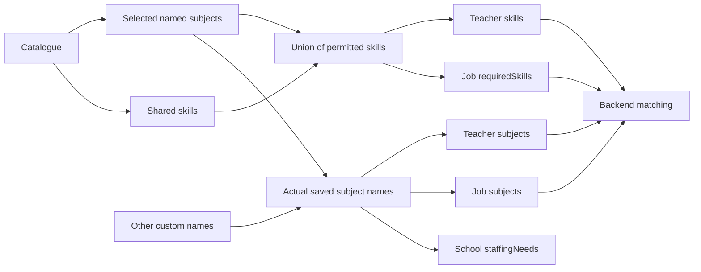

# SupplyEd dropdown reference and usage map

> **Preserved baseline, 19 October 2026:** this is the inventory from before the database-dropdown integration. The control IDs and original usage/value lists are retained for future instructions. Current implementation and API mappings are documented in [DYNAMIC_DROPDOWNS_INTEGRATION.md](DYNAMIC_DROPDOWNS_INTEGRATION.md). Statements below about hardcoded runtime choices or unavailable custom skills describe the earlier implementation, not the updated website. Live API responses are now authoritative.

Originally audited 19 October 2026 against the website working tree and the read-only local backend. This document preserves **where every control was used**, its labels, values, data source, dependencies, and request mapping so a subsequent change can target a specific control without guessing.

The original audit was documentation only. The subsequent implementation changed the website to use database choices; backend files and live records were not edited. Continue using the stable control IDs below, for example “change S04 teacher settings Subjects” or “change W03 school waitlist School type.” Recorded source line numbers belong to the original audit and may have moved.

## Contents

- 1. Coverage and conventions
- 2. Shared dropdown mechanics and option sets
- 3. Waitlist: W01–W09
- 4. Onboarding: O01–O12
- 5. Settings: S01–S10
- 6. Job creation/editing: J01–J07
- 7. Invitations: I01–I05
- 8. Discovery: D01–D06
- 9. Job applications: A01–A03 and status choices
- 10. Bookings, billing, account menus and other selection surfaces
- 11. Retained components and standalone HTML
- 12. Subjects, skills, jobs and matching relationships
- 13. Complete subject/skill catalogue
- 14. Reverse skill-to-subject index
- 15. Complete location option values
- 16. Every route and its control usage
- 17. Every source occurrence, with exact props and source line
- 18. Supporting source definitions and audit manifest

## 1. Coverage and conventions

The source scan parsed **378 authored TS/TSX/JS/HTML files** in `app`, `components`, `features`, `data`, `lib`, `types` and `public`. The primary inventory contains **68 select/shared-wrapper/menu/input occurrences**, including definitions and reused wrappers. Nine real waitlist dropdowns are generated by one helper; their individual call sites are also included. Additional action menus were inspected through `aria-expanded`, menu state, popovers and navigation searches. These counts are source occurrences, not a claim that 68 different menus appear on one screen.

The audit includes native selects/options, shared single/multi selects, teaching wrappers, country/city wrappers, Quill formatting selectors, account/action menus, public standalone HTML, retained components, and nearby controls that could be mistaken for dropdowns. All route page files are inventoried. Dependency bundles, generated build output, tests and CSS are excluded from the authored-control count.

This is a **source audit**, not a snapshot of private account data. Runtime APIs remain authoritative. Account-specific job choices and notifications vary by account; browser timezone/date controls and Stripe-hosted controls do not have a universal fixed list. Their sources and limits are explicitly identified rather than inventing options.

Conventions:

- Unless a mapping is shown, **display label = selected value = submitted value**.
- `""` means empty selection; `[]` means an empty multi-selection; “omitted” means no query/body field.
- Placeholder text is not a valid persisted choice.
- Backend paths below include `/api`. Website proxies and Server Actions can normalize responses; mobile clients should use backend contracts, not copy Next.js transport implementation.
- Current routed controls and retained/unmounted implementations are distinguished. A source definition alone is not evidence that a user currently sees it.

## 2. Shared dropdown mechanics and option sets

### Common option sets

| Set | Values/source | Interpretation |
| --- | --- | --- |
| COUNTRY | United Kingdom → `GB` | Only supported country; some forms prepend an empty placeholder. |
| CITY | All 3,844 names in Section 15 | Exact `getUkCities()` output; each name is both label and value. |
| REGION | All 251 names in Section 15 | Exact `getUkRegions()` output; canonical names are labels and values. |
| SUBJECT | All 70 choices in Section 13 | `GET /api/teaching-catalogue`, canonical `name`; includes Other in editors. |
| SKILL | Shared skills ∪ skills of selected named subjects | Computed, deduplicated, optional multi-selection; no arbitrary skill names. |
| KEY_STAGE | `EYFS`, `KS1`, `KS2`, `KS3`, `KS4`, `KS5` | Current catalogue suggestions; not a newly enforced strict backend enum. |
| CURRENCY | `GBP` | Only currency offered by teacher onboarding. |
| COVER_TYPE | `Same-day cover`, `Long-term roles`, `Intervention groups`, `Exam season`, `SEN support` | School onboarding preferences, separate from staffing subjects. |
| JOB_PAY | Daily → `daily`; Hourly → `hourly`; Fixed → `fixed` | Job wizard labels map to lowercase JSON values. |

### Shared component behavior

Source: `components/molecules/OptionDropdowns.tsx`.

- Options accept a string or `{label,value,group?,keywords?,description?}`. A string becomes an identical label/value pair.
- Single select stores a string and closes after choice. Multi-select stores an array, toggles membership, preserves selection order and stays open.
- Search is enabled only when the caller passes `searchable`; it searches lowercase label plus keywords. Subject aliases are keywords, not extra saved options. Category labels are grouping only.
- Multi-selection summaries show the first two labels and `+N more`. A saved value missing from options can still display as its raw string; that does not mean the backend accepts it.
- `maxSelections` only limits the menu where passed. Teaching subject/skill controls pass 50. Other validators can impose limits independently.
- Keyboard navigation, Escape/outside dismissal, ARIA selection/error/required states and a positioned popover are implemented.
- The hidden native select is part of this component, not another business dropdown. A supplied `name` participates in FormData; other controls feed state-based request builders.
- Default placeholders: Select an option / Select options. An explicit empty option is distinguished from a saved business value.

### Teaching catalogue wrapper

`TeachingSelectionFields.tsx` is reused by teacher onboarding, school onboarding, teacher/school settings, job creation/edit and invitation new-job forms. The hook `useTeachingCatalogue()` shares query key `['teaching-catalogue']`; it fetches the public website proxy, which calls the public backend catalogue without a token. Current query-client caching uses infinite stale/gc times and recognized validation errors trigger invalidation. Loading/failure shows loading/retry rather than an invented option list.

Selecting **Other** reveals an **Other subjects** chip input. Add/Enter commits a name; a remove control removes a chip. Uncommitted text displays an Add/Enter reminder. This is a dependent input, not a separate free-text skill dropdown. Section 12 explains serialization, validation, restore and clear behavior.

## 3. Current waitlist dropdowns — W01–W09

**Where used:** home waitlist section (`/`), `/founding-schools`, `/founding-teachers`. `FoundingInterestForm.tsx` is the shared form; `HomeWaitlistSection.tsx` and `FoundingInterestPage.tsx` mount it. Retained `RegisterInterestForm.tsx` also wraps it. Option source: `features/contact/waitlist-options.ts`.

All nine controls are single-select, required, initially empty, non-searchable and disabled while pending. Every option below is both label and value. They submit the named key through `POST /api/contact/founding-interest` with `type: SCHOOL` or `TEACHER`; validation checks exact list membership. Audience changes remount/reset the form.

| ID | Audience / visible label | Form/body key | Every option, in source order |
| --- | --- | --- | --- |
| W01 | School / Your role | `role` | `Business manager`; `Headteacher`; `Deputy or assistant head`; `Cover manager`; `Trust or MAT lead`; `Other` |
| W02 | School / Area | `area` | `Greater Manchester`; `Lancashire`; `Elsewhere in the United Kingdom` |
| W03 | School / School type | `schoolType` | `Primary`; `Secondary`; `Special / AP`; `All-through` |
| W04 | School / Supply days per term (roughly) | `supplyDaysPerTerm` | `Under 10`; `10 to 30`; `30 to 60`; `More than 60`; `Not sure` |
| W05 | School / How you book cover now | `coverBookingMethod` | `Through an agency`; `Our own pool or bank`; `A mix of both`; `Other` |
| W06 | Teacher / I work as a | `role` | `Qualified teacher (QTS)`; `Early career teacher`; `Teaching assistant`; `Cover supervisor` |
| W07 | Teacher / Where you’ll work | `area` | `Greater Manchester`; `Lancashire`; `Both`; `Elsewhere in the United Kingdom` |
| W08 | Teacher / Are you doing supply now? | `currentSupply` | `Yes, through an agency`; `Yes, directly with schools`; `No, but I'd like to start` |
| W09 | Teacher / How many days a week would you want? | `daysPerWeek` | `1 to 2`; `3 to 4`; `Full week` |

Related controls, explicitly not dropdowns:

- Audience buttons: I'm a school → `SCHOOL`, I'm a teacher → `TEACHER`. This is waitlist audience, not an authenticated account-role update.
- Teacher confirmation phases are checkboxes: `EYFS`, `Primary`, `Secondary`, `SEND / AP`. They send `phases: string[]` with optional `mainSubject` and `postcode` through `PATCH /api/contact/founding-interest/:id/details` using the details token. `mainSubject` is text, not the teaching catalogue, and does not automatically create verified teacher subjects.
- Founding-programme interest and email consent are boolean checkboxes. The modern school waitlist has no tier dropdown; the standalone HTML does.
- UK phone has a fixed +44 prefix and no country dropdown.
- Waitlist `schoolType` is a phase/type label; onboarding `institutionType` is single-school versus MAT. These are not interchangeable enums.

## 4. Onboarding dropdowns — O01–O12

**Where used:** `/onboarding`, reached after authentication/signup. Teacher contact and teaching fields are shown in its initial profile step. School contact-only step precedes school details, compliance and review. Role choice is cards/buttons, not a dropdown.

Sources: `components/organisms/onboarding/steps/AccountBasicsStep.tsx`, `TeacherProfileStep.tsx`, `InstitutionDetailsStep.tsx`, and `onboarding/CountryCityFields.tsx`. The web FormData orchestrator eventually creates/updates `/api/instructors` or `/api/institutions` and their owned profile routes. Editor `localAuthority` maps to backend `county`.

| ID / audience | Dropdown and complete option set | Editor → JSON field | Default, requirement and dependency |
| --- | --- | --- | --- |
| O01 Teacher | Country: Select country → empty; United Kingdom → GB | `profileCountryCode` → `countryCode` | GB initially; required UK. |
| O02 Teacher | City / town: Select city / Select country first → empty; CITY | `profileCity` → `city` | Empty initially; required/searchable; disabled until country valid and nonempty. |
| O03 Teacher | Subjects / SUBJECT | `subjects`, `otherSubjects` | `[]`; optional multi; max 50 actual subjects; reconciles skills. |
| O04 Teacher | Skills / SKILL | `skills` | `[]`; optional multi, max 50; depends on O03. |
| O05 Teacher | Key stages / KEY_STAGE | `keyStages` | `[]`; multi; at least one required by onboarding; server array max 100. |
| O06 Teacher | Currency / GBP | `currency` | GBP initially, only supported option. |
| O07 School | Institution type: Single school → SINGLE_SCHOOL; Part of a multi-academy trust → MAT_SCHOOL | `institutionType` | SINGLE_SCHOOL initially; MAT reveals trust/signatory requirements. |
| O08 School | Country: Select country → empty; United Kingdom → GB | `institutionCountryCode` → `countryCode` | GB initially; required UK. |
| O09 School | City / town: empty placeholder + CITY | `institutionCity` → `city` | Empty; required/searchable; depends on valid country. |
| O10 School | County / region: Select county / region → empty; REGION | `localAuthority` → `county` | Empty/optional/searchable. |
| O11 School | Cover types / COVER_TYPE | `coverTypes` | `[]`; multi; at least one required; validation max 20, no explicit menu maxSelections. |
| O12 School | Staffing needs / SUBJECT | `staffingNeeds`, `otherSubjects` | `[]`; optional multi; subject/Other rules; no school skill dropdown. |

Teacher/school city options are the same full list; choosing a county does not narrow cities. Saved invalid locations remain reviewable rather than being silently guessed.

Document requirement boxes are API-driven uploads, not document-type dropdowns. Each box accepts one file; separate boxes can upload concurrently. Phone code entry and optional verification at document review contain no dropdown. Contact role, registration ID, trust role and compliance contacts are text inputs. Review stages display actual selected names and add no new teaching selectors.

## 5. Settings dropdowns — S01–S10

**Where used:** `/settings`, role-dependent profile section. Source: `components/organisms/SettingsPage.tsx`, including its own local CountryCityFields helper. Defaults come from saved profiles; initial empty forms use GB and empty lists/strings. Save updates `/api/users/me`, then `/api/instructors/:id` or `/api/institutions/:id`; these writes are not atomic.

| ID / audience | Dropdown and options | Profile JSON field | Behavior |
| --- | --- | --- | --- |
| S01 Teacher | Country / United Kingdom → GB | `countryCode` | Fixed supported country; legacy invalid value stays visible for correction. |
| S02 Teacher | City / town / Select city or town → empty + CITY | `city` | Searchable; dataset membership validation. |
| S03 Teacher | County / region / No county or region → empty + REGION | `county` | Searchable/optional. |
| S04 Teacher | Subjects / SUBJECT | `subjects`, `otherSubjects` | Saved actual names restore Other/chips; multi max 50. |
| S05 Teacher | Skills / SKILL | `skills` | Optional multi; depends on S04; no free-text skill list. |
| S06 Teacher | Key stages / KEY_STAGE **plus saved values** | `keyStages` | Optional multi; wrapper unions suggestions with saved values for visibility. |
| S07 School | Country / United Kingdom → GB | `countryCode` | Same settings helper as S01. |
| S08 School | City / town / Select city or town → empty + CITY | `city` | Searchable; required by school settings validation. |
| S09 School | County / region / No county or region → empty + REGION | `county` | Searchable/optional. |
| S10 School | Staffing needs / SUBJECT | `staffingNeeds`, `otherSubjects` | Optional multi; school profile has no skills. |

Untouched stored subject arrays remain verbatim until a selector is edited. The action omits unchanged teaching selections, so a name/bio edit does not force legacy skills or aliases to be revalidated. Edited teaching fields send the complete subject/custom/skill combination, including explicit clears.

**Important current differences:** school settings Cover types is an ArrayField comma-separated text editor, not O11's dropdown. School role/domain/registration details are inputs. There is no additional settings currency dropdown. Admin settings does not render either role-profile group. Payout setup can contain Stripe-owned runtime controls (Section 10).

## 6. Job creation/edit dropdowns — J01–J07

**Where used:** `/post-job`, new and owned-job edit wizard. Source: `components/organisms/PostJobPage.tsx`. New defaults: subjects/skills/stages empty, country GB, payType daily. Editing hydrates from the owned job response. POST `/api/jobs` creates a draft; publication PATCHes ACTIVE; edit PATCHes `/api/jobs/:id`.

| ID | Label / complete options | State/JSON field | Behavior |
| --- | --- | --- | --- |
| J01 | City or town / Not specified → empty + CITY | `city` | Searchable, optional; blank normally omitted. |
| J02 | County or region / Not specified → empty + REGION | `county` | Searchable, optional. |
| J03 | Country / United Kingdom → GB | `countryCode` | One fixed supported choice. |
| J04 | Pay basis / Daily → daily; Hourly → hourly; Fixed → fixed | `payType` | Title-case UI labels, lowercase payload; daily default. |
| J05 | Subjects / SUBJECT | `subjects`, `otherSubjects` | Optional multi; Other chips; review displays actual names. |
| J06 | Required skills / SKILL | `requiredSkills` | Optional multi; depends on J05; different key from teacher skills. |
| J07 | Key stages / KEY_STAGE | `keyStages` | Optional multi; independent of subject selection. |

Posting mode is a card choice: Instant matching → internal `instant`, Open brief → `brief`. The web encodes posting-route metadata in description text; this is not a subject/skill relation. Urgent/QTS are checkboxes; pay/minimum experience are numeric inputs. Work datetime and listing date fields are browser pickers, not finite dropdown lists.

Current description editor is a textarea with Heading/Bullet list/Bold buttons. It does not mount the retained RoleDescriptionEditor font-size dropdown. Postcode lookup is a one-result area check, not an address dropdown.

If subjects, customs or requiredSkills change, the web sends the resulting full group together. Unchanged selection fields are omitted from unrelated PATCHes. It writes no stale legacy scalar subject. Reload splits stored actual custom names back into Other plus chips.

## 7. Invitations — I01–I05 and job radio list

**Where used:** school invitation/hire modal opened from teacher directory cards, teacher profile and eligible messaging conversations. Source: `components/organisms/InvitationModal.tsx`; shared entry through TeacherHireActions. In MessagingPage, the school must own the conversation as poster, it must be writable, have an instructor ID and not already be HIRED. TeacherHireActions also requires an approved school account. Use existing job / Create new job are buttons. POST `/api/job-invitations` accepts exactly one job source plus instructorId and retained requestId.

| ID | Dropdown / label → value | Payload effect | Default/visibility |
| --- | --- | --- | --- |
| I01 | Timezone for dates and deadline: United Kingdom (GMT / BST) → Europe/London; UTC → UTC; browser IANA zone → itself | Converts local work/deadline inputs to zoned ISO timestamps; no timezone property submitted | Europe/London default; values deduplicated, so browser zone may not add a third option. |
| I02 | Pay type: Per day → daily; Per hour → hourly; Fixed amount → fixed | `newJob.payType` | daily default; new-job mode; positive pay and valid type required. |
| I03 | UK city or town: Not specified → empty + CITY | `newJob.city` | Optional/searchable; new-job mode. |
| I04 | Subjects / SUBJECT | `newJob.subjects`, `newJob.otherSubjects` | Optional multi; new-job mode. |
| I05 | Required skills / SKILL | `newJob.requiredSkills` | Optional multi; depends on I04. |

Existing job selection is a **radio-card list**, not a dropdown. Dynamic rows come from GET `/api/jobs/mine` with ACTIVE/DRAFT status, search, page, limit 6. An initial job can be fetched through `/api/jobs/mine/:id` and inserted if absent from the page. Row label contains title, work dates, pay, city and status; the selected/submitted value is **job.id**, never title. Active jobs / Draft jobs buttons switch the query.

Jobs outside DRAFT/ACTIVE, expired jobs, missing/reversed/non-future work dates, or missing/non-positive/invalid pay are disabled with an edit action. Existing-job mode sends only jobId rather than copied teaching fields. New-job mode nests them under newJob. Review shows actual custom names; new private job status is not user-submitted. Invitation deadline and job listing expiry are different fields. Invitation starts school chat; booking waits for teacher acceptance.

## 8. Discovery dropdowns — D01–D06

| ID / page | Label / all choices | Query mapping | Default/behavior |
| --- | --- | --- | --- |
| D01 `/find-jobs` | Role type: All jobs; Urgent only | `/api/jobs`: urgent omitted or true | All jobs default; an urgency filter, not a teacher-role enum. |
| D02 `/find-jobs` | Key stage: All stages + KEY_STAGE | keyStage omitted for All stages, otherwise exact value | All stages default. |
| D03 `/find-jobs` | Subject: All subjects → empty + named SUBJECT choices **excluding Other** | scalar subject; omit empty | Searchable; catalogue required; companion text input accepts exact custom name. |
| D04 `/find-teachers` | Key stage: All key stages → empty + KEY_STAGE | `/api/instructors/directory`: keyStage | Empty default; Apply filters commits draft. |
| D05 `/find-teachers` | UK city or town: Any UK city or town → empty + CITY | city | Empty default; searchable; Apply filters commits. |
| D06 `/find-teachers` | Rating: Any rating → empty; 3+ stars → "3"; 4+ stars → "4"; 4.5+ stars → "4.5" | minRating number 3/4/4.5; omit empty | UI strings become query numbers. |

Sources: `FindJobsPage.tsx`, `FindTeachersPage.tsx`, `TeachingSelectionFields.tsx`. Find jobs defaults to For you; D01–D03 appear on All jobs. For you uses GET `/api/matching/jobs/recommended` and a numeric minimum-score input. Filter changes reset pagination.

**Preserved current behavior:** teacher-directory subject and skill are plain text inputs, not dropdowns. Placeholders are e.g. Mathematics and e.g. SEN. They send scalar subject/skill strings (max 100 characters); backend handles known aliases. No subject-dependent skill option menu exists on this directory page. Rates/experience are numeric; verification/availability filters are checkboxes.

Job subject query matches a name anywhere in the saved array. For custom names use exact saved spelling, e.g. Astronomy. No multi-value subject query, otherSubjects query, or all-Other-jobs option exists. Exact filtering is distinct from recommendation scoring and never edits stored skills.

## 9. Applying for jobs — A01–A03 and application choices

**Where used:** the job-detail application form mounts `components/molecules/ProposalEditor.tsx`. The current job determines jobId and saved jobName; the teacher does not choose subjects, skills, job name or status from a dropdown while applying. The optional formatted proposal uses these three menus:

| ID | Dropdown | Every display label → editor value | Default/effect |
| --- | --- | --- | --- |
| A01 | Font family | SupplyEd Sans → `""`; Arial → `Arial`; Georgia → `Georgia`; Times New Roman → `Times New Roman` | Empty resets inherited font. |
| A02 | Font size | 12 → `12px`; 14 → `14px`; 16 → `""`; 18 → `18px`; 20 → `20px`; 24 → `24px` | Empty displays default 16. |
| A03 | Text color | Default → `""`; swatches → `#17211c`, `#227557`, `#315ca8`, `#7a4a9e`, `#a1483f` | Swatches have no text labels in source. Empty resets color. |

These options change editor formatting and ultimately proposal HTML, not separate application JSON enum fields. Bold/italic/underline/list/link controls are buttons/dialogs, not additional font dropdowns.

### Application filters and school decisions are not dropdowns

- Teacher `/applications`: All → `ALL`; Invited → `INVITED`; Applied → `APPLIED`; Viewed → `VIEWED`; Shortlisted → `SHORTLISTED`; Hired → `HIRED`; Rejected → `REJECTED`. They are filter buttons. ALL omits status. INVITED switches to invitation records rather than sending an invalid application status. Sources: `TeacherApplicationsPage.tsx`, invitations hooks.
- School application job filters: Active jobs → `ACTIVE`, Invited jobs → `INVITED`. They choose the relevant job list, not a teacher decision.
- School decision pipeline: `APPLIED`, `VIEWED`, `SHORTLISTED`, `HIRED`, plus `REJECTED`. Clicking/dragging advances stages; direct APPLIED → HIRED/REJECTED is allowed. VIEWED/SHORTLISTED are optional. Terminal HIRED/REJECTED do not move again through this UI. There is **no INTERVIEW** option. PATCH `/api/applications/:id/status` sends `{status}`; hire uses explicit confirmation. Sources: `ApplicationsWorkspacePage.tsx`, `features/applications/workflow.ts`.
- `/job-invitations` uses status buttons: All invitations → omitted; Pending → PENDING; Accepted → ACCEPTED; Declined → DECLINED; Cancelled → CANCELLED; Expired → EXPIRED. Teacher Accept/Decline and school Cancel are explicit invitation actions, not application status options.

## 10. Bookings, billing, menus and related selection surfaces

### B01–B02: field dropdowns

| ID / location | Label | Every label → value | Mapping/default |
| --- | --- | --- | --- |
| B01 `/bookings`, BookingsPage.tsx | Invoice | Any invoice state → `""`; No invoice → `none`; Unpaid → `unpaid`; Paid → `paid` | GET `/api/bookings/me` invoice query; empty omits; committed with filters. |
| B02 billing refund dialog, BillingPage.tsx | Reason | Requested by the school → `requested_by_customer`; Duplicate payment → `duplicate`; Fraudulent → `fraudulent` | POST `/api/invoices/:id/refund` with amountPence/reason; requested_by_customer default. |

Other billing/booking choices use buttons or inputs:

- Booking tabs: All → `all`/status omitted; Active → `active`/CONFIRMED; Completed → `completed`/COMPLETED; Cancelled → `cancelled`/CANCELLED; No-show → `no-show`/NO_SHOW. Default Active, except a job-linked listing defaults All.
- Invoice tabs: All → `all`/omitted; Unpaid → `unpaid`/OPEN; Paid → `paid`/PAID; Void → `void`/VOID; Written off → `written-off`/UNCOLLECTIBLE; Processing → `pending`/PENDING. Processing is offered to admin only.
- Expanded invoice filters contain booking/profile ID inputs, not dropdowns. Review rating uses buttons 1–5. Units, cancellation reason and purchase-order values are inputs.

### M01. Workspace account dropdown

**Where used:** AppChrome on authenticated workspace pages. Source: `components/molecules/AppAccountMenu.tsx`.

| Label | Action/destination |
| --- | --- |
| Workspace home | Open dashboard |
| Settings | Open settings |
| Security | Open security |
| View public home | Open public root/landing |
| Logout | Sign out |
| My Profile (header, conditional on onProfile) | Open my-profile |

These are actions, not persisted profile values. Display name, verified badge and role label are informational and are not role-switching options. Keyboard menu navigation and dismissal are implemented.

### M02. Public account dropdown

**Where used:** signed-in PublicHeaderAccountSlot on public pages. Source: `components/molecules/PublicAccountMenu.tsx`.

| Audience | Label | Exact destination |
| --- | --- | --- |
| School | Workspace | `/post-auth` |
| School | Teachers | `/find-teachers` |
| School | Messages | `/messaging` |
| School | Settings & billing | `/billing` |
| Teacher | Workspace | `/post-auth` |
| Teacher | Jobs | `/find-jobs` |
| Teacher | Schedule | `/calendar` |
| Teacher | Messages | `/messaging` |
| Admin | Admin access | `/post-auth` |
| Admin | Security | `/security` |
| Unknown/setup | Complete setup | `/post-auth` |
| All signed-in variants | Logout | signOut, then `/login` |

### M03. Job row ellipsis menu

**Where used:** JobManagementList rows on school job-management surfaces. Source: `components/organisms/JobManagementList.tsx`.

- Applications → open that job's applications using its job ID.
- Edit → open that job's editor.
- Close → PATCH status CLOSED; only offered for ACTIVE/DRAFT jobs.
- Delete → deletion confirmation/action for that job.

Close/Delete disable during pending mutation. Closing the menu has no API effect. Separate job-status tabs are All → ALL/omitted, Active → ACTIVE, Draft → DRAFT, Expired → EXPIRED, Closed → CLOSED, Suspended → SUSPENDED.

### M04. Notification dropdown/popover

**Where used:** workspace NotificationBell. Rows are dynamic notification records keyed by notification.id; labels come from API data and navigation from normalized destinations. Static actions: Mark all as read (when unread exists), Email settings, conditional desktop-alert prompt “Get desktop alerts when SupplyEd is in the background. Turn on”, and Show older when another page exists. Empty/loading/error content is not a choice. These are account-specific actions, not a fixed business enum; no live private notification text was copied into this file.

### M05. Public mobile navigation and workspace navigation

PublicHeader's expandable mobile menu contains For schools → `/founding-schools`, For teachers → `/founding-teachers`, How it works → `/#waitlist-how-it-works`, FAQ → `/#faq`, with contextual registration/account actions. Desktop uses direct links. Workspace mobile navigation/sidebar expansion changes layout; role-specific links are navigation, not data fields. Navigation definitions are included in Section 18.

### M06. Theme popovers

**Where used:** PublicThemeControls on login, signup, password recovery and onboarding; TweaksPanel in the workspace shell. The public marketing header itself does not mount PublicThemeControls. Options are local preferences:

| Label | Accent value |
| --- | --- |
| Supply blue | `#008CC4` |
| Emerald | `#16A34A` |
| Violet | `#7C3AED` |
| Rose | `#E11D48` |
| Amber | `#D97706` |
| Slate | `#334155` |

Workspace also offers a native custom color input. Colors update local preferences/CSS, not jobs or profile API fields. There is no finite list of all possible custom colors.

### Other inspected controls and explicit boundaries

- My profile uses activity/review tabs and received/given direction buttons. Teacher dashboard schedule uses Upcoming/This week/This month buttons. Dashboards add no subject-driven skill dropdown of their own.
- Match-score details, teacher filter expansion, invoice filters, FAQ accordions and technical-error details are disclosures, not option-value controls.
- Login/signup/OTP/reset/security pages use inputs, role cards, toggles and provider buttons; no hidden country menu exists in PhoneInput. +44 is fixed.
- CalendarPage has displayed calendar cells and preference toggles, no authored month/year dropdown. Its retained prototype-style controls must not be mistaken for a confirmed availability API integration.
- Messaging uses conversation/attachment lists; selecting a conversation uses its returned ID, not a subject/status dropdown.
- PostcodeLookup requests `https://api.postcodes.io/postcodes/:postcode`; it validates a single postcode/area result, not a selectable street-address list. It never infers a city from a district.
- Native date/datetime, file and color pickers are browser/OS UI. Their presentation varies; constraints come from form validation/upload requirements rather than an authored finite options array.

### Stripe-owned runtime dropdown boundary

PayInvoiceModal mounts Stripe PaymentElement with layout tabs. StripePayoutComponents mounts ConnectAccountOnboarding or ConnectPayouts and a notification banner. Dropdowns inside those frames are generated by Stripe for that payment/account session. Their complete payment-method, country, bank/account or identity choices are **not defined in this repository and were not obtained in this source audit**. This is explicitly recorded, not silently counted as audited local data. Use Stripe's component contract rather than fabricating a static option list. No payment/session was opened or changed for this documentation task.

## 11. Retained components and standalone HTML

These files remain documented even where the active route uses another implementation:

| ID | Source / usage status | Control(s) and values | Editor/request field |
| --- | --- | --- | --- |
| R01 | InstitutionProfileStep.tsx; no current JSX call site found | Country empty + GB; City empty + CITY | institutionCountryCode/countryCode; institutionCity/city |
| R02 | InstitutionStaffingStep.tsx; no current JSX call site found | County / region empty + REGION | localAuthority → county |
| R03 | InstitutionStaffingStep.tsx; retained | Staffing needs / SUBJECT, Other chips; no skills | staffingNeeds + otherSubjects |
| R04 | RoleDescriptionEditor.tsx; no current component call site found | Font size: 12→12px; 14→14px; 16→empty/default; 18→18px; 20→20px; 24→24px; 32→32px | Description HTML formatting, not a separate JSON enum |
| R05 | TagInput.tsx; exported, no current JSX use found | Free-text chips; no finite options | Generic value array, not active skill entry |

The active PostJobPage uses a textarea; active OnboardingPage uses InstitutionDetailsStep. Retained components are not presented as visible active fields.

Standalone assets `public/founding-schools (1) (1).html` and `public/founding-teachers (1).html` contain six native selects. They are directly serveable legacy assets, not the modern React waitlist contract. Bare HTML options submit their exact text. Their SCRIPT_URL integration uses an external form POST; it is not the modern founding-interest REST endpoint and delivery was not tested.

| ID / asset | Label / HTML name | All options (label=value unless stated) | Default/requirement |
| --- | --- | --- | --- |
| L01 School | Role / role | Select your role→empty; Head Teacher; Deputy / Assistant Head; Cover Coordinator; School Business Manager; MAT / Trust leadership; Other | Empty disabled placeholder selected; required |
| L02 School | School type / schoolType | Select type→empty; Primary; Secondary; Special / Alternative provision; Multi-academy trust; Independent; Other | Empty disabled placeholder selected; required |
| L03 School | Tier of interest / tier | Not sure yet, tell me more; Founding School; Founding School Enhanced | First option selected; optional |
| L04 Teacher | Role / role | Select your role→empty; Supply teacher (qualified); ECT; Teaching assistant; HLTA; SEN / SEND specialist; Cover supervisor; Nursery practitioner; Other school support role | Empty disabled placeholder selected; required |
| L05 Teacher | Phase you work in / phase | Select phase→empty; Primary; Secondary; SEND / Special; Early years; Any / flexible | Empty disabled placeholder selected; required |
| L06 Teacher | Availability you're looking for / availability | Day-to-day supply; Long-term cover; Both; Not sure yet | First option selected; optional |

Exact HTML appears in Section 17. Legacy option constants are also preserved in Section 18, including old subject/key-stage/skill arrays. Those are compatibility/reference data, not the current teaching catalogue, and do not create extra active dropdowns merely by existing in source.

## 12. Subjects, skills, jobs and matching relationships

### Data/storage model

The versioned catalogue is source-controlled product data, exposed through GET `/api/teaching-catalogue`. It does not introduce subject-ID/skill-ID lookup tables. Teacher subjects/skills, school staffingNeeds and job subjects/requiredSkills are arrays of names. Category labels only group the UI. A skill can appear under multiple subjects, and shared skills apply globally.



School staffingNeeds is a hiring preference, **not an automatic job-subject assignment or scoring input**. It does not create a job, restrict which subjects a school can post, or unlock a school skill field. Jobs and teachers have their own explicit selections.

### Permitted skills versus selected skills

`allowedSkills = distinct(sharedSkills + every selected named subject's skills)`.

The UI preserves source order: shared skills first, then matching subjects in catalogue order. It does not select every permitted skill automatically. A teacher chooses skills they hold; a school chooses skills the job requires. A skill needs support from only one selected subject, or the shared set, not every subject.

Removing a subject removes a chosen skill only if no remaining subject/shared set allows it. A notice names removed skills and the cleaned array is submitted with the subject change. A skill's presence anywhere in the global catalogue does not make it valid for every job.

Example: Mathematics enables Algebra, Geometry, Fractions and Decimals, Statistics, Problem-Solving, plus shared skills. Adding Physics adds the Physics skills listed in Section 13. Selecting Mathematics does not automatically claim or require Algebra. Removing Mathematics keeps shared skills and any skills supported by another selected subject.

### Other request, response and reload

Teacher selection request:

```json
{
  "subjects": ["Mathematics", "Other"],
  "otherSubjects": ["Astronomy", "Marine Studies"],
  "skills": ["Algebra", "Lesson Planning"]
}
```

Job uses requiredSkills instead of skills. School uses staffingNeeds instead of subjects and has no skills field. Invitation nests job fields under newJob.

Backend response stores actual names: `subjects: ["Mathematics","Astronomy","Marine Studies"]`. There is no response otherSubjects and no saved Other placeholder. Named selections precede custom values. Legacy job scalar subject is the first actual name: Mathematics here, Astronomy for an Other-only selection. The web's joined display subject string is not that scalar write contract.

Custom-name rules: at most 100 characters each; at least one Unicode letter/number; no control characters. Trim/collapse whitespace and deduplicate normalized names. Comparison lowercases, expands `&` to ` and `, replaces non-letter/non-number runs with spaces, and trims. Preserve the first cleaned spelling. Known catalogue names/aliases must be chosen normally (Maths under Other must suggest Mathematics). Other alone permits only shared skills; there are no custom skills.

Edit restoration splits saved actual names into known canonical/alias choices and unknown custom values, then selects Other when customs exist. Keep legacy prose as one reviewable value; never split or guess its subjects. Maximum 50 actual subjects, including customs; the raw request arrays and skills have their own 50-entry limits. Deduplicate before submission.

PATCH rules:

- Omitted fields retain saved values; unrelated edits omit unchanged teaching fields.
- Removing Other sends the new choices without Other **and `otherSubjects: []`**, plus cleaned skills.
- Clearing all sends `subjects: []` or `staffingNeeds: []`, **and `otherSubjects: []`**, leaving only shared/empty skills.
- Skills-only updates retain/revalidate saved customs.
- An otherSubjects-only PATCH can replace an existing custom selection; adding the first custom selection requires explicit Other.
- Response customs must not be copied directly into the request's catalogue subject array.

Errors: INVALID_OTHER_SUBJECTS belongs beside Other subjects; INVALID_TEACHING_SELECTION beside catalogue fields; SKILL_SUBJECT_MISMATCH beside skills; CONFLICTING_JOB_SUBJECTS indicates a stale scalar conflicting with the array. Refresh catalogue, preserve input and allow correction.

### Relevant API field mapping

| Purpose | Backend endpoint | Selection fields |
| --- | --- | --- |
| Catalogue | GET /api/teaching-catalogue | categories subjects name/aliases/skills, sharedSkills, keyStages, version |
| Teacher create/edit | POST /api/instructors; PATCH /api/instructors/:id | subjects, request-only otherSubjects, skills, keyStages |
| Admin teacher edit | PATCH /api/instructors/admin/:id | Same teaching validation; existing admin authorization |
| School create/edit | POST /api/institutions; PATCH /api/institutions/:id | staffingNeeds, otherSubjects; separate coverTypes/county/institutionType |
| Job create/edit | POST /api/jobs; PATCH /api/jobs/:id | subjects, otherSubjects, requiredSkills, keyStages, payType, location |
| Invitation | POST /api/job-invitations | nested newJob teaching fields, or existing jobId |
| Job list | GET /api/jobs | scalar subject, keyStage, urgent |
| Teacher directory | GET /api/instructors/directory | scalar subject, skill, keyStage, city, minRating, other filters |
| Teacher recommendations | GET /api/matching/jobs/recommended | page, limit, minScore; current teacher from authentication |
| School recommended teachers | GET /api/matching/jobs/:jobId/instructors | page, limit, minScore |
| Rank applicants | GET /api/matching/jobs/:jobId/applications | page, limit, minScore |
| Teacher score for one job | GET /api/matching/jobs/:jobId/score | path job and authenticated teacher |

### Matching: subjects and skills are separate factors

The backend canonicalizes known subject/skill aliases. Custom subjects use Unicode-aware comparison; Other itself is excluded. Key stages normalize KS3/ks 3/Key Stage 3 to ks3 and early-years variants to eyfs. UI displays the returned score, factors, flags and explanations; it must not substitute a local scoring algorithm.

Subject value = fraction of the job's distinct wanted subjects held by the teacher. Skill value = fraction of distinct job.requiredSkills held in teacher.skills. Empty job requirements make the factor non-applicable, not a zero penalty. Extra teacher subjects/skills are not penalized.

Example: job subjects Mathematics + Physics and skills Algebra + Lesson Planning; teacher has Mathematics and both skills. Subject factor is 1/2; skill factor 2/2. This does not directly mean a 75 overall score because other factors apply.

| Factor | Default weight | Value / applicability |
| --- | --- | --- |
| Subject | 25 | Required-subject overlap; skip if job has none |
| Key stages | 15 | Required-stage overlap; skip if none |
| Skills | 15 | Required-skill overlap; skip if none |
| Location | 15 | Distance/travel radius or text-area fallback |
| Pay | 10 | Clamp(offer / relevant hourly/daily teacher rate, 0..1); fixed or missing comparison skipped |
| Verification | 10 | DBS verified 1, otherwise 0; applicable |
| Rating | 5 | Shrunk rating, prior 3 with weight 5, divided by 5 |
| Experience | 5 | Clamp(years / positive job minimum, 0..1); skip if no positive minimum |

`score = round(100 × sum(applicable positive weight × value) / sum(applicable positive weights))`. If no positive applicable weights remain, score is 0. Backend MATCH_WEIGHTS can override defaults, so returned weights are authoritative.

Location with coordinates: full value inside half the travel radius; declines to 0.5 at radius; zero beyond. Missing/non-positive radius uses 25 miles for scoring, but only an explicit positive radius flags outsideTravelRadius. Without coordinates: same city 0.8, same county 0.5, different area 0.2; no job location skips the factor. Distance display rounds to one decimal mile.

Rating value is `((count × clampedAverage + 5 × 3) / (count + 5)) / 5`. Schedule conflict is a separate flag, not a weighted factor. Overlapping confirmed bookings on another job create conflict; missing dates do not.

Teacher recommendations exclude previous applicants, use active candidate profiles with repository bounds/caps, then exclude schedule conflicts and explicit travel-radius violations. Recommended jobs use visible unapplied jobs with the same flags. Existing applicants are ranked with flags rather than removed by those hard rules; minScore/pagination still affect the returned list. Subject/skill mismatch lowers score; it does not automatically reject or hire an application.

Sources: backend teaching-catalogue data/validation, matching normalize/scorer/weights/service/repository. Backend was read only. Catalogue v1.2 relies on the existing job-subject catalogue migration/deployment; Other adds no new column or further migration.

## 13. Complete subject/skill catalogue

Catalogue version **1.2.0**: 70 subject choices in 10 categories. SupplyEd product catalogue based on the supplied starter list. Includes specialist and support teaching areas; not an official curriculum or evidence of qualifications.

The canonical name is the dropdown label and stored value. Aliases are search/normalization inputs, not extra options. For Other, the editor token is replaced by actual custom names when stored; see Section 12. The skills below are added to the shared skills, not automatically selected.

### Shared skills: available independently of named subject selection

- Lesson Planning
- Classroom Management
- Adaptive Teaching
- Behaviour Management
- Formative Assessment
- Summative Assessment
- Safeguarding Awareness
- Inclusive Teaching
- Pupil Engagement
- Communication Skills
- Digital Learning Tools
- Parent Communication
- Learning Resource Preparation
- Progress Monitoring
- Exam Preparation
- SEND Support

### Key-stage suggestions

```text
EYFS
KS1
KS2
KS3
KS4
KS5
```

### Core Subjects

| Subject label / canonical value | Accepted aliases | Subject-specific skills (every value) |
| --- | --- | --- |
| English Language | None | Grammar<br>Vocabulary Development<br>Reading Comprehension<br>Creative Writing<br>Spelling and Punctuation |
| English Literature | None | Poetry Analysis<br>Shakespeare<br>Literary Criticism<br>Novel Studies<br>Essay Writing |
| Mathematics | Maths<br>Math<br>Numeracy | Algebra<br>Geometry<br>Fractions and Decimals<br>Statistics<br>Problem-Solving |
| Science | None | Scientific Enquiry<br>Experimental Design<br>Laboratory Safety<br>Data Analysis<br>Scientific Report Writing |
| Biology | None | Cell Biology<br>Genetics<br>Ecology<br>Human Physiology<br>Practical Biology |
| Chemistry | None | Atomic Structure<br>Chemical Reactions<br>Organic Chemistry<br>Titration<br>Laboratory Safety |
| Physics | None | Mechanics<br>Electricity and Circuits<br>Waves<br>Forces and Motion<br>Practical Physics |
| Computing | Computing / Computer Science<br>Computer Science | Programming<br>Algorithms<br>Computational Thinking<br>Data Representation<br>Cybersecurity Fundamentals |

### Humanities and Social Sciences

| Subject label / canonical value | Accepted aliases | Subject-specific skills (every value) |
| --- | --- | --- |
| History | None | Historical Interpretation<br>Source Analysis<br>Chronology<br>Historical Essay Writing<br>Evidence Evaluation |
| Geography | None | Map Reading<br>GIS Fundamentals<br>Climate and Weather<br>Fieldwork<br>Data Interpretation |
| Religious Education | Religious Education (RE)<br>RE<br>RS<br>Religious Studies | World Religions<br>Ethical Reasoning<br>Religious Text Analysis<br>Respectful Discussion<br>Comparative Religion |
| Citizenship | None | British Values<br>Democracy<br>Human Rights<br>Critical Thinking<br>Civic Participation |
| Sociology | None | Social Theory<br>Research Methods<br>Social Inequality<br>Data Analysis<br>Essay Writing |
| Psychology | None | Cognitive Psychology<br>Research Methods<br>Human Behaviour<br>Psychological Statistics<br>Ethical Research |
| Politics | None | UK Government<br>Political Ideologies<br>Electoral Systems<br>Policy Analysis<br>Debate and Argumentation |
| Philosophy | None | Logic and Reasoning<br>Ethics<br>Critical Analysis<br>Philosophical Argument<br>Evaluating Perspectives |
| Economics | None | Microeconomics<br>Macroeconomics<br>Supply and Demand<br>Economic Data Analysis<br>Fiscal and Monetary Policy |
| Accounting | None | Bookkeeping<br>Financial Statements<br>Double-Entry Accounting<br>Budgeting<br>Financial Analysis |

### Modern Foreign Languages

| Subject label / canonical value | Accepted aliases | Subject-specific skills (every value) |
| --- | --- | --- |
| French | None | French Grammar<br>Spoken French<br>French Reading<br>French Writing<br>Listening Comprehension |
| Spanish | None | Spanish Grammar<br>Spoken Spanish<br>Spanish Reading<br>Spanish Writing<br>Listening Comprehension |
| German | None | German Grammar<br>Spoken German<br>German Reading<br>German Writing<br>Listening Comprehension |
| Mandarin Chinese | None | Mandarin Speaking<br>Chinese Characters<br>Pinyin<br>Listening Comprehension<br>Chinese Writing |
| Italian | None | Italian Grammar<br>Spoken Italian<br>Italian Reading<br>Italian Writing<br>Listening Comprehension |
| Urdu | None | Urdu Grammar<br>Urdu Reading<br>Urdu Writing<br>Spoken Urdu<br>Urdu Literature |
| Arabic | None | Arabic Grammar<br>Arabic Reading<br>Arabic Writing<br>Spoken Arabic<br>Listening Comprehension |

### Creative and Performing Arts

| Subject label / canonical value | Accepted aliases | Subject-specific skills (every value) |
| --- | --- | --- |
| Art and Design | Art<br>Art & Design | Drawing<br>Painting<br>Colour Theory<br>Mixed Media<br>Art Portfolio Development |
| Music | None | Music Theory<br>Instrumental Instruction<br>Vocal Training<br>Music Composition<br>Ensemble Performance |
| Drama | Drama / Theatre<br>Theatre<br>Theatre Studies | Acting<br>Improvisation<br>Script Analysis<br>Stagecraft<br>Directing |
| Dance | None | Choreography<br>Dance Technique<br>Rhythm and Coordination<br>Performance<br>Movement Composition |
| Photography | None | Camera Operation<br>Photographic Composition<br>Lighting<br>Photo Editing<br>Visual Storytelling |
| Media Studies | None | Media Analysis<br>Film Language<br>Digital Content Production<br>Audience Research<br>Media Representation |
| Film Studies | None | Film Analysis<br>Cinematography<br>Editing<br>Screenwriting<br>Film History |

### Physical Education and Wellbeing

| Subject label / canonical value | Accepted aliases | Subject-specific skills (every value) |
| --- | --- | --- |
| Physical Education | Physical Education (PE)<br>PE<br>P E<br>Sport<br>Sports | Sports Coaching<br>Fitness Training<br>Team Games<br>Movement Skills<br>Physical Assessment |
| Health and Social Care | None | Health Promotion<br>Safeguarding Awareness<br>Communication Skills<br>Person-Centred Care<br>Health and Safety |
| Food Preparation and Nutrition | Food Technology<br>Food Tech | Food Hygiene<br>Cooking Techniques<br>Nutrition Planning<br>Menu Design<br>Allergen Awareness |
| PSHE | None | Emotional Wellbeing Education<br>Personal Development<br>Financial Literacy<br>Healthy Relationships<br>Decision-Making |
| Relationships and Sex Education | Relationships and Sex Education (RSE)<br>RSE | Healthy Relationships Education<br>Consent Education<br>Online Safety<br>Personal Boundaries<br>Age-Appropriate Health Education |

### Design, Technology and Vocational Subjects

| Subject label / canonical value | Accepted aliases | Subject-specific skills (every value) |
| --- | --- | --- |
| Design and Technology | DT<br>Design Technology | Product Design<br>Computer-Aided Design (CAD)<br>Prototyping<br>Materials Selection<br>Design Evaluation |
| Engineering | None | Engineering Design<br>Technical Drawing<br>Computer-Aided Design (CAD)<br>Applied Mathematics<br>Quality Control |
| Resistant Materials | None | Woodworking<br>Metalworking<br>Workshop Safety<br>Machine Operation<br>Product Construction |
| Product Design | None | Design Research<br>Computer-Aided Design (CAD)<br>Prototyping<br>Ergonomics<br>Sustainable Design |
| Textiles | None | Sewing<br>Pattern Cutting<br>Garment Construction<br>Fabric Selection<br>Textile Design |
| Construction | None | Construction Methods<br>Technical Drawing<br>Building Materials<br>Site Safety<br>Measurement and Estimation |
| Business Studies | Business | Business Planning<br>Marketing<br>Entrepreneurship<br>Business Finance<br>Case Study Analysis |
| Information Technology (ICT) | Information Technology<br>ICT<br>IT | IT Troubleshooting<br>Networking Fundamentals<br>Database Systems<br>Cybersecurity Awareness<br>Productivity Software<br>Digital Literacy<br>Microsoft Office<br>Spreadsheet Skills<br>Database Management<br>Online Safety |
| Travel and Tourism | None | Customer Service<br>Destination Knowledge<br>Travel Planning<br>Tourism Marketing<br>Sustainable Tourism |
| Hospitality and Catering | None | Food Preparation<br>Food Hygiene<br>Customer Service<br>Kitchen Management<br>Menu Planning |

### Primary Education and Early Years

| Subject label / canonical value | Accepted aliases | Subject-specific skills (every value) |
| --- | --- | --- |
| Primary Teaching | Primary / General Classroom<br>Primary<br>General Primary | Lesson Planning<br>Adaptive Teaching<br>Classroom Management<br>Literacy Teaching<br>Numeracy Teaching<br>Phonics Teaching<br>Reading Fluency<br>Early Mathematics<br>Handwriting<br>Formative Assessment<br>Reading Comprehension<br>Writing Instruction<br>Multiplication and Division<br>Primary Science<br>SATs Preparation |
| Early Years (EYFS) | Early Years / EYFS<br>EYFS<br>Early Years<br>Early Years Foundation Stage | Early Child Development<br>Play-Based Learning<br>Early Language Development<br>Observation and Assessment<br>Safeguarding Awareness<br>Phonics Teaching<br>Early Number Skills<br>Fine Motor Development<br>Early Years Assessment |
| Phonics | None | Letter-Sound Correspondence<br>Blending<br>Segmenting<br>Decoding<br>Reading Fluency |
| Primary Reading and Writing | None | Guided Reading<br>Comprehension<br>Creative Writing<br>Grammar Instruction<br>Spelling |
| Primary Mathematics | None | Number Sense<br>Arithmetic<br>Fractions<br>Shape and Measurement<br>Mathematical Reasoning |
| Primary Science | None | Scientific Observation<br>Simple Experiments<br>Living Things<br>Materials and Properties<br>Scientific Vocabulary |

### Special Education and Classroom Support

| Subject label / canonical value | Accepted aliases | Subject-specific skills (every value) |
| --- | --- | --- |
| SEND Support | SEN / SEND<br>SEN<br>SEND<br>Special Educational Needs<br>Special Needs | Adaptive Teaching<br>Individual Education Plans<br>Inclusive Teaching<br>Sensory Support<br>Progress Monitoring |
| Autism Support | None | Visual Schedules<br>Structured Learning<br>Communication Support<br>Sensory Awareness<br>Positive Behaviour Support |
| Learning Difficulties | None | Adaptive Teaching<br>Simplified Instruction<br>Functional Skills Teaching<br>Assistive Technology<br>Progress Monitoring |
| Behaviour Support | None | De-escalation<br>Positive Behaviour Strategies<br>Conflict Resolution<br>Emotional Regulation Support<br>Behaviour Monitoring |
| Pupil Referral Unit (PRU) | None | Behaviour Management<br>Trauma-Informed Practice<br>Re-engagement Strategies<br>Safeguarding Awareness<br>Individual Learning Support |
| Alternative Provision | None | Adaptive Teaching<br>Behaviour Support<br>Vocational Learning<br>Pupil Engagement<br>Progress Assessment |
| Teaching Assistant | None | Small-Group Support<br>One-to-One Support<br>Literacy Support<br>Numeracy Support<br>Classroom Resource Preparation |
| Higher Level Teaching Assistant (HLTA) | None | Cover Supervision<br>Lesson Delivery<br>Classroom Management<br>Learning Assessment<br>Small-Group Teaching |
| Cover Supervisor | None | Classroom Management<br>Behaviour Management<br>Lesson Instructions<br>Pupil Engagement<br>Safeguarding Awareness |

### Additional and Specialist Subjects

| Subject label / canonical value | Accepted aliases | Subject-specific skills (every value) |
| --- | --- | --- |
| Functional Skills English | None | Reading<br>Writing<br>Speaking and Listening<br>Grammar<br>Assessment Preparation |
| Functional Skills Mathematics | None | Numeracy<br>Fractions and Percentages<br>Measurement<br>Practical Problem-Solving<br>Exam Preparation |
| Media Production | None | Video Production<br>Audio Recording<br>Video Editing<br>Scriptwriting<br>Production Planning |
| Business Enterprise | None | Business Planning<br>Market Research<br>Pitching<br>Financial Forecasting<br>Project Management |
| Environmental Studies | None | Sustainability<br>Environmental Science<br>Conservation<br>Fieldwork<br>Environmental Data Analysis |
| Computer Programming | None | Python<br>JavaScript<br>Debugging<br>Data Structures<br>Software Development |
| Cybersecurity | None | Network Security Fundamentals<br>Access Control<br>Threat Awareness<br>Safe Computing Practices<br>Cybersecurity Risk Assessment |

### Other subjects

| Subject label / canonical value | Accepted aliases | Subject-specific skills (every value) |
| --- | --- | --- |
| Other | None | None; shared skills only |

## 14. Reverse skill-to-subject index

There are **335 distinct canonical skill names** across shared and subject-specific lists. Each row is one exact dropdown/API value. Shared means available without selecting a named subject; otherwise selecting any listed subject enables the skill. This map explains availability, not a claim that the teacher possesses every skill.

| Skill label / value | Shared globally? | Subjects explicitly listing this skill |
| --- | --- | --- |
| Access Control | No | Cybersecurity |
| Acting | No | Drama |
| Adaptive Teaching | Yes | Primary Teaching; SEND Support; Learning Difficulties; Alternative Provision |
| Age-Appropriate Health Education | No | Relationships and Sex Education |
| Algebra | No | Mathematics |
| Algorithms | No | Computing |
| Allergen Awareness | No | Food Preparation and Nutrition |
| Applied Mathematics | No | Engineering |
| Arabic Grammar | No | Arabic |
| Arabic Reading | No | Arabic |
| Arabic Writing | No | Arabic |
| Arithmetic | No | Primary Mathematics |
| Art Portfolio Development | No | Art and Design |
| Assessment Preparation | No | Functional Skills English |
| Assistive Technology | No | Learning Difficulties |
| Atomic Structure | No | Chemistry |
| Audience Research | No | Media Studies |
| Audio Recording | No | Media Production |
| Behaviour Management | Yes | Pupil Referral Unit (PRU); Cover Supervisor |
| Behaviour Monitoring | No | Behaviour Support |
| Behaviour Support | No | Alternative Provision |
| Blending | No | Phonics |
| Bookkeeping | No | Accounting |
| British Values | No | Citizenship |
| Budgeting | No | Accounting |
| Building Materials | No | Construction |
| Business Finance | No | Business Studies |
| Business Planning | No | Business Studies; Business Enterprise |
| Camera Operation | No | Photography |
| Case Study Analysis | No | Business Studies |
| Cell Biology | No | Biology |
| Chemical Reactions | No | Chemistry |
| Chinese Characters | No | Mandarin Chinese |
| Chinese Writing | No | Mandarin Chinese |
| Choreography | No | Dance |
| Chronology | No | History |
| Cinematography | No | Film Studies |
| Civic Participation | No | Citizenship |
| Classroom Management | Yes | Primary Teaching; Higher Level Teaching Assistant (HLTA); Cover Supervisor |
| Classroom Resource Preparation | No | Teaching Assistant |
| Climate and Weather | No | Geography |
| Cognitive Psychology | No | Psychology |
| Colour Theory | No | Art and Design |
| Communication Skills | Yes | Health and Social Care |
| Communication Support | No | Autism Support |
| Comparative Religion | No | Religious Education |
| Comprehension | No | Primary Reading and Writing |
| Computational Thinking | No | Computing |
| Computer-Aided Design (CAD) | No | Design and Technology; Engineering; Product Design |
| Conflict Resolution | No | Behaviour Support |
| Consent Education | No | Relationships and Sex Education |
| Conservation | No | Environmental Studies |
| Construction Methods | No | Construction |
| Cooking Techniques | No | Food Preparation and Nutrition |
| Cover Supervision | No | Higher Level Teaching Assistant (HLTA) |
| Creative Writing | No | English Language; Primary Reading and Writing |
| Critical Analysis | No | Philosophy |
| Critical Thinking | No | Citizenship |
| Customer Service | No | Travel and Tourism; Hospitality and Catering |
| Cybersecurity Awareness | No | Information Technology (ICT) |
| Cybersecurity Fundamentals | No | Computing |
| Cybersecurity Risk Assessment | No | Cybersecurity |
| Dance Technique | No | Dance |
| Data Analysis | No | Science; Sociology |
| Data Interpretation | No | Geography |
| Data Representation | No | Computing |
| Data Structures | No | Computer Programming |
| Database Management | No | Information Technology (ICT) |
| Database Systems | No | Information Technology (ICT) |
| De-escalation | No | Behaviour Support |
| Debate and Argumentation | No | Politics |
| Debugging | No | Computer Programming |
| Decision-Making | No | PSHE |
| Decoding | No | Phonics |
| Democracy | No | Citizenship |
| Design Evaluation | No | Design and Technology |
| Design Research | No | Product Design |
| Destination Knowledge | No | Travel and Tourism |
| Digital Content Production | No | Media Studies |
| Digital Learning Tools | Yes | Shared list only |
| Digital Literacy | No | Information Technology (ICT) |
| Directing | No | Drama |
| Double-Entry Accounting | No | Accounting |
| Drawing | No | Art and Design |
| Early Child Development | No | Early Years (EYFS) |
| Early Language Development | No | Early Years (EYFS) |
| Early Mathematics | No | Primary Teaching |
| Early Number Skills | No | Early Years (EYFS) |
| Early Years Assessment | No | Early Years (EYFS) |
| Ecology | No | Biology |
| Economic Data Analysis | No | Economics |
| Editing | No | Film Studies |
| Electoral Systems | No | Politics |
| Electricity and Circuits | No | Physics |
| Emotional Regulation Support | No | Behaviour Support |
| Emotional Wellbeing Education | No | PSHE |
| Engineering Design | No | Engineering |
| Ensemble Performance | No | Music |
| Entrepreneurship | No | Business Studies |
| Environmental Data Analysis | No | Environmental Studies |
| Environmental Science | No | Environmental Studies |
| Ergonomics | No | Product Design |
| Essay Writing | No | English Literature; Sociology |
| Ethical Reasoning | No | Religious Education |
| Ethical Research | No | Psychology |
| Ethics | No | Philosophy |
| Evaluating Perspectives | No | Philosophy |
| Evidence Evaluation | No | History |
| Exam Preparation | Yes | Functional Skills Mathematics |
| Experimental Design | No | Science |
| Fabric Selection | No | Textiles |
| Fieldwork | No | Geography; Environmental Studies |
| Film Analysis | No | Film Studies |
| Film History | No | Film Studies |
| Film Language | No | Media Studies |
| Financial Analysis | No | Accounting |
| Financial Forecasting | No | Business Enterprise |
| Financial Literacy | No | PSHE |
| Financial Statements | No | Accounting |
| Fine Motor Development | No | Early Years (EYFS) |
| Fiscal and Monetary Policy | No | Economics |
| Fitness Training | No | Physical Education |
| Food Hygiene | No | Food Preparation and Nutrition; Hospitality and Catering |
| Food Preparation | No | Hospitality and Catering |
| Forces and Motion | No | Physics |
| Formative Assessment | Yes | Primary Teaching |
| Fractions | No | Primary Mathematics |
| Fractions and Decimals | No | Mathematics |
| Fractions and Percentages | No | Functional Skills Mathematics |
| French Grammar | No | French |
| French Reading | No | French |
| French Writing | No | French |
| Functional Skills Teaching | No | Learning Difficulties |
| Garment Construction | No | Textiles |
| Genetics | No | Biology |
| Geometry | No | Mathematics |
| German Grammar | No | German |
| German Reading | No | German |
| German Writing | No | German |
| GIS Fundamentals | No | Geography |
| Grammar | No | English Language; Functional Skills English |
| Grammar Instruction | No | Primary Reading and Writing |
| Guided Reading | No | Primary Reading and Writing |
| Handwriting | No | Primary Teaching |
| Health and Safety | No | Health and Social Care |
| Health Promotion | No | Health and Social Care |
| Healthy Relationships | No | PSHE |
| Healthy Relationships Education | No | Relationships and Sex Education |
| Historical Essay Writing | No | History |
| Historical Interpretation | No | History |
| Human Behaviour | No | Psychology |
| Human Physiology | No | Biology |
| Human Rights | No | Citizenship |
| Improvisation | No | Drama |
| Inclusive Teaching | Yes | SEND Support |
| Individual Education Plans | No | SEND Support |
| Individual Learning Support | No | Pupil Referral Unit (PRU) |
| Instrumental Instruction | No | Music |
| IT Troubleshooting | No | Information Technology (ICT) |
| Italian Grammar | No | Italian |
| Italian Reading | No | Italian |
| Italian Writing | No | Italian |
| JavaScript | No | Computer Programming |
| Kitchen Management | No | Hospitality and Catering |
| Laboratory Safety | No | Science; Chemistry |
| Learning Assessment | No | Higher Level Teaching Assistant (HLTA) |
| Learning Resource Preparation | Yes | Shared list only |
| Lesson Delivery | No | Higher Level Teaching Assistant (HLTA) |
| Lesson Instructions | No | Cover Supervisor |
| Lesson Planning | Yes | Primary Teaching |
| Letter-Sound Correspondence | No | Phonics |
| Lighting | No | Photography |
| Listening Comprehension | No | French; Spanish; German; Mandarin Chinese; Italian; Arabic |
| Literacy Support | No | Teaching Assistant |
| Literacy Teaching | No | Primary Teaching |
| Literary Criticism | No | English Literature |
| Living Things | No | Primary Science |
| Logic and Reasoning | No | Philosophy |
| Machine Operation | No | Resistant Materials |
| Macroeconomics | No | Economics |
| Mandarin Speaking | No | Mandarin Chinese |
| Map Reading | No | Geography |
| Market Research | No | Business Enterprise |
| Marketing | No | Business Studies |
| Materials and Properties | No | Primary Science |
| Materials Selection | No | Design and Technology |
| Mathematical Reasoning | No | Primary Mathematics |
| Measurement | No | Functional Skills Mathematics |
| Measurement and Estimation | No | Construction |
| Mechanics | No | Physics |
| Media Analysis | No | Media Studies |
| Media Representation | No | Media Studies |
| Menu Design | No | Food Preparation and Nutrition |
| Menu Planning | No | Hospitality and Catering |
| Metalworking | No | Resistant Materials |
| Microeconomics | No | Economics |
| Microsoft Office | No | Information Technology (ICT) |
| Mixed Media | No | Art and Design |
| Movement Composition | No | Dance |
| Movement Skills | No | Physical Education |
| Multiplication and Division | No | Primary Teaching |
| Music Composition | No | Music |
| Music Theory | No | Music |
| Network Security Fundamentals | No | Cybersecurity |
| Networking Fundamentals | No | Information Technology (ICT) |
| Novel Studies | No | English Literature |
| Number Sense | No | Primary Mathematics |
| Numeracy | No | Functional Skills Mathematics |
| Numeracy Support | No | Teaching Assistant |
| Numeracy Teaching | No | Primary Teaching |
| Nutrition Planning | No | Food Preparation and Nutrition |
| Observation and Assessment | No | Early Years (EYFS) |
| One-to-One Support | No | Teaching Assistant |
| Online Safety | No | Relationships and Sex Education; Information Technology (ICT) |
| Organic Chemistry | No | Chemistry |
| Painting | No | Art and Design |
| Parent Communication | Yes | Shared list only |
| Pattern Cutting | No | Textiles |
| Performance | No | Dance |
| Person-Centred Care | No | Health and Social Care |
| Personal Boundaries | No | Relationships and Sex Education |
| Personal Development | No | PSHE |
| Philosophical Argument | No | Philosophy |
| Phonics Teaching | No | Primary Teaching; Early Years (EYFS) |
| Photo Editing | No | Photography |
| Photographic Composition | No | Photography |
| Physical Assessment | No | Physical Education |
| Pinyin | No | Mandarin Chinese |
| Pitching | No | Business Enterprise |
| Play-Based Learning | No | Early Years (EYFS) |
| Poetry Analysis | No | English Literature |
| Policy Analysis | No | Politics |
| Political Ideologies | No | Politics |
| Positive Behaviour Strategies | No | Behaviour Support |
| Positive Behaviour Support | No | Autism Support |
| Practical Biology | No | Biology |
| Practical Physics | No | Physics |
| Practical Problem-Solving | No | Functional Skills Mathematics |
| Primary Science | No | Primary Teaching |
| Problem-Solving | No | Mathematics |
| Product Construction | No | Resistant Materials |
| Product Design | No | Design and Technology |
| Production Planning | No | Media Production |
| Productivity Software | No | Information Technology (ICT) |
| Programming | No | Computing |
| Progress Assessment | No | Alternative Provision |
| Progress Monitoring | Yes | SEND Support; Learning Difficulties |
| Project Management | No | Business Enterprise |
| Prototyping | No | Design and Technology; Product Design |
| Psychological Statistics | No | Psychology |
| Pupil Engagement | Yes | Alternative Provision; Cover Supervisor |
| Python | No | Computer Programming |
| Quality Control | No | Engineering |
| Re-engagement Strategies | No | Pupil Referral Unit (PRU) |
| Reading | No | Functional Skills English |
| Reading Comprehension | No | English Language; Primary Teaching |
| Reading Fluency | No | Primary Teaching; Phonics |
| Religious Text Analysis | No | Religious Education |
| Research Methods | No | Sociology; Psychology |
| Respectful Discussion | No | Religious Education |
| Rhythm and Coordination | No | Dance |
| Safe Computing Practices | No | Cybersecurity |
| Safeguarding Awareness | Yes | Health and Social Care; Early Years (EYFS); Pupil Referral Unit (PRU); Cover Supervisor |
| SATs Preparation | No | Primary Teaching |
| Scientific Enquiry | No | Science |
| Scientific Observation | No | Primary Science |
| Scientific Report Writing | No | Science |
| Scientific Vocabulary | No | Primary Science |
| Screenwriting | No | Film Studies |
| Script Analysis | No | Drama |
| Scriptwriting | No | Media Production |
| Segmenting | No | Phonics |
| SEND Support | Yes | Shared list only |
| Sensory Awareness | No | Autism Support |
| Sensory Support | No | SEND Support |
| Sewing | No | Textiles |
| Shakespeare | No | English Literature |
| Shape and Measurement | No | Primary Mathematics |
| Simple Experiments | No | Primary Science |
| Simplified Instruction | No | Learning Difficulties |
| Site Safety | No | Construction |
| Small-Group Support | No | Teaching Assistant |
| Small-Group Teaching | No | Higher Level Teaching Assistant (HLTA) |
| Social Inequality | No | Sociology |
| Social Theory | No | Sociology |
| Software Development | No | Computer Programming |
| Source Analysis | No | History |
| Spanish Grammar | No | Spanish |
| Spanish Reading | No | Spanish |
| Spanish Writing | No | Spanish |
| Speaking and Listening | No | Functional Skills English |
| Spelling | No | Primary Reading and Writing |
| Spelling and Punctuation | No | English Language |
| Spoken Arabic | No | Arabic |
| Spoken French | No | French |
| Spoken German | No | German |
| Spoken Italian | No | Italian |
| Spoken Spanish | No | Spanish |
| Spoken Urdu | No | Urdu |
| Sports Coaching | No | Physical Education |
| Spreadsheet Skills | No | Information Technology (ICT) |
| Stagecraft | No | Drama |
| Statistics | No | Mathematics |
| Structured Learning | No | Autism Support |
| Summative Assessment | Yes | Shared list only |
| Supply and Demand | No | Economics |
| Sustainability | No | Environmental Studies |
| Sustainable Design | No | Product Design |
| Sustainable Tourism | No | Travel and Tourism |
| Team Games | No | Physical Education |
| Technical Drawing | No | Engineering; Construction |
| Textile Design | No | Textiles |
| Threat Awareness | No | Cybersecurity |
| Titration | No | Chemistry |
| Tourism Marketing | No | Travel and Tourism |
| Trauma-Informed Practice | No | Pupil Referral Unit (PRU) |
| Travel Planning | No | Travel and Tourism |
| UK Government | No | Politics |
| Urdu Grammar | No | Urdu |
| Urdu Literature | No | Urdu |
| Urdu Reading | No | Urdu |
| Urdu Writing | No | Urdu |
| Video Editing | No | Media Production |
| Video Production | No | Media Production |
| Visual Schedules | No | Autism Support |
| Visual Storytelling | No | Photography |
| Vocabulary Development | No | English Language |
| Vocal Training | No | Music |
| Vocational Learning | No | Alternative Provision |
| Waves | No | Physics |
| Woodworking | No | Resistant Materials |
| Workshop Safety | No | Resistant Materials |
| World Religions | No | Religious Education |
| Writing | No | Functional Skills English |
| Writing Instruction | No | Primary Teaching |

## 15. Complete location option values

These are the exact current `getUkCities()` and `getUkRegions()` outputs, including source spelling and punctuation. Each line is both label and value; empty placeholders are documented at their individual controls. Location names are not subject IDs and are not linked to skills. The installed country-state-city dataset and UK normalization source determine these options; update this snapshot if that dependency or helper changes.

### CITY: 3844 options, in actual dropdown order

```text
Abbey Wood
Abbots Bromley
Abbots Langley
Abbotskerswell
Abbotts Ann
Aberaeron
Abercanaid
Abercarn
Aberchirder
Abercynon
Aberdare
Aberdeen
Aberdeen City
Aberdeenshire
Aberdour
Aberfan
Aberfeldy
Aberford
Abergavenny
Abergele
Aberkenfig
Aberlady
Abernethy
Aberporth
Abertillery
Abertridwr
Aberystwyth
Abingdon
Aboyne
Abram
Abridge
Accrington
Acklington
Acle
Acocks Green
Acomb
Acton
Adderbury
Addiebrownhill
Addingham
Addlestone
Adlington
Adwick le Street
Ahoghill
Airdrie
Airmyn
Airth
Albrighton
Alcester
Alconbury
Aldbourne
Aldbrough
Aldeburgh
Alderbury
Alderholt
Alderley Edge
Aldershot
Aldford
Aldridge
Alexandria
Alford
Alfreton
Allanton
Allhallows
Alloa
Almondbank
Almondsbury
Alness
Alnwick
Alresford
Alrewas
Alsager
Alston
Althorne
Alton
Altrincham
Alva
Alvechurch
Alveley
Alveston
Alyth
Amble
Ambleside
Ambrosden
Amersham
Amersham on the Hill
Amesbury
Amlwch
Ammanford
Ampthill
Ancaster
Andover
Anglesey
Angus
Anna Valley
Annahilt
Annalong
Annan
Annfield Plain
Anstey
Anstruther
Antrim
Antrim and Newtownabbey
Appleby
Appleby-in-Westmorland
Appledore
Appleton Thorn
Appley Bridge
Arbroath
Archway
Ardersier
Ardglass
Ardingly
Ardrishaig
Ardrossan
Ards and North Down
Argyll and Bute
Arlesey
Armadale
Armagh
Armagh City Banbridge and Craigavon
Armitage
Armthorpe
Arnold
Arnside
Arundel
Ascot
Asfordby
Ash
Ashbourne
Ashburton
Ashby de la Zouch
Ashford
Ashgill
Ashill
Ashington
Ashtead
Ashton in Makerfield
Ashton Keynes
Ashton-under-Lyne
Ashurst
Ashwell
Askam in Furness
Askern
Aslockton
Aspatria
Aston
Aston Clinton
Aston-on-Trent
Astwood Bank
Atherstone
Atherton
Attleborough
Atworth
Auchinleck
Auchterarder
Auchtermuchty
Auckley
Audlem
Audley
Aveley
Avening
Aviemore
Awsworth
Axbridge
Axminster
Aylesbury
Aylesford
Aylesham
Aylsham
Ayr
Babworth
Backworth
Bacton
Bacup
Badsey
Badsworth
Bagillt
Bagshot
Bagworth
Baildon
Bakewell
Bala
Balcombe
Baldock
Balerno
Balfron
Balintore
Ballater
Ballinamallard
Ballingry
Ballintoy Harbour
Balloch
Ballycastle
Ballyclare
Ballygowan
Ballykelly
Ballymena
Ballymoney
Ballynahinch
Ballypatrick
Ballywalter
Balmedie
Balmullo
Balsall Common
Balsham
Bamburgh
Bampton
Banbridge
Banbury
Banchory
Banff
Bangor
Banham
Bankfoot
Banknock
Banks
Bannockburn
Banstead
Banwell
Bar Hill
Barbican
Bardney
Bardsey
Bargeddie
Bargoed
Barham
Barking
Barkisland
Barlaston
Barlborough
Barlby
Barlestone
Barmby on the Marsh
Barmouth
Barnack
Barnard Castle
Barnburgh
Barnet
Barnetby le Wold
Barnham
Barnoldswick
Barnsbury
Barnsley
Barnstaple
Barnt Green
Barnwood
Barra
Barrhead
Barrow in Furness
Barrow upon Humber
Barrow upon Soar
Barrowby
Barrowford
Barry
Bartley Green
Barton under Needwood
Barton upon Humber
Barton-le-Clay
Baschurch
Basford
Basildon
Basingstoke
Baslow
Bassingbourn
Bassingham
Baston
Bath
Bath and North East Somerset
Bathgate
Batley
Battersea
Battle
Bawtry
Bay Horse
Bayston Hill
Bayswater
Beaconsfield
Beadnell
Beaminster
Bearsden
Beauly
Beaumaris
Bebington
Beccles
Beckenham
Beckingham
Becontree
Bedale
Beddau
Bedford
Bedlington
Bedlinog
Bedwas
Bedworth
Beeford
Beighton
Beith
Belbroughton
Belfast
Belford
Bellaghy
Bellingham
Bellsbank
Bellshill
Belmont
Belper
Belsize Park
Belton
Belvedere
Bembridge
Bempton
Benbecula
Benllech
Benson
Bentley
Benwell
Bere Alston
Bere Regis
Berkeley
Berkhamsted
Berwick-Upon-Tweed
Bethesda
Bethnal Green
Betley
Betws
Betws-y-Coed
Beverley
Bewbush
Bewdley
Bexhill-on-Sea
Bexley
Bicester
Bicknacre
Bicton
Biddenden
Biddestone
Biddulph
Bideford
Bidford-on-Avon
Biggar
Biggin Hill
Biggleswade
Bildeston
Billericay
Billingborough
Billinge
Billingham
Billinghay
Billingshurst
Billington
Bilsdale
Bilsthorpe
Bilston
Bingham
Bingley
Birchington-on-Sea
Bircotes
Birdham
Birdwell
Birkenhead
Birmingham
Bishop Auckland
Bishop Middleham
Bishop Sutton
Bishop's Castle
Bishopbriggs
Bishops Cleeve
Bishops Lydeard
Bishops Stortford
Bishops Waltham
Bishopsteignton
Bishopstoke
Bishopston
Bishopstone
Bishopsworth
Bishopthorpe
Bishopton
Bitton
Blaby
Black Notley
Blackburn
Blackburn with Darwen
Blackheath
Blackley
Blackmoorfoot
Blackpool
Blackridge
Blackrod
Blackwell
Blackwood
Blacon
Blaenau Gwent
Blaenau-Ffestiniog
Blaenavon
Blaengwynfi
Blagdon
Blairgowrie
Blandford Forum
Blantyre
Blaydon-on-Tyne
Bleadon
Blean
Bletchingley
Bletchley
Blewbury
Blidworth
Blindley Heath
Blisworth
Blockley
Bloxham
Bloxwich
Blunham
Bluntisham
Blyth
Blyton
Bo’ness
Boddam
Bodedern
Bodelwyddan
Bodle Street
Bodmin
Bognor Regis
Bollington
Bolsover
Bolton
Bolton le Sands
Bolton upon Dearne
Bonhill
Bonnybridge
Bonnyrigg
Boosbeck
Bootle
Bordon
Boreham
Borehamwood
Borough Green
Borough of Bolton
Borough of Bury
Borough of Halton
Borough of North Tyneside
Borough of Oldham
Borough of Rochdale
Borough of Stockport
Borough of Swindon
Borough of Tameside
Borough of Thurrock
Borough of Torbay
Borough of Wigan
Boroughbridge
Borrowash
Borth
Bosham
Boston
Boston Spa
Botesdale
Bothwell
Botley
Bottesford
Bottisham
Boughton
Bourne
Bourne End
Bournemouth
Bourton
Bourton on the Water
Bovey Tracey
Bovingdon
Bovington Camp
Bow
Bow Brickhill
Bow Street
Bowburn
Bowdon
Bowthorpe
Box
Boxgrove
Boxted
Bozeat
Bracebridge Heath
Brackley
Bracknell
Bracknell Forest
Bradfield
Bradford
Bradford-on-Avon
Brading
Bradley Cross
Bradninch
Bradwell
Braintree
Bramford
Bramhall
Bramham
Bramhope
Bramley
Brampton
Brandesburton
Brandon
Bransgore
Branston
Bratton
Braunston
Braunton
Brayton
Bream
Brechin
Brecon
Bredbury
Bredon
Brenchley
Brent
Brent Knoll
Brentford
Brentwood
Brewood
Bridge
Bridge of Allan
Bridge of Earn
Bridge of Weir
Bridgend
Bridgend county borough
Bridgnorth
Bridgwater
Bridlington
Bridport
Brierfield
Brierley Hill
Brigg
Brighouse
Brighstone
Brightlingsea
Brighton
Brighton and Hove
Brightons
Brigstock
Brill
Brimscombe
Brinklow
Brinscall
Bristol
Briston
Briton Ferry
Brixham
Brixton
Brixton Hill
Brixworth
Broad Blunsdon
Broadfield
Broadstairs
Broadstone
Broadwater
Broadway
Brockenhurst
Brockley
Bromborough
Bromham
Brompton
Bromsgrove
Bromyard
Brooke
Brora
Broseley
Brotton
Brough
Broughshane
Broughton
Broughton Astley
Brownhills
Broxbourne
Broxburn
Brundall
Bruton
Brymbo
Bryn
Brynamman
Brynmawr
Brynna
Bubwith
Buckden
Buckfastleigh
Buckhaven
Buckhurst Hill
Buckie
Buckingham
Buckinghamshire
Buckley
Bucknell
Bude
Budleigh Salterton
Bugbrooke
Bugle
Builth Wells
Bulford
Bulkington
Bulphan
Bunbury
Bungay
Buntingford
Burbage
Bures Saint Mary
Burford
Burgess Hill
Burgh le Marsh
Burghead
Burham
Burley
Burley in Wharfedale
Burnage
Burneside
Burngreave
Burnham-on-Crouch
Burnham-on-Sea
Burniston
Burnley
Burnopfield
Burntisland
Burntwood
Burringham
Burrington
Burry Port
Burscough
Bursledon
Burstwick
Burton
Burton Joyce
Burton Latimer
Burton on the Wolds
Burton Pidsea
Burton upon Stather
Burton upon Trent
Burtonwood
Burwash
Burwell
Bury
Bury St Edmunds
Busby
Bushey
Bushmills
Butterwick
Buxted
Buxton
Byfield
Byram
Caddington
Cadnam
Caergwrle
Caerleon
Caernarfon
Caerphilly
Caerphilly County Borough
Caerwent
Cairneyhill
Cairnryan
Caister-on-Sea
Caistor
Calcot
Calderbank
Caldercruix
Calderdale
Caldicot
Callander
Callington
Calne
Calverton
Camber
Camberley
Camblesforth
Camborne
Cambourne
Cambridge
Cambridgeshire
Cambuslang
Camden Town
Cameley
Camelford
Campbeltown
Campsall
Canary Wharf
Canewdon
Canford Heath
Cannock
Canterbury
Canvey Island
Caol
Capel
Capel le Ferne
Capel Saint Mary
Carcroft
Cardenden
Cardiff
Cardigan
Cardington
Cardross
Carfin
Carlisle
Carlton
Carluke
Carmarthen
Carmarthenshire
Carmunnock
Carnforth
Carnlough
Carnmoney
Carnoustie
Carnwath
Carrickfergus
Carron
Carronshore
Carryduff
Carshalton
Carterton
Castle Cary
Castle Donington
Castle Douglas
Castle Hedingham
Castle Vale
Castledawson
Castlederg
Castleford
Castlereagh
Castlerock
Castleside
Castlewellan
Castor
Catcliffe
Caterham
Caton
Catrine
Catterall
Catterick
Catterick Garrison
Causeway Coast and Glens
Cawood
Cawston
Cawthorne
Caythorpe
Cefn Cribwr
Cemaes Bay
Central Bedfordshire
Chacewater
Chadwell Heath
Chadwell St Mary
Chafford Hundred
Chagford
Chalfont Saint Peter
Chalfont St Giles
Chalford
Chalgrove
Chalton
Chapel Allerton
Chapel en le Frith
Chapel Saint Leonards
Chapelhall
Chapeltown
Chapmanslade
Chard
Charfield
Charing
Charlbury
Charlestown of Aberlour
Charlton Kings
Charlton Marshall
Charminster
Charmouth
Chartham
Charvil
Chasetown
Chatburn
Chatham
Chatteris
Cheadle
Cheadle Heath
Cheadle Hulme
Cheam
Cheddar
Cheddington
Cheddleton
Cheetham Hill
Chelford
Chelmsford
Chelmsley Wood
Chelsea
Cheltenham
Chepstow
Cherry Burton
Chertsey
Chesham
Cheshire East
Cheshire West and Chester
Cheshunt
Chessington
Chester
Chester-le-Street
Chesterfield
Chew Magna
Chichester
Chickerell
Chicksands
Chiddingfold
Chigwell
Chilcompton
Child Okeford
Chilton Foliat
Chilworth
Chinley
Chinnor
Chippenham
Chipping Campden
Chipping Norton
Chipping Ongar
Chipping Sodbury
Chirk
Chirnside
Chiseldon
Chislehurst
Chobham
Cholsey
Choppington
Chopwell
Chorley
Chorleywood
Chorlton
Chorlton cum Hardy
Christchurch
Chryston
Chudleigh
Chudleigh Knighton
Chulmleigh
Church
Church Fenton
Church Stretton
Churchdown
Churchill
Churt
Cinderford
Cirencester
City and Borough of Birmingham
City and Borough of Leeds
City and Borough of Salford
City and Borough of Wakefield
City and County of Swansea
City of Belfast
City of Bristol
City of Edinburgh
City of Kingston upon Hull
City of Leicester
City of London
City of Westminster
City of York
Clackmannan
Clackmannanshire
Clacton-on-Sea
Clapham
Clarborough
Clare
Clarkston
Claydon
Claypole
Clayton le Moors
Clayton West
Clayton-le-Woods
Cleator Moor
Cleckheaton
Cleethorpes
Cleland
Clenchwarton
Cleobury Mortimer
Clerkenwell
Clevedon
Cleveleys
Cliffe
Clifton
Clitheroe
Clive
Clophill
Clowne
Clutton
Clydach
Clydebank
Coalburn
Coalisland
Coaltown of Balgonie
Coalville
Coatbridge
Coates
Cobham
Cockenzie
Cockermouth
Cockfield
Cockington
Codicote
Codsall
Coedpoeth
Cogenhoe
Coggeshall
Coity
Colchester
Cold Ash
Cold Norton
Colden Common
Coldstream
Coleford
Coleraine
Colerne
Colinton
Collier Row
Collingbourne Kingston
Collingham
Colnbrook
Colne
Colsterworth
Coltishall
Colwich
Colwyn Bay
Colyton
Combe Martin
Comber
Comberton
Compton
Compton Martin
Comrie
Congleton
Congresbury
Coningsby
Conisbrough
Connor
Conon Bridge
Consett
Conwy
Cookham
Cookley
Cookstown
Cople
Copmanthorpe
Copplestone
Coppull
Copthorne
Corbridge
Corby
Corby Glen
Corfe Castle
Cornholme
Cornwall
Corse
Corsham
Corston
Cosby
Cosham
Costessey
Cotgrave
Cottenham
Cottesmore
Cottingham
Coulsdon
Coundon
Countesthorpe
County Durham
County of Ceredigion
County of Flintshire
Coupar Angus
Cove
Coven
Coventry
Cowbit
Cowbridge
Cowdenbeath
Cowes
Cowfold
Cowie
Cowley
Cowplain
Coxhoe
Coylton
Cradley Heath
Craigavon
Crail
Cramlington
Cranbrook
Cranfield
Cranham
Cranleigh
Cranwell
Craven Arms
Crawley
Crawley Down
Credenhill
Crediton
Creech Saint Michael
Creswell
Crewe
Crewkerne
Criccieth
Crick
Crickhowell
Cricklade
Crieff
Cringleford
Croeserw
Croft
Crofton
Crofty
Cromer
Cromford
Crondall
Crook
Cropwell Bishop
Crosby
Cross Hands
Cross Hills
Crossford
Crossgar
Crossgates
Crosshouse
Crossmaglen
Croston
Crouch End
Crowborough
Crowland
Crowle
Crowthorne
Croy
Croydon
Cruden Bay
Crumlin
Crumpsall
Crymych
Crynant
Cuckfield
Cuddington
Cudworth
Cuffley
Culcheth
Cullen
Cullingworth
Culloden
Cullompton
Cullybackey
Culmore
Cults
Culverstone Green
Cumbernauld
Cumbria
Cumnock
Cupar
Curdworth
Currie
Curry Rivel
Cushendall
Cuxton
Cwm
Cwmafan
Cwmbach
Cwmbran
Dagenham
Dalbeattie
Dalgety Bay
Dalkeith
Dalmellington
Dalry
Dalrymple
Dalserf
Dalston
Dalton in Furness
Danbury
Danby
Danderhall
Darenth
Daresbury
Darfield
Darlaston
Darlington
Darras Hall
Darrington
Dartford
Dartmouth
Darton
Darvel
Darwen
Datchet
Datchworth
Daventry
Dawlish
Deal
Deanshanger
Dearham
Debenham
Deddington
Dedham
Deeside
Deganwy
Deiniolen
Delabole
Delph
Denbigh
Denbighshire
Denby Dale
Denham
Denholme
Denmead
Denny
Dennyloanhead
Denton
Denton Holme
Derby
Derbyshire
Deri
Derry
Derry City and Strabane
Dersingham
Desborough
Desford
Devizes
Devon
Dewsbury
Dickens Heath
Dickleburgh
Didcot
Didsbury
Diggle
Dinas Powys
Dingwall
Dinnington
Dinton
Disley
Diss
Distington
District of Rutland
Ditchingham
Ditchling
Ditton Hill
Doagh
Dobwalls
Doddington
Dodworth
Dolgellau
Dollar
Donaghadee
Doncaster
Donington
Donisthorpe
Donnington
Dorchester
Dorking
Dormansland
Dornoch
Dorridge
Dorset
Dorstone
Douglas
Doune
Dove Holes
Dover
Dovercourt
Doveridge
Downham Market
Downpatrick
Downton
Draperstown
Draycott
Dreghorn
Driffield
Droitwich
Dromore
Dronfield
Drongan
Droylsden
Drumnadrochit
Drybrook
Ducklington
Dudley
Duffield
Dufftown
Dukinfield
Dulverton
Dumbarton
Dumfries
Dumfries and Galloway
Dunbar
Dunblane
Dunchurch
Dundee
Dundee City
Dundonald
Dundrum
Dundry
Dunfermline
Dungannon
Dungiven
Dunholme
Dunipace
Dunkeswell
Dunlop
Dunloy
Dunnington
Dunoon
Duns
Dunstable
Dunswell
Duntocher
Durham
Dursley
Duxford
Dyce
Dyffryn Ardudwy
Dymchurch
Dyserth
Eaglescliffe
Eaglesham
Earby
Earith
Earl Shilton
Earls Barton
Earls Colne
Earlsfield
Earlston
Easington
Easingwold
East Ayrshire
East Ayton
East Bergholt
East Boldon
East Bridgford
East Calder
East Chevington
East Cowes
East Dean
East Dereham
East Dunbartonshire
East Grinstead
East Hanney
East Harling
East Harptree
East Horsley
East Keswick
East Kilbride
East Leake
East Linton
East Lothian
East Markham
East Molesey
East Peckham
East Rainton
East Renfrewshire
East Riding of Yorkshire
East Sussex
East Tilbury
East Wemyss
East Whitburn
East Wittering
Eastbourne
Eastchurch
Eastington
Eastleigh
Eastoft
Easton
Easton on the Hill
Easton-in-Gordano
Eastriggs
Eastrington
Eastry
Eastwood
Eaton Bray
Eaton Socon
Eattington
Ebbw Vale
Eccles
Eccleshall
Eccleston
Eckington
Edenbridge
Edenfield
Edgmond
Edgware
Edgworth
Edinburgh
Edington
Edith Weston
Edwinstowe
Egham
Eglinton
Egremont
Eight Ash Green
Eilean Siar
Elderslie
Elgin
Elland
Ellerker
Ellerton
Ellesmere
Ellesmere Port
Ellon
Elm Park
Elmstead Market
Elmswell
Elsenham
Elstead
Elstree
Elswick
Elvington
Elwick
Ely
Emberton
Embleton
Embsay
Emley
Emneth
Empingham
Emsworth
Enderby
Enfield Town
Enniskillen
Epping
Epsom
Epworth
Erith
Errol
Erskine
Esher
Essendine
Essex
Essington
Eton
Eton Wick
Etton
Etwall
Euxton
Evanton
Evenwood
Evercreech
Eversholt
Eversley
Everton
Evesham
Ewell
Ewhurst
Ewyas Harold
Exeter
Exhall
Exminster
Exmouth
Exning
Exton
Eye
Eyemouth
Eynsford
Eynsham
Eythorne
Faifley
Failsworth
Fairford
Fairlands
Fairlie
Fairlight
Fakenham
Falkirk
Falkland
Fallin
Fallowfield
Falmouth
Fareham
Faringdon
Farnborough
Farndon
Farnham
Farnham Royal
Farnsfield
Farnworth
Fauldhouse
Faversham
Fazeley
Featherstone
Felixstowe
Felling
Feltham
Felton
Feltwell
Fenstanton
Fenwick
Fermanagh and Omagh
Ferndale
Ferndown
Fernhill Heath
Fernhurst
Ferrybridge
Ferryhill
Fife
Filey
Finchampstead
Findern
Findochty
Findon
Finedon
Finningley
Fintona
Fishburn
Fishguard
Fishtoft
Fitzwilliam
Five Oak Green
Fivemiletown
Flamborough
Fleckney
Fleet
Fleetwood
Flexbury
Flimby
Flimwell
Flint
Flitwick
Flockton
Flookburgh
Flore
Fochabers
Fochriw
Folkestone
Fontwell
Ford
Fordham
Fordingbridge
Forest Row
Forfar
Formby
Forres
Fort William
Forth
Fortrose
Fortuneswell
Foulridge
Foulsham
Four Crosses
Four Lanes
Four Marks
Fowey
Fowlmere
Framlingham
Frampton on Severn
Fraserburgh
Freckleton
Fremington
Freshwater
Freuchie
Frimley
Frinton-on-Sea
Friockheim
Friston
Frizington
Frodsham
Frome
Fulbourn
Full Sutton
Furnace Green
Fylde
Gaerwen
Gainford
Gainsborough
Galashiels
Galgate
Galston
Gamlingay
Garelochhead
Garforth
Gargrave
Garsington
Garstang
Gartcosh
Garvagh
Gateshead
Geddington
Gedney Hill
Gelligaer
Germoe
Gerrards Cross
Giffnock
Gilberdyke
Gilfach Goch
Gilford
Gillingham
Gilwern
Girton
Girvan
Glanamman
Glandwr
Glapwell
Glasgow
Glasgow City
Glastonbury
Glazebury
Glemsford
Glenariff
Glenavy
Glenboig
Glenfield
Glenmavis
Glenrothes
Glinton
Glossop
Gloucester
Gloucestershire
Glusburn
Glyn-neath
Glyncorrwg
Gnosall
Gobowen
Godalming
Godmanchester
Godshill
Godstone
Golborne
Golspie
Goodwick
Goole
Goosnargh
Goostrey
Gorebridge
Goring
Goring-by-Sea
Gorleston-on-Sea
Gorseinon
Gosberton
Gosfield
Gosforth
Gosport
Gossops Green
Gotham
Goudhurst
Gourock
Govilon
Goxhill
Grain
Grange Hill
Grange-over-Sands
Grangemouth
Grantham
Grantown on Spey
Grappenhall
Grassington
Gravesend
Grays
Greasby
Great Amwell
Great Ayton
Great Bardfield
Great Barford
Great Barton
Great Bedwyn
Great Bentley
Great Bookham
Great Chesterford
Great Dunmow
Great Eccleston
Great Glen
Great Gonerby
Great Gransden
Great Hanwood
Great Harwood
Great Haywood
Great Horkesley
Great Horwood
Great Houghton
Great Leighs
Great Malvern
Great Marton
Great Missenden
Great Paxton
Great Sankey
Great Torrington
Great Wakering
Great Waldingfield
Great Wyrley
Great Yarmouth
Great Yeldham
Greater London
Greatham
Greenfield
Greenford
Greenhill
Greenhithe
Greenisland
Greenock
Greetham
Gresford
Gretna
Greyabbey
Grimethorpe
Grimsby
Grimston
Griston
Gronant
Groombridge
Grove
Grovesend
Grundisburgh
Guilden Sutton
Guildford
Guilsfield
Guisborough
Guiseley
Gullane
Gunness
Gunnislake
Gwynedd
Hackleton
Haddenham
Haddington
Hadleigh
Hadley
Hadley Wood
Hadlow
Hadston
Hagley
Hailsham
Hainault
Hale
Halesowen
Halesworth
Halifax
Halkirk
Hallglen
Halling
Hallow
Halstead
Halton
Haltwhistle
Hamble-le-Rice
Hambleton
Hameldon Hill
Hamilton
Hampshire
Hampton
Hampton in Arden
Handcross
Hannington
Hanslope
Hapton
Harbury
Hardingstone
Hardwick Village
Harefield
Harlech
Harleston
Harlington
Harlow
Harold Wood
Harpenden
Harpole
Harrietsham
Harringay
Harrogate
Harrold
Harrow on the Hill
Harston
Harthill
Hartlebury
Hartlepool
Hartley
Hartley Wintney
Hartshill
Hartwell
Harvington
Harwell
Harwich
Haslemere
Haslingden
Haslingfield
Hassocks
Hastings
Haswell
Hatfield
Hatfield Heath
Hatfield Peverel
Hatherleigh
Hathern
Hathersage
Hatton
Haughley
Haughton Green
Havant
Haverfordwest
Haverhill
Haverigg
Hawarden
Hawick
Hawkhurst
Hawkinge
Haworth
Hawthorn
Haxby
Haxey
Hay
Haydock
Haydon Bridge
Hayes
Hayfield
Hayle
Hayling Island
Haynes
Hayton
Haywards Heath
Hazel Grove
Hazlerigg
Heacham
Head of Muir
Headcorn
Heage
Healing
Heanor
Heath and Reach
Heathfield
Heaton Chapel
Heavitree
Hebburn
Hebden Bridge
Heckington
Heckmondwike
Heddon on the Wall
Hedge End
Hedon
Heighington
Helensburgh
Hellaby
Hellifield
Helmsley
Helpston
Helsby
Helston
Hemel Hempstead
Hemingbrough
Hemingford Grey
Hemsby
Hemsworth
Hemyock
Henfield
Hengoed
Henley in Arden
Henley-on-Thames
Henllan
Henlow
Henstridge
Hereford
Herefordshire
Hermitage
Herne Bay
Herstmonceux
Hertford
Hertfordshire
Heswall
Hethersett
Hetton-Le-Hole
Hexham
Heysham
Heywood
Hibaldstow
High Barnet
High Bentham
High Blantyre
High Etherley
High Halden
High Halstow
High Legh
High Ongar
High Peak
High Valleyfield
High Wycombe
Higham Ferrers
Highbridge
Highclere
Highland
Highley
Hightown
Highworth
Hillsborough
Hillside
Hilton
Hinchley Wood
Hinckley
Hindhead
Hindley
Hindon
Hingham
Hinton
Hirwaun
Histon
Hitchin
Hockley
Hockley Heath
Hockliffe
Hockwold cum Wilton
Hoddesdon
Holbeach
Holbeck
Holbrook
Hollingworth
Holloway
Hollym
Holmes Chapel
Holmfirth
Holmwood
Holsworthy
Holt
Holtby
Holton le Clay
Holyhead
Holytown
Holywell
Holywell Green
Holywood
Honeybourne
Honiton
Hoo
Hook
Hook Norton
Hoole
Hope
Hope Valley
Hopeman
Hopton on Sea
Horam
Horbury
Horley
Horncastle
Hornchurch
Horndon on the Hill
Horning
Hornsea
Horrabridge
Horsford
Horsforth
Horsham
Horsmonden
Horsted Keynes
Horton
Horton Kirby
Horwich
Hotham
Houghton
Houghton Conquest
Houghton on the Hill
Houghton-Le-Spring
Hounslow
Houston
Hove
Hoveton
Howden
Howwood
Hoylake
Hoyland Nether
Hucknall
Huddersfield
Hugh Town
Hulme
Humberston
Hundleton
Hungerford
Hunmanby
Hunstanton
Huntingdon
Huntley
Huntly
Huntspill
Hunwick
Hurst
Hurstpierpoint
Husbands Bosworth
Husborne Crawley
Huyton
Hyde
Hyde Heath
Hythe
Ibstock
Ilchester
Ilfracombe
Ilkeston
Ilkley
Ilminster
Immingham
Ince Blundell
Ince-in-Makerfield
Inchinnan
Inchture
Ingatestone
Ingleby Greenhow
Ingleton
Ingoldmells
Ingrave
Inkberrow
Innerleithen
Insch
Inverbervie
Inverclyde
Invergordon
Invergowrie
Inverkeithing
Inverkip
Inverness
Inverurie
Ipplepen
Ipswich
Irchester
Irlam
Ironbridge
Irthlingborough
Irvine
Irvinestown
Isle of Arran
Isle of Bute
Isle of Cumbrae
Isle of Islay
Isle of Lewis
Isle Of Mull
Isle of North Uist
Isle of South Uist
Isle of Wight
Isleham
Isles of Scilly
Isleworth
Islington
Iver
Iver Heath
Ivinghoe
Ivybridge
Iwade
Ixworth
Jarrow
Jedburgh
Johnston
Johnstone
Jordanstown
Keadby
Keady
Kearsley
Kedington
Keelby
Keele
Kegworth
Keighley
Keith
Kelloe
Kelsall
Kelso
Kelty
Kelvedon
Kelvedon Hatch
Kemnay
Kempsey
Kempston
Kempston Hardwick
Kemsing
Kendal
Kenilworth
Kennington
Kennoway
Kensworth
Kent
Kenton
Keresley
Kesgrave
Kessingland
Keswick
Kettering
Ketton
Keyingham
Keynsham
Keyworth
Kibworth Harcourt
Kidderminster
Kidlington
Kidsgrove
Kidwelly
Kilbarchan
Kilbirnie
Kilburn
Kilcreggan
Kilgetty
Kilham
Kilkeel
Killamarsh
Killearn
Killyleagh
Kilmacolm
Kilmarnock
Kilmaurs
Kilrea
Kilsby
Kilsyth
Kilwinning
Kimberley
Kimbolton
Kimpton
Kincardine
Kineton
King's Clipstone
King's Lynn
Kinghorn
Kinglassie
Kings Hill
Kings Langley
Kings Sutton
Kings Worthy
Kingsbridge
Kingsbury
Kingsclere
Kingskerswell
Kingskettle
Kingsland
Kingsley
Kingsteignton
Kingston Bagpuize
Kingston Seymour
Kingston upon Hull
Kingston upon Thames
Kingswells
Kingswinford
Kingswood
Kington
Kingussie
Kinloss
Kinross
Kintbury
Kintore
Kinvere
Kippax
Kippen
Kirby Muxloe
Kircubbin
Kirk Sandall
Kirkburton
Kirkby
Kirkby in Ashfield
Kirkby Lonsdale
Kirkby Stephen
Kirkbymoorside
Kirkcaldy
Kirkconnel
Kirkcudbright
Kirkham
Kirkintilloch
Kirklees
Kirkliston
Kirknewton
Kirkwall
Kirriemuir
Kirton
Kirton in Lindsey
Kislingbury
Kiveton Park
Knaphill
Knaresborough
Knebworth
Knighton
Knottingley
Knowle
Knowsley
Knutsford
Laceby
Lacock
Ladybank
Lakenheath
Lamberhurst
Lambeth
Lambourn
Lamesley
Lamlash
Lampeter
Lanark
Lancashire
Lancaster
Lanchester
Lancing
Landrake
Langford
Langham
Langho
Langholm
Langley Green
Langley Park
Langport
Langtoft
Larbert
Largs
Lark Hill
Larkfield
Larkhall
Larne
Latchingdon and Snoreham
Lauder
Launceston
Laurencekirk
Laurieston
Lavendon
Lavenham
Law
Layer de la Haye
Leasingham
Leatherhead
Lechlade
Leconfield
Ledbury
Ledsham
Lee-on-the-Solent
Leeds
Leek
Leek Wootton
Leeswood
Leicester
Leicestershire
Leigh
Leighton Buzzard
Leiston
Lenham
Lennoxtown
Lenzie
Leominster
Lerwick
Lesbury
Leslie
Lesmahagow
Letchworth
Letchworth Garden City
Letham
Letterston
Leuchars
Leven
Lewes
Leyburn
Leyland
Leysdown-on-Sea
Lhanbryde
Lichfield
Lidlington
Lifton
Lightwater
Limavady
Limekilns
Limpley Stoke
Lincoln
Lincolnshire
Lingdale
Lingfield
Lingwood
Linlithgow
Linthwaite
Linton
Linton upon Ouse
Linwood
Liphook
Lisburn
Lisburn and Castlereagh
Liskeard
Lisnaskea
Liss
Litherland
Little Amwell
Little Chalfont
Little Clacton
Little Dunmow
Little Eaton
Little Hallingbury
Little Hulton
Little Lever
Little Paxton
Little Weighton
Littleborough
Littlebourne
Littlehampton
Littleport
Liverpool
Liversedge
Livingston
Llanarth
Llanbedr
Llanberis
Llanbradach
Llandeilo
Llandovery
Llandrindod Wells
Llandudno
Llandybie
Llandysul
Llanelli
Llanerchymedd
Llanfair Caereinion
Llanfairfechan
Llanfairpwllgwyngyll
Llanfyllin
Llangefni
Llangoed
Llangollen
Llangwm
Llangybi
Llangynidr
Llanharan
Llanharry
Llanidloes
Llanilar
Llanrhaeadr-ym-Mochnant
Llanrug
Llanrwst
Llansantffraid Glan Conwy
Llansteffan
Llantrisant
Llantwit Fardre
Llantwit Major
Llwynypia
Loanhead
Locharbriggs
Lochgelly
Lochgilphead
Lochmaben
Lochwinnoch
Lockerbie
Locking
Lockington
Loddon
Lofthouse
Loftus
Logan
London
Londonderry County Borough
Long Ashton
Long Bennington
Long Buckby
Long Clawson
Long Crendon
Long Eaton
Long Itchington
Long Lawford
Long Melford
Long Stratton
Long Sutton
Long Whatton
Longdendale
Longfield
Longforgan
Longhope
Longhorsley
Longhoughton
Longniddry
Longridge
Longsight
Longstanton
Longton
Longtown
Longwick
Looe
Lossiemouth
Lostwithiel
Loughborough
Louth
Low Ackworth
Low Bradley
Low Etherley
Lowdham
Lower Brailes
Lower Broadheath
Lower Earley
Lower Halstow
Lower Kingswood
Lowestoft
Lowick
Luckington
Luddenden Foot
Ludgershall
Ludlow
Lugwardine
Luncarty
Lund
Lundin Links
Luton
Lutterworth
Lydbrook
Lydd
Lydiard Millicent
Lydney
Lyme Regis
Lyminge
Lymington
Lymm
Lympne
Lympstone
Lyndhurst
Lyneham
Lynemouth
Lynton
Lytchett Matravers
Lytham St Annes
Mablethorpe
Macclesfield
Macduff
Machen
Machynlleth
Macmerry
Maddiston
Madeley
Maesteg
Maghera
Magherafelt
Magheralin
Maghull
Magor
Maiden Newton
Maidenbower
Maidenhead
Maidstone
Maldon
Malmesbury
Malpas
Maltby
Malton
Manby
Manchester
Manea
Mangotsfield
Manningtree
Mansfield
Mansfield Woodhouse
Manston
Manton
Maple Cross
Marazion
March
Marcham
Marchwiel
Marchwood
Marden
Margate
Market Bosworth
Market Deeping
Market Drayton
Market Harborough
Market Lavington
Market Overton
Market Rasen
Market Warsop
Market Weighton
Markfield
Markinch
Marks Tey
Markyate
Marlborough
Marldon
Marlow
Marnhull
Marple
Marr
Marsden
Marshfield
Marske-by-the-Sea
Marston Moretaine
Martham
Martock
Maryburgh
Maryport
Masham
Matlock
Mattishall
Mauchline
Maulden
Maxwellheugh
Maybole
Mayfield
Mayland
Measham
Medway
Melbourn
Melbourne
Meldreth
Melksham
Melrose
Meltham
Meltham Mills
Melton Mowbray
Menai Bridge
Mendip
Menston
Menstrie
Meopham
Meppershall
Mere
Meriden
Merriott
Merthyr Tydfil
Merthyr Tydfil County Borough
Messingham
Metheringham
Methil
Methley
Methven
Metropolitan Borough of Wirral
Mevagissey
Mexborough
Mickle Trafford
Mickleton
Mid and East Antrim
Mid Calder
Mid Ulster
Middle Rasen
Middle Winterslow
Middlesbrough
Middlestown
Middleton
Middlewich
Midhurst
Midlothian
Midsomer Norton
Milborne Port
Milborne St Andrew
Mildenhall
Milford
Milford Haven
Milford on Sea
Millbrook
Millisle
Millom
Millport
Milltimber
Milnathort
Milngavie
Milnrow
Milnthorpe
Milton Keynes
Milton of Campsie
Milton of Leys
Milverton
Minchinhampton
Minehead
Minety
Minster Lovell
Minsterley
Mintlaw
Mirfield
Misterton
Mistley
Mitcham
Mitcheldean
Mobberley
Modbury
Moelfre
Moffat
Moira
Mold
Mollington
Moneymore
Monifieth
Monk Fryston
Monmouth
Monmouthshire
Montrose
Moodiesburn
Moray
Morchard Bishop
Morcott
Morden
Morecambe
Moreton
Moreton in Marsh
Moretonhampstead
Morley
Morpeth
Moss
Mossblown
Mossley
Mostyn
Motcombe
Motherwell
Mouldsworth
Moulton Chapel
Mount Hawke
Mountain Ash
Mountsorrel
Moy
Much Hadham
Much Wenlock
Muir of Ord
Muirhead
Muirkirk
Mulbarton
Mullion
Mundesley
Mundford
Murton
Musselburgh
Mylor Bridge
Mytholmroyd
Nafferton
Nailsea
Nailsworth
Nairn
Nanpean
Nantwich
Narberth
Narborough
Navenby
Neath
Neath Port Talbot
Necton
Needham Market
Needingworth
Nefyn
Neilston
Nelson
Neston
Nether Heyford
Nether Poppleton
Nether Stowey
Netheravon
Netherlee
Netherton
Netley
Nettleham
New Alresford
New Basford
New Cumnock
New Ferry
New Malden
New Marske
New Mills
New Milton
New Pitsligo
New Quay
New Romney
New Stevenston
New Tredegar
Newark on Trent
Newarthill
Newbiggin-by-the-Sea
Newbold Verdon
Newbridge
Newburgh
Newburn
Newbury
Newcastle
Newcastle Emlyn
Newcastle under Lyme
Newcastle upon Tyne
Newchurch
Newent
Newhaven
Newick
Newington
Newmacher
Newmains
Newmarket
Newmilns
Newport
Newport Pagnell
Newport-on-Tay
Newquay
Newry
Newry Mourne and Down
Newton Abbot
Newton Aycliffe
Newton Ferrers
Newton Longville
Newton Mearns
Newton Poppleford
Newton Stewart
Newton-le-Willows
Newtonhill
Newtonmore
Newtown
Newtown St Boswells
Newtownabbey
Newtownards
Newtownstewart
Neyland
Ninfield
Niton
Norfolk
Normandy
North Ayrshire
North Baddesley
North Berwick
North Cave
North Collingham
North Duffield
North East Lincolnshire
North Elmham
North Ferriby
North Lanarkshire
North Leigh
North Lincolnshire
North Luffenham
North Newbald
North Petherton
North Queensferry
North Shields
North Somercotes
North Somerset
North Sunderland
North Tawton
North Thoresby
North Walsham
North Yorkshire
Northallerton
Northam
Northampton
Northamptonshire
Northborough
Northiam
Northleach
Northolt
Northop
Northorpe
Northumberland
Northwich
Norton
Norton Canes
Norwich
Nottingham
Nottinghamshire
Notton
Nuneaton
Oadby
Oakengates
Oakham
Oakington
Oakley
Oban
Ochiltree
Odiham
Ogmore Vale
Okehampton
Old Basing
Old Harlow
Old Kilpatrick
Old Leake
Old Windsor
Oldbury
Oldham
Oldmeldrum
Olney
Olveston
Omagh
Orkney
Orkney Islands
Orleton
Ormesby St Margaret
Ormiston
Ormskirk
Orpington
Orsett
Orwell
Ossett
Oswestry
Otford
Otley
Otterburn
Ottershaw
Ottery St Mary
Ottringham
Oughtibridge
Oundle
Outwell
Over
Overcombe
Overstrand
Overton
Overtown
Owston Ferry
Oxenhope
Oxford
Oxfordshire
Oxted
Paddock Wood
Padiham
Padstow
Paignton
Painswick
Paisley
Pangbourne
Pannal
Pant
Papworth Everard
Par
Parbold
Parkstone
Partington
Partridge Green
Pateley Bridge
Patna
Patrington
Pattingham
Paulton
Peacehaven
Peasedown Saint John
Peaslake
Peckham
Peebles
Pegswood
Pelsall
Pelton
Pembroke
Pembroke Dock
Pembrokeshire
Pembury
Pen-clawdd
Penally
Penarth
Pencader
Pencaitland
Pencoed
Penicuik
Penistone
Penkridge
Penmaenmawr
Penparcau
Penrhyndeudraeth
Penrith
Penryn
Pensilva
Pentre
Pentyrch
Penyffordd
Penygroes
Penzance
Perranporth
Perranwell
Pershore
Perth
Perth and Kinross
Peterborough
Peterculter
Peterhead
Peterlee
Petersfield
Petworth
Pevensey
Pevensey Bay
Pewsey
Pickering
Pilning
Pilsley
Pimperne
Pinchbeck
Pinner
Pinxton
Pirton
Pitlochry
Pitmedden
Pitsea
Pitstone
Pittenweem
Plains
Plean
Plumpton Green
Plymouth
Plympton
Plymstock
Pocklington
Podington
Polbeth
Polesworth
Pollington
Polmont
Polperro
Polzeath
Pont Rhyd-y-cyff
Pontarddulais
Pontefract
Ponteland
Pontesbury
Pontlliw
Pontyates
Pontyberem
Pontyclun
Pontycymer
Pontypool
Pontypridd
Pool
Poole
Poringland
Porlock
Port Bannatyne
Port Erroll
Port Glasgow
Port Talbot
Portadown
Portaferry
Portavogie
Portglenone
Porthcawl
Porthleven
Porthmadog
Portishead
Portknockie
Portland
Portlethen
Portree
Portrush
Portscatho
Portslade
Portsmouth
Portsoy
Portstewart
Potterne
Potters Bar
Potterspury
Potton
Poulton-le-Fylde
Poynton
Prees
Preesall
Prenton
Prescot
Prestatyn
Prestbury
Presteigne
Preston
Prestonpans
Prestwich
Prestwick
Price Town
Princes Risborough
Princetown
Priston
Probus
Prudhoe
Publow
Puckeridge
Pucklechurch
Puddletown
Pudsey
Pulborough
Pulloxhill
Purfleet
Puriton
Purley
Purton
Pwllheli
Pyle
Queenborough
Queensbury
Queensferry
Queniborough
Quorndon
Rackheath
Radcliffe
Radcliffe on Trent
Radlett
Radley
Radstock
Radyr
Raglan
Rainford
Rainham
Rainworth
Ramsbottom
Ramsbury
Ramsey
Ramsgate
Randalstown
Ranskill
Rastrick
Ratby
Rathfriland
Ratho
Ratho Station
Raunds
Ravenshead
Ravenstone
Rawcliffe
Rawmarsh
Rawtenstall
Rayleigh
Rayne
Reading
Redbourn
Redbourne
Redcar
Redcar and Cleveland
Redding
Reddingmuirhead
Redditch
Redhill
Redlynch
Redruth
Reedham
Reepham
Reigate
Rendlesham
Renfrew
Renfrewshire
Renton
Repton
Resolven
Retford
Rhayader
Rhondda
Rhondda Cynon Taf
Rhoose
Rhosllanerchrugog
Rhosneigr
Rhu
Rhuddlan
Rhyl
Rhymney
Riccall
Richmond
Rickinghall
Rickmansworth
Ridgmont
Rillington
Ringmer
Ringstead
Ringwood
Ripley
Ripon
Ripponden
Risca
Riseley
Rishton
Roade
Robertsbridge
Rochdale
Roche
Rochester
Rochford
Rock
Rode
Rode Heath
Rogiet
Romford
Romney Marsh
Romsey
Romsley
Roos
Rosehearty
Rosewell
Roslin
Rosneath
Ross on Wye
Rossendale
Rossett
Rostrevor
Rosyth
Rothbury
Rotherfield Peppard
Rotherham
Rothes
Rothesay
Rothienorman
Rothley
Rothwell
Rottingdean
Rowde
Rowhedge
Rowlands Gill
Rowley Regis
Roxton
Royal Borough of Windsor and Maidenhead
Royal Leamington Spa
Royal Tunbridge Wells
Royal Wootton Bassett
Roydon
Royston
Royton
Ruabon
Ruardean
Ruddington
Rudgwick
Rufford
Rugby
Rugeley
Ruislip
Runcorn
Rushden
Ruskington
Rusthall
Rustington
Rutherglen
Ruthin
Ruyton-XI-Towns
Ryde
Rye
Ryhall
Ryhill
Ryhope
Ryton
Ryton on Dunsmore
Sabden
Sacriston
Saffron Walden
Saint Agnes
Saint Andrews
Saint Asaph
Saint Bees
Saint Boswells
Saint Clears
Saint Columb Major
Saint Cyrus
Saint Davids
Saint Dennis
Saint Leonards-on-Sea
Saint Monans
Saint Neots
Saint Osyth
Saint Peters
Saint Stephen
Saintfield
Salcombe
Sale
Salford
Salfords
Saline
Salisbury
Salsburgh
Saltash
Saltburn-by-the-Sea
Saltcoats
Saltford
Sampford Peverell
Sandbach
Sandbank
Sandford
Sandown
Sandwell
Sandwich
Sandwick
Sandy
Sanquhar
Sapcote
Saughall
Saundersfoot
Sawbridgeworth
Sawston
Sawtry
Saxilby
Saxmundham
Scalby
Scalloway
Scarborough
Scarcroft
Scawby
Scholes
Scole
Scone
Scorton
Scotby
Scotter
Scunthorpe
Seafield
Seaford
Seaham
Seahouses
Seascale
Seaton
Seaton Delaval
Seaview
Sedbergh
Sedgefield
Seend
Seer Green
Sefton
Seghill
Selby
Selkirk
Selsey
Send
Settle
Seven Sisters
Sevenoaks
Severn Beach
Shadoxhurst
Shadwell
Shaftesbury
Shalbourne
Shalfleet
Shanklin
Shap
Sharlston
Sharnbrook
Sharpness
Shaw
Shawbury
Sheerness
Sheffield
Shefford
Shelley
Shenley
Shenstone
Shepherdswell
Shepley
Shepperton
Shepshed
Shepton Mallet
Sherborne
Sherborne St John
Sherburn
Sherburn Hill
Sherburn in Elmet
Sheriff Hutton
Sheringham
Sherington
Sherston
Shetland Islands
Shevington
Shieldhill
Shifnal
Shilbottle
Shildon
Shillingstone
Shillington
Shipdham
Shipham
Shipley
Shipston on Stour
Shipton under Wychwood
Shirebrook
Shiremoor
Shirland
Shirley
Shoreham-by-Sea
Shortlands
Shotley Gate
Shotts
Shrewsbury
Shrewton
Shrivenham
Shropshire
Shurdington
Sible Hedingham
Sibsey
Sidcup
Sidmouth
Sileby
Silkstone
Silloth
Silsden
Silsoe
Silver End
Silverdale
Silverstone
Silverton
Sinfin
Sion Mills
Sir Powys
Sissinghurst
Sittingbourne
Skegness
Skellingthorpe
Skelmersdale
Skelmorlie
Skelton
Skidby
Skinningrove
Skipsea
Skipton
Slaley
Slamannan
Sleaford
Sleights
Slinfold
Slough
Smethwick
Smithton
Snaith
Snettisham
Snodland
Soham
Solihull
Somerset
Somersham
Somerton
Sonning Common
South Ayrshire
South Benfleet
South Brent
South Cave
South Cerney
South Chailey
South Collingham
South Croydon
South Elmsall
South Gloucestershire
South Harting
South Hayling
South Hetton
South Lanarkshire
South Littleton
South Luffenham
South Milford
South Molton
South Nutfield
South Ockendon
South Petherton
South Shields
South Tyneside
South Wingfield
South Witham
Southall
Southam
Southampton
Southchurch Village
Southend-on-Sea
Southery
Southgate
Southminster
Southowram
Southport
Southsea
Southwater
Southwell
Southwick
Southwold
Sowerby Bridge
Spalding
Speldhurst
Spennymoor
Spilsby
Spittal
Spixworth
Spofforth
Spratton
Springside
Sproatley
St Albans
St Austell
St Helens
St Ives
St Just
St Leonards
St Mary's
St Mary's Bay
St. Day
St. Helens
Stafford
Staffordshire
Stagsden
Stainburn
Staindrop
Staines
Stainforth
Stakeford
Stalbridge
Stalham
Stallingborough
Stalybridge
Stamford
Stamford Bridge
Stanbridge
Standlake
Standon
Stanford in the Vale
Stanford-le-Hope
Stanhope
Stanley
Stanmore
Stannington
Stansted Mountfitchet
Stanwick
Staplehurst
Starcross
Startforth
Staveley
Steeple Bumpstead
Steeple Claydon
Steeton
Stenhousemuir
Stepps
Stevenage
Stevenston
Steventon
Stevington
Stewartby
Stewarton
Stewkley
Steyning
Steynton
Stickney
Stillington
Stilton
Stirling
Stithians
Stock
Stockport
Stocksbridge
Stocksfield
Stockton
Stockton Heath
Stockton-on-Tees
Stoke Ferry
Stoke Gabriel
Stoke Gifford
Stoke Golding
Stoke Goldington
Stoke Poges
Stoke Prior
Stoke-on-Trent
Stoke-sub-Hamdon
Stokenchurch
Stokesley
Stone
Stonehaven
Stonehouse
Stonesfield
Stoney Stanton
Stoneyburn
Stornoway
Storrington
Stotfold
Stourbridge
Stourport-on-Severn
Stow on the Wold
Stowmarket
Strabane
Stradbroke
Stranraer
Stratfield Mortimer
Stratford-upon-Avon
Strathaven
Strathblane
Strathpeffer
Stratton
Streatley
Street
Streetly
Strensall
Stretford
Stretham
Stromness
Strood
Stroud
Studley
Sturminster Marshall
Sturminster Newton
Sturry
Sudbrooke
Sudbury
Suffolk
Sunbury-on-Thames
Sunderland
Sundridge
Surbiton
Surrey
Sutterton
Sutton
Sutton Benger
Sutton Bonington
Sutton Bridge
Sutton Coldfield
Sutton Courtenay
Sutton in Ashfield
Sutton on Trent
Sutton upon Derwent
Swadlincote
Swaffham
Swanage
Swanley
Swanmore
Swanscombe
Swansea
Swarthmoor
Swavesey
Sway
Swillington
Swindon
Swineshead
Swinton
Symington
Syston
Sywell
Tadcaster
Tadley
Tadworth
Taibach
Tain
Takeley
Tal-y-bont
Talgarth
Talysarn
Tamworth
Tandragee
Tanfield
Tangmere
Tankerton
Tansley
Tarbert
Tarbolton
Tarleton
Tarporley
Tarvin
Tattenhall
Taunton
Tavistock
Tayport
Teddington
Teignmouth
Telford
Telford and Wrekin
Templecombe
Templepatrick
Templeton
Tempsford
Tenbury Wells
Tenby
Tenterden
Terrington Saint John
Terrington St Clement
Tetbury
Tetney
Tewkesbury
Teynham
Thame
Thames Ditton
Thatcham
Thaxted
The Boldons
The Scottish Borders
Theale
Thetford
Theydon Bois
Thirsk
Thornaby-on-Tees
Thornbury
Thorne
Thorner
Thorney
Thorngumbald
Thornhill
Thornley
Thornliebank
Thornton
Thornton Dale
Thornton Heath
Thornton-Cleveleys
Thorp Arch
Thorpe Hamlet
Thorpe le Soken
Thrapston
Three Crosses
Three Legged Cross
Thurlby
Thurlton
Thurso
Thurston
Tibshelf
Ticehurst
Tickhill
Tickton
Tideswell
Tidworth
Tilbury
Tillicoultry
Timperley
Timsbury
Tingewick
Tintagel
Tintern
Tipton
Tiptree
Tisbury
Tiverton
Tobermory
Toddington
Todmorden
Todwick
Tollesbury
Tolleshunt Knights
Tonbridge
Tonypandy
Tonyrefail
Topsham
Torfaen County Borough
Torphins
Torpoint
Torquay
Torrance
Totnes
Totternhoe
Tottington
Totton
Tow Law
Towcester
Town Row
Townhill
Trafford
Trafford Park
Tranent
Trawsfynydd
Tredegar
Treeton
Trefnant
Tregaron
Tregarth
Treharris
Treorchy
Treuddyn
Trimdon
Trimdon Grange
Trimsaran
Tring
Troon
Trowbridge
Truro
Tullibody
Tumble
Tunstall
Turriff
Tuxford
Twechar
Tweedbank
Twyford
Tycroes
Tyldesley
Tynemouth
Tytherington
Tywyn
Uckfield
Uddingston
Uffculme
Ulceby
Ullapool
Ulrome
Ulverston
Undy
Uny Lelant
Upchurch
Upminster
Upper Basildon
Upper Langwith
Upper Poppleton
Uppingham
Upton
Upton Scudamore
Upton upon Severn
Upwell
Urmston
Ushaw Moor
Usk
Uttoxeter
Vale of Glamorgan
Vale of Leven
Valley
Ventnor
Verwood
Victoria
Viewpark
Virginia Water
Waddesdon
Waddington
Wadebridge
Wadhurst
Wadworth
Wainfleet All Saints
Wakefield
Walberton
Wales
Walkden
Walkern
Walkington
Wallasey
Wallingford
Wallsend
Walsall
Walsden
Waltham
Waltham Abbey
Waltham Cross
Walton
Walton-on-Thames
Walton-on-the-Naze
Wanborough
Wansford
Wantage
Warboys
Wardle
Ware
Wareham
Wargrave
Waringstown
Warkworth
Warlingham
Warminster
Warnham
Warrenpoint
Warrington
Warsop
Warton
Warwick
Warwickshire
Washingborough
Washington
Washwood Heath
Watchet
Water Eaton
Water Orton
Waterbeach
Waterfoot
Wateringbury
Waterloo
Waterlooville
Watford
Wath upon Dearne
Watlington
Wattisham
Watton
Watton at Stone
Weaverham
Wedmore
Wednesbury
Wednesfield
Weedon Beck
Weeting
Welford
Wellesbourne
Wellesbourne Mountford
Welling
Wellingborough
Wellington
Wellow
Wells
Wells-next-the-Sea
Welshpool
Welwyn
Welwyn Garden City
Wem
Wembley
Wembury
Wemyss Bay
Wendover
Wentworth
Wenvoe
Weobley
West Bergholt
West Berkshire
West Bridgford
West Bromwich
West Byfleet
West Calder
West Clandon
West Coker
West Cornforth
West Drayton
West Dunbartonshire
West End
West End of London
West Haddon
West Hallam
West Horsley
West Ilsley
West Kilbride
West Kingsdown
West Kirby
West Linton
West Lothian
West Malling
West Mersea
West Molesey
West Rainton
West Sussex
West Thurrock
West Walton
West Wellow
West Wickham
Westbury
Westcliff-on-Sea
Westcott
Westergate
Westerham
Westfield
Westgate on Sea
Westhill
Westhoughton
Weston
Weston Turville
Weston-super-Mare
Westoning
Westonzoyland
Westquarter
Westwood
Wetheral
Wetherby
Wetwang
Weybridge
Weymouth
Whaley Bridge
Whalley
Whaplode
Wheathampstead
Wheatley
Wheaton Aston
Wheldrake
Whickham
Whimple
Whitburn
Whitby
Whitchurch
White Waltham
Whitecraig
Whitefield
Whitehaven
Whitehead
Whitehills
Whiteparish
Whitland
Whitley
Whitley Bay
Whitstable
Whittingham
Whittington
Whittlesey
Whittlesford
Whitwell
Whitworth
Whyteleafe
Wick
Wickford
Wickham
Wickham Bishops
Wickham Market
Wickwar
Wideopen
Widnes
Wigan
Wigmore
Wigston Magna
Wigton
Wilberfoss
Wilburton
Willand
Willaston
Willenhall
Willingham
Willington
Williton
Wilmcote
Wilmslow
Wilsden
Wilstead
Wilton
Wiltshire
Wimblington
Wimborne Minster
Wincanton
Winchburgh
Winchcombe
Winchelsea Beach
Winchester
Windermere
Windlesham
Windsor
Windygates
Winford
Wing
Wingate
Wingerworth
Wingham
Wingrave
Winkleigh
Winscombe
Winsford
Winslow
Winterbourne
Winterton
Winwick
Wirksworth
Wisbech
Wishaw
Witchford
Witham
Witheridge
Withernsea
Witley
Witney
Wittering
Witton Gilbert
Wiveliscombe
Wivelsfield Green
Wivenhoe
Woburn
Woburn Sands
Woking
Wokingham
Wold Newton
Woldingham
Wollaston
Wolsingham
Wolston
Wolvercote
Wolverhampton
Wombourn
Wombwell
Wood Street Village
Woodborough
Woodbridge
Woodbury
Woodchurch
Woodcote
Woodford
Woodford Green
Woodhall Spa
Woodsetts
Woodstock
Wool
Woolavington
Wooler
Woolley
Woolpit
Wootton
Worcester
Worcester Park
Worcestershire
Workington
Worksop
Worlaby
Wormley
Worthing
Worton
Wotton-under-Edge
Wouldham
Wragby
Wrawby
Wrea Green
Wrexham
Wrington
Writtle
Wrotham
Wroughton
Wroxall
Wychbold
Wye
Wylam
Wymeswold
Y Felinheli
Yalding
Yapton
Yarm
Yarmouth
Yarnton
Yate
Yateley
Yatton
Yaxley
Yeadon
Yealmpton
Yelverton
Yeovil
Yetminster
Ynysybwl
York
Youlgreave
Yoxall
Ystalyfera
```

### REGION: 251 options, in actual dropdown order

```text
Aberdeen
Aberdeenshire
Angus
Antrim
Antrim and Newtownabbey
Ards
Ards and North Down
Argyll and Bute
Armagh City and District Council
Armagh, Banbridge and Craigavon
Ballymena Borough
Ballymoney
Banbridge
Barnsley
Bath and North East Somerset
Bedford
Belfast district
Birmingham
Blackburn with Darwen
Blackpool
Blaenau Gwent County Borough
Bolton
Bournemouth
Bracknell Forest
Bradford
Bridgend County Borough
Brighton and Hove
Buckinghamshire
Bury
Caerphilly County Borough
Calderdale
Cambridgeshire
Carmarthenshire
Carrickfergus Borough Council
Castlereagh
Causeway Coast and Glens
Central Bedfordshire
Ceredigion
Cheshire East
Cheshire West and Chester
City and County of Cardiff
City and County of Swansea
City of Bristol
City of Derby
City of Kingston upon Hull
City of Leicester
City of London
City of Nottingham
City of Peterborough
City of Plymouth
City of Portsmouth
City of Southampton
City of Stoke-on-Trent
City of Sunderland
City of Westminster
City of Wolverhampton
City of York
Clackmannanshire
Coleraine Borough Council
Conwy County Borough
Cookstown District Council
Cornwall
County Durham
Coventry
Craigavon Borough Council
Cumbria
Darlington
Denbighshire
Derbyshire
Derry City and Strabane
Derry City Council
Devon
Doncaster
Dorset
Down District Council
Dudley
Dumfries and Galloway
Dundee
Dungannon and South Tyrone Borough Council
East Ayrshire
East Dunbartonshire
East Lothian
East Renfrewshire
East Riding of Yorkshire
East Sussex
Edinburgh
England
Essex
Falkirk
Fermanagh and Omagh
Fermanagh District Council
Fife
Flintshire
Gateshead
Glasgow
Gloucestershire
Greater London
Greater Manchester
Gwynedd
Halton
Hampshire
Hartlepool
Herefordshire
Hertfordshire
Highland
Inverclyde
Isle of Wight
Isles of Scilly
Kent
Kirklees
Knowsley
Lancashire
Larne Borough Council
Leeds
Leicestershire
Limavady Borough Council
Lincolnshire
Lisburn and Castlereagh
Lisburn City Council
Liverpool
London Borough of Barking and Dagenham
London Borough of Barnet
London Borough of Bexley
London Borough of Brent
London Borough of Bromley
London Borough of Camden
London Borough of Croydon
London Borough of Ealing
London Borough of Enfield
London Borough of Hackney
London Borough of Hammersmith and Fulham
London Borough of Haringey
London Borough of Harrow
London Borough of Havering
London Borough of Hillingdon
London Borough of Hounslow
London Borough of Islington
London Borough of Lambeth
London Borough of Lewisham
London Borough of Merton
London Borough of Newham
London Borough of Redbridge
London Borough of Richmond upon Thames
London Borough of Southwark
London Borough of Sutton
London Borough of Tower Hamlets
London Borough of Waltham Forest
London Borough of Wandsworth
Magherafelt District Council
Manchester
Medway
Merseyside
Merthyr Tydfil County Borough
Metropolitan Borough of Wigan
Mid and East Antrim
Mid Ulster
Middlesbrough
Midlothian
Milton Keynes
Monmouthshire
Moray
Moyle District Council
Neath Port Talbot County Borough
Newcastle upon Tyne
Newport
Newry and Mourne District Council
Newry, Mourne and Down
Newtownabbey Borough Council
Norfolk
North Ayrshire
North Down Borough Council
North East Lincolnshire
North Lanarkshire
North Lincolnshire
North Somerset
North Tyneside
North Yorkshire
Northamptonshire
Northern Ireland
Northumberland
Nottinghamshire
Oldham
Omagh District Council
Orkney Islands
Outer Hebrides
Oxfordshire
Pembrokeshire
Perth and Kinross
Poole
Powys
Reading
Redcar and Cleveland
Renfrewshire
Rhondda Cynon Taf
Rochdale
Rotherham
Royal Borough of Greenwich
Royal Borough of Kensington and Chelsea
Royal Borough of Kingston upon Thames
Rutland
Salford
Sandwell
Scotland
Scottish Borders
Sefton
Sheffield
Shetland Islands
Shropshire
Slough
Solihull
Somerset
South Ayrshire
South Gloucestershire
South Lanarkshire
South Tyneside
South Yorkshire
Southend-on-Sea
St Helens
Staffordshire
Stirling
Stockport
Stockton-on-Tees
Strabane District Council
Suffolk
Surrey
Swindon
Tameside
Telford and Wrekin
Thurrock
Torbay
Torfaen
Trafford
Tyne and Wear
Vale of Glamorgan
Wakefield
Wales
Walsall
Warrington
Warwickshire
West Berkshire
West Dunbartonshire
West Lothian
West Midlands
West Sussex
West Yorkshire
Wiltshire
Windsor and Maidenhead
Wirral
Wokingham
Worcestershire
Wrexham County Borough
```

Regions exclude dataset names with SH- codes and the country-level United Kingdom entry; the helper adds the named metropolitan regions listed in its source. Cities are not narrowed by region. Dropdown availability does not certify an address; postcode verification is separate.

## 16. Every route and its control usage

This route map preserves where controls are mounted. Shared workspace account/notification/theme surfaces M01/M04/M06 apply when AppChrome/RouteShell renders; public navigation/account surfaces M02/M05 apply where PublicHeader is mounted. Authentication, onboarding and account-approval gates can replace the normal page. Role-specific rendering is governed by RouteShell, not just a URL existing.

| URL | Preserved route source | Control usage |
| --- | --- | --- |
| `/applications` | `app/(app)/applications/page.tsx` | Teacher: status/Invited filter buttons (Section 9); school: job filter buttons, application pipeline and hire confirmation. No field dropdown in the list itself. |
| `/billing` | `app/(app)/billing/page.tsx` | B02 refund Reason in refund dialog; invoice tabs; Stripe payment/payout runtime boundary. Processing filter is admin-only. |
| `/bookings` | `app/(app)/bookings/page.tsx` | B01 invoice filter; booking status buttons, rating buttons and billing actions. |
| `/calendar` | `app/(app)/calendar/page.tsx` | Teacher calendar cells/preferences; no authored month/year selector. See retained calendar note. |
| `/dashboard` | `app/(app)/dashboard/page.tsx` | School: M03 job row action menus; teacher: schedule/application buttons; admin dashboard. Shared shell menus. |
| `/find-jobs` | `app/(app)/find-jobs/page.tsx` | Teacher: D01-D03 on All jobs; For you uses recommendation input. Opening a job leads to A01-A03. |
| `/find-teachers` | `app/(app)/find-teachers/page.tsx` | School: D04-D06; subject and skill text inputs; invitation modal I01-I05 through teacher hire actions. |
| `/institution-profile` | `app/(app)/institution-profile/page.tsx` | Institution profile display and links; no separate field dropdown. Shared shell menus. |
| `/job-detail` | `app/(app)/job-detail/page.tsx` | Teacher application ProposalEditor A01-A03. School owned-job actions link to editing/applications. |
| `/job-invitations` | `app/(app)/job-invitations/page.tsx` | Invitation status buttons/details and accept/decline/cancel actions; no independent finite field dropdown. |
| `/job-invitations/[id]` | `app/(app)/job-invitations/[id]/page.tsx` | Invitation detail route using the same workspace component and actions. |
| `/messaging` | `app/(app)/messaging/page.tsx` | Conversation/attachment lists keyed by runtime IDs. School-owned writable conversations not already HIRED can show TeacherHireActions, opening I01-I05 and the job radio list. |
| `/my-profile` | `app/(app)/my-profile/page.tsx` | Role-dependent profile/history tabs and review direction buttons; no extra teaching dropdown. Edit through Settings. |
| `/onboarding` | `app/(app)/onboarding/page.tsx` | O01-O12 by teacher/school; PublicThemeControls M06; document/phone controls are not dropdowns. |
| `/payouts/refresh` | `app/(app)/payouts/refresh/page.tsx` | Payout refresh callback/redirect; no authored field dropdown. |
| `/payouts/return` | `app/(app)/payouts/return/page.tsx` | Payout return callback/redirect; no authored field dropdown. |
| `/post-job` | `app/(app)/post-job/page.tsx` | School create/edit wizard J01-J07; postcode/date/input boundaries in Section 6. |
| `/security` | `app/(app)/security/page.tsx` | Security forms/toggles; no authored finite-value dropdown beyond shared shell. |
| `/settings` | `app/(app)/settings/page.tsx` | Role-dependent S01-S10; school Cover types is a comma-separated editor; payout runtime boundary. |
| `/teacher-profile` | `app/(app)/teacher-profile/page.tsx` | Teacher public profile; school hire/invite actions open I01-I05 and job radio list where allowed. |
| `/forgot-password` | `app/(auth)/forgot-password/page.tsx` | Recovery inputs/OTP; PublicThemeControls M06. |
| `/login` | `app/(auth)/login/page.tsx` | Login inputs and provider actions; PublicThemeControls M06. |
| `/signup` | `app/(auth)/signup/page.tsx` | Signup inputs/role choice flow and provider actions; PublicThemeControls M06. |
| `/founding-schools` | `app/(public)/founding-schools/page.tsx` | School W01-W05 via FoundingInterestPage/FoundingInterestForm; public header menus. |
| `/founding-teachers` | `app/(public)/founding-teachers/page.tsx` | Teacher W06-W09 via FoundingInterestPage/FoundingInterestForm; public header menus. |
| `/how-it-works` | `app/(public)/how-it-works/page.tsx` | Public informational page with PublicHeader M02/M05; no independent business dropdown. |
| `/` | `app/(public)/page.tsx` | HomeWaitlistSection mounts W01-W09 by selected audience; public header menus. |
| `/signatory-approval/[token]` | `app/(public)/signatory-approval/[token]/page.tsx` | Signatory approval form/actions; no authored finite-value dropdown. |
| `/terms` | `app/(public)/terms/page.tsx` | Public terms content; no independent business dropdown. |
| `/post-auth` | `app/post-auth/page.tsx` | Post-auth account routing/setup handling; no authored field dropdown. |

All **30 route page files** in the scanned tree are listed. Standalone public HTML has its own six controls L01-L06 and is not a Next.js page route. Reusable/unmounted controls R01-R05 remain separately recorded.

### Reuse and parent-component call sites

This preserves every JSX mount found for the principal wrappers and popup entry points, including indirect uses such as inviting from messaging. Aliased components can also be mounted through RouteShell (for example TeacherProfilePage aliases PublicTeacherProfilePage); the route map above records those destinations. Paths identify actual call sites, not imports or barrel exports.

| Component | Every matching JSX call site (file:line) |
| --- | --- |
| FoundingInterestForm | `components/organisms/FoundingInterestPage.tsx:342`<br>`components/organisms/HomeWaitlistSection.tsx:98`<br>`components/organisms/RegisterInterestForm.tsx:4` |
| HomeWaitlistSection | `components/organisms/LandingPage.tsx:126` |
| FoundingInterestPage | `app/(public)/founding-schools/page.tsx:43`<br>`app/(public)/founding-teachers/page.tsx:43` |
| RegisterInterestForm | No direct JSX call site found; retained definition or different exported names (see route/source map). |
| TeachingSelectionFields | `components/organisms/InvitationModal.tsx:178`<br>`components/organisms/onboarding/steps/InstitutionDetailsStep.tsx:161`<br>`components/organisms/onboarding/steps/InstitutionStaffingStep.tsx:61`<br>`components/organisms/onboarding/steps/TeacherProfileStep.tsx:26`<br>`components/organisms/PostJobPage.tsx:375`<br>`components/organisms/SettingsPage.tsx:702`<br>`components/organisms/SettingsPage.tsx:797` |
| CatalogueSubjectFilter | `components/organisms/FindJobsPage.tsx:72` |
| CatalogueKeyStages | `components/organisms/SettingsPage.tsx:703` |
| CountryCityFields | `components/organisms/onboarding/steps/AccountBasicsStep.tsx:108`<br>`components/organisms/onboarding/steps/InstitutionDetailsStep.tsx:131`<br>`components/organisms/onboarding/steps/InstitutionProfileStep.tsx:51`<br>`components/organisms/SettingsPage.tsx:636`<br>`components/organisms/SettingsPage.tsx:752` |
| TeacherHireActions | `components/organisms/FindTeachersPage.tsx:268`<br>`components/organisms/MessagingPage.tsx:492`<br>`components/organisms/PublicTeacherProfilePage.tsx:41` |
| InvitationModal | `components/organisms/TeacherHireActions.tsx:26` |
| JobManagementList | `components/organisms/dashboards/SchoolDashboard.tsx:67`<br>`components/organisms/InstitutionDashboard.tsx:79` |
| ProposalEditor | `components/organisms/JobDetailPage.tsx:173` |
| RoleDescriptionEditor | No direct JSX call site found; retained definition or different exported names (see route/source map). |
| InstitutionDetailsStep | `components/organisms/OnboardingPage.tsx:556` |
| InstitutionProfileStep | No direct JSX call site found; retained definition or different exported names (see route/source map). |
| InstitutionStaffingStep | No direct JSX call site found; retained definition or different exported names (see route/source map). |
| TeacherProfileStep | `components/organisms/OnboardingPage.tsx:536` |
| AppAccountMenu | `components/organisms/AppChrome.tsx:153` |
| PublicAccountMenu | `components/organisms/PublicHeaderAccountSlot.tsx:41` |
| PublicHeaderAccountSlot | `components/organisms/PublicHeader.tsx:87` |
| PublicHeader | `app/(public)/how-it-works/page.tsx:52`<br>`app/(public)/terms/page.tsx:139`<br>`components/organisms/FoundingInterestPage.tsx:193`<br>`components/organisms/LandingPage.tsx:31` |
| PublicThemeControls | `app/(public)/layout.tsx:10`<br>`components/organisms/ForgotPasswordRouteClient.tsx:434`<br>`components/organisms/LoginRouteClient.tsx:391`<br>`components/organisms/LoginRouteClient.tsx:408`<br>`components/organisms/LoginRouteClient.tsx:425`<br>`components/organisms/OnboardingRouteClient.tsx:381`<br>`components/organisms/SignupRouteClient.tsx:243`<br>`components/organisms/SignupRouteClient.tsx:262` |
| TweaksPanel | `components/organisms/RouteShell.tsx:210` |
| NotificationBell | `components/organisms/AppChrome.tsx:152` |
| PayInvoiceModal | `components/organisms/BillingPage.tsx:107`<br>`components/organisms/BookingsPage.tsx:261` |
| StripePayoutComponents | `components/organisms/PayoutSettings.tsx:124` |
| TagInput | No direct JSX call site found; retained definition or different exported names (see route/source map). |

## 17. Every source occurrence, with exact props and source line

These snapshots preserve exact names, placeholders, option expressions, current defaults/bindings, disabled/required/search flags and callbacks. They supplement the readable control tables; a wrapper definition is not another independent screen. SRC IDs are tied to this audit snapshot. Repo-relative file paths and one-based lines identify the implementation to edit next.

### SRC-001: select — `components/molecules/OptionDropdowns.tsx:189`

```tsx
<select
          className="option-native-control" aria-hidden="true" tabIndex={-1} name={name} required={required} disabled={disabled}
          multiple={multiple} value={multiple ? value : value[0] ?? ""}
          onChange={(event) => change(Array.from(event.target.selectedOptions, (option) => option.value))}
          onInvalid={(event) => { event.preventDefault(); setNativeInvalid(true); triggerRef.current?.focus(); }}
        >
          {!multiple ? <option value="">{placeholder}</option> : null}
          {normalizedOptions.filter((option) => multiple || option.value !== "").map((option) => <option key={option.value} value={option.value}>{option.label}</option>)}
        </select>
```

### SRC-002: PhoneInput — `components/molecules/PhoneVerification.tsx:127`

```tsx
<PhoneInput action={verificationButton} error={error || (phone && !phoneValidation.valid ? phoneValidation.error : undefined)} id={inputId || `${id}-phone`} required={required}
            disabled={disabled || busy} value={phone} onChange={(value) => { onChange(value); setFailure(null); }} />
```

### SRC-003: select — `components/molecules/ProposalEditor.tsx:230`

```tsx
<select aria-label="Font family" className="ql-font" defaultValue="" title="Font family">
            <option value="">SupplyEd Sans</option>
            <option value="Arial">Arial</option>
            <option value="Georgia">Georgia</option>
            <option value="Times New Roman">Times New Roman</option>
          </select>
```

### SRC-004: select — `components/molecules/ProposalEditor.tsx:236`

```tsx
<select aria-label="Font size" className="ql-size" defaultValue="" title="Font size">
            <option value="12px">12</option>
            <option value="14px">14</option>
            <option value="">16</option>
            <option value="18px">18</option>
            <option value="20px">20</option>
            <option value="24px">24</option>
          </select>
```

### SRC-005: select — `components/molecules/ProposalEditor.tsx:255`

```tsx
<select aria-label="Text color" className="ql-color" defaultValue="" title="Text color">
            <option value="" />
            <option value="#17211c" />
            <option value="#227557" />
            <option value="#315ca8" />
            <option value="#7a4a9e" />
            <option value="#a1483f" />
          </select>
```

### SRC-006: select — `components/molecules/RoleDescriptionEditor.tsx:175`

```tsx
<select aria-label="Font size" className="ql-size" defaultValue="">
            <option value="12px">12</option>
            <option value="14px">14</option>
            <option value="">16</option>
            <option value="18px">18</option>
            <option value="20px">20</option>
            <option value="24px">24</option>
            <option value="32px">32</option>
          </select>
```

### SRC-007: MultiSelectDropdown — `components/molecules/TeachingSelectionFields.tsx:32`

```tsx
<MultiSelectDropdown options={subjectOptions} value={selected} searchable maxSelections={50} placeholder={`Select ${subjectLabel.toLowerCase()}`} error={Boolean(subjectError)} onChange={change} />
```

### SRC-008: MultiSelectDropdown — `components/molecules/TeachingSelectionFields.tsx:39`

```tsx
<MultiSelectDropdown options={skillOptions} value={skills} searchable maxSelections={50} placeholder={`Select ${skillLabel.toLowerCase()}`} error={Boolean(skillError)} onChange={next => onChange(selected, next, custom)} />
```

### SRC-009: SelectDropdown — `components/molecules/TeachingSelectionFields.tsx:53`

```tsx
<SelectDropdown searchable disabled={!query.data} placeholder="All subjects" value={value} onChange={onChange} options={[{ label: "All subjects", value: "" }, ...(query.data?.categories.flatMap(category => category.subjects.filter(subject => subject.name !== "Other").map(subject => ({ label: subject.name, value: subject.name, group: category.name, keywords: subject.aliases.join(" ") }))) ?? [])]} />
```

### SRC-010: MultiSelectDropdown — `components/molecules/TeachingSelectionFields.tsx:58`

```tsx
<MultiSelectDropdown searchable options={[...new Set([...(query.data?.keyStages ?? []), ...value])]} value={value} onChange={onChange} placeholder="Select key stages" disabled={!query.data} />
```

### SRC-011: AppAccountMenu — `components/organisms/AppChrome.tsx:153`

```tsx
<AppAccountMenu
            verified={verified}
            displayName={userName}
            onDashboard={() => go("dashboard")}
            onLanding={onLanding}
            onLogout={onLogout}
            onProfile={state.role === "admin" ? undefined : () => go("my-profile")}
            onSecurity={() => go("security")}
            onSettings={onSettings}
            roleLabel={userSub}
          />
```

### SRC-012: SelectDropdown — `components/organisms/BillingPage.tsx:383`

```tsx
<SelectDropdown aria-label="Reason" className="mt-2" id="invoice-refund-reason" onChange={(value) => setReason(value as RefundReason)} options={[{ label: "Requested by the school", value: "requested_by_customer" }, { label: "Duplicate payment", value: "duplicate" }, { label: "Fraudulent", value: "fraudulent" }]} value={reason} />
```

### SRC-013: SelectDropdown — `components/organisms/BookingsPage.tsx:177`

```tsx
<SelectDropdown aria-label="Invoice" className="mt-2" id="booking-invoice-filter" options={[{ label: "Any invoice state", value: "" }, { label: "No invoice", value: "none" }, { label: "Unpaid", value: "unpaid" }, { label: "Paid", value: "paid" }]} placeholder="Any invoice state" value={filterDraft.invoice ?? ""} onChange={(value) => setFilterDraft((current) => ({ ...current, invoice: (value || undefined) as BookingInvoiceFilter | undefined }))} />
```

### SRC-014: SelectDropdown — `components/organisms/FindJobsPage.tsx:58`

```tsx
<SelectDropdown
            options={["All jobs", "Urgent only"]}
            value={urgency}
            onChange={(value) => { setUrgency(value); setAllPage(1); }}
          />
```

### SRC-015: SelectDropdown — `components/organisms/FindJobsPage.tsx:65`

```tsx
<SelectDropdown
            options={["All stages", ...(catalogue.data?.keyStages ?? [])]}
            value={keyStage}
            onChange={(value) => { setKeyStage(value); setAllPage(1); }}
          />
```

### SRC-016: CatalogueSubjectFilter — `components/organisms/FindJobsPage.tsx:72`

```tsx
<CatalogueSubjectFilter value={subject} onChange={value => { setSubject(value); setAllPage(1); }} />
```

### SRC-017: SelectDropdown — `components/organisms/FindTeachersPage.tsx:132`

```tsx
<SelectDropdown onChange={(value) => update("keyStage", value)} options={stageOptions.map((stage) => ({ label: stage || "All key stages", value: stage }))} placeholder="All key stages" value={draft.keyStage} />
```

### SRC-018: SelectDropdown — `components/organisms/FindTeachersPage.tsx:138`

```tsx
<SelectDropdown onChange={(value) => update("city", value)} options={[{ label: "Any UK city or town", value: "" }, ...getUkCities()]} placeholder="Any UK city or town" searchable value={draft.city} />
```

### SRC-019: SelectDropdown — `components/organisms/FindTeachersPage.tsx:144`

```tsx
<SelectDropdown onChange={(value) => update("minRating", value)} options={[{ label: "Any rating", value: "" }, { label: "3+ stars", value: "3" }, { label: "4+ stars", value: "4" }, { label: "4.5+ stars", value: "4.5" }]} placeholder="Any rating" value={draft.minRating} />
```

### SRC-020: SelectDropdown — `components/organisms/FoundingInterestForm.tsx:127`

```tsx
<SelectDropdown
          aria-invalid={Boolean(errors?.[name])}
          disabled={pending}
          error={Boolean(errors?.[name])}
          id={fieldId(name)}
          name={name}
          onChange={(value) =>
            setValues((current) => ({ ...current, [name]: value }))
          }
          options={options}
          required
          value={values[name] ?? ""}
        />
```

### SRC-021: PhoneInput — `components/organisms/FoundingInterestForm.tsx:265`

```tsx
<PhoneInput
              disabled={pending}
              error={errors?.phone}
              id={fieldId("phone")}
              label="UK phone number (optional)"
              name="phone"
              onChange={(phone) => setValues((current) => ({ ...current, phone }))}
              placeholder="e.g. 07400 123456 or 020 7946 0018"
              value={values.phone ?? ""}
            />
```

### SRC-022: select — `components/organisms/InvitationModal.tsx:151`

```tsx
<select className="input" id="invitation-zone" value={timezone} onChange={e => setTimezone(e.target.value)}>{[...new Set(["Europe/London", "UTC", viewerTimezone])].map(zone => <option value={zone} key={zone}>{zone === "Europe/London" ? "United Kingdom (GMT / BST)" : zone}</option>)}</select>
```

### SRC-023: select — `components/organisms/InvitationModal.tsx:176`

```tsx
<select className="input" id="hire-pay-type" value={draft.payType} onChange={e => update("payType", e.target.value)}><option value="daily">Per day</option><option value="hourly">Per hour</option><option value="fixed">Fixed amount</option></select>
```

### SRC-024: SelectDropdown — `components/organisms/InvitationModal.tsx:178`

```tsx
<SelectDropdown id="hire-city" options={cityOptions} placeholder="Select a UK city or town" searchable error={Boolean(fields.city)} value={draft.city} onChange={value => update("city", value)} />
```

### SRC-025: TeachingSelectionFields — `components/organisms/InvitationModal.tsx:178`

```tsx
<TeachingSelectionFields otherSubjects={draft.otherSubjects} otherError={fields.otherSubjects} subjects={draft.subjects} skills={draft.requiredSkills} skillLabel="Required skills" subjectError={fields.subjects} skillError={fields.requiredSkills} onChange={(subjects, requiredSkills, otherSubjects) => setDraft(current => ({ ...current, subjects, requiredSkills, otherSubjects }))} />
```

### SRC-026: SelectDropdown — `components/organisms/onboarding/CountryCityFields.tsx:37`

```tsx
<SelectDropdown
          error={Boolean(shownCountryError)}
          onChange={onCountryChange}
          options={[{ label: "Select country", value: "" }, { label: UK_COUNTRY_NAME, value: UK_COUNTRY_CODE }]}
          placeholder="Select country"
          value={countryCode}
        />
```

### SRC-027: SelectDropdown — `components/organisms/onboarding/CountryCityFields.tsx:46`

```tsx
<SelectDropdown
          id={cityId}
          error={Boolean(shownCityError)}
          disabled={!countryValidation.valid || !countryCode}
          onChange={onCityChange}
          options={[
            { label: countryCode ? "Select city" : "Select country first", value: "" },
            ...cityOptions,
          ]}
          placeholder={countryCode ? "Select city" : "Select country first"}
          searchable
          value={city}
        />
```

### SRC-028: PhoneInput — `components/organisms/onboarding/steps/AccountBasicsStep.tsx:90`

```tsx
<PhoneInput id="signup-phone" error={errors.phone} required disabled={Boolean(controller.pending)}
            value={form.phone} onChange={(value) => updateField("phone", value)} />
```

### SRC-029: PostcodeLookup — `components/organisms/onboarding/steps/AccountBasicsStep.tsx:95`

```tsx
<PostcodeLookup
              error={errors.postcode}
              id="signup-location"
              label="Postal code"
              onChange={(value) => updateField("postcode", value)}
              onSelect={(selection) => {
                updateField("postcode", selection.postcode);
                if (selection.city) updateField("profileCity", selection.city);
              }}
              placeholder="M1 1AE"
              required
              value={form.postcode}
            />
```

### SRC-030: CountryCityFields — `components/organisms/onboarding/steps/AccountBasicsStep.tsx:108`

```tsx
<CountryCityFields
              city={form.profileCity}
              cityError={errors.profileCity}
              cityId="signup-city"
              cityRequired
              countryCode={form.profileCountryCode}
              countryError={errors.profileCountryCode}
              countryRequired
              onCityChange={(value) => updateField("profileCity", value)}
              onCountryChange={(value) => {
                updateField("profileCountryCode", value);
                updateField("profileCity", "");
              }}
            />
```

### SRC-031: SelectDropdown — `components/organisms/onboarding/steps/InstitutionDetailsStep.tsx:20`

```tsx
<SelectDropdown
          id="institution-type"
          error={Boolean(errors.institutionType)}
          options={[
            { value: "SINGLE_SCHOOL", label: "Single school" },
            { value: "MAT_SCHOOL", label: "Part of a multi-academy trust" },
          ]}
          value={form.institutionType}
          onChange={(selection) => {
            const value = selection === "MAT_SCHOOL" ? "MAT_SCHOOL" : "SINGLE_SCHOOL";
            updateField("institutionType", value);
            if (value === "SINGLE_SCHOOL") {
              updateField("trustName", "");
              updateField("trustCompanyNumber", "");
              updateField("signatoryName", "");
              updateField("signatoryEmail", "");
              updateField("signatoryJobTitle", "");
            }
          }}
        />
```

### SRC-032: PostcodeLookup — `components/organisms/onboarding/steps/InstitutionDetailsStep.tsx:108`

```tsx
<PostcodeLookup
          error={errors.postcode}
          hint="Check the UK postcode, then select your city or town."
          id="institution-postcode"
          label="School postal code"
          onChange={(value) => updateField("postcode", value)}
          onSelect={(selection) => {
            updateField("postcode", selection.postcode);
            if (selection.city) updateField("institutionCity", selection.city);
          }}
          placeholder="M1 1AE"
          required
          value={form.postcode}
        />
```

### SRC-033: CountryCityFields — `components/organisms/onboarding/steps/InstitutionDetailsStep.tsx:131`

```tsx
<CountryCityFields
          city={form.institutionCity}
          cityError={errors.institutionCity}
          cityId="institution-city"
          cityRequired
          countryCode={form.institutionCountryCode}
          countryError={errors.institutionCountryCode}
          countryRequired
          onCityChange={(value) => updateField("institutionCity", value)}
          onCountryChange={(value) => {
            updateField("institutionCountryCode", value);
            updateField("institutionCity", "");
          }}
        />
```

### SRC-034: SelectDropdown — `components/organisms/onboarding/steps/InstitutionDetailsStep.tsx:146`

```tsx
<SelectDropdown id="institution-region" options={[{ label: "Select county / region", value: "" }, ...regionOptions]} searchable value={form.localAuthority} onChange={(value) => updateField("localAuthority", value)} error={Boolean(errors.localAuthority)} />
```

### SRC-035: MultiSelectDropdown — `components/organisms/onboarding/steps/InstitutionDetailsStep.tsx:160`

```tsx
<MultiSelectDropdown error={Boolean(errors.coverTypes)} options={coverTypes} placeholder="Select cover types" value={form.coverTypes} onChange={value => updateField("coverTypes", value)} />
```

### SRC-036: TeachingSelectionFields — `components/organisms/onboarding/steps/InstitutionDetailsStep.tsx:161`

```tsx
<TeachingSelectionFields otherSubjects={form.otherSubjects} otherError={errors.otherSubjects} subjectLabel="Staffing needs" subjects={form.staffingNeeds} subjectError={errors.staffingNeeds} onChange={(subjects, _skills, otherSubjects) => { updateField("staffingNeeds", subjects); updateField("otherSubjects", otherSubjects); }} />
```

### SRC-037: PostcodeLookup — `components/organisms/onboarding/steps/InstitutionProfileStep.tsx:49`

```tsx
<PostcodeLookup id="institution-postcode" error={errors.postcode} required value={form.postcode}
            onChange={(value) => updateField("postcode", value)} onSelect={(selection) => updateField("postcode", selection.postcode)} />
```

### SRC-038: CountryCityFields — `components/organisms/onboarding/steps/InstitutionProfileStep.tsx:51`

```tsx
<CountryCityFields
            city={form.institutionCity}
            cityError={errors.institutionCity}
            cityId="institution-city"
            cityRequired
            countryCode={form.institutionCountryCode}
            countryError={errors.institutionCountryCode}
            countryRequired
            onCityChange={(value) => updateField("institutionCity", value)}
            onCountryChange={(value) => {
              updateField("institutionCountryCode", value);
              updateField("institutionCity", "");
            }}
          />
```

### SRC-039: SelectDropdown — `components/organisms/onboarding/steps/InstitutionStaffingStep.tsx:50`

```tsx
<SelectDropdown
            id="authority"
            options={[{ label: "Select county / region", value: "" }, ...regionOptions]}
            searchable
            error={Boolean(errors.localAuthority)}
            value={form.localAuthority}
            onChange={(value) => updateField("localAuthority", value)}
          />
```

### SRC-040: TeachingSelectionFields — `components/organisms/onboarding/steps/InstitutionStaffingStep.tsx:61`

```tsx
<TeachingSelectionFields otherSubjects={form.otherSubjects} otherError={errors.otherSubjects} subjectLabel="Staffing needs" subjects={form.staffingNeeds} subjectError={errors.staffingNeeds} onChange={(subjects, _skills, otherSubjects) => { updateField("staffingNeeds", subjects); updateField("otherSubjects", otherSubjects); }} />
```

### SRC-041: TeachingSelectionFields — `components/organisms/onboarding/steps/TeacherProfileStep.tsx:26`

```tsx
<TeachingSelectionFields otherSubjects={form.otherSubjects} otherError={errors.otherSubjects} subjects={form.subjects} skills={form.skills} subjectError={errors.subjects} skillError={errors.skills} onChange={(subjects, skills, otherSubjects) => { updateField("subjects", subjects); updateField("skills", skills); updateField("otherSubjects", otherSubjects); }} />
```

### SRC-042: MultiSelectDropdown — `components/organisms/onboarding/steps/TeacherProfileStep.tsx:28`

```tsx
<MultiSelectDropdown
              error={Boolean(errors.keyStages)}
              options={catalogue.data?.keyStages ?? []}
              placeholder="Select key stages"
              value={form.keyStages}
              onChange={(value) => updateField("keyStages", value)}
            />
```

### SRC-043: SelectDropdown — `components/organisms/onboarding/steps/TeacherProfileStep.tsx:73`

```tsx
<SelectDropdown
              error={Boolean(errors.currency)}
              options={currencies}
              placeholder="Select currency"
              value={form.currency}
              onChange={(value) => updateField("currency", value)}
            />
```

### SRC-044: PostcodeLookup — `components/organisms/PostJobPage.tsx:311`

```tsx
<PostcodeLookup
                error={errors.postalCode}
                hint="Check the postcode area, then select the city or town."
                id="post-job-postcode"
                onChange={(value) => updateForm("postalCode", value)}
                onSelect={(selection) => {
                  updateForm("postalCode", selection.postcode);
                  updateForm("countryCode", "GB");
                  if (selection.city) updateForm("city", selection.city);
                  if (selection.county) updateForm("county", selection.county);
                }}
                value={form.postalCode}
              />
```

### SRC-045: SelectDropdown — `components/organisms/PostJobPage.tsx:328`

```tsx
<SelectDropdown options={[{ label: "Not specified", value: "" }, ...getUkCities()]} placeholder="Select a UK city or town" searchable value={form.city} onChange={(value) => updateForm("city", value)} />
```

### SRC-046: SelectDropdown — `components/organisms/PostJobPage.tsx:331`

```tsx
<SelectDropdown options={[{ label: "Not specified", value: "" }, ...getUkRegions()]} placeholder="Select a UK county or region" searchable value={form.county} onChange={(value) => updateForm("county", value)} />
```

### SRC-047: SelectDropdown — `components/organisms/PostJobPage.tsx:334`

```tsx
<SelectDropdown options={[{ label: "United Kingdom", value: "GB" }]} value={form.countryCode} onChange={(value) => updateForm("countryCode", value)} />
```

### SRC-048: SelectDropdown — `components/organisms/PostJobPage.tsx:356`

```tsx
<SelectDropdown
                options={payTypeOptions}
                value={formatPayTypeLabel(form.payType)}
                onChange={(value) => updateForm("payType", readPayTypeLabel(value))}
              />
```

### SRC-049: TeachingSelectionFields — `components/organisms/PostJobPage.tsx:375`

```tsx
<TeachingSelectionFields otherSubjects={form.otherSubjects} otherError={errors.otherSubjects} subjects={form.subjects} skills={form.requiredSkills} skillLabel="Required skills" subjectError={errors.subjects} skillError={errors.requiredSkills} onChange={(subjects, requiredSkills, otherSubjects) => setForm(current => ({ ...current, subjects, requiredSkills, otherSubjects }))} />
```

### SRC-050: MultiSelectDropdown — `components/organisms/PostJobPage.tsx:401`

```tsx
<MultiSelectDropdown
              id="job-key-stages"
              options={catalogue.data?.keyStages ?? []}
              placeholder="Select key stages"
              value={form.keyStages}
              onChange={(value) => updateForm("keyStages", value)}
            />
```

### SRC-051: PublicAccountMenu — `components/organisms/PublicHeaderAccountSlot.tsx:41`

```tsx
<PublicAccountMenu email={account.email} name={account.name} role={account.role} verified={verification.data?.verified === true} />
```

### SRC-052: SelectDropdown — `components/organisms/SettingsPage.tsx:309`

```tsx
<SelectDropdown onChange={onCountryChange} options={[{ label: "United Kingdom", value: "GB" }]} placeholder="Select United Kingdom" value={country.valid ? country.value : countryCode} />
```

### SRC-053: SelectDropdown — `components/organisms/SettingsPage.tsx:312`

```tsx
<SelectDropdown onChange={onCityChange} options={[{ label: "Select city or town", value: "" }, ...cityOptions]} placeholder="Select a UK city or town" searchable value={selectedCity.valid ? selectedCity.value : city} />
```

### SRC-054: PostcodeLookup — `components/organisms/SettingsPage.tsx:616`

```tsx
<PostcodeLookup
                  error={errors.postalCode}
                  id="settings-instructor-postcode"
                  label="Postal code"
                  onChange={(value) => updateInstructor("postalCode", value)}
                  onSelect={(selection) => {
                    updateInstructorCountry("GB");
                    updateInstructor("postalCode", selection.postcode);
                    if (selection.city) updateInstructor("city", selection.city);
                    if (selection.county) updateInstructor("county", selection.county);
                  }}
                  value={form.instructor.postalCode}
                />
```

### SRC-055: CountryCityFields — `components/organisms/SettingsPage.tsx:636`

```tsx
<CountryCityFields
                  city={form.instructor.city}
                  cityError={errors.city}
                  countryCode={form.instructor.countryCode}
                  countryError={errors.countryCode}
                  countryRequired
                  onCityChange={(value) => updateInstructor("city", value)}
                  onCountryChange={updateInstructorCountry}
                />
```

### SRC-056: SelectDropdown — `components/organisms/SettingsPage.tsx:646`

```tsx
<SelectDropdown onChange={(value) => updateInstructor("county", value)} options={[{ label: "No county or region", value: "" }, ...regionOptions]} searchable value={validateUkRegion(form.instructor.county).value} />
```

### SRC-057: TeachingSelectionFields — `components/organisms/SettingsPage.tsx:702`

```tsx
<TeachingSelectionFields otherSubjects={form.instructor.otherSubjects} otherError={errors.otherSubjects} subjects={form.instructor.subjects} skills={form.instructor.skills} subjectError={errors.subjects} skillError={errors.skills} onChange={(subjects, skills, otherSubjects) => { updateInstructor("subjects", subjects); updateInstructor("skills", skills); updateInstructor("otherSubjects", otherSubjects); }} />
```

### SRC-058: CatalogueKeyStages — `components/organisms/SettingsPage.tsx:703`

```tsx
<CatalogueKeyStages value={form.instructor.keyStages} onChange={value => updateInstructor("keyStages", value)} />
```

### SRC-059: PostcodeLookup — `components/organisms/SettingsPage.tsx:732`

```tsx
<PostcodeLookup
                  error={errors.postalCode}
                  id="settings-institution-postcode"
                  label="Postal code"
                  onChange={(value) => updateInstitution("postalCode", value)}
                  onSelect={(selection) => {
                    updateInstitutionCountry("GB");
                    updateInstitution("postalCode", selection.postcode);
                    if (selection.city) updateInstitution("city", selection.city);
                    if (selection.county) updateInstitution("county", selection.county);
                  }}
                  value={form.institution.postalCode}
                />
```

### SRC-060: CountryCityFields — `components/organisms/SettingsPage.tsx:752`

```tsx
<CountryCityFields
                  city={form.institution.city}
                  cityError={errors.city}
                  cityRequired
                  countryCode={form.institution.countryCode}
                  countryError={errors.countryCode}
                  countryRequired
                  onCityChange={(value) => updateInstitution("city", value)}
                  onCountryChange={updateInstitutionCountry}
                />
```

### SRC-061: SelectDropdown — `components/organisms/SettingsPage.tsx:763`

```tsx
<SelectDropdown onChange={(value) => updateInstitution("county", value)} options={[{ label: "No county or region", value: "" }, ...regionOptions]} searchable value={validateUkRegion(form.institution.county).value} />
```

### SRC-062: TeachingSelectionFields — `components/organisms/SettingsPage.tsx:797`

```tsx
<TeachingSelectionFields otherSubjects={form.institution.otherSubjects} otherError={errors.otherSubjects} subjectLabel="Staffing needs" subjects={form.institution.staffingNeeds} subjectError={errors.staffingNeeds} onChange={(subjects, _skills, otherSubjects) => { updateInstitution("staffingNeeds", subjects); updateInstitution("otherSubjects", otherSubjects); }} />
```

### SRC-063: select — `public/founding-schools (1) (1).html:629`

```html
<select id="loi-role" name="role" class="form-select" required>
              <option value="" disabled selected>Select your role</option>
              <option>Head Teacher</option>
              <option>Deputy / Assistant Head</option>
              <option>Cover Coordinator</option>
              <option>School Business Manager</option>
              <option>MAT / Trust leadership</option>
              <option>Other</option>
            </select>
```

### SRC-064: select — `public/founding-schools (1) (1).html:657`

```html
<select id="loi-type" name="schoolType" class="form-select" required>
              <option value="" disabled selected>Select type</option>
              <option>Primary</option>
              <option>Secondary</option>
              <option>Special / Alternative provision</option>
              <option>Multi-academy trust</option>
              <option>Independent</option>
              <option>Other</option>
            </select>
```

### SRC-065: select — `public/founding-schools (1) (1).html:670`

```html
<select id="loi-tier" name="tier" class="form-select">
            <option selected>Not sure yet, tell me more</option>
            <option>Founding School</option>
            <option>Founding School Enhanced</option>
          </select>
```

### SRC-066: select — `public/founding-teachers (1).html:670`

```html
<select id="ft-role" name="role" class="form-select" required>
              <option value="" disabled selected>Select your role</option>
              <option>Supply teacher (qualified)</option>
              <option>ECT</option>
              <option>Teaching assistant</option>
              <option>HLTA</option>
              <option>SEN / SEND specialist</option>
              <option>Cover supervisor</option>
              <option>Nursery practitioner</option>
              <option>Other school support role</option>
            </select>
```

### SRC-067: select — `public/founding-teachers (1).html:701`

```html
<select id="ft-phase" name="phase" class="form-select" required>
              <option value="" disabled selected>Select phase</option>
              <option>Primary</option>
              <option>Secondary</option>
              <option>SEND / Special</option>
              <option>Early years</option>
              <option>Any / flexible</option>
            </select>
```

### SRC-068: select — `public/founding-teachers (1).html:713`

```html
<select id="ft-availability" name="availability" class="form-select">
            <option selected>Day-to-day supply</option>
            <option>Long-term cover</option>
            <option>Both</option>
            <option>Not sure yet</option>
          </select>
```

### Individual waitlist helper calls

#### W01 call — `components/organisms/FoundingInterestForm.tsx:218`

```tsx
select("role", "Your role", waitlistSchoolRoles)
```

#### W02 call — `components/organisms/FoundingInterestForm.tsx:226`

```tsx
select("area", "Area", waitlistSchoolAreas)
```

#### W03 call — `components/organisms/FoundingInterestForm.tsx:227`

```tsx
select("schoolType", "School type", waitlistSchoolTypes)
```

#### W04 call — `components/organisms/FoundingInterestForm.tsx:229`

```tsx
select(
              "supplyDaysPerTerm",
              "Supply days per term (roughly)",
              supplyDaysOptions,
            )
```

#### W05 call — `components/organisms/FoundingInterestForm.tsx:234`

```tsx
select(
              "coverBookingMethod",
              "How you book cover now",
              coverBookingOptions,
            )
```

#### W06 call — `components/organisms/FoundingInterestForm.tsx:276`

```tsx
select("role", "I work as a", waitlistTeacherRoles)
```

#### W07 call — `components/organisms/FoundingInterestForm.tsx:277`

```tsx
select("area", "Where you’ll work", waitlistTeacherAreas)
```

#### W08 call — `components/organisms/FoundingInterestForm.tsx:279`

```tsx
select(
              "currentSupply",
              "Are you doing supply now?",
              currentSupplyOptions,
            )
```

#### W09 call — `components/organisms/FoundingInterestForm.tsx:284`

```tsx
select(
              "daysPerWeek",
              "How many days a week would you want?",
              daysPerWeekOptions,
            )
```

### Supplementary semantic menu/radio/disclosure occurrences

These include actual menu definitions and related disclosures/radios so they are not silently missed. They are not all data dropdowns; definitions may overlap primary records. JobManagementList uses an expanded action panel without a menu role and is preserved in Section 18.

#### EXTRA-01: button — `components/molecules/AppAccountMenu.tsx:33`

```tsx
<button
      className={[
        "flex w-full cursor-pointer items-center gap-3 rounded-lg px-3 py-2.5 text-left text-sm transition focus-visible:outline-none focus-visible:ring-2",
        tone === "danger"
          ? "text-danger hover:bg-danger-tint focus-visible:ring-danger"
          : "text-slate hover:bg-brand-tint focus-visible:ring-brand",
      ].join(" ")}
      onClick={() => void selectAction()}
      role="menuitem"
      type="button"
    >
      <span
        className={[
          "flex h-9 w-9 shrink-0 items-center justify-center rounded-lg",
          tone === "danger" ? "bg-danger-tint text-danger" : "bg-chalk text-brand",
        ].join(" ")}
      >
        <Icon name={icon} size={17} />
      </span>
      <span className="min-w-0">
        <span className="block font-semibold text-ink">{label}</span>
        <span className="block truncate text-xs text-muted">{sub}</span>
      </span>
    </button>
```

#### EXTRA-02: button — `components/molecules/AppAccountMenu.tsx:152`

```tsx
<button
        ref={triggerRef}
        aria-label={`Account menu for ${displayName}`}
        aria-controls={open ? menuId : undefined}
        aria-expanded={open}
        aria-haspopup="menu"
        className="flex h-11 max-w-[300px] cursor-pointer items-center gap-2 rounded-full border border-transparent bg-surface py-1 pl-1 pr-2.5 text-left transition hover:border-border hover:bg-chalk focus-visible:outline-none focus-visible:ring-2 focus-visible:ring-brand focus-visible:ring-offset-2"
        onClick={() => setOpen((current) => !current)}
        onKeyDown={(event) => {
          if (event.key === "ArrowDown" || event.key === "ArrowUp") { event.preventDefault(); setOpen(true); }
        }}
        type="button"
      >
        <Avatar name={displayName} size="sm" />
        <span className="hidden min-w-0 sm:block">
          <span className="block max-w-[190px] truncate text-sm font-semibold leading-4 text-ink">{displayName}</span>
          <span className="flex items-center gap-1 text-[11px] leading-4 text-muted"><span>{roleLabel}</span>{verified ? <Tag tone="green">Verified</Tag> : null}</span>
        </span>
        <Icon className={`text-muted transition ${open ? "rotate-180" : ""}`} name="chevronDown" size={15} />
      </button>
```

#### EXTRA-03: div — `components/molecules/AppAccountMenu.tsx:174`

```tsx
<div
          className="absolute right-0 z-50 mt-2 max-h-[calc(100dvh-100px)] w-[min(320px,calc(100vw-32px))] overflow-y-auto rounded-xl border border-border bg-surface shadow-panel"
          id={menuId} role="menu" aria-label="Account actions"
        >
          <div className="relative border-b border-border bg-chalk p-4">
            {onProfile ? <button aria-label="My Profile" className="absolute inset-0 z-10 rounded-t-xl transition hover:bg-brand/5 focus-visible:outline-none focus-visible:ring-2 focus-visible:ring-inset focus-visible:ring-brand" onClick={() => closeThen(onProfile)} role="menuitem" type="button" /> : null}
            <div className="flex min-w-0 items-center gap-3">
              <Avatar name={displayName} />
              <div className="min-w-0">
                <div className="truncate font-semibold text-ink">{displayName}</div>
                <div className="mt-2 inline-flex rounded-full bg-brand-tint px-2.5 py-1 text-[11px] font-semibold text-brand">
                  {roleLabel}
                </div>
                {verified ? <Tag className="ml-2" tone="green">Verified</Tag> : null}
                {onProfile ? <span className="mt-2 flex items-center gap-1 text-xs font-semibold text-brand">My Profile <Icon name="arrowRight" size={13} /></span> : null}
              </div>
            </div>
          </div>

          <div className="p-2">
            {actions.map((action) => (
              <AppAccountMenuItem key={action.label} {...action} />
            ))}
          </div>
        </div>
```

#### EXTRA-04: button — `components/molecules/AppAccountMenu.tsx:179`

```tsx
<button aria-label="My Profile" className="absolute inset-0 z-10 rounded-t-xl transition hover:bg-brand/5 focus-visible:outline-none focus-visible:ring-2 focus-visible:ring-inset focus-visible:ring-brand" onClick={() => closeThen(onProfile)} role="menuitem" type="button" />
```

#### EXTRA-05: button — `components/molecules/OptionDropdowns.tsx:199`

```tsx
<button
        {...aria} ref={triggerRef}
        aria-label={aria["aria-label"] ?? (aria["aria-labelledby"] || id ? undefined : placeholder)}
        aria-expanded={isOpen} aria-haspopup="listbox" aria-controls={isOpen ? listId : undefined}
        aria-activedescendant={isOpen && !searchable ? activeOptionId : undefined}
        aria-invalid={error || nativeInvalid || aria["aria-invalid"] || undefined}
        aria-required={required || aria["aria-required"] || undefined}
        aria-describedby={[aria["aria-describedby"], nativeInvalid ? `${controlId}-validation` : ""].filter(Boolean).join(" ") || undefined}
        role="combobox" id={controlId} className={cn("select option-trigger", className)}
        data-placeholder={value.length === 0 || (value[0] === "" && summary === placeholder) || undefined} disabled={disabled}
        onClick={() => isOpen ? close() : show()} type="button" title={summary || undefined}
      >
        <span className="option-summary">{summary || placeholder}</span>
        {multiple && value.length > 0 ? <span className="option-count" aria-label={`${value.length} selected`}>{value.length}</span> : null}
        <Icon name="chevronDown" size={16} className={cn("option-chevron", isOpen && "rotate-180")} />
      </button>
```

#### EXTRA-06: input — `components/molecules/OptionDropdowns.tsx:221`

```tsx
<input
                ref={searchRef} aria-label={`Search ${placeholder.toLocaleLowerCase().replace(/^select /, "")}`}
                aria-autocomplete="list" aria-controls={listId} aria-expanded="true" aria-activedescendant={activeOptionId}
                autoComplete="off" placeholder="Search options…" role="combobox" value={query}
                onChange={(event) => { setQuery(event.target.value); setActiveIndex(0); }}
              />
```

#### EXTRA-07: div — `components/molecules/OptionDropdowns.tsx:229`

```tsx
<div className="option-list" role="listbox" id={listId} aria-label={aria["aria-label"] ?? placeholder} aria-labelledby={aria["aria-labelledby"]} aria-multiselectable={multiple || undefined}>
            {filteredOptions.map((option, index) => {
              const selected = value.includes(option.value);
              return (
                <Fragment key={option.value}>
                {option.group && option.group !== filteredOptions[index - 1]?.group ? <div role="presentation" className="px-3 py-2 text-xs font-semibold text-muted">{option.group}</div> : null}
                <button
                  key={option.value} id={`${listId}-${index}`} aria-selected={selected} className="option-item"
                  data-active={activeIndex === index || undefined} onMouseDown={(event) => event.preventDefault()}
                  onClick={() => { setActiveIndex(index); choose(option); }} role="option" tabIndex={-1} type="button"
                >
                  <span className="option-indicator" data-multiple={multiple || undefined} aria-hidden="true">{selected ? <Icon name="check" size={12} /> : null}</span>
                  <span className="option-copy"><span>{option.label}</span>{option.description ? <span className="option-description">{option.description}</span> : null}</span>
                </button>
                </Fragment>
              );
            })}
            {filteredOptions.length === 0 ? <div className="option-empty" role="status">No options found</div> : null}
          </div>
```

#### EXTRA-08: details — `components/molecules/PhoneVerification.tsx:180`

```tsx
<details className="mt-2 text-xs text-muted">
                <summary className="cursor-pointer">Details for support</summary>
                <p className="mt-1 break-all">Reference: {failure.requestId}</p>
              </details>
```

#### EXTRA-09: Btn — `components/molecules/ProposalPreviewModal.tsx:73`

```tsx
<Btn aria-haspopup="dialog" className="proposal-preview-open" icon="eye" onClick={() => setOpen(true)} variant="secondary">View full proposal</Btn>
```

#### EXTRA-10: button — `components/molecules/PublicAccountMenu.tsx:119`

```tsx
<button
        ref={triggerRef}
        aria-label={`Account menu for ${displayName}`}
        aria-controls={open ? menuId : undefined}
        aria-expanded={open}
        aria-haspopup="menu"
        className="flex h-11 min-w-0 items-center gap-2 rounded-full border border-border-strong bg-surface py-1 pl-1 pr-2.5 text-left transition hover:bg-chalk focus-visible:outline-none focus-visible:ring-2 focus-visible:ring-brand focus-visible:ring-offset-2"
        onClick={() => setOpen((current) => !current)}
        onKeyDown={(event) => {
          if (event.key === "ArrowDown" || event.key === "ArrowUp") {
            event.preventDefault();
            setOpen(true);
          }
        }}
        type="button"
      >
        <Avatar name={displayName} size="sm" />
        <span className="hidden min-w-0 max-w-[150px] sm:block">
          <span className="block truncate text-sm font-semibold leading-4 text-ink">{displayName}</span>
          <span className="flex items-center gap-1 text-[11px] leading-4 text-muted"><span className="truncate">{email || roleLabel}</span>{verified ? <Tag tone="green">Verified</Tag> : null}</span>
        </span>
        <Icon className="text-muted" name="chevronDown" size={15} />
      </button>
```

#### EXTRA-11: div — `components/molecules/PublicAccountMenu.tsx:161`

```tsx
<div id={menuId} role="menu" aria-label="Account actions">
          <div className="p-2">
            {accountLinks.map((item) => (
              <Link
                key={item.href}
                className="flex items-center gap-3 rounded-lg px-3 py-2.5 text-sm transition hover:bg-brand-tint focus-visible:outline-none focus-visible:ring-2 focus-visible:ring-brand"
                href={item.href}
                onClick={() => setOpen(false)}
                role="menuitem"
              >
                <span className="flex h-9 w-9 shrink-0 items-center justify-center rounded-lg bg-chalk text-brand">
                  <Icon name={item.icon} size={17} />
                </span>
                <span className="min-w-0">
                  <span className="block font-semibold text-ink">{item.label}</span>
                  <span className="block truncate text-xs text-muted">{item.sub}</span>
                </span>
              </Link>
            ))}
          </div>

          <div className="border-t border-border p-2">
            <button
              className="flex w-full items-center gap-3 rounded-lg px-3 py-2.5 text-left text-sm font-semibold text-danger transition hover:bg-danger-tint focus-visible:outline-none focus-visible:ring-2 focus-visible:ring-danger"
              onClick={logout}
              role="menuitem"
              type="button"
            >
              <span className="flex h-9 w-9 shrink-0 items-center justify-center rounded-lg bg-danger-tint text-danger">
                <Icon name="x" size={17} />
              </span>
              Logout
            </button>
          </div>
          </div>
```

#### EXTRA-12: Link — `components/molecules/PublicAccountMenu.tsx:164`

```tsx
<Link
                key={item.href}
                className="flex items-center gap-3 rounded-lg px-3 py-2.5 text-sm transition hover:bg-brand-tint focus-visible:outline-none focus-visible:ring-2 focus-visible:ring-brand"
                href={item.href}
                onClick={() => setOpen(false)}
                role="menuitem"
              >
                <span className="flex h-9 w-9 shrink-0 items-center justify-center rounded-lg bg-chalk text-brand">
                  <Icon name={item.icon} size={17} />
                </span>
                <span className="min-w-0">
                  <span className="block font-semibold text-ink">{item.label}</span>
                  <span className="block truncate text-xs text-muted">{item.sub}</span>
                </span>
              </Link>
```

#### EXTRA-13: button — `components/molecules/PublicAccountMenu.tsx:183`

```tsx
<button
              className="flex w-full items-center gap-3 rounded-lg px-3 py-2.5 text-left text-sm font-semibold text-danger transition hover:bg-danger-tint focus-visible:outline-none focus-visible:ring-2 focus-visible:ring-danger"
              onClick={logout}
              role="menuitem"
              type="button"
            >
              <span className="flex h-9 w-9 shrink-0 items-center justify-center rounded-lg bg-danger-tint text-danger">
                <Icon name="x" size={17} />
              </span>
              Logout
            </button>
```

#### EXTRA-14: details — `components/organisms/BillingPage.tsx:412`

```tsx
<details className="invoice-filters card card-pad mb-4">
      <summary className="cursor-pointer text-sm font-semibold">Filter invoices by booking or profile</summary>
      <form className="mt-4" onSubmit={(event) => {
        event.preventDefault();
        if (Object.values(values).some((value) => value.trim() && !/^[0-9a-f]{8}-[0-9a-f]{4}-[0-9a-f]{4}-[0-9a-f]{4}-[0-9a-f]{12}$/i.test(value.trim()))) {
          setError("Enter a valid UUID for each filter, or leave it empty.");
          return;
        }
        setError(null);
        onApply({ bookingId: values.bookingId.trim() || undefined, instructorId: values.instructorId.trim() || undefined, institutionId: values.institutionId.trim() || undefined });
      }}>
        <div className="grid gap-3 sm:grid-cols-3">
          {fields.map((field) => <label key={field.key} className="text-sm font-semibold">{field.label}<input className="input mt-2 w-full font-normal" value={values[field.key]} onChange={(event) => setValues({ ...values, [field.key]: event.target.value })} placeholder="UUID" /></label>)}
        </div>
        {error ? <p className="mt-3 text-sm text-danger" role="alert">{error}</p> : null}
        <div className="mt-4 flex justify-end gap-2">
          <Btn size="sm" variant="ghost" onClick={() => { setValues({ bookingId: "", instructorId: "", institutionId: "" }); setError(null); onApply({}); }}>Clear filters</Btn>
          <Btn size="sm" type="submit">Apply filters</Btn>
        </div>
      </form>
    </details>
```

#### EXTRA-15: details — `components/organisms/FoundingSchoolSections.tsx:235`

```tsx
<details
              className="group"
              key={faq.question}
              open={index === 0}
            >
              <summary className="flex cursor-pointer list-none items-center justify-between gap-4 font-semibold text-ink">
                {faq.question}
                <span className="text-2xl leading-none text-brand group-open:hidden">+</span>
                <span className="hidden text-2xl leading-none text-brand group-open:block">-</span>
              </summary>
              <div className="text-muted">
                {faq.answer}
              </div>
            </details>
```

#### EXTRA-16: details — `components/organisms/FoundingTeacherSections.tsx:248`

```tsx
<details
              className="group"
              key={faq.question}
              open={index === 0}
            >
              <summary className="flex cursor-pointer list-none items-center justify-between gap-4 font-semibold text-ink">
                {faq.question}
                <span className="text-2xl leading-none text-brand group-open:hidden">+</span>
                <span className="hidden text-2xl leading-none text-brand group-open:block">-</span>
              </summary>
              <div className="text-muted">
                {faq.answer}
              </div>
            </details>
```

#### EXTRA-17: details — `components/organisms/HomeWaitlistSection.tsx:266`

```tsx
<details key={question} open={index === 0}>
                  <summary>
                    {question}
                    <Icon name="plus" size={17} />
                  </summary>
                  <p>{answer}</p>
                </details>
```

#### EXTRA-18: details — `components/organisms/InvitationErrorNotice.tsx:26`

```tsx
<details className="mt-3 border-t border-danger/15 pt-3 text-xs text-muted"><summary className="w-fit cursor-pointer font-medium hover:text-ink">Technical details</summary><p className="mt-2 leading-5">Share this reference with support if you need help:</p><code className="mt-1 block break-all leading-5">{error.requestId}</code></details>
```

#### EXTRA-19: div — `components/organisms/InvitationModal.tsx:157`

```tsx
<div className="max-h-72 space-y-2 overflow-y-auto overscroll-contain pr-1" role="radiogroup" aria-label="Available jobs">
            {choices.map(job => { const problem = jobInvitationProblem(job); return <div key={job.id} className={`rounded-xl border p-4 ${chosen?.id === job.id ? "border-brand bg-brand-tint" : "border-border"}`}>
              <label className="flex items-start gap-3"><input className="mt-1 accent-brand" type="radio" name="hire-job" checked={chosen?.id === job.id} disabled={Boolean(problem) || jobs.isPlaceholderData} onChange={() => { setSelected(job); setError(""); }} /><span className="min-w-0 flex-1"><span className="block font-semibold text-ink">{job.title}</span><span className="mt-1 block text-xs leading-5 text-muted">{displayDate(job.startDate)} · {displayPay(job.payAmount, job.payType)}</span><span className="block text-xs text-muted">{job.city} · {job.status === "DRAFT" ? "Draft" : "Active"}</span></span></label>
              {problem ? <div className="mt-2 pl-6"><p className="text-xs text-muted">{problem}</p><Btn className="mt-1" variant="ghost" size="sm" onClick={() => { onClose(); go("post-job", { jobId: job.id }); }}>Edit job</Btn></div> : null}
            </div>; })}
          </div>
```

#### EXTRA-20: input — `components/organisms/InvitationModal.tsx:159`

```tsx
<input className="mt-1 accent-brand" type="radio" name="hire-job" checked={chosen?.id === job.id} disabled={Boolean(problem) || jobs.isPlaceholderData} onChange={() => { setSelected(job); setError(""); }} />
```

#### EXTRA-21: button — `components/organisms/MessageAttachmentPreview.tsx:119`

```tsx
<button
        ref={cardRef}
        aria-label={`Preview ${attachment.fileName}`}
        aria-haspopup="dialog"
        className={`attachment-preview-card mt-2 block w-60 max-w-full overflow-hidden rounded-xl border text-left focus-visible:outline-2 focus-visible:outline-offset-2 focus-visible:outline-brand ${light ? "border-surface/25 bg-surface/15" : "border-border bg-surface"}`}
        onClick={() => { setVisible(true); setOpen(true); }}
        type="button"
      >
        <span className="flex h-28 items-center justify-center overflow-hidden bg-black/5">
          {isImage && preview && !error ? (
            // eslint-disable-next-line @next/next/no-img-element
             setError("Preview unavailable. You can still download the file.")} src={preview.url} />
          ) : isText && preview && !error ? (
            <span className="h-full w-full whitespace-pre-wrap break-words p-3 font-mono text-[10px] leading-4">{preview.text.slice(0, 600) || "Empty text file"}</span>
          ) : (
            <span className="flex flex-col items-center gap-2 text-xs">
              <Icon name={isImage ? "image" : "file"} size={30} />
              {error ? "Preview unavailable" : fileLabel}
            </span>
          )}
        </span>
        <span className="block px-3 py-2">
          <span className="block truncate text-xs font-semibold" title={attachment.fileName}>{attachment.fileName}</span>
          <span className={`mt-1 flex items-center justify-between gap-2 text-[11px] ${light ? "text-white" : "text-muted"}`}>
            <span>{formatFileSize(attachment.sizeBytes)}</span>
            <span className="flex items-center gap-1"><Icon name="eye" size={12} /> View file</span>
          </span>
        </span>
      </button>
```

#### EXTRA-22: div — `components/organisms/MyProfilePage.tsx:99`

```tsx
<div className="my-profile-tabs" role="tablist" aria-label="Profile activity">
              {tabs.map((tab, index) => <button key={tab.id} id={`profile-tab-${tab.id}`} aria-controls={`profile-panel-${tab.id}`} aria-selected={activeTab === tab.id} role="tab" tabIndex={activeTab === tab.id ? 0 : -1} type="button" onClick={() => setActiveTab(tab.id)} onKeyDown={event => {
                if (!["ArrowLeft", "ArrowRight", "Home", "End"].includes(event.key)) return;
                event.preventDefault();
                const next = event.key === "Home" ? 0 : event.key === "End" ? tabs.length - 1 : (index + (event.key === "ArrowRight" ? 1 : -1) + tabs.length) % tabs.length;
                setActiveTab(tabs[next].id);
                document.getElementById(`profile-tab-${tabs[next].id}`)?.focus();
              }}><Icon name={tab.icon} size={16} />{tab.label}{tab.count != null ? <span>{tab.count}</span> : null}</button>)}
            </div>
```

#### EXTRA-23: button — `components/organisms/NotificationBell.tsx:103`

```tsx
<button
        ref={triggerRef}
        aria-controls={open ? panelId : undefined}
        aria-expanded={open}
        aria-haspopup="dialog"
        aria-label={unread > 0 ? `Notifications, ${unread} unread` : "Notifications"}
        className="notif-btn"
        onClick={toggle}
        type="button"
      >
        <Icon name="bell" size={16} />
        {unread > 0 ? (
          <span className="absolute right-1 top-1 min-w-[16px] rounded-full bg-danger px-1 text-center text-[10px] font-bold leading-4 text-white">
            {unread > 99 ? "99+" : unread}
          </span>
        ) : null}
      </button>
```

#### EXTRA-24: details — `components/organisms/PublicHeader.tsx:90`

```tsx
<details className="marketing-mobile-nav">
          <summary aria-label="Navigation menu">
            <Icon name="list" size={21} />
          </summary>
          <nav aria-label="Mobile public navigation">
            {navItems.map((item) => (
              <Link
                aria-current={active === item.id ? "page" : undefined}
                href={item.href}
                key={item.id}
              >
                {item.label}
                <Icon name="arrow" size={15} />
              </Link>
            ))}
            <Link href={waitlistHref} onClick={scrollToWaitlist}>
              Join the waitlist
              <Icon name="arrow" size={15} />
            </Link>
          </nav>
        </details>
```

## 18. Supporting source definitions and audit manifest

### Preserved legacy/current constant sets

Current waitlist constants and retained founding-interest constants are included separately. Do not replace the current catalogue with legacy subject/skill arrays. Onboarding initial values include non-dropdown fields for context; only the controls mapped above are dropdowns.

#### waitlist

```json
{
  "waitlistSchoolRoles": [
    "Business manager",
    "Headteacher",
    "Deputy or assistant head",
    "Cover manager",
    "Trust or MAT lead",
    "Other"
  ],
  "waitlistTeacherRoles": [
    "Qualified teacher (QTS)",
    "Early career teacher",
    "Teaching assistant",
    "Cover supervisor"
  ],
  "waitlistSchoolAreas": [
    "Greater Manchester",
    "Lancashire",
    "Elsewhere in the United Kingdom"
  ],
  "waitlistTeacherAreas": [
    "Greater Manchester",
    "Lancashire",
    "Both",
    "Elsewhere in the United Kingdom"
  ],
  "waitlistSchoolTypes": [
    "Primary",
    "Secondary",
    "Special / AP",
    "All-through"
  ],
  "supplyDaysOptions": [
    "Under 10",
    "10 to 30",
    "30 to 60",
    "More than 60",
    "Not sure"
  ],
  "coverBookingOptions": [
    "Through an agency",
    "Our own pool or bank",
    "A mix of both",
    "Other"
  ],
  "currentSupplyOptions": [
    "Yes, through an agency",
    "Yes, directly with schools",
    "No, but I'd like to start"
  ],
  "daysPerWeekOptions": [
    "1 to 2",
    "3 to 4",
    "Full week"
  ],
  "waitlistPhases": [
    "EYFS",
    "Primary",
    "Secondary",
    "SEND / AP"
  ]
}
```

#### legacy

```json
{
  "foundingSchoolRoles": [
    "Head Teacher",
    "Deputy / Assistant Head",
    "Cover Coordinator",
    "School Business Manager",
    "MAT / Trust leadership",
    "Other"
  ],
  "foundingTeacherRoles": [
    "Supply teacher (qualified)",
    "ECT",
    "Teaching assistant",
    "HLTA",
    "SEN / SEND specialist",
    "Cover supervisor",
    "Nursery practitioner",
    "Other school support role"
  ],
  "schoolTypes": [
    "Primary",
    "Secondary",
    "Special / Alternative provision",
    "Multi-academy trust",
    "Independent",
    "Other"
  ],
  "foundingSchoolTiers": [
    "Not sure yet, tell me more",
    "Founding School",
    "Founding School Enhanced"
  ],
  "foundingSchoolCoverTypes": [
    "Same-day cover",
    "Long-term roles",
    "Intervention groups",
    "Exam season",
    "SEN support"
  ],
  "teacherPhases": [
    "Primary",
    "Secondary",
    "SEND / Special",
    "Early years",
    "Any / flexible"
  ],
  "teacherAvailabilityOptions": [
    "Day-to-day supply",
    "Long-term cover",
    "Both",
    "Not sure yet"
  ],
  "foundingTeacherSubjects": [
    "Maths",
    "English",
    "Science",
    "Humanities",
    "SEN",
    "All Primary"
  ],
  "foundingTeacherKeyStages": [
    "EYFS",
    "KS1",
    "KS2",
    "KS3",
    "KS4",
    "KS5"
  ],
  "foundingTeacherSkills": [
    "Classroom management",
    "SEN support",
    "Safeguarding",
    "Behaviour support",
    "Phonics",
    "Exam preparation"
  ]
}
```

#### onboarding

```json
{
  "initialForm": {
    "bio": "",
    "confirmPassword": "",
    "contactRole": "",
    "complianceContact": "",
    "complianceEmail": "",
    "coverTypes": [],
    "currency": "GBP",
    "dailyRate": "",
    "documents": {},
    "email": "",
    "fullName": "",
    "hourlyRate": "",
    "institutionAddress": "",
    "institutionCity": "",
    "institutionCountryCode": "GB",
    "institutionDomain": "",
    "institutionProfileId": "",
    "institutionRegistrationId": "",
    "institutionType": "SINGLE_SCHOOL",
    "keyStages": [],
    "localAuthority": "",
    "maxTravelDistance": "",
    "password": "",
    "phone": "",
    "profileCity": "",
    "profileCountryCode": "GB",
    "postcode": "",
    "safeguardingConfirmed": false,
    "schoolName": "",
    "skills": [],
    "staffingNeeds": [],
    "signatoryEmail": "",
    "signatoryJobTitle": "",
    "signatoryName": "",
    "subjects": [],
    "teacherProfileId": "",
    "teachingReferenceNumber": "",
    "termsAccepted": false,
    "typicalPupilCount": "",
    "trustCompanyNumber": "",
    "trustName": "",
    "yearsExperience": ""
  },
  "coverTypes": [
    "Same-day cover",
    "Long-term roles",
    "Intervention groups",
    "Exam season",
    "SEN support"
  ],
  "currencies": [
    "GBP"
  ],
  "countryCodes": [
    "GB"
  ],
  "unselectedSteps": [
    {
      "label": "Choose role",
      "description": "Select how you want to use SupplyED"
    },
    {
      "label": "Role details",
      "description": "Complete the details needed for that path"
    },
    {
      "label": "Verification",
      "description": "Provide required safety or compliance details"
    },
    {
      "label": "Review",
      "description": "Confirm before submitting"
    }
  ]
}
```

#### palettes

```json
[
  {
    "name": "Supply blue",
    "accent": "#008CC4"
  },
  {
    "name": "Emerald",
    "accent": "#16A34A"
  },
  {
    "name": "Violet",
    "accent": "#7C3AED"
  },
  {
    "name": "Rose",
    "accent": "#E11D48"
  },
  {
    "name": "Amber",
    "accent": "#D97706"
  },
  {
    "name": "Slate",
    "accent": "#334155"
  }
]
```

### Exact behavior/normalization source snapshots

These are read-only reference excerpts for future integration, not a request to paste server implementation into mobile. The API owns validation/matching. Original files remain unchanged.

#### `components/molecules/OptionDropdowns.tsx` — original source starts at line 1

SHA-256: `6061ea056aee915099a5c519dac727c576d7afdeb25fee4f9e3d3287e52c1a53`

```tsx
"use client";

import { Fragment, type AriaAttributes, type KeyboardEvent, useEffect, useId, useLayoutEffect, useRef, useState } from "react";

import { cn } from "@/lib/cn";
import { Icon } from "../atoms";

export type SelectOption = { group?: string; keywords?: string; description?: string | null; label: string; value: string };
type DropdownProps = AriaAttributes & {
  id?: string;
  name?: string;
  className?: string;
  options: readonly (string | SelectOption)[];
  placeholder?: string;
  error?: boolean;
  disabled?: boolean;
  required?: boolean;
  searchable?: boolean;
  maxSelections?: number;
};
type SelectDropdownProps = DropdownProps & { value: string; onChange: (value: string) => void };
type MultiSelectDropdownProps = DropdownProps & { value: string[]; onChange: (value: string[]) => void };

function normalizeOption(option: string | SelectOption): SelectOption {
  return typeof option === "string" ? { label: option, value: option } : option;
}

/** One control, menu and keyboard model for single, multiple and searchable selections. */
function OptionDropdown({
  id, name, className, value, options, onChange, placeholder, error,
  disabled = false, required, searchable = false, multiple = false, maxSelections, ...aria
}: DropdownProps & { value: string[]; onChange: (value: string[]) => void; placeholder: string; multiple?: boolean }) {
  const generatedId = useId();
  const controlId = id ?? generatedId;
  const listId = `${controlId}-options`;
  const [open, setOpen] = useState(false);
  const [query, setQuery] = useState("");
  const [activeIndex, setActiveIndex] = useState(0);
  const [nativeInvalid, setNativeInvalid] = useState(false);
  const rootRef = useRef<HTMLDivElement>(null);
  const triggerRef = useRef<HTMLButtonElement>(null);
  const menuRef = useRef<HTMLDivElement>(null);
  const searchRef = useRef<HTMLInputElement>(null);
  const clearRef = useRef<HTMLButtonElement>(null);
  const typeaheadRef = useRef({ text: "", time: 0 });
  const normalizedOptions = options.map(normalizeOption);
  const filteredOptions = normalizedOptions.filter((option) => `${option.label} ${option.keywords ?? ""}`.toLocaleLowerCase().includes(query.toLocaleLowerCase()));
  const labels = value.map((item) => normalizedOptions.find((option) => option.value === item)?.label ?? item);
  const summary = labels.length > 2 ? `${labels.slice(0, 2).join(", ")} +${labels.length - 2} more` : labels.join(", ");
  const activeOptionId = filteredOptions[activeIndex] ? `${listId}-${activeIndex}` : undefined;
  const isOpen = open && !disabled;

  function close(restoreFocus = false) {
    setOpen(false);
    if (restoreFocus) triggerRef.current?.focus();
  }
  function show(fromEnd = false) {
    setQuery("");
    const selectedIndex = normalizedOptions.findIndex((option) => value.includes(option.value));
    setActiveIndex(selectedIndex >= 0 ? selectedIndex : fromEnd ? normalizedOptions.length - 1 : 0);
    setOpen(true);
  }
  function change(next: string[]) {
    setNativeInvalid(false);
    onChange(next);
  }
  function choose(option: SelectOption) {
    if (multiple && maxSelections && value.length >= maxSelections && !value.includes(option.value)) return;
    if (multiple) change(value.includes(option.value) ? value.filter((item) => item !== option.value) : [...value, option.value]);
    else { change([option.value]); close(true); }
  }

  useLayoutEffect(() => {
    if (!isOpen) return;
    const menu = menuRef.current;
    const trigger = triggerRef.current;
    if (!menu || !trigger) return;
    // Top-layer menus escape overflow without leaving a parent dialog's DOM/focus scope.
    menu.showPopover?.();
    function position() {
      if (!menu || !trigger) return;
      const rect = trigger.getBoundingClientRect();
      const viewport = window.visualViewport;
      const left = viewport?.offsetLeft ?? 0;
      const top = viewport?.offsetTop ?? 0;
      const viewportWidth = viewport?.width ?? window.innerWidth;
      const viewportHeight = viewport?.height ?? window.innerHeight;
      const gap = 6;
      const margin = 8;
      if (rect.bottom < top || rect.top > top + viewportHeight) {
        setOpen(false);
        return;
      }
      const below = top + viewportHeight - rect.bottom - gap - margin;
      const above = rect.top - top - gap - margin;
      const openAbove = below < 260 && above > below;
      const availableHeight = Math.max(0, openAbove ? above : below);
      const width = Math.min(rect.width, viewportWidth - margin * 2);
      menu.style.width = `${width}px`;
      menu.style.left = `${Math.max(left + margin, Math.min(rect.left, left + viewportWidth - width - margin))}px`;
      menu.style.maxHeight = `${Math.min(360, availableHeight)}px`;
      menu.style.top = `${openAbove ? Math.max(top + margin, rect.top - gap - menu.offsetHeight) : rect.bottom + gap}px`;
    }
    position();
    searchRef.current?.focus({ preventScroll: true });
    const observer = new ResizeObserver(position);
    observer.observe(trigger);
    observer.observe(menu);
    window.addEventListener("resize", position);
    window.addEventListener("scroll", position, true);
    window.visualViewport?.addEventListener("resize", position);
    window.visualViewport?.addEventListener("scroll", position);
    return () => {
      observer.disconnect();
      window.removeEventListener("resize", position);
      window.removeEventListener("scroll", position, true);
      window.visualViewport?.removeEventListener("resize", position);
      window.visualViewport?.removeEventListener("scroll", position);
      if (menu.matches(":popover-open")) menu.hidePopover?.();
    };
  }, [isOpen]);

  useEffect(() => {
    if (!isOpen) return;
    function dismissOutside(event: Event) {
      if (!rootRef.current?.contains(event.target as Node)) setOpen(false);
    }
    document.addEventListener("pointerdown", dismissOutside);
    document.addEventListener("focusin", dismissOutside);
    return () => {
      document.removeEventListener("pointerdown", dismissOutside);
      document.removeEventListener("focusin", dismissOutside);
    };
  }, [isOpen]);

  useEffect(() => {
    if (isOpen && activeOptionId) document.getElementById(activeOptionId)?.scrollIntoView({ block: "nearest" });
  }, [activeOptionId, isOpen]);

  function handleKeyDown(event: KeyboardEvent<HTMLDivElement>) {
    const inSearch = event.target === searchRef.current;
    const inClear = event.target === clearRef.current;
    if (isOpen && event.key === "Escape") {
      event.preventDefault(); event.stopPropagation(); close(true); return;
    }
    if (event.key === "Tab" && isOpen) {
      if (!event.shiftKey && !inClear && clearRef.current) {
        event.preventDefault(); clearRef.current.focus();
      } else if (event.shiftKey && inClear) {
        event.preventDefault(); (searchRef.current ?? triggerRef.current)?.focus();
      } else {
        // Restore the field's position in tab order before native Tab advances.
        triggerRef.current?.focus(); close();
      }
      return;
    }
    if (inClear) return;
    if (["ArrowDown", "ArrowUp", "Home", "End"].includes(event.key) && (!inSearch || !["Home", "End"].includes(event.key))) {
      event.preventDefault();
      if (!isOpen) { show(event.key === "ArrowUp" || event.key === "End"); return; }
      const last = filteredOptions.length - 1;
      setActiveIndex(event.key === "Home" ? 0 : event.key === "End" ? last : Math.max(0, Math.min(last, activeIndex + (event.key === "ArrowDown" ? 1 : -1))));
      return;
    }
    if (isOpen && (event.key === "Enter" || (event.key === " " && !inSearch))) {
      event.preventDefault();
      const option = filteredOptions[activeIndex];
      if (option) choose(option);
      return;
    }
    if (!inSearch && event.key.length === 1 && event.key !== " " && !event.ctrlKey && !event.metaKey && !event.altKey) {
      event.preventDefault();
      const now = event.timeStamp;
      const previous = typeaheadRef.current;
      const text = now - previous.time < 700 ? previous.text + event.key : event.key;
      typeaheadRef.current = { text, time: now };
      if (!isOpen) show();
      if (searchable) { setQuery(text); setActiveIndex(0); }
      else {
        const index = normalizedOptions.findIndex((option) => option.label.toLocaleLowerCase().startsWith(text.toLocaleLowerCase()));
        if (index >= 0) setActiveIndex(index);
      }
    }
  }

  return (
    <div ref={rootRef} className="option-dropdown" onKeyDownCapture={handleKeyDown}>
      {name || required ? (
        <select
          className="option-native-control" aria-hidden="true" tabIndex={-1} name={name} required={required} disabled={disabled}
          multiple={multiple} value={multiple ? value : value[0] ?? ""}
          onChange={(event) => change(Array.from(event.target.selectedOptions, (option) => option.value))}
          onInvalid={(event) => { event.preventDefault(); setNativeInvalid(true); triggerRef.current?.focus(); }}
        >
          {!multiple ? <option value="">{placeholder}</option> : null}
          {normalizedOptions.filter((option) => multiple || option.value !== "").map((option) => <option key={option.value} value={option.value}>{option.label}</option>)}
        </select>
      ) : null}
      <button
        {...aria} ref={triggerRef}
        aria-label={aria["aria-label"] ?? (aria["aria-labelledby"] || id ? undefined : placeholder)}
        aria-expanded={isOpen} aria-haspopup="listbox" aria-controls={isOpen ? listId : undefined}
        aria-activedescendant={isOpen && !searchable ? activeOptionId : undefined}
        aria-invalid={error || nativeInvalid || aria["aria-invalid"] || undefined}
        aria-required={required || aria["aria-required"] || undefined}
        aria-describedby={[aria["aria-describedby"], nativeInvalid ? `${controlId}-validation` : ""].filter(Boolean).join(" ") || undefined}
        role="combobox" id={controlId} className={cn("select option-trigger", className)}
        data-placeholder={value.length === 0 || (value[0] === "" && summary === placeholder) || undefined} disabled={disabled}
        onClick={() => isOpen ? close() : show()} type="button" title={summary || undefined}
      >
        <span className="option-summary">{summary || placeholder}</span>
        {multiple && value.length > 0 ? <span className="option-count" aria-label={`${value.length} selected`}>{value.length}</span> : null}
        <Icon name="chevronDown" size={16} className={cn("option-chevron", isOpen && "rotate-180")} />
      </button>
      {nativeInvalid ? <div className="option-validation" id={`${controlId}-validation`} role="alert">Please select {multiple ? "at least one option" : "an option"}.</div> : null}
      {isOpen ? (
        <div ref={menuRef} className="option-menu" popover="manual">
          {searchable ? (
            <div className="option-search">
              <Icon name="search" size={16} />
              <input
                ref={searchRef} aria-label={`Search ${placeholder.toLocaleLowerCase().replace(/^select /, "")}`}
                aria-autocomplete="list" aria-controls={listId} aria-expanded="true" aria-activedescendant={activeOptionId}
                autoComplete="off" placeholder="Search options…" role="combobox" value={query}
                onChange={(event) => { setQuery(event.target.value); setActiveIndex(0); }}
              />
            </div>
          ) : null}
          <div className="option-list" role="listbox" id={listId} aria-label={aria["aria-label"] ?? placeholder} aria-labelledby={aria["aria-labelledby"]} aria-multiselectable={multiple || undefined}>
            {filteredOptions.map((option, index) => {
              const selected = value.includes(option.value);
              return (
                <Fragment key={option.value}>
                {option.group && option.group !== filteredOptions[index - 1]?.group ? <div role="presentation" className="px-3 py-2 text-xs font-semibold text-muted">{option.group}</div> : null}
                <button
                  key={option.value} id={`${listId}-${index}`} aria-selected={selected} className="option-item"
                  data-active={activeIndex === index || undefined} onMouseDown={(event) => event.preventDefault()}
                  onClick={() => { setActiveIndex(index); choose(option); }} role="option" tabIndex={-1} type="button"
                >
                  <span className="option-indicator" data-multiple={multiple || undefined} aria-hidden="true">{selected ? <Icon name="check" size={12} /> : null}</span>
                  <span className="option-copy"><span>{option.label}</span>{option.description ? <span className="option-description">{option.description}</span> : null}</span>
                </button>
                </Fragment>
              );
            })}
            {filteredOptions.length === 0 ? <div className="option-empty" role="status">No options found</div> : null}
          </div>
          {multiple && value.length > 0 ? (
            <div className="option-footer">
              <button ref={clearRef} className="option-clear" onClick={() => { change([]); (searchRef.current ?? triggerRef.current)?.focus(); }} type="button">Clear selection</button>
            </div>
          ) : null}
        </div>
      ) : null}
    </div>
  );
}

export function SelectDropdown({ value, onChange, placeholder = "Select an option", ...props }: SelectDropdownProps) {
  const hasEmptyOption = props.options.some((option) => normalizeOption(option).value === "");
  return <OptionDropdown {...props} value={value || hasEmptyOption ? [value] : []} onChange={(values) => onChange(values[0] ?? "")} placeholder={placeholder} />;
}

export function MultiSelectDropdown({ placeholder = "Select options", ...props }: MultiSelectDropdownProps) {
  return <OptionDropdown {...props} placeholder={placeholder} multiple />;
}
```

#### `components/molecules/TeachingSelectionFields.tsx` — original source starts at line 1

SHA-256: `5765e41a8b42110c81b4d625937ac30e96648a9cf14348f7d6321961657b928c`

```tsx
"use client";
import { useState } from "react";
import { useTeachingCatalogue } from "@/features/teaching-catalogue/use-teaching-catalogue";
import { allowedSkills, toSubjectEditor, cleanOtherSubjects, otherSubjectsError, reconcileSkills } from "@/features/teaching-catalogue/selection";
import { Field } from "../atoms";
import { MultiSelectDropdown, SelectDropdown, type SelectOption } from "./OptionDropdowns";

export function TeachingSelectionFields({ subjects, skills, otherSubjects, otherError, onChange, subjectLabel = "Subjects", skillLabel = "Skills", subjectError, skillError }: {
  subjects: string[]; skills?: string[]; otherSubjects?: string[]; otherError?: string; onChange: (subjects: string[], skills: string[], otherSubjects: string[]) => void;
  subjectLabel?: string; skillLabel?: string; subjectError?: string; skillError?: string;
}) {
  const catalogue = useTeachingCatalogue();
  const [notice, setNotice] = useState("");
  if (!catalogue.data) return <CatalogueStatus />;
  const data = catalogue.data;
  const editor = toSubjectEditor(data, subjects, otherSubjects);
  const selected = editor.subjects;
  const custom = editor.otherSubjects ?? [];
  const subjectOptions: SelectOption[] = data.categories.flatMap(category => category.subjects.map(subject => ({ label: subject.name, value: subject.name, group: category.name, keywords: subject.aliases.join(" ") })));
  const skillOptions = allowedSkills(selected, data);
  function change(next: string[]) {
    const cleaned = reconcileSkills(next, skills ?? [], data);
    const removed = (skills ?? []).filter(skill => !cleaned.includes(skill));
    setNotice(removed.length ? `Removed skills that do not apply to these subjects: ${removed.join(", ")}.` : "");
    onChange(next, cleaned, next.includes("Other") ? custom : []);
  }
  function reviewValues(values: string[], supported: string[], remove: (value: string) => void) {
    return values.filter(value => !supported.includes(value)).map(value => <div key={value} className="mt-2 flex items-center justify-between gap-3 rounded-lg border border-amber-200 bg-amber-50 p-3 text-sm"><span>{value} <strong className="text-amber-800">Needs review</strong></span><button type="button" className="font-semibold underline" onClick={() => remove(value)} aria-label={`Remove ${value}`}>Remove</button></div>);
  }
  return <div className="space-y-4">
    <Field label={subjectLabel} error={subjectError} hint="Search by subject or familiar abbreviation. Select up to 50.">
      <MultiSelectDropdown options={subjectOptions} value={selected} searchable maxSelections={50} placeholder={`Select ${subjectLabel.toLowerCase()}`} error={Boolean(subjectError)} onChange={change} />
      
    </Field>
    {selected.includes("Other") ? <Field label="Other subjects" error={otherError || otherSubjectsError(selected, custom, data)} hint="Add actual subject names one at a time. Custom subjects allow shared skills only; review any imported legacy names.">
      <OtherSubjectsInput value={custom} catalogue={data} maxItems={50 - selected.filter(value => value !== "Other").length} onChange={next => onChange(selected, skills ?? [], next)} />
    </Field> : otherError ? <p role="alert" className="text-sm text-danger">{otherError}</p> : null}
    {skills !== undefined ? <Field label={skillLabel} error={skillError} hint="Shared teaching skills and skills for your selected subjects. Optional.">
      <MultiSelectDropdown options={skillOptions} value={skills} searchable maxSelections={50} placeholder={`Select ${skillLabel.toLowerCase()}`} error={Boolean(skillError)} onChange={next => onChange(selected, next, custom)} />
      {reviewValues(skills, skillOptions, value => onChange(selected, skills.filter(item => item !== value), custom))}
    </Field> : null}
    {notice ? <p role="status" className="rounded-lg bg-blue-50 p-3 text-sm text-blue-900">{notice}</p> : null}
  </div>;
}

export function CatalogueStatus() {
  const query = useTeachingCatalogue();
  return query.isError ? <div role="alert" className="rounded-xl border border-amber-200 bg-amber-50 p-4 text-sm">Subjects and skills could not be loaded. Your other details are saved in this form. <button type="button" className="font-semibold underline" onClick={() => void query.refetch()}>Try again</button></div> : !query.data ? <p role="status" className="text-sm text-muted">Loading subjects and skills…</p> : null;
}

export function CatalogueSubjectFilter({ value, onChange }: { value: string; onChange: (value: string) => void }) {
  const query = useTeachingCatalogue();
  return <><SelectDropdown searchable disabled={!query.data} placeholder="All subjects" value={value} onChange={onChange} options={[{ label: "All subjects", value: "" }, ...(query.data?.categories.flatMap(category => category.subjects.filter(subject => subject.name !== "Other").map(subject => ({ label: subject.name, value: subject.name, group: category.name, keywords: subject.aliases.join(" ") }))) ?? [])]} /><label className="mt-2 block text-xs text-muted">Or enter an exact custom subject<input className="input mt-1" disabled={!query.data} maxLength={100} placeholder="e.g. Astronomy" value={query.data?.categories.some(category => category.subjects.some(subject => subject.name === value)) ? "" : value} onChange={event => onChange(event.target.value)} /></label><CatalogueStatus /></>;
}

export function CatalogueKeyStages({ value, onChange }: { value: string[]; onChange: (value: string[]) => void }) {
  const query = useTeachingCatalogue();
  return <MultiSelectDropdown searchable options={[...new Set([...(query.data?.keyStages ?? []), ...value])]} value={value} onChange={onChange} placeholder="Select key stages" disabled={!query.data} />;
}

function OtherSubjectsInput({ value, onChange, catalogue, maxItems }: { value: string[]; onChange: (value: string[]) => void; catalogue: import("@/features/teaching-catalogue/types").TeachingCatalogue; maxItems: number }) {
  const [draft, setDraft] = useState("");
  const [error, setError] = useState<string>();
  function add() {
    if (!draft) return;
    const problem = otherSubjectsError(["Other"], [draft], catalogue);
    if (problem) { setError(problem); return; }
    const next = cleanOtherSubjects([...value, draft]);
    if (next.length > maxItems) { setError("Select up to 50 subjects in total."); return; }
    onChange(next); setDraft(""); setError(undefined);
  }
  return <div>
    <div className="mb-2 flex flex-wrap gap-2">{value.map((name, index) => <span key={`${name}-${index}`} className="inline-flex max-w-full items-center gap-2 rounded-full bg-brand-tint px-3 py-1 text-sm"><span className="break-words">{name}</span><button type="button" aria-label={`Remove ${name}`} onClick={() => onChange(value.filter((_, itemIndex) => itemIndex !== index))}>&times;</button></span>)}</div>
    <div className="flex gap-2"><input className="input min-w-0 flex-1" aria-label="Other subject name" aria-invalid={Boolean(error)} maxLength={100} value={draft} placeholder="e.g. Astronomy" onChange={event => { setDraft(event.target.value); setError(undefined); }} onKeyDown={event => { if (event.key === "Enter") { event.preventDefault(); add(); } }} /><button type="button" className="rounded-lg border border-border px-4 text-sm font-semibold" onClick={add}>Add</button></div>
    {draft ? <p className="mt-1 text-xs text-muted">Choose Add or press Enter to include this name before saving.</p> : null}
    {error ? <p role="alert" className="mt-1 text-sm text-danger">{error}</p> : null}
  </div>;
}
```

#### `features/teaching-catalogue/selection.ts` — original source starts at line 1

SHA-256: `4c682738ff3f4f634dc3889b83e691a2a7782d3b7cefa39c9a280c3b25727b54`

```ts
import type { TeachingCatalogue } from "./types";

/** Preserve a legacy sentence as one reviewable value; never infer subjects from prose. */
export function selectionValues(value: unknown): string[] {
  return Array.isArray(value) ? value.filter((item): item is string => typeof item === "string" && Boolean(item.trim())) : typeof value === "string" && value.trim() ? [value] : [];
}

export function jobSubjects(job: { subjects?: string[] | null; subject?: string | null }): string[] {
  return Array.isArray(job.subjects) ? selectionValues(job.subjects) : job.subject && job.subject !== "General cover" ? [job.subject] : [];
}

export const subjectKey = (value: string) => value.toLowerCase().replace(/&/g, " and ").replace(/[^\p{L}\p{N}]+/gu, " ").trim();
const key = subjectKey;
export function canonicalSubjects(values: string[], catalogue: TeachingCatalogue): string[] {
  const subjects = catalogue.categories.flatMap(category => category.subjects);
  return [...new Set(values.map(value => {
    const matches = subjects.filter(subject => [subject.name, ...subject.aliases].some(alias => key(alias) === key(value)));
    return matches.length === 1 ? matches[0].name : value;
  }))];
}

export function allowedSkills(subjects: string[], catalogue: TeachingCatalogue): string[] {
  const names = canonicalSubjects(subjects, catalogue);
  return [...new Set([...catalogue.sharedSkills, ...catalogue.categories.flatMap(category => category.subjects).filter(subject => names.includes(subject.name)).flatMap(subject => subject.skills)])];
}

export function reconcileSkills(subjects: string[], skills: string[], catalogue: TeachingCatalogue): string[] {
  const allowed = new Set(allowedSkills(subjects, catalogue));
  return [...new Set(skills.filter(skill => allowed.has(skill)))];
}

export function catalogueError(code?: string) {
  return code === "INVALID_OTHER_SUBJECTS" || code === "INVALID_TEACHING_SELECTION" || code === "SKILL_SUBJECT_MISMATCH" || code === "CONFLICTING_JOB_SUBJECTS";
}

/** Responses store actual names. Only requests contain Other + otherSubjects. */
export function toSubjectEditor(catalogue: TeachingCatalogue | undefined, values: string[], otherSubjects?: string[]) {
  if (!catalogue) return { subjects: values, otherSubjects };
  const canonical = canonicalSubjects(values, catalogue);
  if (otherSubjects !== undefined) return { subjects: canonical, otherSubjects };
  const known = new Set(catalogue.categories.flatMap(category => category.subjects.map(subject => subject.name)));
  const custom = canonical.filter(value => !known.has(value));
  return { subjects: [...new Set([...canonical.filter(value => known.has(value)), ...(custom.length ? ["Other"] : [])])], otherSubjects: custom };
}

export function cleanOtherSubjects(values: string[]): string[] {
  const unique = new Map<string, string>();
  for (const value of values) {
    const cleaned = value.trim().replace(/\s+/gu, " ");
    if (!unique.has(subjectKey(cleaned))) unique.set(subjectKey(cleaned), cleaned);
  }
  return [...unique.values()];
}

export function actualSubjects(subjects: string[], otherSubjects?: string[]) {
  return !Array.isArray(subjects) || !Array.isArray(otherSubjects) ? subjects : [...subjects.filter(value => value !== "Other"), ...otherSubjects];
}

export function otherSubjectsError(subjects: string[] | undefined, values: unknown, catalogue?: TeachingCatalogue): string | undefined {
  if (subjects !== undefined && !Array.isArray(subjects)) return undefined;
  // Omission deliberately preserves custom names during a PATCH.
  if (values === undefined) return subjects?.includes("Other") ? "Add at least one name under Other subjects." : undefined;
  if (!Array.isArray(values) || values.length > 50 || values.some(value => typeof value !== "string" || value.length > 100 || /\p{Cc}/u.test(value) || !subjectKey(value))) return "Use up to 50 subject names, each 1–100 characters, without control characters.";
  const names = values as string[];
  if (catalogue) {
    const known = catalogue.categories.flatMap(category => category.subjects);
    const match = known.find(subject => names.some(name => [subject.name, ...subject.aliases].some(alias => subjectKey(alias) === subjectKey(name))));
    if (match) return `Select ${match.name} from the catalogue instead of entering it under Other.`;
  }
  if (subjects && subjects.includes("Other") !== (names.length > 0)) return "Select Other and add at least one name, or remove Other and clear its names.";
  if ((subjects?.filter(value => value !== "Other").length ?? 0) + cleanOtherSubjects(names).length > 50) return "Select up to 50 subjects in total, including Other subjects.";
  return undefined;
}
```

#### `lib/uk-validation.ts` — original source starts at line 1

SHA-256: `be7e74ef440838aadecf68b00f5afb7a49e4be5be2ca9a274b91e0f13532ed99`

```ts
import { City, State } from "country-state-city";
import { parsePhoneNumberFromString } from "libphonenumber-js/max";

export const UK_COUNTRY_CODE = "GB";
export const UK_COUNTRY_NAME = "United Kingdom";
export type ValidationOptions = { required?: boolean };
export type UkValidationResult = { valid: boolean; value: string; error?: string };

function inputText(value: unknown) {
  return typeof value === "string" ? value.trim() : "";
}
function result(value: string, valid: boolean, error: string): UkValidationResult {
  return valid ? { valid, value } : { valid, value, error };
}
function optionalEmpty(value: unknown, options: ValidationOptions) {
  return !options.required && (value == null || (typeof value === "string" && !value.trim()));
}

/** Format/numbering-plan validation only: this does not establish ownership or reachability. */
export function validateUkPhone(value: unknown, options: ValidationOptions = {}): UkValidationResult {
  const raw = inputText(value);
  const error = "Enter a valid UK phone number.";
  if (optionalEmpty(value, options)) return { valid: true, value: "" };
  if (!raw || raw.length > 40 || !/^[+\d\s().-]+$/.test(raw)) return result(raw, false, error);
  // Require an explicit UK prefix instead of guessing a country for bare digits.
  const compact = raw.replace(/[\s().-]/g, "");
  if (!/^(?:\+44|0044|0(?!0))\d+$/.test(compact)) return result(raw, false, error);
  const phone = parsePhoneNumberFromString(raw.replace(/^00/, "+"), { defaultCountry: "GB", extract: false });
  return phone?.country === "GB" && phone.isValid() && !phone.ext
    ? { valid: true, value: phone.number }
    : result(raw, false, error);
}

// Royal Mail outward/inward letter-position rules, including GIR 0AA. Crown
// dependencies are not part of the UK. A format match does not prove existence.
const postcodePattern = /^(?:GIR0AA|(?:[A-PR-UWYZ]\d\d?|[A-PR-UWYZ][A-HK-Y]\d\d?|[A-PR-UWYZ]\d[A-HJKPSTUW]|[A-PR-UWYZ][A-HK-Y]\d[ABEHMNPRVWXY])\d[ABD-HJLNP-UW-Z]{2})$/;
export function validateUkPostcode(value: unknown, options: ValidationOptions = {}): UkValidationResult {
  const raw = inputText(value);
  if (optionalEmpty(value, options)) return { valid: true, value: "" };
  const compact = raw.toUpperCase().replace(/\s+/g, "");
  const valid = raw.length <= 20 && postcodePattern.test(compact) && !/^(?:GY|JE|IM)/.test(compact);
  return result(valid ? `${compact.slice(0, -3)} ${compact.slice(-3)}` : raw, valid, "Enter a valid UK postcode, for example SW1A 1AA.");
}

export function validateUkCountry(value: unknown, options: ValidationOptions = {}): UkValidationResult {
  const raw = inputText(value);
  if (optionalEmpty(value, options)) return { valid: true, value: "" };
  const valid = ["gb", "uk", "united kingdom", "united kingdom of great britain and northern ireland"].includes(raw.toLowerCase());
  return result(valid ? UK_COUNTRY_CODE : raw, valid, "Only United Kingdom addresses are supported.");
}

function locationKey(value: string) {
  return value.normalize("NFKC").replace(/[’‘]/g, "'").replace(/\s+/g, " ").trim().toLocaleLowerCase("en-GB");
}
const cityNames = [...new Set((City.getCitiesOfCountry("GB") ?? []).map(city => city.name))].sort((a, b) => a.localeCompare(b, "en-GB"));
const cityByName = new Map(cityNames.map(name => [locationKey(name), name]));
// These two overseas subdivisions are incorrectly grouped under GB in v3.2.1.
const regions = State.getStatesOfCountry("GB").filter(state => !state.isoCode.startsWith("SH-") && state.name !== "United Kingdom");
const regionNames = [...new Set([...regions.map(state => state.name), "Greater London", "Greater Manchester", "Merseyside", "South Yorkshire", "West Yorkshire", "West Midlands", "Tyne and Wear"])].sort((a, b) => a.localeCompare(b, "en-GB"));
const regionByName = new Map(regionNames.map(name => [locationKey(name), name]));
for (const name of regionNames) {
  const alias = name.replace(/^(?:City and County of |City of |Royal Borough of |London Borough of |Metropolitan Borough of )/, "").replace(/ (?:County Borough|Borough Council|District Council|City Council|district)$/, "");
  if (!regionByName.has(locationKey(alias))) regionByName.set(locationKey(alias), name);
}

export function getUkCities(): string[] { return [...cityNames]; }
export function getUkRegions(): string[] { return [...regionNames]; }

/** Dataset membership, not address verification; never infer a town from a district. */
export function validateUkCity(value: unknown, options: ValidationOptions = {}): UkValidationResult {
  const raw = inputText(value);
  if (optionalEmpty(value, options)) return { valid: true, value: "" };
  const canonical = cityByName.get(locationKey(raw));
  return result(canonical ?? raw, Boolean(canonical), "Select a valid UK city or town.");
}

export function validateUkRegion(value: unknown, options: ValidationOptions = {}): UkValidationResult {
  const raw = inputText(value);
  if (optionalEmpty(value, options)) return { valid: true, value: "" };
  const canonical = regionByName.get(locationKey(raw));
  return result(canonical ?? raw, Boolean(canonical), "Select a valid UK county or region.");
}
```

#### `features/applications/workflow.ts` — original source starts at line 1

SHA-256: `fca13571fa125d276266eb4d4f4342d656f44c011c26888ff237355172d3f406`

```ts
import type { JobApplicationStatus } from "./types";

export const applicationPipeline: readonly Exclude<JobApplicationStatus, "REJECTED">[] = [
  "APPLIED", "VIEWED", "SHORTLISTED", "HIRED",
];

/** Applications may skip ahead, but never return to a previous or terminal stage. */
export function canTransitionApplication(current: JobApplicationStatus, target: JobApplicationStatus) {
  if (current === "HIRED" || current === "REJECTED") return false;
  const currentIndex = applicationPipeline.indexOf(current);
  if (currentIndex < 0) return false;
  if (target === "REJECTED") return true;
  return applicationPipeline.indexOf(target) > currentIndex;
}
```

#### `components/molecules/AppAccountMenu.tsx` — original source starts at line 1

SHA-256: `bee3fc2ddc3e4615fbe70079e07b7deb3cf5df72058945a4642d75589b7e347f`

```tsx
"use client";

import { useEffect, useId, useRef, useState } from "react";

import { Avatar, Icon, Tag } from "../atoms";

type AppAccountMenuProps = {
  verified: boolean;
  displayName: string;
  onDashboard: () => void;
  onLanding: () => void;
  onLogout: () => void | Promise<void>;
  onProfile?: () => void;
  onSecurity: () => void;
  onSettings: () => void;
  roleLabel: string;
};

type MenuAction = {
  icon: string;
  label: string;
  onSelect: () => void | Promise<void>;
  sub: string;
  tone?: "danger";
};

function AppAccountMenuItem({ icon, label, onSelect, sub, tone }: MenuAction) {
  async function selectAction() {
    await onSelect();
  }

  return (
    <button
      className={[
        "flex w-full cursor-pointer items-center gap-3 rounded-lg px-3 py-2.5 text-left text-sm transition focus-visible:outline-none focus-visible:ring-2",
        tone === "danger"
          ? "text-danger hover:bg-danger-tint focus-visible:ring-danger"
          : "text-slate hover:bg-brand-tint focus-visible:ring-brand",
      ].join(" ")}
      onClick={() => void selectAction()}
      role="menuitem"
      type="button"
    >
      <span
        className={[
          "flex h-9 w-9 shrink-0 items-center justify-center rounded-lg",
          tone === "danger" ? "bg-danger-tint text-danger" : "bg-chalk text-brand",
        ].join(" ")}
      >
        <Icon name={icon} size={17} />
      </span>
      <span className="min-w-0">
        <span className="block font-semibold text-ink">{label}</span>
        <span className="block truncate text-xs text-muted">{sub}</span>
      </span>
    </button>
  );
}

export function AppAccountMenu({
  verified,
  displayName,
  onDashboard,
  onLanding,
  onLogout,
  onProfile,
  onSecurity,
  onSettings,
  roleLabel,
}: AppAccountMenuProps) {
  const [open, setOpen] = useState(false);
  const menuId = useId();
  const menuRef = useRef<HTMLDivElement | null>(null);
  const triggerRef = useRef<HTMLButtonElement | null>(null);

  useEffect(() => {
    if (!open) return;
    menuRef.current?.querySelector<HTMLElement>('[role="menuitem"]')?.focus();

    function onPointerDown(event: PointerEvent) {
      if (!menuRef.current?.contains(event.target as Node)) setOpen(false);
    }

    function onKeyDown(event: KeyboardEvent) {
      if (!menuRef.current?.contains(event.target as Node)) return;
      if (event.key === "Escape") {
        event.preventDefault();
        setOpen(false);
        triggerRef.current?.focus();
        return;
      }
      if (!["ArrowDown", "ArrowUp", "Home", "End"].includes(event.key)) return;
      event.preventDefault();
      const items = Array.from(menuRef.current.querySelectorAll<HTMLElement>('[role="menuitem"]'));
      const current = items.indexOf(document.activeElement as HTMLElement);
      const next = event.key === "Home" ? 0 : event.key === "End" ? items.length - 1 : (current + (event.key === "ArrowDown" ? 1 : -1) + items.length) % items.length;
      items[next]?.focus();
    }

    document.addEventListener("pointerdown", onPointerDown);
    document.addEventListener("keydown", onKeyDown);

    return () => {
      document.removeEventListener("pointerdown", onPointerDown);
      document.removeEventListener("keydown", onKeyDown);
    };
  }, [open]);

  function closeThen(action: () => void | Promise<void>) {
    setOpen(false);
    return action();
  }

  const actions: MenuAction[] = [
    {
      icon: "home",
      label: "Workspace home",
      onSelect: () => closeThen(onDashboard),
      sub: "Open your dashboard",
    },
    {
      icon: "settings",
      label: "Settings",
      onSelect: () => closeThen(onSettings),
      sub: "Update account and profile details",
    },
    {
      icon: "shield",
      label: "Security",
      onSelect: () => closeThen(onSecurity),
      sub: "Manage two-factor authentication",
    },
    {
      icon: "arrowLeft",
      label: "View public home",
      onSelect: () => closeThen(onLanding),
      sub: "Return to the SupplyED homepage",
    },
    {
      icon: "x",
      label: "Logout",
      onSelect: () => closeThen(onLogout),
      sub: "End this session on this device",
      tone: "danger",
    },
  ];

  return (
    <div ref={menuRef} className="relative" onBlur={(event) => {
      if (event.relatedTarget && !event.currentTarget.contains(event.relatedTarget as Node)) setOpen(false);
    }}>
      <button
        ref={triggerRef}
        aria-label={`Account menu for ${displayName}`}
        aria-controls={open ? menuId : undefined}
        aria-expanded={open}
        aria-haspopup="menu"
        className="flex h-11 max-w-[300px] cursor-pointer items-center gap-2 rounded-full border border-transparent bg-surface py-1 pl-1 pr-2.5 text-left transition hover:border-border hover:bg-chalk focus-visible:outline-none focus-visible:ring-2 focus-visible:ring-brand focus-visible:ring-offset-2"
        onClick={() => setOpen((current) => !current)}
        onKeyDown={(event) => {
          if (event.key === "ArrowDown" || event.key === "ArrowUp") { event.preventDefault(); setOpen(true); }
        }}
        type="button"
      >
        <Avatar name={displayName} size="sm" />
        <span className="hidden min-w-0 sm:block">
          <span className="block max-w-[190px] truncate text-sm font-semibold leading-4 text-ink">{displayName}</span>
          <span className="flex items-center gap-1 text-[11px] leading-4 text-muted"><span>{roleLabel}</span>{verified ? <Tag tone="green">Verified</Tag> : null}</span>
        </span>
        <Icon className={`text-muted transition ${open ? "rotate-180" : ""}`} name="chevronDown" size={15} />
      </button>

      {open ? (
        <div
          className="absolute right-0 z-50 mt-2 max-h-[calc(100dvh-100px)] w-[min(320px,calc(100vw-32px))] overflow-y-auto rounded-xl border border-border bg-surface shadow-panel"
          id={menuId} role="menu" aria-label="Account actions"
        >
          <div className="relative border-b border-border bg-chalk p-4">
            {onProfile ? <button aria-label="My Profile" className="absolute inset-0 z-10 rounded-t-xl transition hover:bg-brand/5 focus-visible:outline-none focus-visible:ring-2 focus-visible:ring-inset focus-visible:ring-brand" onClick={() => closeThen(onProfile)} role="menuitem" type="button" /> : null}
            <div className="flex min-w-0 items-center gap-3">
              <Avatar name={displayName} />
              <div className="min-w-0">
                <div className="truncate font-semibold text-ink">{displayName}</div>
                <div className="mt-2 inline-flex rounded-full bg-brand-tint px-2.5 py-1 text-[11px] font-semibold text-brand">
                  {roleLabel}
                </div>
                {verified ? <Tag className="ml-2" tone="green">Verified</Tag> : null}
                {onProfile ? <span className="mt-2 flex items-center gap-1 text-xs font-semibold text-brand">My Profile <Icon name="arrowRight" size={13} /></span> : null}
              </div>
            </div>
          </div>

          <div className="p-2">
            {actions.map((action) => (
              <AppAccountMenuItem key={action.label} {...action} />
            ))}
          </div>
        </div>
      ) : null}
    </div>
  );
}
```

#### `components/molecules/PublicAccountMenu.tsx` — original source starts at line 1

SHA-256: `cae26a888b5f622f0a495be485fe5181834817ae42b5d75366f47b37cf6b3302`

```tsx
"use client";

import Link from "next/link";
import { useRouter } from "next/navigation";
import { signOut } from "next-auth/react";
import { useEffect, useId, useRef, useState } from "react";

import { startRouteLoading } from "@/lib/navigation-loading";

import { Avatar, Icon, Tag } from "../atoms";

type PublicAccountMenuProps = {
  verified: boolean;
  email?: string | null;
  name?: string | null;
  role?: string | null;
};

function getDisplayName(name?: string | null, email?: string | null) {
  const trimmedName = name?.trim();
  if (trimmedName) return trimmedName;

  const emailName = email?.split("@")[0]?.replace(/[._-]+/g, " ").trim();
  return emailName || "SupplyED account";
}

function getRoleLabel(role?: string | null) {
  if (role === "institution") return "School workspace";
  if (role === "teacher") return "Teacher account";
  if (role === "admin") return "Administrator";
  return "SupplyED account";
}

function getAccountLinks(role?: string | null) {
  if (role === "institution") {
    return [
      { href: "/post-auth", icon: "home", label: "Workspace", sub: "Continue to your school workspace" },
      { href: "/find-teachers", icon: "search", label: "Teachers", sub: "Review matched teachers" },
      { href: "/messaging", icon: "message", label: "Messages", sub: "Continue conversations" },
      { href: "/billing", icon: "settings", label: "Settings & billing", sub: "Manage account details" },
    ];
  }

  if (role === "teacher") {
    return [
      { href: "/post-auth", icon: "home", label: "Workspace", sub: "Continue to your teacher workspace" },
      { href: "/find-jobs", icon: "search", label: "Jobs", sub: "Review matching roles" },
      { href: "/calendar", icon: "calendar", label: "Schedule", sub: "Review availability" },
      { href: "/messaging", icon: "message", label: "Messages", sub: "Continue conversations" },
    ];
  }

  if (role === "admin") {
    return [
      { href: "/post-auth", icon: "home", label: "Admin access", sub: "Continue to administrator routing" },
      { href: "/security", icon: "shield", label: "Security", sub: "Manage account security" },
    ];
  }

  return [
    { href: "/post-auth", icon: "home", label: "Complete setup", sub: "Continue account setup" },
  ];
}

export function PublicAccountMenu({ email, name, role, verified }: PublicAccountMenuProps) {
  const router = useRouter();
  const [open, setOpen] = useState(false);
  const menuRef = useRef<HTMLDivElement | null>(null);
  const triggerRef = useRef<HTMLButtonElement | null>(null);
  const menuId = useId();
  const displayName = getDisplayName(name, email);
  const roleLabel = getRoleLabel(role);
  const accountLinks = getAccountLinks(role);

  useEffect(() => {
    if (!open) return;
    menuRef.current?.querySelector<HTMLElement>('[role="menuitem"]')?.focus();

    function onPointerDown(event: PointerEvent) {
      if (!menuRef.current?.contains(event.target as Node)) setOpen(false);
    }

    function onKeyDown(event: KeyboardEvent) {
      if (!menuRef.current?.contains(event.target as Node)) return;
      if (event.key === "Escape") {
        event.preventDefault();
        setOpen(false);
        triggerRef.current?.focus();
        return;
      }
      if (!["ArrowDown", "ArrowUp", "Home", "End"].includes(event.key)) return;
      event.preventDefault();
      const items = Array.from(menuRef.current.querySelectorAll<HTMLElement>('[role="menuitem"]'));
      const index = items.indexOf(document.activeElement as HTMLElement);
      const next = event.key === "Home" ? 0 : event.key === "End" ? items.length - 1 : (index + (event.key === "ArrowDown" ? 1 : -1) + items.length) % items.length;
      items[next]?.focus();
    }

    document.addEventListener("pointerdown", onPointerDown);
    document.addEventListener("keydown", onKeyDown);

    return () => {
      document.removeEventListener("pointerdown", onPointerDown);
      document.removeEventListener("keydown", onKeyDown);
    };
  }, [open]);

  async function logout() {
    setOpen(false);
    await signOut({ redirect: false });
    startRouteLoading();
    router.push("/login");
  }

  return (
    <div ref={menuRef} className="public-account-menu relative" onBlur={(event) => {
      if (!event.currentTarget.contains(event.relatedTarget as Node | null)) setOpen(false);
    }}>
      <button
        ref={triggerRef}
        aria-label={`Account menu for ${displayName}`}
        aria-controls={open ? menuId : undefined}
        aria-expanded={open}
        aria-haspopup="menu"
        className="flex h-11 min-w-0 items-center gap-2 rounded-full border border-border-strong bg-surface py-1 pl-1 pr-2.5 text-left transition hover:bg-chalk focus-visible:outline-none focus-visible:ring-2 focus-visible:ring-brand focus-visible:ring-offset-2"
        onClick={() => setOpen((current) => !current)}
        onKeyDown={(event) => {
          if (event.key === "ArrowDown" || event.key === "ArrowUp") {
            event.preventDefault();
            setOpen(true);
          }
        }}
        type="button"
      >
        <Avatar name={displayName} size="sm" />
        <span className="hidden min-w-0 max-w-[150px] sm:block">
          <span className="block truncate text-sm font-semibold leading-4 text-ink">{displayName}</span>
          <span className="flex items-center gap-1 text-[11px] leading-4 text-muted"><span className="truncate">{email || roleLabel}</span>{verified ? <Tag tone="green">Verified</Tag> : null}</span>
        </span>
        <Icon className="text-muted" name="chevronDown" size={15} />
      </button>

      {open ? (
        <div
          className="public-account-popover absolute right-0 z-50 mt-2 w-[min(320px,calc(100vw-32px))] max-h-[calc(100dvh-100px)] overflow-y-auto rounded-panel border border-border bg-surface shadow-panel"
        >
          <div className="border-b border-border bg-chalk p-4">
            <div className="flex min-w-0 items-center gap-3">
              <Avatar name={displayName} />
              <div className="min-w-0">
                <div className="truncate font-semibold text-ink">{displayName}</div>
                <div className="truncate text-sm text-muted">{email || "SupplyED account"}</div>
                <div className="mt-2 inline-flex rounded-full bg-brand-tint px-2.5 py-1 text-[11px] font-semibold text-brand">
                  {roleLabel}
                </div>
                {verified ? <Tag className="ml-2" tone="green">Verified</Tag> : null}
              </div>
            </div>
          </div>

          <div id={menuId} role="menu" aria-label="Account actions">
          <div className="p-2">
            {accountLinks.map((item) => (
              <Link
                key={item.href}
                className="flex items-center gap-3 rounded-lg px-3 py-2.5 text-sm transition hover:bg-brand-tint focus-visible:outline-none focus-visible:ring-2 focus-visible:ring-brand"
                href={item.href}
                onClick={() => setOpen(false)}
                role="menuitem"
              >
                <span className="flex h-9 w-9 shrink-0 items-center justify-center rounded-lg bg-chalk text-brand">
                  <Icon name={item.icon} size={17} />
                </span>
                <span className="min-w-0">
                  <span className="block font-semibold text-ink">{item.label}</span>
                  <span className="block truncate text-xs text-muted">{item.sub}</span>
                </span>
              </Link>
            ))}
          </div>

          <div className="border-t border-border p-2">
            <button
              className="flex w-full items-center gap-3 rounded-lg px-3 py-2.5 text-left text-sm font-semibold text-danger transition hover:bg-danger-tint focus-visible:outline-none focus-visible:ring-2 focus-visible:ring-danger"
              onClick={logout}
              role="menuitem"
              type="button"
            >
              <span className="flex h-9 w-9 shrink-0 items-center justify-center rounded-lg bg-danger-tint text-danger">
                <Icon name="x" size={17} />
              </span>
              Logout
            </button>
          </div>
          </div>
        </div>
      ) : null}
    </div>
  );
}
```

#### `components/organisms/PublicHeader.tsx` — original source starts at line 1

SHA-256: `7c1b2d350ce6a2f335543ff368c9c44874fc596ed11bc3b28aff8647aa5a8c5d`

```tsx
"use client";

import Link from "next/link";
import type { MouseEvent } from "react";

import { QueryProvider } from "@/lib/query/query-client";

import { Icon, Logo, buttonClassName } from "../atoms";
import { PublicHeaderAccountSlot } from "./PublicHeaderAccountSlot";

type PublicHeaderProps = {
  active?: "founding-schools" | "founding-teachers" | "home" | "how-it-works";
};

const navItems = [
  { id: "founding-schools", label: "For schools", href: "/founding-schools" },
  {
    id: "founding-teachers",
    label: "For teachers",
    href: "/founding-teachers",
  },
  {
    id: "how-it-works",
    label: "How it works",
    href: "/#waitlist-how-it-works",
  },
  { id: "faq", label: "FAQ", href: "/#faq" },
] as const;

export function PublicHeader({ active = "home" }: PublicHeaderProps) {
  const waitlistHref =
    active === "founding-schools"
      ? "#school-registration"
      : active === "founding-teachers"
        ? "#teacher-registration"
        : "/#register-interest";

  function scrollToWaitlist(event: MouseEvent<HTMLAnchorElement>) {
    if (event.button !== 0 || event.metaKey || event.ctrlKey || event.shiftKey || event.altKey) return;

    const destination = new URL(event.currentTarget.href);
    if (destination.pathname !== window.location.pathname) return;

    const registration = document.getElementById(destination.hash.slice(1));
    if (!registration) return;

    event.preventDefault();
    event.currentTarget.closest("details")?.removeAttribute("open");
    registration.scrollIntoView({
      behavior: window.matchMedia("(prefers-reduced-motion: reduce)").matches
        ? "auto"
        : "smooth",
      block: "start",
    });
  }

  return (
    <header className="marketing-header">
      <div className="marketing-header-inner">
        <Logo href="/" size={25} />

        <nav aria-label="Public navigation" className="marketing-nav">
          {navItems.map((item) => (
            <Link
              key={item.id}
              aria-current={active === item.id ? "page" : undefined}
              className={`app-nav-link ${active === item.id ? "active" : ""}`}
              href={item.href}
            >
              {item.label}
            </Link>
          ))}
        </nav>

        <div className="marketing-account">
          <Link
            className={buttonClassName({
              size: "sm",
              className: "marketing-nav-waitlist",
            })}
            href={waitlistHref}
            onClick={scrollToWaitlist}
          >
            Join the waitlist
          </Link>
          <QueryProvider>
            <PublicHeaderAccountSlot />
          </QueryProvider>
        </div>
        <details className="marketing-mobile-nav">
          <summary aria-label="Navigation menu">
            <Icon name="list" size={21} />
          </summary>
          <nav aria-label="Mobile public navigation">
            {navItems.map((item) => (
              <Link
                aria-current={active === item.id ? "page" : undefined}
                href={item.href}
                key={item.id}
              >
                {item.label}
                <Icon name="arrow" size={15} />
              </Link>
            ))}
            <Link href={waitlistHref} onClick={scrollToWaitlist}>
              Join the waitlist
              <Icon name="arrow" size={15} />
            </Link>
          </nav>
        </details>
      </div>
    </header>
  );
}
```

#### `components/molecules/PublicThemeControls.tsx` — original source starts at line 1

SHA-256: `e6a623e383f20440ca05e6f18986a34b756a9b37bf89e0f542d4bb02038d27a7`

```tsx
"use client";

import { useEffect, useRef, useState } from "react";

import { defaultTweaks } from "@/data/supplyed";
import { loadTweaks, saveTweaks } from "@/lib/supplyed-preferences";
import { applyBrandTheme, brandPalettes, deriveBrandTheme } from "@/lib/theme";
import { Icon } from "../atoms";

export function PublicThemeControls() {
  const [accent, setAccent] = useState(() => deriveBrandTheme(defaultTweaks.accent).accent);
  const [open, setOpen] = useState(false);
  const controlsRef = useRef<HTMLDivElement | null>(null);
  const triggerRef = useRef<HTMLButtonElement | null>(null);
  const safeAccent = deriveBrandTheme(accent).accent;

  function closeControls() {
    setOpen(false);
    requestAnimationFrame(() => triggerRef.current?.focus());
  }

  useEffect(() => {
    if (!open) return;
    controlsRef.current?.querySelector<HTMLButtonElement>('[aria-pressed="true"]')?.focus();
    function dismiss(event: PointerEvent) {
      if (!controlsRef.current?.contains(event.target as Node)) setOpen(false);
    }
    document.addEventListener("pointerdown", dismiss);
    return () => document.removeEventListener("pointerdown", dismiss);
  }, [open]);
  function openControls() {
    setAccent(deriveBrandTheme(loadTweaks().accent).accent);
    setOpen(true);
  }

  function selectAccent(nextAccent: string) {
    const normalizedAccent = deriveBrandTheme(nextAccent).accent;
    const savedTweaks = loadTweaks();
    const nextTweaks = { ...savedTweaks, accent: normalizedAccent };

    setAccent(normalizedAccent);
    applyBrandTheme(normalizedAccent);
    saveTweaks(nextTweaks);
  }

  if (!open) {
    return (
      <button
        ref={triggerRef}
        aria-label="Open theme colors"
        aria-expanded={false}
        className="fixed bottom-5 right-5 z-[70] flex h-11 w-11 items-center justify-center rounded-full border border-border bg-surface/95 text-ink shadow-panel backdrop-blur transition hover:-translate-y-0.5 focus-visible:outline-none focus-visible:ring-2 focus-visible:ring-brand focus-visible:ring-offset-2"
        onClick={openControls}
        type="button"
      >
        <span className="absolute bottom-2 right-2 h-3 w-3 rounded-full border border-surface" style={{ background: safeAccent }} />
        <Icon name="palette" size={17} />
      </button>
    );
  }

  return (
    <div
      ref={controlsRef}
      role="group"
      aria-label="Theme colors"
      className="fixed bottom-5 right-5 z-[70] flex max-w-[calc(100vw-40px)] flex-wrap items-center gap-1 rounded-panel border border-border bg-surface/95 p-2 shadow-panel backdrop-blur"
      onKeyDown={(event) => {
        if (event.key === "Escape") {
          event.preventDefault();
          closeControls();
        }
      }}
      onBlur={(event) => {
        if (!event.currentTarget.contains(event.relatedTarget as Node | null)) setOpen(false);
      }}
    >
      {brandPalettes.map((palette) => {
        const selected = safeAccent.toLowerCase() === palette.accent.toLowerCase();

        return (
          <button
            key={palette.accent}
            aria-label={palette.name}
            aria-pressed={selected}
            className="h-8 w-8 shrink-0 rounded-full border border-surface transition hover:scale-105 focus-visible:outline-none focus-visible:ring-2 focus-visible:ring-ink focus-visible:ring-offset-2 cursor-pointer"
            onClick={() => selectAccent(palette.accent)}
            style={{
              background: palette.accent,
              boxShadow: selected ? "0 0 0 2px var(--surface), 0 0 0 3px var(--ink)" : "0 0 0 1px var(--border)",
            }}
            title={palette.name}
            type="button"
          />
        );
      })}

      <button
        aria-label="Close theme colors"
        className="flex h-8 w-8 shrink-0 items-center justify-center cursor-pointer rounded-full text-muted transition hover:bg-chalk hover:text-ink focus-visible:outline-none focus-visible:ring-2 focus-visible:ring-brand focus-visible:ring-offset-2"
        onClick={(event) => {
          event.stopPropagation();
          closeControls();
        }}
        type="button"
      >
        <Icon name="x" size={15} />
      </button>
    </div>
  );
}
```

#### `components/organisms/TweaksPanel.tsx` — original source starts at line 1

SHA-256: `859c5f2c85d0364689441a297d4142066269c8e1ea594e4c4b647bf00f905d10`

```tsx
import type { AppState, SetAppState, SetTweaks, Tweaks } from "@/types/supplyed";
import { brandPalettes, deriveBrandTheme } from "@/lib/theme";

import { Btn, Icon } from "../atoms";

export function TweaksPanel({
  state,
  setState,
  tweaks,
  setTweaks,
}: {
  state: AppState;
  setState: SetAppState;
  tweaks: Tweaks;
  setTweaks: SetTweaks;
}) {
  const safeAccent = deriveBrandTheme(tweaks.accent).accent;
  const selectedPreset = brandPalettes.some((palette) => palette.accent.toLowerCase() === safeAccent.toLowerCase());

  if (!state.tweaksOpen) {
    return (
      <button
        className="fixed bottom-5 right-5 z-[70] inline-flex items-center gap-2 rounded-full border border-border bg-white px-3.5 py-2.5 text-ink shadow-panel"
        onClick={() => setState((current) => ({ ...current, tweaksOpen: true }))}
        type="button"
      >
        <Icon name="palette" size={16} />
        <span className="text-sm font-semibold">Theme</span>
        <span className="h-4 w-4 rounded-full border border-border" style={{ background: safeAccent }} />
      </button>
    );
  }

  return (
    <div aria-label="Theme settings" className="tweaks-panel" role="region">
      <div className="mb-3 flex items-center justify-between">
        <div className="font-heading text-lg">Theme</div>
        <Btn aria-label="Close theme settings" variant="ghost" size="sm" icon="x" onClick={() => setState((current) => ({ ...current, tweaksOpen: false }))} />
      </div>

      <div className="flex items-center gap-2.5">
        {brandPalettes.map((palette) => {
          const selected = safeAccent.toLowerCase() === palette.accent.toLowerCase();

          return (
            <button
              key={palette.accent}
              aria-label={palette.name}
              aria-pressed={selected}
              className="h-6 w-6 rounded-full border border-white transition hover:scale-105 focus:outline-none focus:ring-2 focus:ring-ink focus:ring-offset-2"
              onClick={() => setTweaks((current) => ({ ...current, accent: palette.accent }))}
              style={{
                background: palette.accent,
                boxShadow: selected ? "0 0 0 2px #fff, 0 0 0 4px var(--ink)" : "0 0 0 1px rgba(15, 23, 42, 0.12)",
              }}
              title={palette.name}
              type="button"
            />
          );
        })}
        <label
          aria-label="Custom accent color"
          className="relative h-6 w-6 cursor-pointer rounded-full border border-white transition hover:scale-105 focus-within:ring-2 focus-within:ring-ink focus-within:ring-offset-2"
          style={{
            background: "conic-gradient(from 180deg, #008CC4, #16A34A, #7C3AED, #E11D48, #D97706, #008CC4)",
            boxShadow: selectedPreset ? "0 0 0 1px rgba(15, 23, 42, 0.12)" : "0 0 0 2px #fff, 0 0 0 4px var(--ink)",
          }}
          title="Custom color"
        >
          <input
            aria-label="Custom accent color"
            className="absolute inset-0 cursor-pointer opacity-0"
            onChange={(event) => setTweaks((current) => ({ ...current, accent: event.target.value }))}
            type="color"
            value={safeAccent}
          />
        </label>
      </div>
    </div>
  );
}
```

#### `components/organisms/JobManagementList.tsx` — original source starts at line 1

SHA-256: `0a8c1bbc1d370d96dc9fee258d8f09ef149db7ef10d3715327b05db03e10b6b0`

```tsx
import { useEffect, useId, useRef, useState } from "react";

import { useJobApplications } from "@/features/applications/use-applications";
import type { Job, JobsPagination, JobStatus, JobStatusCounts } from "@/features/jobs/types";
import { formatJobVisibilityLabel, formatUkListingInstant, getJobVisibilityLabel, type JobVisibilityLabel } from "@/features/jobs/listing-window";
import type { Tone } from "@/types/supplyed";

import { Btn, Icon, Tag } from "../atoms";
import { SectionLoader } from "../molecules";

export type JobStatusFilter = "ALL" | JobStatus;

type JobManagementListProps = {
  actionPending?: boolean;
  /** Totals per status across every job, so each tab shows its full count whatever page is open. */
  counts?: JobStatusCounts;
  emptyActionLabel?: string;
  emptyMessage: string;
  filter: JobStatusFilter;
  jobs: Job[];
  loading?: boolean;
  onApplications: (job: Job) => void;
  onClose: (job: Job) => void;
  onCreate: () => void;
  onDelete: (job: Job) => void;
  onEdit: (job: Job) => void;
  onFilterChange: (filter: JobStatusFilter) => void;
  onPageChange?: (page: number) => void;
  pagination?: JobsPagination;
  refreshing?: boolean;
  title: string;
};

const statusFilters: Array<{ label: string; value: JobStatusFilter }> = [
  { label: "All", value: "ALL" },
  { label: "Active", value: "ACTIVE" },
  { label: "Draft", value: "DRAFT" },
  { label: "Expired", value: "EXPIRED" },
  { label: "Closed", value: "CLOSED" },
  { label: "Suspended", value: "SUSPENDED" },
];

export function JobManagementList({
  actionPending,
  counts,
  emptyActionLabel = "Post a job",
  emptyMessage,
  filter,
  jobs,
  loading,
  onApplications,
  onClose,
  onCreate,
  onDelete,
  onEdit,
  onFilterChange,
  onPageChange,
  pagination,
  refreshing = false,
  title,
}: JobManagementListProps) {
  // The backend already filtered by status; this only guards against a stale page during a tab switch.
  const filteredJobs = filter === "ALL" ? jobs : jobs.filter((job) => job.status === filter);

  const resultOffset = pagination ? (pagination.page - 1) * pagination.limit : 0;
  const resultStart = pagination && filteredJobs.length ? Math.min(pagination.total, resultOffset + 1) : 0;
  const resultEnd = pagination ? Math.min(pagination.total, resultOffset + filteredJobs.length) : filteredJobs.length;

  return (
    <section aria-busy={loading || refreshing || undefined} className="job-management-workspace card">
      <header className="job-management-heading">
        <div><h2>{title}</h2><p>Manage your roles and find your next great teacher.</p></div>
        <Btn icon="plus" size="sm" variant="secondary" onClick={onCreate}>New role</Btn>
      </header>
        <div aria-label="Filter roles by status" className="workspace-status-filters job-status-toolbar">
          {statusFilters.map((statusFilter) => {
            const count = counts?.[statusFilter.value];
            return (
              <button
                key={statusFilter.value}
                aria-pressed={filter === statusFilter.value}
                className={`min-h-9 rounded-lg border px-3 py-2 text-xs font-medium transition-colors ${
                  filter === statusFilter.value ? "border-brand bg-brand-tint text-brand" : "border-border bg-surface text-slate hover:bg-chalk"
                }`}
                onClick={() => onFilterChange(statusFilter.value)}
                type="button"
              >
                <span>{statusFilter.label}</span>{count === undefined ? null : <span className="job-status-count">{count}</span>}
              </button>
            );
          })}
        </div>

      <div className="job-management-list">
        {loading ? <div className="p-5"><SectionLoader rows={3} /></div> : null}
        {!loading && filteredJobs.length === 0 ? (
          <div className="px-5 py-8 text-center">
            <div className="font-heading text-[22px]">No roles found</div>
            <p className="mx-auto mt-2 max-w-[380px] text-sm leading-6 text-muted">{emptyMessage}</p>
            <Btn className="mt-4" icon="plus" onClick={onCreate}>{emptyActionLabel}</Btn>
          </div>
        ) : null}
        {filteredJobs.map((job) => (
          <JobManagementRow
            key={job.id}
            actionPending={actionPending}
            job={job}
            onApplications={onApplications}
            onClose={onClose}
            onDelete={onDelete}
            onEdit={onEdit}
          />
        ))}
      </div>
      {pagination && onPageChange ? (
        <footer className="job-pagination">
          <p aria-live="polite" className="job-pagination-summary">{loading || refreshing ? "Loading roles…" : pagination.total > 0 ? `Showing ${resultStart}–${resultEnd} of ${pagination.total} ${pagination.total === 1 ? "role" : "roles"}` : "No roles to show"}</p>
          <nav aria-label="Job pages" className="job-pagination-controls">
          <Btn disabled={pagination.page <= 1 || loading || refreshing} size="sm" variant="ghost" onClick={() => onPageChange(pagination.page - 1)}>Previous</Btn>
          {pageItems(pagination.page, Math.max(1, pagination.totalPages)).map((item, index) =>
            typeof item === "number" ? (
              <button
                key={item}
                aria-current={item === pagination.page ? "page" : undefined}
                aria-label={`Page ${item}`}
                className={`h-9 min-w-9 rounded-lg border px-2 text-sm font-semibold transition-colors ${
                  item === pagination.page
                    ? "border-brand bg-brand text-white"
                    : "border-border bg-surface text-slate hover:border-brand hover:bg-brand-tint hover:text-brand"
                }`}
                disabled={loading || refreshing}
                onClick={() => onPageChange(item)}
                type="button"
              >
                {item}
              </button>
            ) : (
              <span key={`${item}-${index}`} aria-hidden="true" className="px-1 text-muted">…</span>
            ),
          )}
          <Btn disabled={!pagination.hasNextPage || loading || refreshing} size="sm" variant="ghost" onClick={() => onPageChange(pagination.page + 1)}>Next</Btn>
          </nav>
        </footer>
      ) : null}
    </section>
  );
}

function pageItems(currentPage: number, totalPages: number): Array<number | "ellipsis"> {
  const pages = Array.from(new Set([1, currentPage - 1, currentPage, currentPage + 1, totalPages]))
    .filter((page) => page >= 1 && page <= totalPages)
    .sort((left, right) => left - right);
  const items: Array<number | "ellipsis"> = [];

  pages.forEach((page, index) => {
    if (index > 0 && page - pages[index - 1] > 1) items.push("ellipsis");
    items.push(page);
  });

  return items;
}

function JobManagementRow({
  actionPending,
  job,
  onApplications,
  onClose,
  onDelete,
  onEdit,
}: {
  actionPending?: boolean;
  job: Job;
  onApplications: (job: Job) => void;
  onClose: (job: Job) => void;
  onDelete: (job: Job) => void;
  onEdit: (job: Job) => void;
}) {
  const canClose = job.status === "ACTIVE" || job.status === "DRAFT";
  const visibility = getJobVisibilityLabel(job);
  const applicationsQuery = useJobApplications(job.id, { limit: 1 });
  const applicantCount = applicationsQuery.data?.pagination.total;
  const [menuOpen, setMenuOpen] = useState(false);
  const menuRef = useRef<HTMLDivElement>(null);
  const menuTriggerRef = useRef<HTMLButtonElement>(null);
  const menuId = useId();

  useEffect(() => {
    if (!menuOpen) return;
    const root = menuRef.current;
    function dismissOutside(event: PointerEvent) {
      if (!root?.contains(event.target as Node)) setMenuOpen(false);
    }
    function dismissOnEscape(event: KeyboardEvent) {
      if (event.key !== "Escape" || !root?.contains(event.target as Node)) return;
      event.preventDefault();
      event.stopPropagation();
      setMenuOpen(false);
      menuTriggerRef.current?.focus();
    }
    document.addEventListener("pointerdown", dismissOutside);
    root?.addEventListener("keydown", dismissOnEscape);
    return () => {
      document.removeEventListener("pointerdown", dismissOutside);
      root?.removeEventListener("keydown", dismissOnEscape);
    };
  }, [menuOpen]);

  return (
    <div
      className="job-management-row"
      onClick={() => onApplications(job)}
    >
      <div aria-hidden="true" className="job-management-icon"><Icon name={job.status === "ACTIVE" ? "file" : job.status === "DRAFT" ? "edit" : "checkCircle"} size={22} /></div>
      <div className="job-management-copy">
        <div className="job-management-status"><Tag tone={visibilityTone(visibility)}>{formatJobVisibilityLabel(visibility)}</Tag>{job.urgent ? <Tag tone="red">Urgent</Tag> : null}<span>Posted {job.postedAt}</span></div>
        <button className="job-management-title" onClick={(event) => { event.stopPropagation(); onApplications(job); }} type="button">{job.title}</button>
        <div className="job-management-meta"><span><Icon name="pin" size={13} />{[job.city === "Location TBC" ? "" : job.city, job.county, job.postalCode].filter(Boolean).join(", ") || "Location TBC"}</span><span><Icon name="calendar" size={13} />{job.date}</span><span><Icon name="pound" size={13} />{formatPay(job)}</span>{job.liveFrom ? <span>Opens {formatUkListingInstant(job.liveFrom)}</span> : null}{job.expiresAt ? <span>Closes {formatUkListingInstant(job.expiresAt)}</span> : null}</div>
        <div className="job-management-skills"><Tag tone={job.mode === "instant" ? "" : "purple"}>{job.mode === "instant" ? "Instant" : "Brief"}</Tag>{job.requiredSkills.slice(0, 4).map((skill) => <span key={skill} className="pill">{skill}</span>)}{job.minExperienceYears != null ? <span className="pill">{job.minExperienceYears}+ years</span> : null}</div>
      </div>
      <button className="job-applicant-action" onClick={(event) => { event.stopPropagation(); onApplications(job); }} type="button">
        <span aria-label={applicantCount !== undefined ? `${applicantCount} applicants` : applicationsQuery.isError ? "Applicant count unavailable" : "Loading applicant count"} aria-live="polite"><strong>{applicantCount ?? (applicationsQuery.isError ? "-" : "...")}</strong><span>{applicantCount === 1 ? "applicant" : "applicants"}</span></span>
        <span>Review <Icon name="arrowRight" size={13} /></span>
      </button>
      <div ref={menuRef} className="job-management-menu" onBlur={(event) => { if (!event.currentTarget.contains(event.relatedTarget as Node | null)) setMenuOpen(false); }} onClick={(event) => event.stopPropagation()}>
        <button
          ref={menuTriggerRef}
          aria-controls={menuOpen ? menuId : undefined}
          aria-expanded={menuOpen}
          aria-label={`Options for ${job.title}`}
          className="grid h-10 w-10 place-items-center rounded-lg border border-border-strong bg-surface text-slate transition hover:border-brand hover:bg-brand-tint hover:text-brand focus-visible:outline-none focus-visible:ring-2 focus-visible:ring-brand focus-visible:ring-offset-2"
          onClick={() => setMenuOpen((current) => !current)}
          type="button"
        >
          <Icon name="moreH" size={18} />
        </button>
        {menuOpen ? (
          <div id={menuId} className="absolute right-0 z-30 mt-2 w-44 rounded-lg border border-border bg-surface p-1.5 shadow-card">
            <button
              className="flex w-full items-center gap-2 rounded-md px-3 py-2 text-left text-sm font-medium text-ink hover:bg-chalk"
              onClick={() => {
                setMenuOpen(false);
                onApplications(job);
              }}
              type="button"
            >
              <Icon name="users" size={14} />
              Applications
            </button>
            <button
              className="flex w-full items-center gap-2 rounded-md px-3 py-2 text-left text-sm font-medium text-ink hover:bg-chalk"
              onClick={() => {
                setMenuOpen(false);
                onEdit(job);
              }}
              type="button"
            >
              <Icon name="edit" size={14} />
              Edit
            </button>
            {canClose ? (
              <button
                className="flex w-full items-center gap-2 rounded-md px-3 py-2 text-left text-sm font-medium text-ink hover:bg-chalk disabled:cursor-not-allowed disabled:opacity-50"
                disabled={actionPending}
                onClick={() => {
                  setMenuOpen(false);
                  onClose(job);
                }}
                type="button"
              >
                <Icon name="x" size={14} />
                Close
              </button>
            ) : null}
            <button
              className="flex w-full items-center gap-2 rounded-md px-3 py-2 text-left text-sm font-medium text-danger hover:bg-danger-tint disabled:cursor-not-allowed disabled:opacity-50"
              disabled={actionPending}
              onClick={() => {
                setMenuOpen(false);
                onDelete(job);
              }}
              type="button"
            >
              <Icon name="x" size={14} />
              Delete
            </button>
          </div>
        ) : null}
      </div>
    </div>
  );
}

export function formatPay(job: Job) {
  if (!job.rate) return "Rate TBC";
  if (job.payType === "hourly") return `GBP ${job.rate}/hr`;
  if (job.payType === "fixed") return `GBP ${job.rate} fixed`;
  return `GBP ${job.rate}/day`;
}

export function formatJobStatus(status: Job["status"]) {
  return status ? status.toLowerCase().replace(/_/g, " ") : "draft";
}

function visibilityTone(status: JobVisibilityLabel): Tone | "ghost" | "red" {
  if (status === "live") return "green";
  if (status === "draft" || status === "scheduled") return "amber";
  if (status === "suspended") return "red";
  return "ghost";
}
```

#### `components/organisms/NotificationBell.tsx` — original source starts at line 1

SHA-256: `61060308d85721279d714d2279ca33dab9a9fb1f2ccebf11278c597d90d12f99`

```tsx
"use client";

import { useRouter } from "next/navigation";
import { useQueryClient } from "@tanstack/react-query";
import { queryKeys } from "@/lib/query/keys";
import { invitationReturnPath } from "@/lib/invitation-links";
import { useCallback, useEffect, useId, useRef, useState } from "react";

import type { AppNotification, NotificationType } from "@/features/notifications/types";
import {
  desktopAlertPermission,
  flattenNotifications,
  useMarkAllNotificationsRead,
  useMarkNotificationRead,
  useNotifications,
  useNotificationStream,
  useUnreadNotifications,
} from "@/features/notifications/use-notifications";
import { useMounted } from "@/lib/use-mounted";

import { Btn, Icon } from "../atoms";
import { SectionLoader } from "../molecules";

const ICON_BY_TYPE: Record<NotificationType, string> = {
  APPLICATION_RECEIVED: "users",
  APPLICATION_STATUS: "file",
  BOOKING_CANCELLED: "x",
  BOOKING_COMPLETED: "check",
  BOOKING_CONFIRMED: "checkCircle",
  INVOICE_PAID: "pound",
  JOB_MATCH: "zap",
  JOB_INVITATION: "mail",
  JOB_INVITATION_STATUS: "file",
  PROFILE_STATUS: "shield",
  REVIEW_RECEIVED: "star",
};

/**
 * The bell in the top bar: the unread count, and a panel listing
 * notifications newest first. New ones arrive live over the socket (teachers
 * and schools); opening one marks it read and goes to its page.
 */
export function NotificationBell({ live, onSettings }: { live: boolean; onSettings: () => void }) {
  const router = useRouter();
  const queryClient = useQueryClient();
  const mounted = useMounted();
  const [open, setOpen] = useState(false);
  const [permission, setPermission] = useState<NotificationPermission | "unsupported">("unsupported");
  const panelRef = useRef<HTMLDivElement>(null);
  const triggerRef = useRef<HTMLButtonElement>(null);
  const panelId = useId();
  const unreadQuery = useUnreadNotifications(true);
  const listQuery = useNotifications(open);
  const markRead = useMarkNotificationRead();
  const markAllRead = useMarkAllNotificationsRead();
  const openLink = useCallback((link: string) => {
    if (invitationReturnPath(link)) void queryClient.invalidateQueries({ queryKey: queryKeys.invitations.all });
    router.push(link);
  }, [router, queryClient]);
  useNotificationStream(live, openLink);

  const unread = mounted ? unreadQuery.data?.total ?? 0 : 0;
  const notifications = flattenNotifications(listQuery.data);

  // Close on a click outside the panel or on Escape.
  useEffect(() => {
    if (!open) return;
    const onPointer = (event: MouseEvent) => {
      if (panelRef.current && !panelRef.current.contains(event.target as Node)) setOpen(false);
    };
    const onKey = (event: KeyboardEvent) => {
      if (event.key === "Escape") {
        setOpen(false);
        triggerRef.current?.focus();
      }
    };
    document.addEventListener("mousedown", onPointer);
    document.addEventListener("keydown", onKey);
    return () => {
      document.removeEventListener("mousedown", onPointer);
      document.removeEventListener("keydown", onKey);
    };
  }, [open]);

  function toggle() {
    setPermission(desktopAlertPermission());
    setOpen((value) => !value);
  }

  function select(notification: AppNotification) {
    if (!notification.readAt) markRead.mutate(notification);
    setOpen(false);
    if (notification.link) openLink(notification.link);
  }

  async function enableDesktopAlerts() {
    if (desktopAlertPermission() === "unsupported") return;
    setPermission(await Notification.requestPermission());
  }

  return (
    <div ref={panelRef} className="relative">
      <button
        ref={triggerRef}
        aria-controls={open ? panelId : undefined}
        aria-expanded={open}
        aria-haspopup="dialog"
        aria-label={unread > 0 ? `Notifications, ${unread} unread` : "Notifications"}
        className="notif-btn"
        onClick={toggle}
        type="button"
      >
        <Icon name="bell" size={16} />
        {unread > 0 ? (
          <span className="absolute right-1 top-1 min-w-[16px] rounded-full bg-danger px-1 text-center text-[10px] font-bold leading-4 text-white">
            {unread > 99 ? "99+" : unread}
          </span>
        ) : null}
      </button>

      {open ? (
        <div
          id={panelId}
          aria-label="Notifications"
          className="notification-panel flex max-h-[70vh] flex-col overflow-hidden rounded-xl border border-border bg-surface shadow-panel"
          role="dialog"
        >
          <div className="flex flex-wrap items-center justify-between gap-2 border-b border-border px-5 py-4">
            <div><div className="font-semibold">Notifications</div><p className="mt-0.5 text-xs text-muted">Your latest workspace updates</p></div>
            <div className="flex items-center gap-1">
              {unread > 0 ? (
                <Btn disabled={markAllRead.isPending} size="sm" variant="ghost" onClick={() => markAllRead.mutate()}>
                  Mark all as read
                </Btn>
              ) : null}
              <Btn size="sm" variant="ghost" onClick={() => { setOpen(false); onSettings(); }}>
                Email settings
              </Btn>
            </div>
          </div>

          {permission === "default" && live ? (
            <button className="border-b border-border bg-brand-tint px-4 py-2 text-left text-xs text-brand" onClick={() => void enableDesktopAlerts()} type="button">
              Get desktop alerts when SupplyEd is in the background. Turn on
            </button>
          ) : null}

          <div className="min-h-0 flex-1 overflow-y-auto">
            {listQuery.isLoading ? <div className="p-4"><SectionLoader rows={3} /></div> : null}
            {listQuery.error ? <p className="p-4 text-sm text-danger" role="alert">{listQuery.error.message}</p> : null}
            {!listQuery.isLoading && !listQuery.error && notifications.length === 0 ? (
              <div className="px-4 py-10 text-center">
                <span className="mx-auto mb-4 flex h-12 w-12 items-center justify-center rounded-xl border border-border bg-chalk text-brand-dark"><Icon name="bell" size={21} /></span>
                <div className="font-semibold">You&apos;re all caught up</div>
                <p className="mt-1 text-sm text-muted">Job matches, application updates and bookings will show here.</p>
              </div>
            ) : null}
            {notifications.map((notification) => (
              <button
                key={notification.id}
                className={`flex w-full gap-3 border-b border-border px-5 py-4 text-left transition hover:bg-chalk ${notification.readAt ? "" : "bg-brand-tint/40"}`}
                onClick={() => select(notification)}
                type="button"
              >
                <span className={`mt-0.5 flex h-8 w-8 shrink-0 items-center justify-center rounded-full ${notification.readAt ? "bg-chalk text-muted" : "bg-brand-tint text-brand"}`}>
                  <Icon name={ICON_BY_TYPE[notification.type] ?? "bell"} size={15} />
                </span>
                <span className="min-w-0 flex-1">
                  <span className={`block text-sm ${notification.readAt ? "font-medium" : "font-semibold"}`}>{notification.title}</span>
                  <span className="mt-0.5 block text-xs leading-5 text-muted">{notification.body}</span>
                  <span className="mt-1 block text-[11px] text-muted">{timeAgo(notification.createdAt)}</span>
                </span>
                {notification.readAt ? null : <span aria-label="Unread" className="mt-2 h-2 w-2 shrink-0 rounded-full bg-brand" />}
              </button>
            ))}
            {listQuery.hasNextPage ? (
              <div className="p-3">
                <Btn className="w-full" loading={listQuery.isFetchingNextPage} loadingLabel="Loading" size="sm" variant="ghost" onClick={() => void listQuery.fetchNextPage()}>
                  Show older
                </Btn>
              </div>
            ) : null}
          </div>
        </div>
      ) : null}
    </div>
  );
}

function timeAgo(value: string) {
  const seconds = Math.max(0, (Date.now() - new Date(value).getTime()) / 1000);
  if (seconds < 60) return "Just now";
  if (seconds < 3600) return `${Math.floor(seconds / 60)} min ago`;
  if (seconds < 86_400) return `${Math.floor(seconds / 3600)} h ago`;
  if (seconds < 7 * 86_400) return `${Math.floor(seconds / 86_400)} d ago`;
  return new Intl.DateTimeFormat("en-GB", { day: "numeric", month: "short" }).format(new Date(value));
}
```

#### `components/organisms/TeacherHireActions.tsx` — original source starts at line 1

SHA-256: `e06109926ab31a68ee8066c6c655294efa82ae3d66230bd3d06f1ecc6560d204`

```tsx
"use client";

import { useState } from "react";
import { useWorkspaceAccount } from "@/features/auth/workspace-account";
import { useStartConversation } from "@/features/conversations/use-conversations";
import type { GoFn } from "@/types/supplyed";
import { Btn } from "../atoms";
import { InvitationModal, type HireTeacher } from "./InvitationModal";

export function TeacherHireActions({ teacher, go, jobId, hideMessage = false }: { teacher: HireTeacher; go: GoFn; jobId?: string; hideMessage?: boolean }) {
  const [hireOpen, setHireOpen] = useState(false);
  const account = useWorkspaceAccount();
  const message = useStartConversation();
  if (account.role !== "institution") return null;
  // Do not hide school actions behind a second account request. The workspace
  // already resolved this account and its approval; the API authorizes mutations.
  const blocked = account.applicationStatus !== "approved";
  const disabled = blocked;
  return <div className="teacher-hire-actions mt-3 text-left">
    <div className="flex flex-wrap gap-2">
      <Btn disabled={disabled} icon="send" size="sm" onClick={() => setHireOpen(true)}>Invite to job</Btn>
      {!hideMessage ? <Btn disabled={disabled} icon="message" loading={message.isPending} loadingLabel="Opening" size="sm" variant="secondary" onClick={() => message.mutate({ instructorId: teacher.id }, { onSuccess: conversation => go("messaging", { conversationId: conversation.id }) })}>Message</Btn> : null}
    </div>
    {blocked ? <p className="mt-2 text-xs text-muted">Available when your school account is approved.</p> : null}
    {message.error ? <p className="mt-2 text-xs text-danger" role="alert">{message.error.message}</p> : null}
    {hireOpen ? <InvitationModal accountId={account.id} go={go} initialJobId={jobId} onClose={() => setHireOpen(false)} teacher={teacher} /> : null}
  </div>;
}
```

#### `../supplyed-backend/src/modules/teaching-catalogue/teaching-catalogue.ts` — original source starts at line 1

SHA-256: `2b2f201652ba2f6a969a6f673060d790f4b0f12dc400b390068fc5fd259cbbb8`

```ts
import { BadRequestException } from '@nestjs/common';
import { TEACHING_CATALOGUE } from './teaching-catalogue.data';

export const MAX_TEACHING_SELECTIONS = 50;
export const OTHER_SUBJECT = 'Other';
export const catalogueKey = (value: string) =>
  value
    .toLowerCase()
    .replace(/&/g, ' and ')
    .replace(/[^\p{L}\p{N}]+/gu, ' ')
    .trim();
export const SUBJECTS = TEACHING_CATALOGUE.categories.flatMap((category) => category.subjects);
const subjectsByName = new Map(
  SUBJECTS.flatMap((subject) =>
    [subject.name, ...subject.aliases].map((name) => [catalogueKey(name), subject.name] as const),
  ),
);
const skillsByName = new Map(
  [...TEACHING_CATALOGUE.sharedSkills, ...SUBJECTS.flatMap((subject) => subject.skills)].map((name) => [
    catalogueKey(name),
    name,
  ]),
);

/** Only unambiguous spelling/legacy aliases; each resolves to a catalogue value. */
const SKILL_ALIASES: Record<string, string> = {
  'differentiated instruction': 'Adaptive Teaching',
  'differentiated learning': 'Adaptive Teaching',
  safeguarding: 'Safeguarding Awareness',
  'phonics instruction': 'Phonics Teaching',
  phonics: 'Phonics Teaching',
  'play based activities': 'Play-Based Learning',
  'individual progress tracking': 'Progress Monitoring',
  'technical drawings': 'Technical Drawing',
  cad: 'Computer-Aided Design (CAD)',
  'cad modelling': 'Computer-Aided Design (CAD)',
  'student engagement': 'Pupil Engagement',
  'behavior management': 'Behaviour Management',
  sen: 'SEND Support',
  send: 'SEND Support',
  'special educational needs': 'SEND Support',
};

export const resolveSubject = (value: string) => subjectsByName.get(catalogueKey(value));
export const validateStaffingNeeds = (value: unknown, otherSubjects: unknown = []) =>
  validateSubjects(value, otherSubjects, 'staffingNeeds subjects');
export function resolveSkill(value: string): string | undefined {
  const key = catalogueKey(value);
  return skillsByName.get(key) ?? (Object.hasOwn(SKILL_ALIASES, key) ? SKILL_ALIASES[key] : undefined);
}

function invalid(code: string, message: string): never {
  throw new BadRequestException({ code, message });
}

function selected(raw: unknown, field: string, resolve: (value: string) => string | undefined): string[] {
  if (
    !Array.isArray(raw) ||
    raw.length > MAX_TEACHING_SELECTIONS ||
    raw.some((value) => typeof value !== 'string' || value.length > 100)
  ) {
    return invalid(
      'INVALID_TEACHING_SELECTION',
      `${field} must be a list of up to 50 catalogue names, each no longer than 100 characters.`,
    );
  }
  const names = raw as string[];
  const unknown = names.filter((name) => !resolve(name));
  if (unknown.length)
    return invalid(
      'INVALID_TEACHING_SELECTION',
      `Choose ${field} from the teaching catalogue. Unrecognised values: ${unknown.join(', ')}.`,
    );
  return [...new Set(names.map((name) => resolve(name)!))];
}

/** Custom names are accepted only through the explicit Other flow, never as catalogue additions. */
function validateSubjects(raw: unknown, otherSubjects: unknown, field = 'subjects'): string[] {
  const choices = selected(raw, field, resolveSubject);
  if (!Array.isArray(otherSubjects) || otherSubjects.length > MAX_TEACHING_SELECTIONS) {
    return invalid('INVALID_OTHER_SUBJECTS', 'otherSubjects must be a list of up to 50 subject names.');
  }
  const custom = new Map<string, string>();
  for (const value of otherSubjects as unknown[]) {
    if (typeof value !== 'string' || value.length > 100 || /\p{Cc}/u.test(value) || !catalogueKey(value)) {
      return invalid(
        'INVALID_OTHER_SUBJECTS',
        'Each other subject must contain a name of 1–100 characters, without control characters.',
      );
    }
    const name = value.trim().replace(/\s+/gu, ' ');
    if (resolveSubject(name)) {
      return invalid(
        'INVALID_OTHER_SUBJECTS',
        `Select ${resolveSubject(name)} from the catalogue instead of entering it as an other subject.`,
      );
    }
    if (!custom.has(catalogueKey(name))) custom.set(catalogueKey(name), name);
  }
  if (choices.includes(OTHER_SUBJECT) !== custom.size > 0) {
    return invalid(
      'INVALID_OTHER_SUBJECTS',
      'Select Other and enter at least one other subject, or remove Other and clear otherSubjects.',
    );
  }
  const subjects = [...choices.filter((name) => name !== OTHER_SUBJECT), ...custom.values()];
  if (subjects.length > MAX_TEACHING_SELECTIONS)
    return invalid('INVALID_OTHER_SUBJECTS', 'Select up to 50 subjects in total, including other subjects.');
  return subjects;
}

/** Reconstruct editor choices from stored names for safe partial updates. */
function storedChoices(values: string[]) {
  const subjects = [...new Set(values.map(resolveSubject).filter((value): value is string => Boolean(value)))];
  const otherSubjects = values.filter((value) => !resolveSubject(value));
  if (otherSubjects.length) subjects.push(OTHER_SUBJECT);
  return { subjects, otherSubjects };
}

export function schoolTeachingSelection(
  input: { staffingNeeds?: string[]; otherSubjects?: string[] },
  existing?: { staffingNeeds: string[] },
): { staffingNeeds?: string[] } {
  if (existing && input.staffingNeeds === undefined && input.otherSubjects === undefined) return {};
  const stored = storedChoices(existing?.staffingNeeds ?? []);
  return {
    staffingNeeds: validateStaffingNeeds(
      input.staffingNeeds === undefined ? stored.subjects : input.staffingNeeds,
      input.otherSubjects === undefined ? stored.otherSubjects : input.otherSubjects,
    ),
  };
}

/** Shared skills plus the union of skills for the selected catalogue subjects. */
export function validateTeachingSelection(
  subjects: unknown,
  skills: unknown,
  skillsField = 'skills',
  otherSubjects: unknown = [],
) {
  const canonicalSubjects = validateSubjects(subjects, otherSubjects);
  const canonicalSkills = selected(skills, skillsField, resolveSkill);
  const allowed = new Set([
    ...TEACHING_CATALOGUE.sharedSkills,
    ...SUBJECTS.filter((subject) => canonicalSubjects.includes(subject.name)).flatMap((subject) => subject.skills),
  ]);
  const unrelated = canonicalSkills.filter((skill) => !allowed.has(skill));
  if (unrelated.length)
    invalid(
      'SKILL_SUBJECT_MISMATCH',
      `These ${skillsField} do not belong to the selected subjects: ${unrelated.join(', ')}. Select the relevant subject or remove these skills.`,
    );
  return { subjects: canonicalSubjects, skills: canonicalSkills };
}

export function profileTeachingSelection(
  input: { subjects?: string[]; skills?: string[]; otherSubjects?: string[] },
  existing?: { subjects: string[]; skills: string[] },
): { subjects?: string[]; skills?: string[] } {
  if (existing && input.subjects === undefined && input.skills === undefined && input.otherSubjects === undefined)
    return {};
  const stored = storedChoices(existing?.subjects ?? []);
  return validateTeachingSelection(
    input.subjects === undefined ? stored.subjects : input.subjects,
    input.skills === undefined ? (existing?.skills ?? []) : input.skills,
    'skills',
    input.otherSubjects === undefined ? stored.otherSubjects : input.otherSubjects,
  );
}

/** Legacy single-subject jobs remain readable without claiming unknown labels are approved. */
export function jobSubjects(job: { subjects?: string[]; subject?: string | null }): string[] {
  return job.subjects?.length ? job.subjects : job.subject ? [job.subject] : [];
}

export function jobTeachingSelection(
  input: { subjects?: string[]; subject?: string | null; requiredSkills?: string[]; otherSubjects?: string[] },
  existing?: { subjects?: string[]; subject?: string | null; requiredSkills: string[] },
): { subjects?: string[]; subject?: string | null; requiredSkills?: string[] } {
  const hasSubjects = input.subjects !== undefined;
  const hasLegacy = input.subject !== undefined;
  if (existing && !hasSubjects && !hasLegacy && input.requiredSkills === undefined && input.otherSubjects === undefined)
    return {};
  const stored = storedChoices(existing ? jobSubjects(existing) : []);
  const rawSubjects = hasSubjects
    ? input.subjects
    : hasLegacy
      ? input.subject === null
        ? []
        : [input.subject]
      : stored.subjects;
  const selection = validateTeachingSelection(
    rawSubjects,
    input.requiredSkills === undefined ? (existing?.requiredSkills ?? []) : input.requiredSkills,
    'requiredSkills',
    input.otherSubjects === undefined ? stored.otherSubjects : input.otherSubjects,
  );
  if (hasSubjects && hasLegacy) {
    const legacy = input.subject == null ? '' : catalogueKey(resolveSubject(input.subject) ?? input.subject);
    if (legacy !== catalogueKey(selection.subjects[0] ?? ''))
      invalid('CONFLICTING_JOB_SUBJECTS', 'Send subjects only, or make subject match the first selected subject.');
  }
  return { subjects: selection.subjects, subject: selection.subjects[0] ?? null, requiredSkills: selection.skills };
}
```

#### `../supplyed-backend/src/modules/matching/normalize.ts` — original source starts at line 1

SHA-256: `25e0ecea7a1625478b108480511c8e23e79ff7ed34dede42c0b2a0598da2e96d`

```ts
import { catalogueKey, OTHER_SUBJECT, resolveSubject, resolveSkill } from '../teaching-catalogue/teaching-catalogue';
import type { Coordinates } from '../geocoding/geocoding.service';

/**
 * Lower-cased, trimmed, single-spaced, with "&" spelled out and punctuation
 * dropped, so "Art & Design", "art and design" and "ART-AND-DESIGN" agree.
 */
export function normaliseTag(raw: string | null | undefined): string {
  return (raw ?? '')
    .toLowerCase()
    .replace(/&/g, ' and ')
    .replace(/[^a-z0-9]+/g, ' ')
    .trim();
}

/** Catalogue identities keep distinct subjects and skills distinct, including legacy spellings. */
export function canonicalSubject(raw: string | null | undefined): string {
  if (resolveSubject(raw ?? '') === OTHER_SUBJECT) return '';
  return catalogueKey(resolveSubject(raw ?? '') ?? raw ?? '');
}

export function canonicalSkill(raw: string | null | undefined): string {
  return normaliseTag(resolveSkill(raw ?? '') ?? raw);
}

/**
 * "KS3", "ks 3", "Key Stage 3" and "key-stage-3" all become "ks3". Early
 * years spellings become "eyfs". Anything else is returned compacted.
 */
export function normaliseKeyStage(raw: string | null | undefined): string {
  const compact = normaliseTag(raw).replace(/\s+/g, '');
  const stage = /^(?:ks|keystage)(\d)$/.exec(compact);

  if (stage) {
    return `ks${stage[1]}`;
  }

  if (compact === 'earlyyears' || compact === 'eyfs' || compact === 'foundation') {
    return 'eyfs';
  }

  return compact;
}

const EARTH_RADIUS_MILES = 3958.8;

/** Great-circle distance in miles. Accurate to well under 1% for UK distances. */
export function haversineMiles(a: Coordinates, b: Coordinates): number {
  const toRadians = (degrees: number) => (degrees * Math.PI) / 180;
  const dLat = toRadians(b.latitude - a.latitude);
  const dLng = toRadians(b.longitude - a.longitude);
  const h =
    Math.sin(dLat / 2) ** 2 +
    Math.cos(toRadians(a.latitude)) * Math.cos(toRadians(b.latitude)) * Math.sin(dLng / 2) ** 2;

  return 2 * EARTH_RADIUS_MILES * Math.asin(Math.min(1, Math.sqrt(h)));
}
```

#### `../supplyed-backend/src/modules/matching/match-weights.ts` — original source starts at line 1

SHA-256: `3d3442bfa07e5df3c73a76cea2c77d4bf7d907180d167deacce2c8b345e40d06`

```ts
import { Logger } from '@nestjs/common';

export const MATCH_FACTOR_KEYS = [
  'subject',
  'keyStages',
  'skills',
  'location',
  'pay',
  'verification',
  'rating',
  'experience',
] as const;

export type MatchFactorKey = (typeof MATCH_FACTOR_KEYS)[number];
export type MatchWeights = Record<MatchFactorKey, number>;

/**
 * Relative importance of each factor. They are summed over the factors that
 * apply to a given pair, so they need not add up to 100 — but keeping them
 * there makes the defaults read as percentages.
 */
export const DEFAULT_MATCH_WEIGHTS: MatchWeights = {
  subject: 25,
  keyStages: 15,
  skills: 15,
  location: 15,
  pay: 10,
  verification: 10,
  rating: 5,
  experience: 5,
};

/**
 * Weights from MATCH_WEIGHTS, a JSON object of factor -> non-negative number,
 * merged over the defaults. Unknown keys are ignored. An unparseable value
 * falls back to the defaults with a warning rather than taking matching down.
 */
export function loadMatchWeights(raw = process.env.MATCH_WEIGHTS, logger?: Pick<Logger, 'warn'>): MatchWeights {
  if (!raw) {
    return { ...DEFAULT_MATCH_WEIGHTS };
  }

  try {
    const parsed: unknown = JSON.parse(raw);

    if (!parsed || typeof parsed !== 'object' || Array.isArray(parsed)) {
      throw new Error('expected a JSON object');
    }

    const overrides = parsed as Record<string, unknown>;
    const weights = { ...DEFAULT_MATCH_WEIGHTS };

    for (const key of MATCH_FACTOR_KEYS) {
      const value = overrides[key];

      if (value === undefined) {
        continue;
      }

      if (typeof value !== 'number' || !Number.isFinite(value) || value < 0) {
        throw new Error(`"${key}" must be a non-negative number`);
      }

      weights[key] = value;
    }

    return weights;
  } catch (error) {
    logger?.warn(`Ignoring MATCH_WEIGHTS: ${error instanceof Error ? error.message : String(error)}`);

    return { ...DEFAULT_MATCH_WEIGHTS };
  }
}
```

#### `../supplyed-backend/src/modules/matching/match-scorer.ts` — original source starts at line 1

SHA-256: `5223d269bfd9bac0e381386b1c3c4a396a12418ab7168d4a03dcb495e9053e34`

```ts
import { DEFAULT_MATCH_WEIGHTS, MATCH_FACTOR_KEYS, MatchFactorKey, MatchWeights } from './match-weights';
import { canonicalSubject, canonicalSkill, haversineMiles, normaliseKeyStage, normaliseTag } from './normalize';
import { jobSubjects } from '../teaching-catalogue/teaching-catalogue';

/** The parts of a job the scorer reads. Decimals are already converted to numbers. */
export interface MatchJob {
  subject: string | null;
  subjects?: string[];
  keyStages: string[];
  requiredSkills: string[];
  minExperienceYears: number | null;
  payAmount: number | null;
  payType: string | null;
  city: string | null;
  county: string | null;
  latitude: number | null;
  longitude: number | null;
}

/** The parts of an instructor profile the scorer reads. */
export interface MatchInstructor {
  subjects: string[];
  keyStages: string[];
  skills: string[];
  experience: number | null;
  hourlyRate: number | null;
  dailyRate: number | null;
  city: string | null;
  county: string | null;
  latitude: number | null;
  longitude: number | null;
  maxTravelDistance: number | null;
  ratingAverage: number;
  ratingCount: number;
  dbsVerified: boolean;
}

/** Facts about the pair that live outside the two rows and are batch-loaded by the service. */
export interface MatchContext {
  /** The instructor holds a confirmed booking on another job whose dates overlap this one. */
  scheduleConflict: boolean;
}

export interface MatchFactor {
  key: MatchFactorKey;
  label: string;
  weight: number;
  /** 0..1 contribution before weighting. */
  value: number;
  /** False when the job gives nothing to compare on; the factor then drops out of the denominator. */
  applicable: boolean;
  detail: string;
}

export interface MatchFlags {
  scheduleConflict: boolean;
  outsideTravelRadius: boolean;
  distanceKnown: boolean;
}

export interface MatchResult {
  /** 0..100 */
  score: number;
  distanceMiles: number | null;
  factors: MatchFactor[];
  flags: MatchFlags;
}

/** Assumed travel radius for instructors who never set one. Scores only; never excludes. */
export const DEFAULT_TRAVEL_RADIUS_MILES = 25;

/** A brand-new instructor is treated as a 3.0 until five ratings say otherwise. */
const RATING_PRIOR = 3;
const RATING_PRIOR_WEIGHT = 5;
const MAX_RATING = 5;

const FACTOR_LABELS: Record<MatchFactorKey, string> = {
  subject: 'Subject',
  keyStages: 'Key stages',
  skills: 'Skills',
  location: 'Location',
  pay: 'Pay',
  verification: 'Verification',
  rating: 'Rating',
  experience: 'Experience',
};

type FactorEvaluation = Pick<MatchFactor, 'value' | 'applicable' | 'detail'>;

/**
 * Score one job against one instructor. Pure: no I/O, no clock, so the
 * same inputs always give the same score and the function is trivially
 * testable. The weighted average runs over applicable factors only, so a
 * job that states no minimum experience does not penalise everyone for it.
 */
export function scoreMatch(
  job: MatchJob,
  instructor: MatchInstructor,
  context: MatchContext,
  weights: MatchWeights = DEFAULT_MATCH_WEIGHTS,
): MatchResult {
  const location = scoreLocation(job, instructor);
  const evaluations: Record<MatchFactorKey, FactorEvaluation> = {
    subject: scoreSubject(job, instructor),
    keyStages: scoreOverlap(job.keyStages, instructor.keyStages, normaliseKeyStage, 'key stages'),
    skills: scoreOverlap(job.requiredSkills, instructor.skills, canonicalSkill, 'required skills'),
    location: location.factor,
    pay: scorePay(job, instructor),
    verification: scoreVerification(instructor),
    rating: scoreRating(instructor),
    experience: scoreExperience(job, instructor),
  };

  const factors = MATCH_FACTOR_KEYS.map((key) => ({
    key,
    label: FACTOR_LABELS[key],
    weight: weights[key],
    ...evaluations[key],
  }));
  const applicable = factors.filter((factor) => factor.applicable && factor.weight > 0);
  const totalWeight = applicable.reduce((sum, factor) => sum + factor.weight, 0);
  const weighted = applicable.reduce((sum, factor) => sum + factor.weight * factor.value, 0);

  return {
    score: totalWeight > 0 ? Math.round((weighted / totalWeight) * 100) : 0,
    distanceMiles: location.distanceMiles,
    factors,
    flags: {
      scheduleConflict: context.scheduleConflict,
      outsideTravelRadius: location.outsideTravelRadius,
      distanceKnown: location.distanceMiles !== null,
    },
  };
}

const skipped = (detail: string): FactorEvaluation => ({ value: 0, applicable: false, detail });
const clamp01 = (value: number) => Math.min(1, Math.max(0, value));
const unique = <T>(items: T[]) => [...new Set(items)];

function scoreSubject(job: MatchJob, instructor: MatchInstructor): FactorEvaluation {
  return scoreOverlap(jobSubjects(job), instructor.subjects, canonicalSubject, 'subjects');
}

/** Share of the job's tags the instructor also holds, after normalisation. */
function scoreOverlap(
  required: string[],
  held: string[],
  normalise: (raw: string) => string,
  noun: string,
): FactorEvaluation {
  const wanted = unique(required.map(normalise).filter(Boolean));

  if (wanted.length === 0) {
    return skipped(`Job lists no ${noun}`);
  }

  const have = new Set(held.map(normalise));
  const matched = wanted.filter((tag) => have.has(tag)).length;

  return { value: matched / wanted.length, applicable: true, detail: `${matched} of ${wanted.length} ${noun}` };
}

function scoreLocation(
  job: MatchJob,
  instructor: MatchInstructor,
): { factor: FactorEvaluation; distanceMiles: number | null; outsideTravelRadius: boolean } {
  const jobHasCoordinates = job.latitude != null && job.longitude != null;
  const instructorHasCoordinates = instructor.latitude != null && instructor.longitude != null;

  if (jobHasCoordinates && instructorHasCoordinates) {
    const distance = haversineMiles(
      { latitude: job.latitude as number, longitude: job.longitude as number },
      { latitude: instructor.latitude as number, longitude: instructor.longitude as number },
    );
    const declaredRadius = instructor.maxTravelDistance ?? 0;
    const radius = declaredRadius > 0 ? declaredRadius : DEFAULT_TRAVEL_RADIUS_MILES;
    const half = radius / 2;
    // Full marks inside half the radius, sliding to 0.5 at the radius, nothing beyond it.
    const value = distance <= half ? 1 : distance <= radius ? 1 - 0.5 * ((distance - half) / half) : 0;
    const limit =
      declaredRadius > 0 ? `travels up to ${declaredRadius} miles` : `no travel limit set, assuming ${radius}`;

    return {
      factor: { value, applicable: true, detail: `${distance.toFixed(1)} miles away, ${limit}` },
      distanceMiles: Math.round(distance * 10) / 10,
      // Only an explicit radius can rule someone out; a missing one is not a refusal to travel.
      outsideTravelRadius: declaredRadius > 0 && distance > declaredRadius,
    };
  }

  // Text fallback for rows that were never geocoded: low confidence, so capped well below a known distance.
  const jobCity = normaliseTag(job.city);
  const jobCounty = normaliseTag(job.county);

  if (!jobCity && !jobCounty) {
    return { factor: skipped('Job has no location'), distanceMiles: null, outsideTravelRadius: false };
  }

  let factor: FactorEvaluation;

  if (jobCity && jobCity === normaliseTag(instructor.city)) {
    factor = { value: 0.8, applicable: true, detail: 'Same city, distance unknown' };
  } else if (jobCounty && jobCounty === normaliseTag(instructor.county)) {
    factor = { value: 0.5, applicable: true, detail: 'Same county, distance unknown' };
  } else {
    factor = { value: 0.2, applicable: true, detail: 'Different area, distance unknown' };
  }

  return { factor, distanceMiles: null, outsideTravelRadius: false };
}

function scorePay(job: MatchJob, instructor: MatchInstructor): FactorEvaluation {
  const payType = normaliseTag(job.payType);
  const unit = payType === 'hourly' ? 'hour' : payType === 'daily' ? 'day' : null;

  if (!unit) {
    return skipped(payType === 'fixed' ? 'Fixed-price job' : 'Pay type not stated');
  }

  const rate = unit === 'hour' ? instructor.hourlyRate : instructor.dailyRate;

  if (job.payAmount == null || rate == null || rate <= 0) {
    return skipped(job.payAmount == null ? 'Pay not stated' : `Instructor has no ${unit}ly rate`);
  }

  return {
    value: clamp01(job.payAmount / rate),
    applicable: true,
    detail: `Offers ${job.payAmount} per ${unit}, instructor asks ${rate}`,
  };
}

function scoreVerification(instructor: MatchInstructor): FactorEvaluation {
  return {
    value: instructor.dbsVerified ? 1 : 0,
    applicable: true,
    detail: instructor.dbsVerified ? 'DBS verified' : 'DBS not verified',
  };
}

function scoreRating(instructor: MatchInstructor): FactorEvaluation {
  const count = Math.max(0, instructor.ratingCount);
  const average = Math.min(MAX_RATING, Math.max(0, instructor.ratingAverage));
  const shrunk = (count * average + RATING_PRIOR_WEIGHT * RATING_PRIOR) / (count + RATING_PRIOR_WEIGHT);

  return {
    value: shrunk / MAX_RATING,
    applicable: true,
    detail: count > 0 ? `${average.toFixed(1)} from ${count} ratings` : 'No ratings yet',
  };
}

function scoreExperience(job: MatchJob, instructor: MatchInstructor): FactorEvaluation {
  const minimum = job.minExperienceYears ?? 0;

  if (minimum <= 0) {
    return skipped('Job sets no minimum experience');
  }

  const years = Math.max(0, instructor.experience ?? 0);

  return { value: clamp01(years / minimum), applicable: true, detail: `${years} of ${minimum} years required` };
}
```

#### `../supplyed-backend/src/modules/matching/dto/match-list-query.dto.ts` — original source starts at line 1

SHA-256: `05332c2ae263a8e1622adb1491b2db1e3ce357db1fbc339266a5949aee4cf5d8`

```ts
import { ApiPropertyOptional } from '@nestjs/swagger';
import { Type } from 'class-transformer';
import { IsInt, IsOptional, Max, Min } from 'class-validator';

export class MatchListQueryDto {
  @ApiPropertyOptional({ default: 0, minimum: 0, maximum: 100, description: 'Hide matches scoring below this' })
  @IsOptional()
  @Type(() => Number)
  @IsInt()
  @Min(0)
  @Max(100)
  minScore = 0;

  @ApiPropertyOptional({ default: 1, minimum: 1 })
  @IsOptional()
  @Type(() => Number)
  @IsInt()
  @Min(1)
  page = 1;

  @ApiPropertyOptional({ default: 20, minimum: 1, maximum: 100 })
  @IsOptional()
  @Type(() => Number)
  @IsInt()
  @Min(1)
  @Max(100)
  limit = 20;
}
```

### Workspace navigation definitions — `components/organisms/AppChrome.tsx:18`

```tsx
const institutionNav: NavItem[] = [
  { id: "dashboard", label: "Dashboard", icon: "home" },
  { id: "find-teachers", label: "Teachers", icon: "search" },
  { id: "applications", label: "Applications", icon: "users" },
  { id: "job-invitations", label: "Invitations", icon: "mail" },
  { id: "bookings", label: "Bookings", icon: "file" },
  { id: "messaging", label: "Messages", icon: "message" },
  { id: "billing", label: "Billing", icon: "pound" },
];

const teacherNav: NavItem[] = [
  { id: "dashboard", label: "Dashboard", icon: "home" },
  { id: "find-jobs", label: "Jobs", icon: "search" },
  { id: "applications", label: "Applications", icon: "users" },
  { id: "bookings", label: "Bookings", icon: "file" },
  { id: "billing", label: "Earnings", icon: "pound" },
  { id: "messaging", label: "Messages", icon: "message" },
  { id: "job-invitations", label: "Invitations", icon: "mail" },
];

const adminNav: NavItem[] = [
  { id: "dashboard", label: "Dashboard", icon: "home" },
  { id: "billing", label: "Payments", icon: "pound" },
  { id: "security", label: "Security", icon: "shield" },
];
```

### Audit manifest

Files scanned for authored controls, with SHA-256 fingerprints of the working-tree content. A changed fingerprint means recheck that file before a future edit; it does not imply an error. API routes without UI are included so the scan scope is reproducible. Generated/vendor files and secrets are not copied.

| Scanned source | SHA-256 |
| --- | --- |
| `app/(app)/applications/page.tsx` | `c704ddd4850b4c756ff371c268243c3f2f5bb99e7b4e252ca053030260444dbd` |
| `app/(app)/billing/page.tsx` | `8e5a1602f29e1f5492444f797b46f7929feffed6e1eeaf396d57228e74c9bca0` |
| `app/(app)/bookings/page.tsx` | `5ae8dc8bf9549ef4361c7b672fbcfaff87769cc6b50ecaeb8010b096f7475dda` |
| `app/(app)/calendar/page.tsx` | `5db2349956f743ec735c3b08472c479c214beb67005534e4b093196f3d92372a` |
| `app/(app)/dashboard/page.tsx` | `c93ff38af2dd0879f80b0f257413b7092e4b271afa7166fe83cfbeb5a8ae263a` |
| `app/(app)/error.tsx` | `da44b3ef6bacacde022acbeafdf5902a9c72929221334b36f8df11b2577f8b0f` |
| `app/(app)/find-jobs/page.tsx` | `534281f3cfb7a19c1694d5c89fd54dc1c00428291b2b3de5f8a86243a8708c91` |
| `app/(app)/find-teachers/page.tsx` | `dba6cd5d620e8a7374c6201e525e61268d84d5fa41fac6e2ed423ccbed69ec0b` |
| `app/(app)/institution-profile/page.tsx` | `f4f82eeace8e19488e6f7dae2d4ee775643bca37434cae6f63af6e5ed1800a18` |
| `app/(app)/job-detail/page.tsx` | `9717c9189bc63054e05e049a8623431d8dec73f6e092ca2509082e1a1f6b3a03` |
| `app/(app)/job-invitations/page.tsx` | `9ebf9092e9a086b1aa9a6deea867147d8768a2659092f46d93aff6b629b8041b` |
| `app/(app)/job-invitations/[id]/page.tsx` | `32cd753e2fa4726f29820e60f76832628b4654a39a710fa14b634c74c44ad56c` |
| `app/(app)/layout.tsx` | `de067bd23b8dbdc905251732317f46a3a91f9c1d40383fbc21c587ee15f3d480` |
| `app/(app)/loading.tsx` | `f707efe1f4d7eedda412756aec3d06c43d1f1bb73b0bff62e79269eaedfb574a` |
| `app/(app)/messaging/page.tsx` | `92227c634daf095e691eb0714e066a5043d2a67e87708641b937c01dfbd07c15` |
| `app/(app)/my-profile/page.tsx` | `7d938b276bc02523b010325b60e0fc4410f185005df9da397c6b84688b2b49ed` |
| `app/(app)/onboarding/actions.ts` | `532d6b8d7753f4df73985ade0c7ff8868ed377e2f366e3452ac73c93cabca4e3` |
| `app/(app)/onboarding/page.tsx` | `cc1fc5df60b6d092ebc9af5386d57bc88e4e7bcfe8a379b19476a09d4bc1df93` |
| `app/(app)/payouts/refresh/page.tsx` | `39ec2a269b112bc7498f93922696004da82a74906f6c486ad55484ac844ae79a` |
| `app/(app)/payouts/return/page.tsx` | `75b484f9280a985f7ebdb5f976422c3882a0e76884af2f51da43ea0f8b0b63d8` |
| `app/(app)/post-job/page.tsx` | `2d444bae5d23004811a2eb9526e14b4fed29c36e935da753980788672271788d` |
| `app/(app)/security/page.tsx` | `1d4db98d398d8592b1f4bd2196887f95963e54240697a7f57ab1cba010579226` |
| `app/(app)/settings/page.tsx` | `40d13c7133818786ab58e21fec6ebcc586fe75de69d0f2cb40dcd830fcc2d496` |
| `app/(app)/teacher-profile/page.tsx` | `20bbaa6daa176fbb27640a38c420b46d0031079fda2c510b31f1e1bbaf48bd43` |
| `app/(auth)/error.tsx` | `a45a95d382ea60d32a9b04beb5e681297e191b5f5545ce41dd4a0f6898340e0c` |
| `app/(auth)/forgot-password/actions.ts` | `b23fe1af17a1752552a2e7fc1edb929ffbdd30bc5332a353e5470fb76362be2f` |
| `app/(auth)/forgot-password/page.tsx` | `122d33bee1534fb7fc777d37624734f14f7e10ef52cc3071ed550c95a4a23569` |
| `app/(auth)/layout.tsx` | `e505fd045a39614d1d6ee0cfb8cb1455c03f468e56b405be175d59e203bf72c5` |
| `app/(auth)/loading.tsx` | `af3c4b8c3d4d7dcdad5e6c5606db86b1b41688b29ac80c8a81bc4827e6bfbbaf` |
| `app/(auth)/login/actions.ts` | `4e8763823936a0970ac7f5006c786f49dbb30855b96341266576569d9ace4343` |
| `app/(auth)/login/page.tsx` | `ddf5c536bb6ade222b5c099ddb5e836eadecab50cce7403a57970e024ad8e81f` |
| `app/(auth)/signup/actions.ts` | `b3dfd631a2fc5dcecdfd67c4f0588916c09fbc0d2588afc76de22487b9fde081` |
| `app/(auth)/signup/page.tsx` | `61f45bff846f86c9e2d1c4f2276db1cc36f95e22166836a5a7108178282deb31` |
| `app/(public)/error.tsx` | `64cb7aaf36a9299ff921246399195cd37a877c31ab10b02859eb475def7f49bf` |
| `app/(public)/founding-schools/page.tsx` | `8e6de34828b7b846a49a101bf0b47cbeb6286c63e7bf071e88e10326c959ed36` |
| `app/(public)/founding-teachers/page.tsx` | `03a5f0773d3f566fd709cfb1708a4e0a145397d20e7f5a2b25b3d3b0109ec8ae` |
| `app/(public)/how-it-works/page.tsx` | `7668f12abce9959f868563b1c3c0ea2a29f915397dfabde693202d5f888b4060` |
| `app/(public)/layout.tsx` | `465cc781b5f3b7252b9b531cc79de213683eba770d01173214bec03b7ec56988` |
| `app/(public)/loading.tsx` | `b171498fe2d0b33cdee2cbac6e224e5442006c30c9787ef617bf45ccc591e46a` |
| `app/(public)/page.tsx` | `c27fffc1619b951e9f0e7b91b764ff6ab7db788e6e728897ea3d29160b017d35` |
| `app/(public)/signatory-approval/[token]/page.tsx` | `fc2e6f1e2e0c8b723ff26b94cc97fa5222a3dc1094c600c0bf1b3af5c7940f4e` |
| `app/(public)/terms/page.tsx` | `9630f94c0e3b50cebe1bae83d9ad0c82298835f8200b93fabcfac4d3aed4b177` |
| `app/api/applications/active-jobs/count/route.ts` | `bc347757e29eac1c3fc8125e7fc5b6ea85cac030b2042e1f54012f912aa0652b` |
| `app/api/applications/job/[jobId]/route.ts` | `a4a1840d58d79048df85dfbaee047e98bd0894996491db7ee56298df63e51cfe` |
| `app/api/applications/me/route.ts` | `77dfe06444ca0cbc9c6e207ab0aa9269286c5ad134fff02d6aa51f39a5c4c684` |
| `app/api/applications/[id]/history/route.ts` | `84507b03c020c586d96be6e05770aac9d93f9b1d65beaf69589139cb8a82d36c` |
| `app/api/applications/[id]/route.ts` | `9535350f10004f81a68db10674d46afd0a6e3249cc0d5386f9cd7363527caea1` |
| `app/api/auth/me/route.ts` | `fe54b2a2736f56950ad09f056f925d733e9e033ca3fea62533a7ac1e5bc62ea2` |
| `app/api/auth/[...nextauth]/route.ts` | `f3cbb00c59a2c251ecb04fb3adae51ca97b846872a5a9867ad33bd097028d5bf` |
| `app/api/bookings/me/route.ts` | `f45e26aba4e9cf1a3adfa5c92209a5dce912b2c97980de9dc2db2b71b48f68e5` |
| `app/api/bookings/[id]/route.ts` | `3bec5402b11b7e541334c72b62a0ab03d148a606bf52c8aa9ccde156946b1f14` |
| `app/api/conversations/route.ts` | `87d9d0c732d1a2705a2decb84b986704c890072e220b32dc458081f2ef07c47c` |
| `app/api/conversations/socket-ticket/route.ts` | `c216b5c602904c79458984a6836d13b1fed46f3e5289e4ce29ba41b6b31a0c78` |
| `app/api/conversations/unread-count/route.ts` | `9a2dba4eb8c32b582f6f59a92badab579b156e96208662fad4a905ec93bceb0f` |
| `app/api/conversations/[id]/attachments/route.ts` | `14cc857b8fdc865bbb02ce722d217996c04d0d6ef62e40d3a2b5c5e58057ce25` |
| `app/api/conversations/[id]/attachments/[attachmentId]/preview/route.ts` | `1891308c80ed5e1b98b4225e59772f617d4aadbe044a9da5b2c926303353b920` |
| `app/api/conversations/[id]/messages/route.ts` | `846f6dbf8be23ef691193b2979fbc5f331703fb5aba2a929a173108b3a53e93d` |
| `app/api/conversations/[id]/route.ts` | `24da62697a8af2c8954306fa305a59ffc3474e700ae9ee58ba25d262747a3d2b` |
| `app/api/health/route.ts` | `0de3edeb3a2f0d7b56c5a19ebfb614a34d3f52b2a1ed627ab5c6121cb1d03d68` |
| `app/api/institutions/profile/[id]/route.ts` | `e09ebf8dea0f5455206400094ba9f0ee07bb878b4c778de8affd6192a26a6d8f` |
| `app/api/instructors/directory/route.ts` | `d23c3c7cc55f4bd2db25ab67b1ac38678e45bae4f9b992082fa4000970484edb` |
| `app/api/instructors/profile/[id]/route.ts` | `b1e3ae6b09665f71d52bc15f2a0323297f04481da0ab3049d067aaea830af9d1` |
| `app/api/invoices/me/route.ts` | `2ff5f3c639e45e8cec479c57b3353eada778d0ebbb7d94b9e6b7827155d7c51c` |
| `app/api/invoices/route.ts` | `0766fed5c63c50cc1ff94df2ce7742c87a9cf477d33cf6026136e8f5fd4a21d0` |
| `app/api/invoices/[id]/route.ts` | `40518c81de3193305172e93f651a72b4f0cd6bcb2858b09a43bce2603b9ce387` |
| `app/api/job-invitations/me/route.ts` | `6691fad36cbac9d5f8df65e7e8124db18d3e242fce96fd1bce409dc0814eeab4` |
| `app/api/job-invitations/[id]/route.ts` | `4a11f571c4ea5e06abc9e26c0d7fd4481ecd4371a906960ee04895ff8faa6f58` |
| `app/api/jobs/mine/route.ts` | `be3ffac93a8b0bc487caac576cc7fa9d990265077d485a2d9bca6115960eb0b6` |
| `app/api/jobs/route.ts` | `a6493f5d9df877e13125c04c822d953809f0943c5130784b9d61ba316c33ad93` |
| `app/api/jobs/[id]/route.ts` | `5cc15d45b5d1786eb99df31b23886504162e0161245dbe3080f06ddfd0e251db` |
| `app/api/matching/jobs/recommended/route.ts` | `2c4592ed84eadddc274530c10711b5a65f30bb68882a9149f5f08c727baf438b` |
| `app/api/matching/jobs/[jobId]/applications/route.ts` | `3bc522c043c52f0b6d9f77489b036dc5b1f30fd417d53138ac0174f1064bed19` |
| `app/api/matching/jobs/[jobId]/instructors/route.ts` | `a623a7918dcac7bff075c1edfabe8038a46f8bf4e60b49a407846722644f3b41` |
| `app/api/matching/jobs/[jobId]/score/route.ts` | `09538af2b2b8fb2e28802fdd2f09a7545c86b2512cb716b9ab4dbc49a0eb27f3` |
| `app/api/my-profile/applications/route.ts` | `3f4c3e8085686f0e8b095e5484ecfb0b5c67686c21c7f0f9e177aea44c12a815` |
| `app/api/my-profile/reviews/route.ts` | `9b4afc5ece5aad8b65335ee96e37fea29de6d832060ae9732872edb74756a9e7` |
| `app/api/notifications/preferences/route.ts` | `984325c836186cf48450c960ef2a02746ce96925056be095188cc83ca7e9bdf7` |
| `app/api/notifications/route.ts` | `946c012359fdf4c912631226a16d392293ce4247e015d89fb28012a8301a5c90` |
| `app/api/notifications/unread-count/route.ts` | `a4b3ea6b464708381184141c2dfe3600820a821b63d768817c62f98e3f8f726a` |
| `app/api/onboarding/document-requirements/route.ts` | `7fc85a705c68487168ac57e663bcc6bc084ec4b5cf6d30e8a127bd4922092cca` |
| `app/api/onboarding/documents/route.ts` | `0d32dd3baa82269033d7bd0bd46b4d4b925a6bad438757456d4ca09e23b2f0fa` |
| `app/api/onboarding/documents/[documentId]/preview/route.ts` | `58a60fe368992e5c7de6f36dbd1f8dda12b5fac3d5628f0f8a4a3d87221543ae` |
| `app/api/onboarding/me/route.ts` | `2670bccd2ccbbd6cfb4d5b9f01f565bcb0e8a25e4e868c7118727e6e02bf6491` |
| `app/api/payments/payout-account/balance/route.ts` | `1249987823f63d0762059ec921f3466cffcaa3ab8ebe4de6705153f5dc99886b` |
| `app/api/payments/payout-account/instant-payout/route.ts` | `934eda388784bbe7bfff052dcc8b166309f5af304b8c8e75ea74b50439647354` |
| `app/api/payments/payout-account/route.ts` | `b084b1d0a756ae9870950a4a6c97e4441d0ce5bc078c2b90cd658ffb541935aa` |
| `app/api/payments/payout-accounts/instructor/[instructorId]/route.ts` | `9c9f902b81f16587b4c2553394e37968b44f639c3bc0b430b7d3726bfc9dc2d6` |
| `app/api/reviews/institution/[institutionId]/route.ts` | `86e8ad98b082c3c8d41a888bad1c0d2aa5e0affde20b412c6ea0487e13162ed2` |
| `app/api/reviews/instructor/[instructorId]/route.ts` | `d29a948acfbea81a0c0acaa5195de648ab45dea2acf765d42438ff58e04c768f` |
| `app/api/settings/profile/route.ts` | `c9a37d62649d9e4ab6e27cbfd2d087cd1df2c0d4dcd4ab74b23a950211ffd9f1` |
| `app/api/signatory-approvals/[token]/route.ts` | `7f2a1bb8bf7fd1e0ad8cdf55fe6799b9043476a5fb89763257ca94d76eb34298` |
| `app/api/teachers/route.ts` | `fa1e39bc1c1bb2a056e7ffe5f8dfeb37ad6dc93f99be7fa3a6a42f36711940df` |
| `app/api/teachers/[id]/route.ts` | `38366ca6a0d46c7d0655f9dc49aa85c4d207cac4507f52167a968692dd2ff56e` |
| `app/api/teaching-catalogue/route.ts` | `a258e326b4bedc7663a71d9409111be0a75f9c0a4e1a76f0a0560d797de16cff` |
| `app/layout.tsx` | `10593e05a0fa9b0fdcc72c8abc86fe499da74f3c56ba2e7dab9980fa6f9f0034` |
| `app/loading.tsx` | `af052d6675e3f56a26aa65d5cbffbba6adc84a7127327091789a3c2e686bfa4c` |
| `app/manifest.ts` | `3aaea5bce94ea0232f18cf69e5162ed20e8f9732f72cf23824c22347d1669b34` |
| `app/not-found.tsx` | `33182210cfcd05845b0df770b2230fcec882e7438c9c8aaac5448b9980e12082` |
| `app/post-auth/page.tsx` | `b4c8b874c3cfa9a3f93704d4bb5682a86c19c0f609619740292001496fdf9838` |
| `app/robots.ts` | `366fcec01b11348eb16e34d2c96214c29ebe2bc1a2f0255f691e7d2be49f1e05` |
| `app/sitemap.ts` | `8f3a3a7324f892023bdcc8aee591155eb092544fdf02952432fba35738490ba4` |
| `components/atoms/Avatar.tsx` | `d02dbc4733da47e0468e743a499e2d5b42641188ad841297932e83aec5fb5823` |
| `components/atoms/Button.tsx` | `eb11b94e65bee9ebe7af3d9fa719e43376616107e102af7aa09fbb86e97f5213` |
| `components/atoms/Checkbox.tsx` | `a37d160e6147e0396f6f612ace9986731966fc708d04fedad419a4ee8e406572` |
| `components/atoms/Chip.tsx` | `f40e6873e1594dd37629536678ff58c0d669d838ee1be78732347f9ce543ccdc` |
| `components/atoms/Field.tsx` | `ef32a8ed5164004398fa9384011024cc8c8d685ee6968206b4545c59eb653927` |
| `components/atoms/Icon.tsx` | `d8d8ef81d8cc083a4d5ef4429a21671901d88c02a6bde4c6d65dd510f80e11b0` |
| `components/atoms/index.ts` | `ba46c2417f0fc207c436b75a24a17e8eae69b08bb31bec5f87354492bb3bc0ee` |
| `components/atoms/Logo.tsx` | `17ab1eb43ac8bcb8c5805e24b651838a90e0922b18d3768710267ce5687c2d10` |
| `components/atoms/MatchScore.tsx` | `dc724c2c0e38cbc10a9dd2a4592772776625e5ba5edcd279cfd9e7d6b5aec1f8` |
| `components/atoms/PasswordInput.tsx` | `d3bf88abb4a6d279de3e637a41b1c2808a4dd97667df0f5c07107277196a1e15` |
| `components/atoms/Stars.tsx` | `a01592cf601e03b6cd9b087792e4b2d7e1991ca754cab6ae0005e7be67549200` |
| `components/atoms/Stat.tsx` | `ecd4e6081a290d7cc9e7657be0389b535ffbba6d424bc9589038b1c0f600db10` |
| `components/atoms/Tag.tsx` | `dabcfc3f3c975437dc88cdefe1e7521bab389356a6aadf58d9f3f92048bd37de` |
| `components/atoms/Toggle.tsx` | `f0e3cfe1a930d0a972f4c9b0e3f3c4d7a18e53322db862c6c9c7ed775ec8b5ec` |
| `components/atoms/VerifyBadge.tsx` | `6ca69936a0fbb24e307bd1a8b4ea60a7543c08dc5c4a9db08ea13c8ad76cb599` |
| `components/molecules/AppAccountMenu.tsx` | `bee3fc2ddc3e4615fbe70079e07b7deb3cf5df72058945a4642d75589b7e347f` |
| `components/molecules/BookingPaymentNotice.tsx` | `289d03644cc7c1951b6536bb867ddb1ed6f0bf9429caba1c08b198b57744ce10` |
| `components/molecules/FormattedJobDescription.tsx` | `a4b3c84dc587d30505ee2aea7fc38fecc94f6ed9d5261f54822b5b43b444508e` |
| `components/molecules/index.ts` | `40e3777e68ab01898965b80e3190d971cec38708f036a184d21b23d26f4e13f0` |
| `components/molecules/Loaders.tsx` | `4752719b3a89e2b2010f305c948b79a90a64c1b512ec3229c53e84d86f66817d` |
| `components/molecules/MatchScorePanel.tsx` | `65f5765496b97feec2949051cb2a47eec18350cbb612dbbbc19ecfd6e5067bf5` |
| `components/molecules/Modal.tsx` | `35ae88176f83eec2907459105728c5f9580c794e0575f50a2a76924b158fcee5` |
| `components/molecules/OptionDropdowns.tsx` | `6061ea056aee915099a5c519dac727c576d7afdeb25fee4f9e3d3287e52c1a53` |
| `components/molecules/PageHead.tsx` | `655e4b7136610d896f816be7fe49182f483e98fa39128c7ab1025ff9d03d8a56` |
| `components/molecules/PasswordFeedback.tsx` | `0d805d70f44898cc78d129f685f4a54065683b71cc70ce0bd215e798208ca5d9` |
| `components/molecules/PhoneInput.tsx` | `fd7c05696abc6afce33eb6e21d00ca41ac211a73b599f4055f6c084c492d8e0d` |
| `components/molecules/PhoneVerification.tsx` | `e9c1fa9215aef3a80d03073268cd744749cc996bd1fc3b053afddd535122cf18` |
| `components/molecules/PostcodeLookup.tsx` | `6350b28ffc9bce9709eb868370ed0e972ee4c238b755b5c91c9d61b103d36b42` |
| `components/molecules/ProposalContent.tsx` | `c6563175913b054627a34481e6820418b0ed9f7088bebd2bdade9a708fa142ce` |
| `components/molecules/ProposalEditor.tsx` | `cf080450bc07079758c543339aa69c443aeb7e04542ac8ccd43508f636a0b025` |
| `components/molecules/ProposalPreviewModal.tsx` | `1d4118ed6c86dc04ea931b6d389ea0eb81919964d763db235386adbf290b4489` |
| `components/molecules/PublicAccountMenu.tsx` | `cae26a888b5f622f0a495be485fe5181834817ae42b5d75366f47b37cf6b3302` |
| `components/molecules/PublicThemeControls.tsx` | `e6a623e383f20440ca05e6f18986a34b756a9b37bf89e0f542d4bb02038d27a7` |
| `components/molecules/RoleDescriptionEditor.tsx` | `1f88974bd876ff629c8eeba2fbba82d8b5da254541bb321dfacdba8956b286e3` |
| `components/molecules/RouteErrorState.tsx` | `b064df3c190d8fc9ebf269416df0c33d69aa5381d7fb02114cd4ee6ba1343c15` |
| `components/molecules/RouteLoader.tsx` | `7845cbdaedcea765510683ed800c1089996c0f2cca1bbf0119a9a177f6280a9c` |
| `components/molecules/SocialAuthButtons.tsx` | `23034d91f2de2ab174a276eed896b106e4c0b345a89595e3f3ea25f856bb5e0d` |
| `components/molecules/TagInput.tsx` | `bf7e0b78ec57e8991e4e04b2e98c3d43ce1c754392694a5ccc0b1e884408c3f2` |
| `components/molecules/TeachingSelectionFields.tsx` | `5765e41a8b42110c81b4d625937ac30e96648a9cf14348f7d6321961657b928c` |
| `components/molecules/ToastStack.tsx` | `56d2dd71be39a50ff75afedbee4faa262090baf617a43612f4f5730f2f4291c6` |
| `components/organisms/AdminDashboard.tsx` | `e6e97632e816ac9fe6eac2f69588252b9a3d41294beb323498f6b95cbc114df1` |
| `components/organisms/AdminPayoutLookup.tsx` | `b6be15c3d6744b01b9ec30ca25340ae303cc0e87fd68e96bfe7f11daa526d966` |
| `components/organisms/AppChrome.tsx` | `acbc6ae68634e6e999adddeb7ceadf163fb54f879cb5d5cc8a2114597f331a4c` |
| `components/organisms/ApplicationsJobList.tsx` | `228dbfcbcefbf0a9ec5996535b2be4294ec6da91c0db1d7ec937926fc4d59e36` |
| `components/organisms/ApplicationsPage.tsx` | `d3d5de85b29172cea6e8e2e770ee32972738b341988ea9043a3768a9195a4a12` |
| `components/organisms/ApplicationStatusPage.tsx` | `466e8e68997969458cead9e82d3568a9fe2763ff03d2fc192a95d9479600c5e4` |
| `components/organisms/ApplicationsWorkspacePage.tsx` | `8df011d8d972a69d35e972262dd5783cb2f5cd0f734cfbbd35d97ebc49e6e5cd` |
| `components/organisms/AuthProgress.tsx` | `8aa24e39b583f793423a11699e1bee72ad3be52b735fc092bbd79ff44af3b10b` |
| `components/organisms/BillingPage.tsx` | `277ab06509ab354d607827800e4d70bc9c097465312a1c1c4aaf86fb56f81a3d` |
| `components/organisms/BookingsPage.tsx` | `b54203d5da1317392f5029928c2b318d15672a49de6a87640528082e0e1d1a9f` |
| `components/organisms/CalendarPage.tsx` | `0970076453d93c640ab33d1af3514eba4b1dfe042ffaafee03ad2081a4fd0339` |
| `components/organisms/DashboardMessages.tsx` | `1884459b1cc45133f6d6cf773f3132337e9c325d646c203a5d3ec866fd50f5e6` |
| `components/organisms/dashboards/SchoolDashboard.tsx` | `c56d10911350b5f9fb536b0e29a049ce80797f2bb75a427f50285997e5d623c1` |
| `components/organisms/dashboards/TeacherDashboard.tsx` | `d84550b288061c99ad3b9e129fefaa52a64937a53bfda3af4316d611a055a98c` |
| `components/organisms/DeleteJobModal.tsx` | `f5f8b59653fb3cbd3e468f2e0be8c6d3bcc2d5c5693ce03d9316801950efd7a5` |
| `components/organisms/FindJobsPage.tsx` | `78c6bafb5a6f013e7960a7d95be0ada205f83f42e347801fb18b500d6ef80010` |
| `components/organisms/FindTeachersPage.tsx` | `e992204dbc8115f4f4a5fe4c0fb539d6012b0cce082a2c8172e498f6b42f76ef` |
| `components/organisms/ForgotPasswordRouteClient.tsx` | `ec4af45e7601273a1cd47b26e898bfeb37a866280a1209469fefebb06f2819b5` |
| `components/organisms/FoundingInterestForm.tsx` | `1e01f1b57b49a996da3be4ad716684cdae5b591fe7f53de7e42018c16f4adeac` |
| `components/organisms/FoundingInterestPage.tsx` | `460899104659f2f4a9632dcbe1adab8fe3b8d0ad82b5f1ef0d6c0e2ca0c4fd39` |
| `components/organisms/FoundingSchoolSections.tsx` | `9801bb9b403b7f5ffbc3f4186761e5d8a950a22ffa81d85c461ef506b5db5212` |
| `components/organisms/FoundingTeacherSections.tsx` | `40c290ff268046745e0688bf331139327a413b8edfd52a1f49273aab05630981` |
| `components/organisms/HomeWaitlistSection.tsx` | `dfa0837e7cb4e1788c97aa3623a66829d226f15d01d1490b280053b36ad6c48a` |
| `components/organisms/index.ts` | `58695a9da9a3c45607aa120d1f9fc96778b8d0919250537afe7201858abd552d` |
| `components/organisms/InstitutionDashboard.tsx` | `022b23eb21d81a81ddbbba9403585a88c3ee05df6662f6ade105e8e34e968a27` |
| `components/organisms/InstitutionProfilePage.tsx` | `fff4c73b73c51b39b89c0703f4012eacd40279082e09200f09ede54ec14ff164` |
| `components/organisms/InvitationErrorNotice.tsx` | `7e3fe0a119a0f389d8cd55ebac362afbb493f1a9df5ad3f2ae0f0312b88d11ae` |
| `components/organisms/InvitationModal.tsx` | `6d81863f778e7d605a9a621594dba83b32ee1037516fa539cd1ddf269c0c617d` |
| `components/organisms/InvoiceDetailsModal.tsx` | `2b5ecdeef990c387c2c97622ed296db24974c4ebc1c91bd7135fec1cee2d027e` |
| `components/organisms/JobDetailPage.tsx` | `52a834c2ef7f21597da35776745237c6de4290fbefca46a78a500c8a5faaceb2` |
| `components/organisms/JobInvitationsPage.tsx` | `c389c00aad2aee4a654e6983b2b624aeee4d7ff75cb0e0f5a4940c010bafaa67` |
| `components/organisms/JobManagementList.tsx` | `0a8c1bbc1d370d96dc9fee258d8f09ef149db7ef10d3715327b05db03e10b6b0` |
| `components/organisms/LandingPage.tsx` | `5630048586efc4991fbba5b368edb2969764598e8bb13f0596953e7b183b95da` |
| `components/organisms/LoginPage.tsx` | `517a5013f713122c494ebdb0ac7b86a2d9394718319274647b385c2d62c8a7e8` |
| `components/organisms/LoginRouteClient.tsx` | `b00c27e9e95d40ab0459bfcd025d120e03562c3402c3097b8fdb415c93f84ac6` |
| `components/organisms/MessageAttachmentPreview.tsx` | `1880fffa19bde535c4ef51340c12310a906fdfc54b69cbbcbacad9702f0b6b4e` |
| `components/organisms/MessagingPage.tsx` | `3da28b6226c5412c869c2ea21beea69da0cfc7dac38099c4287f81f4000d1b3b` |
| `components/organisms/MyProfilePage.tsx` | `fa3d2a385f69d3a88f6dbf52c33fc15ffd93624c7d063e999926eea9aa7933af` |
| `components/organisms/NotificationBell.tsx` | `61060308d85721279d714d2279ca33dab9a9fb1f2ccebf11278c597d90d12f99` |
| `components/organisms/NotificationSettings.tsx` | `c80558720447e257d7ca537da3204b8b5324f78fcde8401aa631d86fa4fdf5e9` |
| `components/organisms/onboarding/constants.ts` | `8529abee7a4b20e86dc690bbb555cfa8bdf705286a143d82c81a12d63ffe7f33` |
| `components/organisms/onboarding/CountryCityFields.tsx` | `3a01a8d56b7f18edf1c326750ef82dae0eb0f2b29421ffceb76d7687c39f9fcf` |
| `components/organisms/onboarding/DocumentPreviewModal.tsx` | `895629bea5555a24934b5ce69ade5b0693b550a285757f411c905248e4122f5d` |
| `components/organisms/onboarding/ReviewCard.tsx` | `13b214195f9211eff42c7c2e94757a617663f11ebb4198825f16749e0388b339` |
| `components/organisms/onboarding/step-types.ts` | `c84b5d313728f4411e8792256f309adadf691b473f07392ee04caf104fc354ba` |
| `components/organisms/onboarding/steps/AccountBasicsStep.tsx` | `1d19534aa0026b59601e4fd781cee14042b41abe36c1b90ecd259817b7b67f35` |
| `components/organisms/onboarding/steps/DocumentUploadStep.tsx` | `b1641848860800aa6a8c8d07055dae861e3e77e60293b9c05302b5b28cb687a8` |
| `components/organisms/onboarding/steps/InstitutionComplianceStep.tsx` | `3bade911ce43b1bb31bba3ed9c830ba1fde8b84078ffc6b2729f566199e475c3` |
| `components/organisms/onboarding/steps/InstitutionDetailsStep.tsx` | `db3bf918f9aa1f9215c5100e8945ce4cf40db6caeee8b240c2ac1324cbf8bfdf` |
| `components/organisms/onboarding/steps/InstitutionProfileStep.tsx` | `3ff3d5eadfd674e6c7e2bdd71c41d314d2e9936cae1477e58f6c1642253ea77c` |
| `components/organisms/onboarding/steps/InstitutionStaffingStep.tsx` | `980b4a69c9ef4e482376aa20a0fde574ce00e7d2f88808385ca9fd9f53a30396` |
| `components/organisms/onboarding/steps/ReviewStep.tsx` | `d1a77d19b62e04fc30baa305ab51aaa26f44c404288bbb3357f37bb36f3941a3` |
| `components/organisms/onboarding/steps/TeacherDocumentsStep.tsx` | `d1f6549cad719cf4b7d69071277cf67bc64734001db2ae8e7ab9d47f751fe384` |
| `components/organisms/onboarding/steps/TeacherProfileStep.tsx` | `297b974591ce84835da9e1953bf4fe3403201f758f6c9ac7869fdce3b730ef14` |
| `components/organisms/onboarding/types.ts` | `712a9bad6c786591a71c5d6834130ebcf943241aa0968c7adab09eb5a7a878dd` |
| `components/organisms/onboarding/UploadCard.tsx` | `3476294423a266b5b67b591f088770c751b3d0255d52966a8ff39446dcc333ac` |
| `components/organisms/onboarding/useOnboardingForm.tsx` | `1c519c2497ce801dd6d8b96e3b6767ef779809cdf5500eeb7d6f529fc5140f54` |
| `components/organisms/onboarding/utils.ts` | `85ad29d19a9f6601f13722745319b1fc326d14e369b19c99b2f99dd15be53d34` |
| `components/organisms/onboarding/validation.ts` | `d6447977cd237647801af3a8e8bfb76340d6dd49d6ef83b0a3a559b8b2cddadd` |
| `components/organisms/OnboardingPage.tsx` | `9a18a44b63b947f45fd9853e95bfc0d51f3997df1b9d28597e31aded77e9defa` |
| `components/organisms/OnboardingRouteClient.tsx` | `7897688c72cb2b11161582470ba252e863a4934f26e8dc0b1cf12af4e1d0b214` |
| `components/organisms/PayInvoiceModal.tsx` | `67c78a32ef43b08ae224d1b095b4d2385b7eb9117cf88fc4a2f38280367ea8f3` |
| `components/organisms/PayoutCallbackPage.tsx` | `3dc3fcc9adb444e4f28773845ee0f2ca0582724e9754e448a199d3689119be96` |
| `components/organisms/PayoutSettings.tsx` | `45cf1851517e3013205e58ebbe26c2fd03150491649e9c503d6901d7960756c4` |
| `components/organisms/PostAuthRedirectClient.tsx` | `0900bfcf9b923b8da91ca0bdf989ce92f338e60922dd050ee0359343e7836103` |
| `components/organisms/PostJobPage.tsx` | `568d47bf6ac772a919dd3c3e88ec8ea5c1e4bbb7871934a47898b7fa05124610` |
| `components/organisms/ProfileReviewsPanel.tsx` | `76a968b9241a2ec191d7ed1d888608928af13e166c1a0524d06571931439e70c` |
| `components/organisms/PublicFooter.tsx` | `45169144be1ade591f3a8b2eb77cc1ebef17fb2c658d5e170a29d45592ff2c00` |
| `components/organisms/PublicHeader.tsx` | `7c1b2d350ce6a2f335543ff368c9c44874fc596ed11bc3b28aff8647aa5a8c5d` |
| `components/organisms/PublicHeaderAccountSlot.tsx` | `ff040e179b5cea6649a48872b47104da900f6f9d30996c16ec37158d480aecb3` |
| `components/organisms/PublicProfileReviews.tsx` | `84efa5f9c9f7096868ef149a7b579968dd2947c3170479a3f6dacf409e70bdcc` |
| `components/organisms/PublicTeacherProfilePage.tsx` | `e19fa95d768ebec9f1fb429495d7a8213e160b523934f554d2c15a331650a6f8` |
| `components/organisms/RecentNotifications.tsx` | `d2ab9de84b982cced8965e05e8c6a232a85679bdcec4ed5a7fc10a98bcdfbc6e` |
| `components/organisms/RegisterInterestForm.tsx` | `8c2fc807cc875d070a5ec3ab52378d2dccf51b3e91bb20f0f3dafe02ef21f8af` |
| `components/organisms/RouteShell.tsx` | `a42afb207acd5b55c129ac4852b2434c39aef231471f9e83fdd3293f6b21842d` |
| `components/organisms/SecurityPage.tsx` | `17f4146c436ca71a956de0b93498d9a38ba369cc3c73929efd78fc52017a6343` |
| `components/organisms/SettingsPage.tsx` | `b4473dd96f43135e9c3813fb3a3e6170648abd4077e557bcc6999477a47cb1d3` |
| `components/organisms/SignatoryApprovalPage.tsx` | `6215f56bd2beee72cc27b1366f8cc8776acc5dc994143043b2df5c1bd2e8a53e` |
| `components/organisms/SignupAccessPage.tsx` | `f7ee20cc7c435f1ed903cd3833c8ff4e85b69746fb489993f7a28f2f107b1b07` |
| `components/organisms/SignupRouteClient.tsx` | `66b70ce36df3bda62f39ecc7be397c1fbafbf8d75b801fa32574c59609353c60` |
| `components/organisms/SignupVerifyPage.tsx` | `827a0f726fc7671c9a31234b760a120fe2911fb32a633215e1feef8a83808fc8` |
| `components/organisms/StripePayoutComponents.tsx` | `3cf88b79167f6207180c2c93680053a7eb6db4844d78dbea7788b8382e8bfb17` |
| `components/organisms/TeacherApplicationsPage.tsx` | `c71ba3ef30d320eb031a63125dfd7884e081099728a3e295ecf504ecf84002a7` |
| `components/organisms/TeacherDashboard.tsx` | `cb3ef6d0a66d87b4cae1fadb993936af65694db95dcfd325ce511931f4402fb4` |
| `components/organisms/TeacherHireActions.tsx` | `e06109926ab31a68ee8066c6c655294efa82ae3d66230bd3d06f1ecc6560d204` |
| `components/organisms/TeacherProfilePage.tsx` | `7e26bf8b4b8de63378313881ffc2dafcde234ce6accd870b17cd9580dc2f9ad4` |
| `components/organisms/TweaksPanel.tsx` | `859c5f2c85d0364689441a297d4142066269c8e1ea594e4c4b647bf00f905d10` |
| `components/organisms/TwoFactorChallengePage.tsx` | `0070e2da862dec79a1a5d22ca26818a3a0f557bab0af2a63abd70ddc22fcfa7d` |
| `components/organisms/WaitlistConfirmation.tsx` | `0f4eb22164f13432127782677e63e2eed3b1317bfd7b25ae8670ca36ef9f55eb` |
| `components/organisms/WaitlistSchoolIntro.tsx` | `0a0c28f37be17a995aba1fa8bfb9db271d1df95e6d998cd185e7acff4c7c0999` |
| `components/organisms/WaitlistTeacherIntro.tsx` | `00ed162adcca2decf5472c88d63e2ff8149080d25f43b7144a341b9d5ff5228a` |
| `components/organisms/WorkspacePanels.tsx` | `0b80527a2fba85db38d5e6d43355eaab30d2f9438876f2c772681e956ce0d001` |
| `components/route-shell.tsx` | `e4802f54b61aba896ba63c169248dd624a035467710ddd7cfb9cb7a1d512570f` |
| `features/applications/actions.ts` | `8729cacbd280df0a76ca5fe2cadc33f7760d982c5e2527a2bc06d15bf057ff86` |
| `features/applications/queries.ts` | `9d0ef0787e7993af26d904798e2c8b81b4dafbf331ccfb8b17ad7d7394a04801` |
| `features/applications/rich-text.ts` | `63bb558597d019ce57260d63395bbfb00a566521f7edbbbaab64afcb25111db8` |
| `features/applications/schemas.ts` | `9284ecc560aaa4dc29424ccfc329e0a6d958a6840419c0946e8e794f389a327a` |
| `features/applications/types.ts` | `2a57142b2d3c209329ad4cbb845742185d952cf1bac8a0eae54db4607bb23f08` |
| `features/applications/use-applications.ts` | `7cbd1e0b85357833dca8b3105d6d8cba5754fb496ce17ba62861e0ff2ef6c2bb` |
| `features/applications/workflow.ts` | `fca13571fa125d276266eb4d4f4342d656f44c011c26888ff237355172d3f406` |
| `features/auth/actions.ts` | `e9213cb49bf726098a6459eea83721c521aef77df4b658806a2298a1b20554f5` |
| `features/auth/backend.ts` | `0c20a5e46711ddebed72faf1091f051dac4072880255d5f2cd812141d4860783` |
| `features/auth/error-messages.ts` | `8d2f1316f372beb746f8c8d938970a42cfc39675bb0552d839da6310250b4b1c` |
| `features/auth/phone-actions.ts` | `e9c29fc05738f705620f7b5ef8097e45dabe60092a8ab8d15a7dacbe66dd4061` |
| `features/auth/phone-types.ts` | `85ef9faf3315fcdf39a996c079d91a92b5f97117325941cd8e4f2af1feb5ffa0` |
| `features/auth/queries.ts` | `a15e68c82e71ec3d490a29d9d1578a2f894c2b142d2d3f679f2a39471fa8e711` |
| `features/auth/schemas.ts` | `ab2ed4d9b53a1729025f0367609f819d9365cac3fa664659a6b6cd82145dc4f9` |
| `features/auth/session-ticket.ts` | `d136a9ea47b4ccbdd46c460d0974a73c2247d6d2989f96cd5096a3d2648b2dc1` |
| `features/auth/social-auth.ts` | `acdd6b82ccc8332f7f5a67414896a56d21f5f900adc74f37cc270e8e36c6ccb8` |
| `features/auth/two-factor-actions.ts` | `7142f94276a4eac8175cf70313597bf5aa73df13b5d4a49c51915cc263c5f0b6` |
| `features/auth/types.ts` | `12074dd479958c604dfb32db0d2be33085477b313e5dd4fde88fe71177a2874e` |
| `features/auth/use-current-user.ts` | `b88cd1447cf7266706b15f1c45b3721c9ab9d7efe34f7a9acec716311b4d38db` |
| `features/auth/use-phone-verification.ts` | `cd0f42903bd10b790e5af9d6a990ae1c7417e45ed228296eae2cf8063ee7c6aa` |
| `features/auth/workspace-account.tsx` | `27cc33b54c656cbd88f7812382d5fc3b0b7eaa14bc76b7b1fdd6b9a35c505038` |
| `features/bookings/actions.ts` | `19787ab12e36d08ea09fbc382adf4633d25054a074bff9993911dcbcb6e8f7ee` |
| `features/bookings/queries.ts` | `084a9c503591ec298222d05d724d9a81297fce975f6b27aff878f9edf376c1ee` |
| `features/bookings/schemas.ts` | `578b7c43cdefa6a7314748c1466dbf62aed861e329296cc65b9eb18cf3d1568a` |
| `features/bookings/types.ts` | `1cc96fb7915312ee21fbb10871bd3b9957b50b12296816b40349a5c086856666` |
| `features/bookings/use-bookings.ts` | `7a52ee9ac2c3db55b8bc51b364ca6611e50333517b7940c91892f72085ed89cd` |
| `features/contact/actions.ts` | `4dee7bc89c1c554f74b2aa652dba833cc006c7b046309401d51a8674a86f1ab6` |
| `features/contact/founding-interest-options.ts` | `3d0fc077699753a04fa5bc08034cc499b7c61cad522494d8a5424d98a1f7e5ba` |
| `features/contact/validation.ts` | `a5bbeb8c157b4566ae08d3965126891229220a9f8d033917c486538a05d2d065` |
| `features/contact/waitlist-client.ts` | `47dacf6e8e42c7e758a55f26fd78ee539b317eb5f50d9c4fb38cb501af68244c` |
| `features/contact/waitlist-options.ts` | `6e050169f321902dcbdbd479e1d245a27347fe2e43566b176c354685e20cfcb3` |
| `features/conversations/actions.ts` | `1a62e22ee0fc74f8e965cc665b24a55ca094721082761b638be5fd0b44565a91` |
| `features/conversations/queries.ts` | `73faca0ec26eabc036abdd35d5ae4356caa286d79c49d27d15500d0cc58047d8` |
| `features/conversations/schemas.ts` | `830703a0d655e99e6fbd0098e924769d2ce1481f55db24393a91f97b814e8fad` |
| `features/conversations/socket.ts` | `fb26c99746466f300592ee2005974996e5f3100a11b8d160f6f5484e5ffc5a03` |
| `features/conversations/types.ts` | `e0217c9b63108f9519ac2b4a29700fd83e2d6a93d44c68481d686f6326758c65` |
| `features/conversations/use-conversations.ts` | `83486eb674a952672352cebbebe4548debe7adc29d89a422499c5184f9c1890f` |
| `features/dashboard/teacher-dashboard-data.ts` | `cb4ae1a5e5236510c70af5ee75207113f86baf4cb3175e3761cac10e55835658` |
| `features/dashboard/use-teacher-dashboard.ts` | `8a64b1a55e35c6377ac7b603b807a91f7d27606b23d175345f7bc38822d3e5f2` |
| `features/invitations/actions.ts` | `0b59336096df8c893a21901803859e0e082aef74944a75312d84f4fc9bc07c41` |
| `features/invitations/queries.ts` | `4e99daf43c989b72e3f468c233aecae2fd7b944095b4cad72ba60b5b44194406` |
| `features/invitations/schemas.ts` | `79d445230a4389b287dde51e13c2dfce2f050ec4b48a6d213b3d9c998711d1c3` |
| `features/invitations/types.ts` | `b5ae2ff2c480401c446d6c2d590d9740250fc0f7a6ed6d1a8dbff033aa97a3d2` |
| `features/invitations/use-invitations.ts` | `3f4cd5aed01dd99c196e3646b434e7ef712db8545dcdff1d1b7fa5ca5d735245` |
| `features/invitations/validation.ts` | `7fc2511160d1b9db3cf745afe3b60c1e4b306020f38e45a78de1361bba621f9b` |
| `features/jobs/actions.ts` | `b09400e0542387bf16f4d2dfe40bda6aa4552dc93437fec2b5bfa1fd840764f0` |
| `features/jobs/listing-window.ts` | `56ffd797212dae57f50423eb50981601c004ffce37f9ab7b40965fd757c07cf9` |
| `features/jobs/queries.ts` | `5d72a6f297428e3c61181d3cb4c7a8c0fe248c1ac0810ee6291ee01fe2da3c70` |
| `features/jobs/schemas.ts` | `d9ed0ed833eca99f32ee205b8be8b05c691bd992e99ab3a6e34f5ce869c97fed` |
| `features/jobs/types.ts` | `1d09d47317357d2a9caa54688362e92a0a263c0a84bcf51e76b5c08cb32abfa6` |
| `features/jobs/use-jobs.ts` | `7d61abef9144b84ae1140bacb8c971c71afe8b299481719b15c8f20fe1e129f1` |
| `features/jobs/validation.ts` | `64c4996f5cc1b1b0b04f9adb2adf2b1beb244af7873e6534d2159d0c94ab158c` |
| `features/matching/queries.ts` | `c6c280f80b248c03b70a289a04a7acc4614143c98dae1c78722a23042a660c60` |
| `features/matching/schemas.ts` | `d09ec128a10b9de9f95c506c6ea2ab91a527223bebb51d29d4abe4f230e38d85` |
| `features/matching/types.ts` | `6f0821b3bd5f0dae274473a63400e973c418fc9c009283562ba9f1ad2179bea0` |
| `features/matching/use-matching.ts` | `e9507abadc88ed30386da8c3826cc7eb7209f6311327b132b44f40d4f4e22650` |
| `features/my-profile/queries.ts` | `03e9441edecdea6fe3a479555b410014a2f8e11a7a5635d910294a7f29c300c8` |
| `features/my-profile/types.ts` | `04bca932a7b18f4c78e80c35916b1f0ab27f6dad50b1fa98a1939c253cb9f0f6` |
| `features/my-profile/use-my-profile.ts` | `814e30ecb905e9fdbc53b3053767384c35b394de4de3897c55378e4fabf36e56` |
| `features/notifications/actions.ts` | `5148273818e7f1a1cafdb8b7aa915719eaec38f262c8a14291db4d7ab1fdf78c` |
| `features/notifications/queries.ts` | `d60baa26c691c77615cba279f3659aff2139a3466cade4650f9e9e135dd90ca6` |
| `features/notifications/schemas.ts` | `047daf964c26378d677b11c8a0d7f4a23fa1db2631be4edbaf684fa1e0e903c1` |
| `features/notifications/types.ts` | `7c44be834c41f0cd79bca2c30f3a9e95150c32d4a7a1e0d3c2e2bf0adae22446` |
| `features/notifications/use-notifications.ts` | `fbd3261118abd4d2b7806b01969c62a209b436c02fd7ded671c429afabe1eba4` |
| `features/onboarding/actions.ts` | `1994e9a99b772c2f13fd93c6c4d7b3f6ea0b701f480b87fbf528132faa71cfb4` |
| `features/onboarding/document-requirements.ts` | `980739e452c41456dd94baa7a052a71641a95bb2ea513c32509290aff62e2e5a` |
| `features/onboarding/document-utils.ts` | `b6de9b867c14c1098293f4fa107a8bb44a5c8c601f04ffa5cae2f20664badd93` |
| `features/onboarding/documents.ts` | `50f8d8e2e9496e1a3b3c17066eb368596242cda7ab7a834e95f5f19f1ec44f04` |
| `features/onboarding/profile-progress.ts` | `bff93dd00b7a5b75c4490e4d8653005a4157be54a5e3d8a3a1968e29887b6314` |
| `features/onboarding/queries.ts` | `3eb654937b4bf77df2082189bb7720b82389cb88f7ce029aacd76dbbe5cbfc33` |
| `features/onboarding/schemas.ts` | `6e56a3ddfa74e2fe6043e16bad532cf877091f9c83defa60cf69f5d0e6504643` |
| `features/onboarding/types.ts` | `ebc4891b7ffce26c966f43076ecdcd91e20c64cf9b3af99235a8670b44d1ccbb` |
| `features/onboarding/use-onboarding.ts` | `154748337568d8c52127e7a7cc59522fb9072ebe39b55dfb9ff9453d625e0b91` |
| `features/onboarding/validation.ts` | `c0f0dfe876823b762c0a50fbf1e48c908aa4363bd811bcefd572a4a4a6bd7a03` |
| `features/payments/actions.ts` | `aae0909c24312d7f2d909257003fe2cca651c6cc8bccacec4520fb4eed23d159` |
| `features/payments/admin-payout-queries.ts` | `560533e64e68d726cbf7b1cbae6359e16824001c8641d5ca761cc9e3567c7b60` |
| `features/payments/invoice-links.ts` | `c6d4f570564eb4fa649f9fc12ce1ff5012888af3ffac572e07c6e5abe029ae56` |
| `features/payments/payout-auth.ts` | `5a168e57530ae07871fdf69bb45139b7fb38a35fcabe3e2f98e271b6a9c0962e` |
| `features/payments/queries.ts` | `79f9e5ca96715725a7b63b53777ed8e6ac865fdf498b40bd865616a7cdf5924b` |
| `features/payments/route-query.ts` | `ba60fb5a19c4645a9adcaf949d2bd0e039aea4f882be2b9cc35e2fc081b2463e` |
| `features/payments/schemas.ts` | `6b82cf015cf6df70c571c7423b026a692428e80f2972c2e168d327ce7a2e2bc0` |
| `features/payments/stripe-client.ts` | `19829c822a7b7b9688a7410a36b7db6a6d9315246d4accd8c10bafb493c3c39a` |
| `features/payments/types.ts` | `566b02c16f166a2f46c08b13704ac78bacb76abcd154707766f2bf2a0461a664` |
| `features/payments/use-payments.ts` | `951db3b185e252b088b3376d9c307c2da68ab48cb4b4e427582a475a0197dc21` |
| `features/public-profiles/queries.ts` | `a3fe18603de087e8ec37bef5e7f2056cb2ef7c3bcc3be01b65657f1e2d7c815f` |
| `features/public-profiles/schemas.ts` | `5499f7499c092fc21d97e4884d1cafecabf3f166c5dcc647ddb6602f5aa8a1ae` |
| `features/public-profiles/types.ts` | `4878c12fda868630ff1812496636af5e3297bb3d66fdade6f79ac0e26753427e` |
| `features/public-profiles/use-public-profiles.ts` | `08edbf16fa022b9736a30bfe39063ed02556b58531240fbbb348e67768bc84e6` |
| `features/reviews/queries.ts` | `e17655007133f9d66d4c3c3cb8cfab353fb6819c0171117ec147bdcd5ce8cd29` |
| `features/reviews/schemas.ts` | `7d46d628ba4f4e27533443e2ee06827acbccbeb876705df1233e886db9f70d68` |
| `features/reviews/types.ts` | `d2018cffca9ea0cb769d943f7ccb7174a26eacf59bbda3c8ba40a5eba4369af4` |
| `features/reviews/use-reviews.ts` | `e4283708fe67207d95e28ffd88d6fa1e3df38890932f6deacff8fb6d67cf45df` |
| `features/settings/actions.ts` | `237864053a0390cf8bddc1d26e5ad213616af38ab27ef00c9cebac4b87d09257` |
| `features/settings/queries.ts` | `aa8bb3a5b2031776554054aeb49b1d3f4a31ce697334c94fa90dd156dfa31cfb` |
| `features/settings/types.ts` | `edf4b84347dae4ac1f5484945921a4cf52aace7046636553582c383b58964bfe` |
| `features/settings/use-settings.ts` | `0524c16e5f70617d1afa5caa41443bc490192a2992f346c35a265391a504fe5f` |
| `features/settings/validation.ts` | `cfb9746ca67ea7d37a17788e1cbd83a32c323d67fc83eb0a332b1af3bbf6e7e3` |
| `features/teachers/actions.ts` | `5f2cac68b9e36b1cc8c5b0032d15e1fbf16191860708300d316aaefa1bf77dda` |
| `features/teachers/queries.ts` | `bb74d33bae300e03d2e1b38e80064f9cf7a0c485d48618f7e3a4abe180f51b01` |
| `features/teachers/schemas.ts` | `f73c3153a9a7fd6ddefa8c19f3729b89d5c84ae4d80a1d367f00431450be1512` |
| `features/teachers/types.ts` | `61120c7834b5763534bcc7b28bf7ada37e3ce2f433a7f22ebac73e7e8e57ccf2` |
| `features/teachers/use-teachers.ts` | `65d94c0e76f762e6414389f5b795cc710e035cabb93d2f010fcc86da95266706` |
| `features/teaching-catalogue/patch.ts` | `4f29edca7e4f3c9da495cb2df81e7b55a068d24b4a528f0d6e5a8446b64bb129` |
| `features/teaching-catalogue/selection.ts` | `4c682738ff3f4f634dc3889b83e691a2a7782d3b7cefa39c9a280c3b25727b54` |
| `features/teaching-catalogue/types.ts` | `8c0c9ea4b64e3480711698e4105d39656ba3315fe54127f63db1b6d0662c68f1` |
| `features/teaching-catalogue/use-teaching-catalogue.ts` | `6444b067b029f652d54787c303b7ca81f59cf9c21f1202184df55b1eea22a142` |
| `data/supplyed.ts` | `d83794f24bc66347d100a542ec1cc109ad449984eae190964f9092d091e3a2e6` |
| `lib/auth-code-validation.ts` | `217033fb107682b9c996c05e6bb7dc2377ac0f3296d059ae883c495f23835bca` |
| `lib/auth-session-routing.ts` | `9f6393cb8c1b00233cc62925d9467aa42b5e577f6e1657db2a9bb99ec738c662` |
| `lib/cn.ts` | `579adc03a7bcdcce50cf54eb3dab1b01a17a3a6e3b1d045f6594ab28a56c85c9` |
| `lib/code-resend-cooldown.ts` | `122b15e0eb324d9669e1eae1e33d3a1d887ecc5887c5faa64a829b79f1f8388b` |
| `lib/founding-signup-intent.ts` | `e65f929fc083989ff3cf01a3cac34e91ad0e6cea44293b2a1c7f5e095959022f` |
| `lib/invitation-links.ts` | `bbe19371622ea47eb5a1f6edc3a0ad9246d5c9fd1f5105e1dd2f4cd45aaed9eb` |
| `lib/navigation-loading.ts` | `11c1f3a6835198eb608420bb263d77dbb33222cdf848590cb353276b3c9fe90e` |
| `lib/postcode.ts` | `6442963fcd5250cb241da03c1399acb08b2baa6edbeb40f08a609c130859989d` |
| `lib/query/fetch-json.ts` | `2b78b9e911113eef63c289968e179a80f03c78114a39514d2e405c93a0fa2db5` |
| `lib/query/keys.ts` | `b2d93d8afc2fab801be6205cdacea3190682f0318b9ef4ccb5e7428feb023f9e` |
| `lib/query/query-client.tsx` | `07a6e56dd1a511fdd1a48eefa238aa66e2fa0faa09638da79d511aa5610d7680` |
| `lib/routes.ts` | `a395cc1c82919c05ceb58843dbc0cec50a88afde39179bde5cd5946835d203ad` |
| `lib/seo.ts` | `01ae57e7469b4b1294956bb2463b15895fba314d85cc28f9c36c0ab5298f22bf` |
| `lib/server/action-response.ts` | `44fd599c7c4aea4df52a00bed50327e4c0ad869939536987aaac3dc21533b927` |
| `lib/server/api-client.ts` | `90dca16d09067d77df3fedc5a34c987df8f5cd2424fb8da65cd360ad2225354d` |
| `lib/server/api-error.ts` | `25443ae1eaa9d4d5403796ca9e7f1ea56b121b1b3bbbf7c0f9793c92b25a7d80` |
| `lib/server/auth-context.ts` | `12b2f756543828bd1442d4f53e94c30ff20c96aea2cdf7aa5a6f2829ca133bbd` |
| `lib/server/backend-config.ts` | `4dd508d53a0d358db820d9e96443eb649886a5448818e1db50fb8d76be156d0e` |
| `lib/server/jwt.ts` | `55ded8c093a7e6640d77c1b75ffc3da74c680f875ff0714188c387f9aca8cf16` |
| `lib/server/query-validation.ts` | `7c429f23bee9733e7cbb7c8a8cbe4904d58819fdd1f172feec60969a754b94c2` |
| `lib/server/route-error.ts` | `caf15a7cc8d54b1163f8554f25345bfc626ef8b6e9b86638633bca80145dfb8d` |
| `lib/server/token-refresh.ts` | `cc5909720db4220a9b6d946cb7a5c7620db1fc44d3080e5de5b791a9d248c47e` |
| `lib/server/upload-request.ts` | `f7b3d06f5c00b725708839fa02665e89625a684906209758c5d47ed1a5334242` |
| `lib/supplyed-preferences.ts` | `708485f2e4a4a02ef819e24fd4199b9674122c63f31351cae4937990728d653c` |
| `lib/theme.ts` | `67f7e76504aa778d80f155dc1ab290787977c4bcc71ffb95cf2c1cdb40eb92c2` |
| `lib/uk-phone-input.ts` | `aa8be1eef88384479db555c33c8e7b87e3ecfaa72956b8a673b505bc10c0bcf9` |
| `lib/uk-validation.ts` | `be7e74ef440838aadecf68b00f5afb7a49e4be5be2ca9a274b91e0f13532ed99` |
| `lib/use-auth-toasts.ts` | `a027e54f89b9ad72b84e33469980ce7c58ed363df4e8d66fa3a33713ad12bd9e` |
| `lib/use-mounted.ts` | `b107a9887aa6d76fdb09377c4a0e945807b27acc4b32b83f4c0b067c741c8094` |
| `lib/user-display.ts` | `6cb3a91f28f612f34a63b139c12f2b0f5d6d95f4098175ad06fdcaef9cfae7e2` |
| `lib/zoned-date-time.ts` | `74c37035450e7db4e3d0c85a62c3841204fcf8f4e0dbb73571200057104cae22` |
| `types/next-auth.d.ts` | `7bb4d5aecb690cb7c406e5ecf16c0e74e587a1b45eb64ee85bb80d0a924f192d` |
| `types/route.ts` | `382b7c1df1b78ff2fed5f84f424f66e365f29e5783612b75553e482e7a0c494b` |
| `types/supplyed.ts` | `25c76db7da303d66f823d45ccfc462075576174bec3948fe6e9581675d44cfaa` |
| `public/founding-schools (1) (1).html` | `e500f2c5eb72ce6a3e28dbf7854f2e7d45cca2be1c649331ba42f32d259ab8fb` |
| `public/founding-teachers (1).html` | `a17bfa4d5dbe39a2ccdb3e71806627678da07c73be27c66e3496de3765c8245b` |
| `public/uk-phone-validation.js` | `6322391a84d1d1d224c0904e3e4e2f2071cf678859ac7d4fd19f119674139fc2` |

### Verification totals and future-use instructions

- Authored source files scanned: **378**.
- Route page files: **30**.
- Primary source occurrences: **68**.
- Individual waitlist helper calls: **9**.
- Supplementary semantic occurrences: **24**.
- Subject choices: **70**.
- Distinct skills in reverse index: **335**.
- Cities: **3844**.
- Regions: **251**.

To request a change, name a stable control ID and its role/page, for example `J06 required skills on /post-job` or `W03 school waitlist School type`. Changing a shared component can affect every recorded call site. Keep current routed uses separate from retained components, update backend-supported mappings rather than inventing values, and preserve the Other/skills dependency rules.

This file is the preserved baseline for the next command. No website/backend behavior was changed by this documentation task. Runtime catalogue/API data can change after this snapshot; fetch it rather than hardcoding this document in a client.
